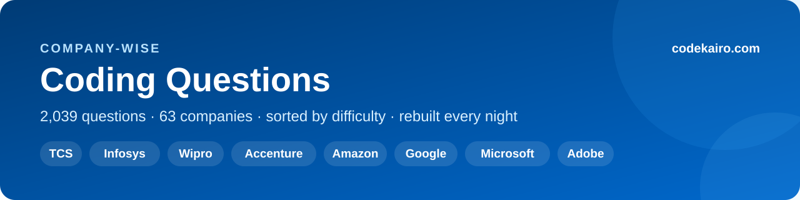

  
  
  
  
  

# Company-wise Coding Questions

Coding questions asked by **TCS, Infosys, Wipro, Accenture, Amazon, Google, Microsoft** and 56 more companies — **2,039 questions** across **63 companies**, sorted by company and difficulty. Every question links to a free page on [CodeKairo](https://codekairo.com/companies?utm_source=github) where you can solve it in 13 languages, with hints and an editorial.

> ⭐ **Star the repo** so it is there when your drive comes — and so the next student searching finds it too. The lists are rebuilt every night.

## Contents

- [Service companies (campus placements)](#service-companies-campus-placements)
- [Product companies](#product-companies)
- [More companies](#more-companies)
- [Most asked across companies](#most-asked-across-companies)
- [How to use these lists](#how-to-use-these-lists)
- [Where the company tags come from](#where-the-company-tags-come-from)

## Service companies (campus placements)

| Company | Questions | Difficulty | Mock test | Hiring process |
|---|---:|---|---|---|
| [TCS](companies/tcs.md) | 124 | 🟢 113 · 🟡 11 · 🔴 0 | [TCS NQT — Foundation](https://codekairo.com/tests/tcs-nqt-foundation?utm_source=github) +2 | [4 rounds](https://codekairo.com/simulations/tcs?utm_source=github) |
| [Infosys](companies/infosys.md) | 83 | 🟢 74 · 🟡 9 · 🔴 0 | [Infosys SE / DSE — Aptitude](https://codekairo.com/tests/infosys-systems-engineer?utm_source=github) +1 | [3 rounds](https://codekairo.com/simulations/infosys?utm_source=github) |
| [Wipro](companies/wipro.md) | 40 | 🟢 36 · 🟡 4 · 🔴 0 | [Wipro NLTH — Aptitude](https://codekairo.com/tests/wipro-nlth-aptitude?utm_source=github) +1 | [3 rounds](https://codekairo.com/simulations/wipro?utm_source=github) |
| [Accenture](companies/accenture.md) | 29 | 🟢 25 · 🟡 4 · 🔴 0 | [Accenture — Cognitive & Technical](https://codekairo.com/tests/accenture-cognitive-technical?utm_source=github) | [3 rounds](https://codekairo.com/simulations/accenture?utm_source=github) |
| [Capgemini](companies/capgemini.md) | 26 | 🟢 26 · 🟡 0 · 🔴 0 | [Capgemini — Technical & English](https://codekairo.com/tests/capgemini-technical-english?utm_source=github) | [3 rounds](https://codekairo.com/simulations/capgemini?utm_source=github) |
| [Cognizant](companies/cognizant.md) | 25 | 🟢 23 · 🟡 2 · 🔴 0 | [Cognizant GenC — Aptitude](https://codekairo.com/tests/cognizant-genc-aptitude?utm_source=github) | [3 rounds](https://codekairo.com/simulations/cognizant?utm_source=github) |
| [HCL](companies/hcl.md) | 19 | 🟢 11 · 🟡 7 · 🔴 1 | [HCLTech — Written Test](https://codekairo.com/tests/hcltech-aptitude-technical?utm_source=github) | [3 rounds](https://codekairo.com/simulations/hcltech?utm_source=github) |
| [Mindtree](companies/mindtree.md) | 19 | 🟢 17 · 🟡 2 · 🔴 0 | [LTIMindtree — Online Assessment](https://codekairo.com/tests/ltimindtree-online-assessment?utm_source=github) | [3 rounds](https://codekairo.com/simulations/ltimindtree?utm_source=github) |
| [Mphasis](companies/mphasis.md) | 13 | 🟢 6 · 🟡 6 · 🔴 1 | [Mphasis — AMCAT Assessment](https://codekairo.com/tests/mphasis-amcat?utm_source=github) | [3 rounds](https://codekairo.com/simulations/mphasis?utm_source=github) |
| [Virtusa](companies/virtusa.md) | 13 | 🟢 9 · 🟡 4 · 🔴 0 | [Virtusa — Online Test & Coder Challenge](https://codekairo.com/tests/virtusa-coder-challenge?utm_source=github) | [4 rounds](https://codekairo.com/simulations/virtusa?utm_source=github) |
| [Tech Mahindra](companies/tech-mahindra.md) | 12 | 🟢 8 · 🟡 4 · 🔴 0 | [Tech Mahindra — Aptitude & Technical](https://codekairo.com/tests/tech-mahindra-written?utm_source=github) | [3 rounds](https://codekairo.com/simulations/tech-mahindra?utm_source=github) |

## Product companies

| Company | Questions | Difficulty | Mock test | Hiring process |
|---|---:|---|---|---|
| [Amazon](companies/amazon.md) | 1,812 | 🟢 513 · 🟡 934 · 🔴 365 | [Amazon — SDE Online Assessment](https://codekairo.com/tests/amazon-reasoning-debugging?utm_source=github) | [4 rounds](https://codekairo.com/simulations/amazon?utm_source=github) |
| [Google](companies/google.md) | 1,309 | 🟢 192 · 🟡 741 · 🔴 376 | [Google — Online Assessment](https://codekairo.com/tests/google-online-assessment?utm_source=github) | [4 rounds](https://codekairo.com/simulations/google?utm_source=github) |
| [Microsoft](companies/microsoft.md) | 449 | 🟢 112 · 🟡 243 · 🔴 94 | [Microsoft — Online Assessment](https://codekairo.com/tests/microsoft-online-assessment?utm_source=github) | [4 rounds](https://codekairo.com/simulations/microsoft?utm_source=github) |
| [Adobe](companies/adobe.md) | 225 | 🟢 123 · 🟡 93 · 🔴 9 | [Adobe — Campus Aptitude](https://codekairo.com/tests/adobe-campus-aptitude?utm_source=github) | [5 rounds](https://codekairo.com/simulations/adobe?utm_source=github) |
| [Meta](companies/meta.md) | 223 | 🟢 40 · 🟡 134 · 🔴 49 | [Meta — Coding Screen](https://codekairo.com/tests/meta-coding-screen?utm_source=github) | [4 rounds](https://codekairo.com/simulations/meta?utm_source=github) |
| [Flipkart](companies/flipkart.md) | 63 | 🟢 2 · 🟡 49 · 🔴 12 | [Flipkart — Online Coding](https://codekairo.com/tests/flipkart-online-coding?utm_source=github) | [4 rounds](https://codekairo.com/simulations/flipkart?utm_source=github) |
| [Zoho](companies/zoho.md) | 37 | 🟢 23 · 🟡 14 · 🔴 0 | [Zoho — Round 1](https://codekairo.com/tests/zoho-round-one?utm_source=github) | [5 rounds](https://codekairo.com/simulations/zoho?utm_source=github) |
| [Apple](companies/apple.md) | 33 | 🟢 15 · 🟡 10 · 🔴 8 | [Apple — Coding Assessment](https://codekairo.com/tests/apple-coding-assessment?utm_source=github) | [4 rounds](https://codekairo.com/simulations/apple?utm_source=github) |
| [Morgan Stanley](companies/morgan-stanley.md) | 29 | 🟢 8 · 🟡 17 · 🔴 4 | [Morgan Stanley — Aptitude & Technical](https://codekairo.com/tests/morgan-stanley-assessment?utm_source=github) | [4 rounds](https://codekairo.com/simulations/morgan-stanley?utm_source=github) |
| [Oracle](companies/oracle.md) | 17 | 🟢 3 · 🟡 13 · 🔴 1 | [Oracle — Aptitude & Verbal](https://codekairo.com/tests/oracle-aptitude-verbal?utm_source=github) | [4 rounds](https://codekairo.com/simulations/oracle?utm_source=github) |
| [Goldman Sachs](companies/goldman-sachs.md) | 14 | 🟢 2 · 🟡 7 · 🔴 5 | [Goldman Sachs — Aptitude Test](https://codekairo.com/tests/goldman-sachs-aptitude?utm_source=github) | [4 rounds](https://codekairo.com/simulations/goldman-sachs?utm_source=github) |
| [Salesforce](companies/salesforce.md) | 12 | 🟢 0 · 🟡 11 · 🔴 1 | [Salesforce — SWE Assessment](https://codekairo.com/tests/salesforce-swe-assessment?utm_source=github) | [4 rounds](https://codekairo.com/simulations/salesforce?utm_source=github) |

## More companies

| Company | Questions | Difficulty |
|---|---:|---|
| [Airbnb](companies/airbnb.md) | 26 | 🟢 7 · 🟡 8 · 🔴 11 |
| [Arcesium](companies/arcesium.md) | 16 | 🟢 0 · 🟡 13 · 🔴 3 |
| [Atlassian](companies/atlassian.md) | 25 | 🟢 3 · 🟡 16 · 🔴 6 |
| [Bloomberg](companies/bloomberg.md) | 79 | 🟢 23 · 🟡 54 · 🔴 2 |
| [Capital One](companies/capital-one.md) | 24 | 🟢 8 · 🟡 13 · 🔴 3 |
| [CRED](companies/cred.md) | 6 | 🟢 1 · 🟡 5 · 🔴 0 |
| [Databricks](companies/databricks.md) | 24 | 🟢 2 · 🟡 12 · 🔴 10 |
| [Directi](companies/directi.md) | 18 | 🟢 3 · 🟡 9 · 🔴 6 |
| [Dream11](companies/dream11.md) | 14 | 🟢 1 · 🟡 13 · 🔴 0 |
| [Dropbox](companies/dropbox.md) | 13 | 🟢 3 · 🟡 6 · 🔴 4 |
| [Epic Systems](companies/epic-systems.md) | 15 | 🟢 4 · 🟡 10 · 🔴 1 |
| [Freshworks](companies/freshworks.md) | 10 | 🟢 2 · 🟡 8 · 🔴 0 |
| [Hotstar](companies/hotstar.md) | 11 | 🟢 2 · 🟡 9 · 🔴 0 |
| [Hulu](companies/hulu.md) | 10 | 🟢 2 · 🟡 8 · 🔴 0 |
| [Indeed](companies/indeed.md) | 19 | 🟢 6 · 🟡 8 · 🔴 5 |
| [Intuit](companies/intuit.md) | 25 | 🟢 5 · 🟡 14 · 🔴 6 |
| [LinkedIn](companies/linkedin.md) | 19 | 🟢 4 · 🟡 11 · 🔴 4 |
| [LiveRamp](companies/liveramp.md) | 9 | 🟢 3 · 🟡 6 · 🔴 0 |
| [MathWorks](companies/mathworks.md) | 21 | 🟢 5 · 🟡 10 · 🔴 6 |
| [Myntra](companies/myntra.md) | 22 | 🟢 4 · 🟡 15 · 🔴 3 |
| [Nutanix](companies/nutanix.md) | 24 | 🟢 2 · 🟡 18 · 🔴 4 |
| [Ola](companies/ola.md) | 20 | 🟢 5 · 🟡 11 · 🔴 4 |
| [Palantir](companies/palantir.md) | 19 | 🟢 5 · 🟡 11 · 🔴 3 |
| [Paytm](companies/paytm.md) | 16 | 🟢 4 · 🟡 12 · 🔴 0 |
| [PhonePe](companies/phonepe.md) | 23 | 🟢 2 · 🟡 14 · 🔴 7 |
| [Razorpay](companies/razorpay.md) | 14 | 🟢 2 · 🟡 11 · 🔴 1 |
| [Riot Games](companies/riot-games.md) | 6 | 🟢 2 · 🟡 3 · 🔴 1 |
| [Rubrik](companies/rubrik.md) | 20 | 🟢 1 · 🟡 11 · 🔴 8 |
| [Samsung](companies/samsung.md) | 24 | 🟢 6 · 🟡 15 · 🔴 3 |
| [Snapchat](companies/snapchat.md) | 24 | 🟢 2 · 🟡 15 · 🔴 7 |
| [Spotify](companies/spotify.md) | 17 | 🟢 7 · 🟡 8 · 🔴 2 |
| [Sprinklr](companies/sprinklr.md) | 23 | 🟢 1 · 🟡 13 · 🔴 9 |
| [Swiggy](companies/swiggy.md) | 10 | 🟢 0 · 🟡 8 · 🔴 2 |
| [Twitter](companies/twitter.md) | 25 | 🟢 5 · 🟡 14 · 🔴 6 |
| [Two Sigma](companies/two-sigma.md) | 16 | 🟢 3 · 🟡 8 · 🔴 5 |
| [Uber](companies/uber.md) | 68 | 🟢 2 · 🟡 42 · 🔴 24 |
| [Walmart](companies/walmart.md) | 12 | 🟢 0 · 🟡 11 · 🔴 1 |
| [Yahoo](companies/yahoo.md) | 22 | 🟢 6 · 🟡 13 · 🔴 3 |
| [Yelp](companies/yelp.md) | 22 | 🟢 7 · 🟡 12 · 🔴 3 |
| [Zomato](companies/zomato.md) | 24 | 🟢 2 · 🟡 17 · 🔴 5 |

## Most asked across companies

The questions the most companies ask — learn these and you have seen the patterns behind a large share of every list. [All 100 →](most-asked.md)

| Rank | Question | Difficulty | Companies | Asked at |
|---:|---|---|---:|---|
| 1 | [Two Sum](https://codekairo.com/problems/two-sum?utm_source=github) | 🟢 Easy | 19 | [Morgan Stanley](companies/morgan-stanley.md), [Airbnb](companies/airbnb.md), [Atlassian](companies/atlassian.md), [Intuit](companies/intuit.md) +15 more |
| 2 | [Valid Parentheses](https://codekairo.com/problems/valid-parentheses?utm_source=github) | 🟢 Easy | 15 | [Airbnb](companies/airbnb.md), [Intuit](companies/intuit.md), [Twitter](companies/twitter.md), [PhonePe](companies/phonepe.md) +11 more |
| 3 | [Longest Substring Without Repeating Characters](https://codekairo.com/problems/longest-substring-without-repeating-characters?utm_source=github) | 🟡 Medium | 14 | [Morgan Stanley](companies/morgan-stanley.md), [Atlassian](companies/atlassian.md), [Nutanix](companies/nutanix.md), [Zomato](companies/zomato.md) +10 more |
| 4 | [Merge Intervals](https://codekairo.com/problems/merge-intervals?utm_source=github) | 🟡 Medium | 13 | [Morgan Stanley](companies/morgan-stanley.md), [Atlassian](companies/atlassian.md), [Intuit](companies/intuit.md), [Twitter](companies/twitter.md) +9 more |
| 5 | [Number of Islands](https://codekairo.com/problems/number-of-islands?utm_source=github) | 🟡 Medium | 10 | [Capital One](companies/capital-one.md), [Snapchat](companies/snapchat.md), [Zomato](companies/zomato.md), [MathWorks](companies/mathworks.md) +6 more |
| 6 | [Word Ladder](https://codekairo.com/problems/word-ladder?utm_source=github) | 🔴 Hard | 10 | [Amazon](companies/amazon.md), [Google](companies/google.md), [Microsoft](companies/microsoft.md), [Meta](companies/meta.md) +6 more |
| 7 | [Text Justification](https://codekairo.com/problems/text-justification?utm_source=github) | 🔴 Hard | 10 | [Amazon](companies/amazon.md), [Google](companies/google.md), [Microsoft](companies/microsoft.md), [Airbnb](companies/airbnb.md) +6 more |
| 8 | [Word Search](https://codekairo.com/problems/word-search?utm_source=github) | 🟡 Medium | 9 | [Amazon](companies/amazon.md), [Google](companies/google.md), [Microsoft](companies/microsoft.md), [Meta](companies/meta.md) +5 more |
| 9 | [Reverse String](https://codekairo.com/problems/reverse-string?utm_source=github) | 🟢 Easy | 8 | [Amazon](companies/amazon.md), [Microsoft](companies/microsoft.md), [TCS](companies/tcs.md), [Infosys](companies/infosys.md) +4 more |
| 10 | [Valid Anagram](https://codekairo.com/problems/valid-anagram?utm_source=github) | 🟢 Easy | 8 | [Amazon](companies/amazon.md), [Infosys](companies/infosys.md), [Bloomberg](companies/bloomberg.md), [Uber](companies/uber.md) +4 more |
| 11 | [Fibonacci Number](https://codekairo.com/problems/fibonacci-number?utm_source=github) | 🟢 Easy | 8 | [Amazon](companies/amazon.md), [TCS](companies/tcs.md), [Infosys](companies/infosys.md), [Wipro](companies/wipro.md) +4 more |
| 12 | [Find Pivot Index](https://codekairo.com/problems/find-pivot-index?utm_source=github) | 🟢 Easy | 8 | [Amazon](companies/amazon.md), [Google](companies/google.md), [Adobe](companies/adobe.md), [Meta](companies/meta.md) +4 more |
| 13 | [First Unique Character in a String](https://codekairo.com/problems/first-unique-character-in-a-string?utm_source=github) | 🟢 Easy | 8 | [Amazon](companies/amazon.md), [Microsoft](companies/microsoft.md), [Bloomberg](companies/bloomberg.md), [Morgan Stanley](companies/morgan-stanley.md) +4 more |
| 14 | [Spiral Matrix](https://codekairo.com/problems/spiral-matrix?utm_source=github) | 🟡 Medium | 8 | [Morgan Stanley](companies/morgan-stanley.md), [Capital One](companies/capital-one.md), [Databricks](companies/databricks.md), [Nutanix](companies/nutanix.md) +4 more |
| 15 | [Count Primes](https://codekairo.com/problems/count-primes?utm_source=github) | 🟡 Medium | 8 | [Amazon](companies/amazon.md), [Google](companies/google.md), [Microsoft](companies/microsoft.md), [Adobe](companies/adobe.md) +4 more |

## How to use these lists

1. **Open your target company and do its "Start with these 10".** They are the questions most other companies ask too.
2. **Then work down its Easy list.** It is the quickest way to see the patterns a company leans on before the harder questions.
3. **Solve, don't read.** Each question's page runs your code against hidden tests in 13 languages; the hints come one at a time, and the editorial explains the approach with code in Python, Java, C++ and JavaScript.
4. **Before a drive, sit the mock test.** Service companies' tests are built on each company's published pattern, and the [hiring process pages](https://codekairo.com/simulations?utm_source=github) walk through every round.
5. **Read what others were asked.** [Interview experiences](https://codekairo.com/interview-experiences?utm_source=github) are members' own accounts of real rounds.

## Where the company tags come from

Each company's list is CodeKairo's own annotation of where a question tends to come up, built from public reports of past coding rounds and interviews. No company publishes or endorses these lists, and CodeKairo is not affiliated with any of them. They show what has been asked before, not what will be asked next — use them to practise the patterns, not as a leak.

## Corrections

Spotted a question under the wrong company, or a broken link? [Open an issue](../../issues) and it will be fixed at the source, so the next nightly rebuild carries it.

---

Rebuilt every night from [codekairo.com/companies](https://codekairo.com/companies?utm_source=github). Last refreshed: November 2026.
