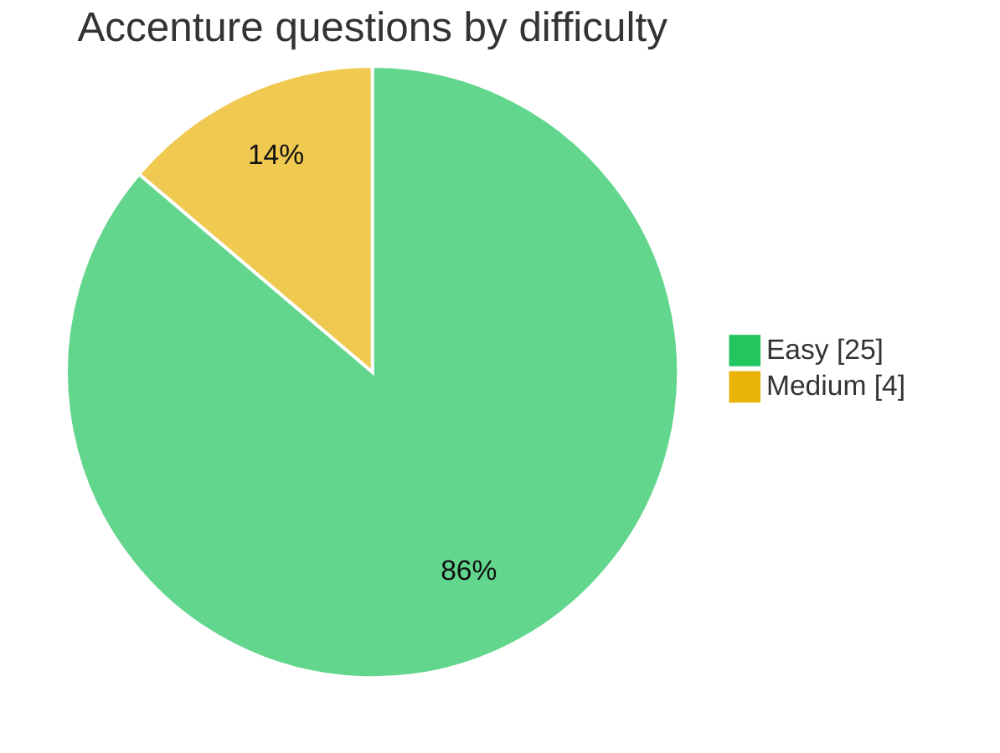

[← All companies](../README.md) · [Most asked across companies](../most-asked.md)

# Accenture Coding Questions

   

**29 Accenture coding questions** — 25 easy and 4 medium. Each one links to a free page where you can solve it in 13 languages, with hints and an editorial.

29 problems the CodeKairo catalogue tags as commonly asked in Accenture's coding rounds — 25 easy and 4 medium, no hard ones — each judged by hidden tests in 13 languages. The most common topics among them are Arrays (18), Strings (7) and Math (6). CodeKairo's Accenture — Cognitive & Technical mock covers the Accenture Cognitive and Technical Assessment pattern, which runs on a single clock and so rewards a different approach from most placement papers. The tag is the catalogue's own annotation of where a problem tends to come up — not a list published by Accenture, which CodeKairo is not affiliated with.

**Practise on CodeKairo:** [All 29 Accenture questions](https://codekairo.com/challenges/company/accenture?utm_source=github) · [Accenture — Cognitive & Technical mock test](https://codekairo.com/tests/accenture-cognitive-technical?utm_source=github) · [Accenture hiring process, round by round](https://codekairo.com/simulations/accenture?utm_source=github)

## Contents

- [Start with these 10](#start-with-these-10)
- [Topics Accenture asks most](#topics-accenture-asks-most)
- 🟢 [Easy (25)](#easy-25)
- 🟡 [Medium (4)](#medium-4)

## Start with these 10

The Accenture questions most other companies ask too — the patterns worth knowing first.

1. 🟢 [Fibonacci Number](https://codekairo.com/problems/fibonacci-number?utm_source=github) — also asked at 7 other companies
2. 🟢 [Armstrong Number](https://codekairo.com/problems/armstrong-number?utm_source=github) — also asked at 6 other companies
3. 🟢 [Length of Last Word](https://codekairo.com/problems/length-of-last-word?utm_source=github) — also asked at 4 other companies
4. 🟡 [Minimum Number of Platforms](https://codekairo.com/problems/minimum-number-of-platforms?utm_source=github) — also asked at 4 other companies
5. 🟢 [Perfect Number](https://codekairo.com/problems/perfect-number?utm_source=github) — also asked at 3 other companies
6. 🟢 [Find Greatest Common Divisor of Array](https://codekairo.com/problems/find-greatest-common-divisor-of-array?utm_source=github) — also asked at 3 other companies
7. 🟢 [Left Rotate an Array by D Places](https://codekairo.com/problems/left-rotate-array-by-d?utm_source=github) — also asked at 3 other companies
8. 🟢 [Running Sum of 1d Array](https://codekairo.com/problems/running-sum-of-1d-array?utm_source=github) — also asked at 2 other companies
9. 🟢 [Leaders in an Array](https://codekairo.com/problems/leaders-in-an-array?utm_source=github) — also asked at 2 other companies
10. 🟢 [Chocolate Distribution Problem](https://codekairo.com/problems/chocolate-distribution-problem?utm_source=github) — also asked at 2 other companies

## Topics Accenture asks most

[Arrays](https://codekairo.com/challenges/arrays?utm_source=github) (18) · [Strings](https://codekairo.com/challenges/strings?utm_source=github) (7) · [Math](https://codekairo.com/challenges/math?utm_source=github) (6) · [Simulation](https://codekairo.com/challenges/simulation?utm_source=github) (4) · [Two Pointers](https://codekairo.com/challenges/two-pointers?utm_source=github) (4) · [Sorting](https://codekairo.com/challenges/sorting?utm_source=github) (3) · [Enumeration](https://codekairo.com/challenges/enumeration?utm_source=github) (2) · [Greedy](https://codekairo.com/challenges/greedy?utm_source=github) (2) · [Number Theory](https://codekairo.com/challenges/number-theory?utm_source=github) (2) · [Sliding Window](https://codekairo.com/challenges/sliding-window?utm_source=github) (2)

## Easy (25)

| # | Question | Topics | Acceptance |
|---:|---|---|---:|
| 164 | 🟢 [Fibonacci Number](https://codekairo.com/problems/fibonacci-number?utm_source=github) | Math, Dynamic Programming, Recursion | — |
| 166 | 🟢 [Armstrong Number](https://codekairo.com/problems/armstrong-number?utm_source=github) | Math | — |
| 172 | 🟢 [Perfect Number](https://codekairo.com/problems/perfect-number?utm_source=github) | Math | — |
| 174 | 🟢 [Find Greatest Common Divisor of Array](https://codekairo.com/problems/find-greatest-common-divisor-of-array?utm_source=github) | Arrays, Math, Number Theory | — |
| 187 | 🟢 [Running Sum of 1d Array](https://codekairo.com/problems/running-sum-of-1d-array?utm_source=github) | Arrays, Prefix Sum | 80% |
| 215 | 🟢 [Length of Last Word](https://codekairo.com/problems/length-of-last-word?utm_source=github) | Strings | — |
| 476 | 🟢 [Leaders in an Array](https://codekairo.com/problems/leaders-in-an-array?utm_source=github) | Arrays | — |
| 506 | 🟢 [Chocolate Distribution Problem](https://codekairo.com/problems/chocolate-distribution-problem?utm_source=github) | Arrays, Sorting, Sliding Window | — |
| 601 | 🟢 [Find the Peaks](https://codekairo.com/problems/find-the-peaks?utm_source=github) | Arrays, Enumeration | — |
| 624 | 🟢 [Left Rotate an Array by D Places](https://codekairo.com/problems/left-rotate-array-by-d?utm_source=github) | Arrays, Two Pointers | — |
| 626 | 🟢 [Maximum Difference Between Adjacent Elements in a Circular Array](https://codekairo.com/problems/maximum-difference-between-adjacent-elements-in-a-circular-array?utm_source=github) | Arrays | — |
| 636 | 🟢 [Check if Binary String Has at Most One Segment of Ones](https://codekairo.com/problems/check-if-binary-string-has-at-most-one-segment-of-ones?utm_source=github) | Strings | — |
| 660 | 🟢 [Maximum Number of Words Found in Sentences](https://codekairo.com/problems/maximum-number-of-words-found-in-sentences?utm_source=github) | Strings, Arrays | — |
| 665 | 🟢 [Counting Elements](https://codekairo.com/problems/counting-elements?utm_source=github) | Hash Table, Arrays, Counting | — |
| 692 | 🟢 [Sum Multiples](https://codekairo.com/problems/sum-multiples?utm_source=github) | Math, Number Theory | — |
| 720 | 🟢 [Complement of Base 10 Integer](https://codekairo.com/problems/complement-of-base-10-integer?utm_source=github) | Bit Manipulation, Math | — |
| 783 | 🟢 [Minimum Recolors to Get K Consecutive Black Blocks](https://codekairo.com/problems/minimum-recolors-to-get-k-consecutive-black-blocks?utm_source=github) | Strings, Sliding Window | — |
| 810 | 🟢 [Kth Missing Positive Number](https://codekairo.com/problems/kth-missing-positive-number?utm_source=github) | Arrays, Binary Search | — |
| 841 | 🟢 [Maximum Height of a Triangle](https://codekairo.com/problems/maximum-height-of-a-triangle?utm_source=github) | Arrays, Greedy, Enumeration | — |
| 850 | 🟢 [Determine the Winner of a Bowling Game](https://codekairo.com/problems/determine-the-winner-of-a-bowling-game?utm_source=github) | Arrays, Simulation | — |
| 990 | 🟢 [Distribute Elements Into Two Arrays I](https://codekairo.com/problems/distribute-elements-into-two-arrays-i?utm_source=github) | Arrays, Simulation | — |
| 1014 | 🟢 [Count Asterisks](https://codekairo.com/problems/count-asterisks?utm_source=github) | Strings | — |
| 1021 | 🟢 [Number of Strings That Appear as Substrings in Word](https://codekairo.com/problems/number-of-strings-that-appear-as-substrings-in-word?utm_source=github) | Arrays, Strings | — |
| 1074 | 🟢 [Delete Greatest Value in Each Row](https://codekairo.com/problems/delete-greatest-value-in-each-row?utm_source=github) | Arrays, Matrix, Sorting | — |
| 1079 | 🟢 [Find the Original Typed String I](https://codekairo.com/problems/find-the-original-typed-string-i?utm_source=github) | Strings | — |

## Medium (4)

| # | Question | Topics | Acceptance |
|---:|---|---|---:|
| 373 | 🟡 [Minimum Number of Platforms](https://codekairo.com/problems/minimum-number-of-platforms?utm_source=github) | Arrays, Greedy, Sorting | — |
| 613 | 🟡 [Rearrange Array in Max/Min Form](https://codekairo.com/problems/rearrange-array-in-max-min-form?utm_source=github) | Arrays, Two Pointers | — |
| 931 | 🟡 [Reachable Nodes With Restrictions](https://codekairo.com/problems/reachable-nodes-with-restrictions?utm_source=github) | Arrays, Trees, Graph | — |
| 2031 | 🟡 [Rotate a Linked List](https://codekairo.com/problems/rotate-a-linked-list?utm_source=github) | Linked List, Two Pointers | — |

---

[← All companies](../README.md) · Rebuilt every night from [codekairo.com](https://codekairo.com/challenges/company/accenture?utm_source=github). Last refreshed: November 2026. ⭐ [Star the repo](https://github.com/ayaanp14/company-wise-coding-questions) if it helps.
