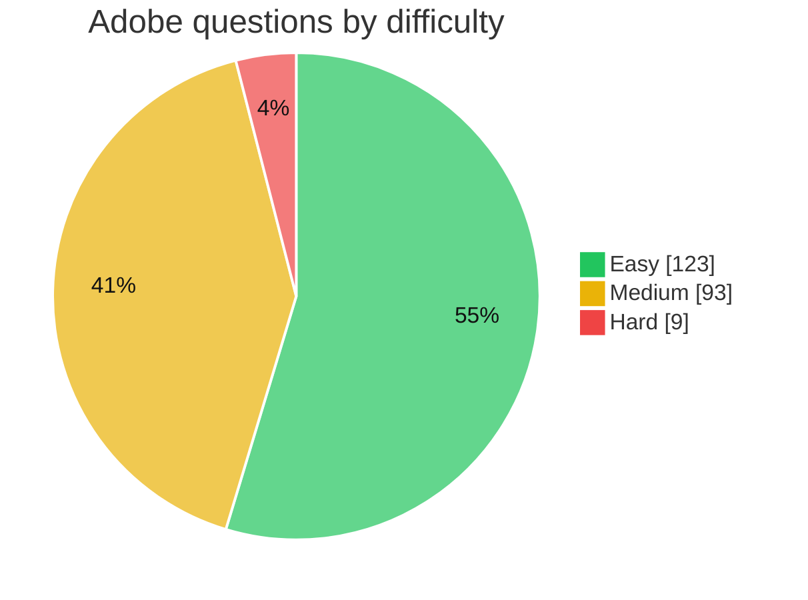

[← All companies](../README.md) · [Most asked across companies](../most-asked.md)

# Adobe Coding Questions

   

**225 Adobe coding questions** — 123 easy, 93 medium and 9 hard. Each one links to a free page where you can solve it in 13 languages, with hints and an editorial.

225 problems the CodeKairo catalogue tags as commonly asked in Adobe's coding rounds — 123 easy, 93 medium and 9 hard — each judged by hidden tests in 13 languages. The most common topics among them are Arrays (117), Strings (64) and Math (59). CodeKairo's Adobe — Campus Aptitude mock covers the Adobe campus aptitude pattern: three equal sections of twenty questions, twenty minutes each, where the only difficulty in the format is the pace. The tag is the catalogue's own annotation of where a problem tends to come up — not a list published by Adobe, which CodeKairo is not affiliated with.

**Practise on CodeKairo:** [All 225 Adobe questions](https://codekairo.com/challenges/company/adobe?utm_source=github) · [Adobe — Campus Aptitude mock test](https://codekairo.com/tests/adobe-campus-aptitude?utm_source=github) · [Adobe hiring process, round by round](https://codekairo.com/simulations/adobe?utm_source=github)

## Contents

- [Start with these 10](#start-with-these-10)
- [Topics Adobe asks most](#topics-adobe-asks-most)
- 🟢 [Easy (123)](#easy-123)
- 🟡 [Medium (93)](#medium-93)
- 🔴 [Hard (9)](#hard-9)

## Start with these 10

The Adobe questions most other companies ask too — the patterns worth knowing first.

1. 🟢 [Find Pivot Index](https://codekairo.com/problems/find-pivot-index?utm_source=github) — also asked at 7 other companies
2. 🟡 [Count Primes](https://codekairo.com/problems/count-primes?utm_source=github) — also asked at 7 other companies
3. 🟡 [String Compression](https://codekairo.com/problems/string-compression?utm_source=github) — also asked at 7 other companies
4. 🟢 [Can Place Flowers](https://codekairo.com/problems/can-place-flowers?utm_source=github) — also asked at 5 other companies
5. 🟡 [Largest Number](https://codekairo.com/problems/largest-number?utm_source=github) — also asked at 5 other companies
6. 🟢 [Add Digits](https://codekairo.com/problems/add-digits?utm_source=github) — also asked at 4 other companies
7. 🟢 [Add Binary](https://codekairo.com/problems/add-binary?utm_source=github) — also asked at 4 other companies
8. 🟡 [Reverse Integer](https://codekairo.com/problems/reverse-integer?utm_source=github) — also asked at 4 other companies
9. 🟡 [Remove Duplicates from Sorted Array II](https://codekairo.com/problems/remove-duplicates-from-sorted-array-ii?utm_source=github) — also asked at 4 other companies
10. 🟡 [Unique Paths II](https://codekairo.com/problems/unique-paths-ii?utm_source=github) — also asked at 4 other companies

## Topics Adobe asks most

[Arrays](https://codekairo.com/challenges/arrays?utm_source=github) (117) · [Strings](https://codekairo.com/challenges/strings?utm_source=github) (64) · [Math](https://codekairo.com/challenges/math?utm_source=github) (59) · [Hash Table](https://codekairo.com/challenges/hash-table?utm_source=github) (35) · [Sorting](https://codekairo.com/challenges/sorting?utm_source=github) (35) · [Greedy](https://codekairo.com/challenges/greedy?utm_source=github) (34) · [Simulation](https://codekairo.com/challenges/simulation?utm_source=github) (32) · [Two Pointers](https://codekairo.com/challenges/two-pointers?utm_source=github) (32) · [Dynamic Programming](https://codekairo.com/challenges/dynamic-programming?utm_source=github) (31) · [Bit Manipulation](https://codekairo.com/challenges/bit-manipulation?utm_source=github) (24)

## Easy (123)

| # | Question | Topics | Acceptance |
|---:|---|---|---:|
| 152 | 🟢 [Ugly Number](https://codekairo.com/problems/ugly-number?utm_source=github) | Math | — |
| 153 | 🟢 [Add Digits](https://codekairo.com/problems/add-digits?utm_source=github) | Math, Simulation, Number Theory | — |
| 161 | 🟢 [Add Binary](https://codekairo.com/problems/add-binary?utm_source=github) | Math, Strings, Bit Manipulation | — |
| 165 | 🟢 [N-th Tribonacci Number](https://codekairo.com/problems/n-th-tribonacci-number?utm_source=github) | Math, Dynamic Programming, Memoization | — |
| 176 | 🟢 [Number of Steps to Reduce a Number to Zero](https://codekairo.com/problems/number-of-steps-to-reduce-a-number-to-zero?utm_source=github) | Math, Bit Manipulation | — |
| 179 | 🟢 [Maximum 69 Number](https://codekairo.com/problems/maximum-69-number?utm_source=github) | Math, Greedy | — |
| 186 | 🟢 [Find Pivot Index](https://codekairo.com/problems/find-pivot-index?utm_source=github) | Arrays, Prefix Sum | — |
| 188 | 🟢 [How Many Numbers Are Smaller Than the Current Number](https://codekairo.com/problems/how-many-numbers-are-smaller-than-the-current-number?utm_source=github) | Arrays, Hash Table, Counting Sort | — |
| 189 | 🟢 [Number of Good Pairs](https://codekairo.com/problems/number-of-good-pairs?utm_source=github) | Arrays, Hash Table, Math | — |
| 190 | 🟢 [Shuffle the Array](https://codekairo.com/problems/shuffle-the-array?utm_source=github) | Arrays | — |
| 194 | 🟢 [Create Target Array in the Given Order](https://codekairo.com/problems/create-target-array-in-the-given-order?utm_source=github) | Arrays, Simulation | — |
| 199 | 🟢 [Can Place Flowers](https://codekairo.com/problems/can-place-flowers?utm_source=github) | Arrays, Greedy | — |
| 204 | 🟢 [Sort Array By Parity](https://codekairo.com/problems/sort-array-by-parity?utm_source=github) | Arrays, Two Pointers, Sorting | — |
| 206 | 🟢 [Relative Sort Array](https://codekairo.com/problems/relative-sort-array?utm_source=github) | Arrays, Hash Table, Sorting | — |
| 212 | 🟢 [Reverse Vowels of a String](https://codekairo.com/problems/reverse-vowels-of-a-string?utm_source=github) | Two Pointers, Strings | — |
| 223 | 🟢 [Jewels and Stones](https://codekairo.com/problems/jewels-and-stones?utm_source=github) | Hash Table, Strings | — |
| 224 | 🟢 [Goal Parser Interpretation](https://codekairo.com/problems/goal-parser-interpretation?utm_source=github) | Strings | — |
| 226 | 🟢 [Maximum Nesting Depth of the Parentheses](https://codekairo.com/problems/maximum-nesting-depth-of-the-parentheses?utm_source=github) | Strings, Stack | — |
| 233 | 🟢 [Buddy Strings](https://codekairo.com/problems/buddy-strings?utm_source=github) | Hash Table, Strings | — |
| 236 | 🟢 [Maximum Number of Balloons](https://codekairo.com/problems/maximum-number-of-balloons?utm_source=github) | Hash Table, Strings, Counting | — |
| 237 | 🟢 [Determine if String Halves Are Alike](https://codekairo.com/problems/determine-if-string-halves-are-alike?utm_source=github) | Strings, Counting | — |
| 238 | 🟢 [Remove Outermost Parentheses](https://codekairo.com/problems/remove-outermost-parentheses?utm_source=github) | Strings, Stack | — |
| 239 | 🟢 [Split a String in Balanced Strings](https://codekairo.com/problems/split-a-string-in-balanced-strings?utm_source=github) | Strings, Greedy, Counting | — |
| 255 | 🟢 [Reverse Prefix of Word](https://codekairo.com/problems/reverse-prefix-of-word?utm_source=github) | Two Pointers, Strings, Stack | — |
| 257 | 🟢 [Can Make Arithmetic Progression From Sequence](https://codekairo.com/problems/can-make-arithmetic-progression-from-sequence?utm_source=github) | Arrays, Sorting | — |
| 258 | 🟢 [Check If N and Its Double Exist](https://codekairo.com/problems/check-if-n-and-its-double-exist?utm_source=github) | Arrays, Hash Table, Two Pointers | — |
| 261 | 🟢 [Maximum Product of Two Elements in an Array](https://codekairo.com/problems/maximum-product-of-two-elements-in-an-array?utm_source=github) | Arrays, Sorting, Heap | — |
| 263 | 🟢 [Count Good Triplets](https://codekairo.com/problems/count-good-triplets?utm_source=github) | Arrays, Enumeration | — |
| 266 | 🟢 [Maximum Product Difference Between Two Pairs](https://codekairo.com/problems/maximum-product-difference-between-two-pairs?utm_source=github) | Arrays, Greedy, Sorting | — |
| 267 | 🟢 [Minimum Number of Moves to Seat Everyone](https://codekairo.com/problems/minimum-number-of-moves-to-seat-everyone?utm_source=github) | Arrays, Greedy, Sorting | — |
| 270 | 🟢 [Apply Operations to an Array](https://codekairo.com/problems/apply-operations-to-an-array?utm_source=github) | Arrays, Two Pointers, Simulation | — |
| 278 | 🟢 [Reshape the Matrix](https://codekairo.com/problems/reshape-the-matrix?utm_source=github) | Arrays, Matrix, Simulation | — |
| 279 | 🟢 [Flipping an Image](https://codekairo.com/problems/flipping-an-image?utm_source=github) | Arrays, Two Pointers, Matrix | — |
| 280 | 🟢 [Image Smoother](https://codekairo.com/problems/image-smoother?utm_source=github) | Arrays, Matrix | — |
| 282 | 🟢 [Lucky Numbers in a Matrix](https://codekairo.com/problems/lucky-numbers-in-a-matrix?utm_source=github) | Arrays, Matrix | — |
| 286 | 🟢 [Number of Equivalent Domino Pairs](https://codekairo.com/problems/number-of-equivalent-domino-pairs?utm_source=github) | Arrays, Hash Table, Counting | — |
| 292 | 🟢 [Pascal's Triangle II](https://codekairo.com/problems/pascals-triangle-ii?utm_source=github) | Arrays, Dynamic Programming | — |
| 296 | 🟢 [Determine Whether Matrix Can Be Obtained By Rotation](https://codekairo.com/problems/determine-whether-matrix-can-be-obtained-by-rotation?utm_source=github) | Arrays, Matrix | — |
| 297 | 🟢 [Check if Matrix Is X-Matrix](https://codekairo.com/problems/check-if-matrix-is-x-matrix?utm_source=github) | Arrays, Matrix | — |
| 299 | 🟢 [Largest Local Values in a Matrix](https://codekairo.com/problems/largest-local-values-in-a-matrix?utm_source=github) | Arrays, Matrix | — |
| 301 | 🟢 [Cells with Odd Values in a Matrix](https://codekairo.com/problems/cells-with-odd-values-in-a-matrix?utm_source=github) | Arrays, Math, Simulation | — |
| 304 | 🟢 [Find Winner on a Tic Tac Toe Game](https://codekairo.com/problems/find-winner-on-a-tic-tac-toe-game?utm_source=github) | Arrays, Hash Table, Matrix | — |
| 305 | 🟢 [Matrix Cells in Distance Order](https://codekairo.com/problems/matrix-cells-in-distance-order?utm_source=github) | Arrays, Math, Matrix | — |
| 327 | 🟢 [Divisor Game](https://codekairo.com/problems/divisor-game?utm_source=github) | Math, Dynamic Programming, Brainteaser | — |
| 341 | 🟢 [Assign Cookies](https://codekairo.com/problems/assign-cookies?utm_source=github) | Arrays, Two Pointers, Greedy | — |
| 345 | 🟢 [Maximum Units on a Truck](https://codekairo.com/problems/maximum-units-on-a-truck?utm_source=github) | Arrays, Greedy, Sorting | — |
| 350 | 🟢 [Minimum Cost to Move Chips to The Same Position](https://codekairo.com/problems/minimum-cost-to-move-chips-to-the-same-position?utm_source=github) | Arrays, Math, Greedy | — |
| 360 | 🟢 [Smallest Range I](https://codekairo.com/problems/smallest-range-i?utm_source=github) | Arrays, Math | — |
| 362 | 🟢 [Maximum Score After Splitting a String](https://codekairo.com/problems/maximum-score-after-splitting-a-string?utm_source=github) | Strings, Prefix Sum | — |
| 366 | 🟢 [Sort Array by Increasing Frequency](https://codekairo.com/problems/sort-array-by-increasing-frequency?utm_source=github) | Arrays, Hash Table, Sorting | — |
| 369 | 🟢 [Minimum Absolute Difference](https://codekairo.com/problems/minimum-absolute-difference?utm_source=github) | Arrays, Sorting | — |
| 371 | 🟢 [Sort Integers by The Number of 1 Bits](https://codekairo.com/problems/sort-integers-by-the-number-of-1-bits?utm_source=github) | Arrays, Bit Manipulation, Sorting | — |
| 374 | 🟢 [Baseball Game](https://codekairo.com/problems/baseball-game?utm_source=github) | Arrays, Strings, Stack | — |
| 375 | 🟢 [Make The String Great](https://codekairo.com/problems/make-the-string-great?utm_source=github) | Strings, Stack | — |
| 380 | 🟢 [Crawler Log Folder](https://codekairo.com/problems/crawler-log-folder?utm_source=github) | Arrays, Strings, Stack | — |
| 382 | 🟢 [Final Prices With a Special Discount in a Shop](https://codekairo.com/problems/final-prices-with-a-special-discount-in-a-shop?utm_source=github) | Arrays, Stack, Monotonic Stack | — |
| 391 | 🟢 [Time Needed to Buy Tickets](https://codekairo.com/problems/time-needed-to-buy-tickets?utm_source=github) | Arrays, Queue, Simulation | — |
| 394 | 🟢 [Number of Students Unable to Eat Lunch](https://codekairo.com/problems/number-of-students-unable-to-eat-lunch?utm_source=github) | Arrays, Stack, Queue | — |
| 395 | 🟢 [Minimum String Length After Removing Substrings](https://codekairo.com/problems/minimum-string-length-after-removing-substrings?utm_source=github) | Strings, Stack, Simulation | — |
| 411 | 🟢 [Hamming Distance](https://codekairo.com/problems/hamming-distance?utm_source=github) | Bit Manipulation | — |
| 413 | 🟢 [Power of Four](https://codekairo.com/problems/power-of-four?utm_source=github) | Math, Bit Manipulation, Recursion | — |
| 417 | 🟢 [Number Complement](https://codekairo.com/problems/number-complement?utm_source=github) | Bit Manipulation | — |
| 419 | 🟢 [Prime Number of Set Bits in Binary Representation](https://codekairo.com/problems/prime-number-of-set-bits?utm_source=github) | Math, Bit Manipulation | — |
| 420 | 🟢 [Convert a Number to Hexadecimal](https://codekairo.com/problems/convert-a-number-to-hexadecimal?utm_source=github) | Math, Bit Manipulation | — |
| 421 | 🟢 [Base 7](https://codekairo.com/problems/base-7?utm_source=github) | Math | — |
| 422 | 🟢 [Nim Game](https://codekairo.com/problems/nim-game?utm_source=github) | Math, Brainteaser, Game Theory | — |
| 425 | 🟢 [XOR Operation in an Array](https://codekairo.com/problems/xor-operation-in-an-array?utm_source=github) | Math, Bit Manipulation, Simulation | — |
| 426 | 🟢 [Decode XORed Array](https://codekairo.com/problems/decode-xored-array?utm_source=github) | Arrays, Bit Manipulation | — |
| 429 | 🟢 [Binary Number with Alternating Bits](https://codekairo.com/problems/binary-number-with-alternating-bits?utm_source=github) | Bit Manipulation | — |
| 432 | 🟢 [Minimum Bit Flips to Convert Number](https://codekairo.com/problems/minimum-bit-flips-to-convert-number?utm_source=github) | Bit Manipulation | — |
| 434 | 🟢 [Count the Number of Consistent Strings](https://codekairo.com/problems/count-the-number-of-consistent-strings?utm_source=github) | Arrays, Hash Table, Strings | — |
| 439 | 🟢 [Sum of All Subset XOR Totals](https://codekairo.com/problems/sum-of-all-subset-xor-totals?utm_source=github) | Arrays, Math, Backtracking | — |
| 440 | 🟢 [Water Bottles](https://codekairo.com/problems/water-bottles?utm_source=github) | Math, Simulation | — |
| 441 | 🟢 [Count Odd Numbers in an Interval Range](https://codekairo.com/problems/count-odd-numbers-in-an-interval-range?utm_source=github) | Math | — |
| 489 | 🟢 [Find N Unique Integers Sum up to Zero](https://codekairo.com/problems/find-n-unique-integers-sum-up-to-zero?utm_source=github) | Arrays, Math | — |
| 492 | 🟢 [Count Largest Group](https://codekairo.com/problems/count-largest-group?utm_source=github) | Math, Hash Table | — |
| 503 | 🟢 [Count Operations to Obtain Zero](https://codekairo.com/problems/count-operations-to-obtain-zero?utm_source=github) | Math, Simulation | — |
| 509 | 🟢 [Reverse Only Letters](https://codekairo.com/problems/reverse-only-letters?utm_source=github) | Strings, Two Pointers | — |
| 512 | 🟢 [Goat Latin](https://codekairo.com/problems/goat-latin?utm_source=github) | Strings | — |
| 516 | 🟢 [Count Substrings with Only One Distinct Letter](https://codekairo.com/problems/count-substrings-with-only-one-distinct-letter?utm_source=github) | Strings, Math | — |
| 519 | 🟢 [Maximum Repeating Substring](https://codekairo.com/problems/maximum-repeating-substring?utm_source=github) | Strings | — |
| 522 | 🟢 [Determine Color of a Chessboard Square](https://codekairo.com/problems/determine-color-of-a-chessboard-square?utm_source=github) | Math, Strings | — |
| 525 | 🟢 [Redistribute Characters to Make All Strings Equal](https://codekairo.com/problems/redistribute-characters-to-make-all-strings-equal?utm_source=github) | Arrays, Strings, Counting | — |
| 531 | 🟢 [Capitalize the Title](https://codekairo.com/problems/capitalize-the-title?utm_source=github) | Strings | — |
| 533 | 🟢 [Minimum Number of Operations to Convert Time](https://codekairo.com/problems/minimum-number-of-operations-to-convert-time?utm_source=github) | Strings, Greedy | — |
| 537 | 🟢 [Odd String Difference](https://codekairo.com/problems/odd-string-difference?utm_source=github) | Arrays, Strings, Hash Table | — |
| 539 | 🟢 [Split Strings by Separator](https://codekairo.com/problems/split-strings-by-separator?utm_source=github) | Arrays, Strings | — |
| 544 | 🟢 [Minimum Sum of Four Digit Number After Splitting Digits](https://codekairo.com/problems/minimum-sum-of-four-digit-number-after-splitting-digits?utm_source=github) | Math, Greedy, Sorting | — |
| 546 | 🟢 [Sum of Digits of String After Convert](https://codekairo.com/problems/sum-of-digits-of-string-after-convert?utm_source=github) | Strings, Simulation | — |
| 556 | 🟢 [Largest Odd Number in String](https://codekairo.com/problems/largest-odd-number-in-string?utm_source=github) | Strings, Math, Greedy | — |
| 560 | 🟢 [Furthest Point From Origin](https://codekairo.com/problems/furthest-point-from-origin?utm_source=github) | Strings, Greedy | — |
| 564 | 🟢 [Count Tested Devices After Test Operations](https://codekairo.com/problems/count-tested-devices-after-test-operations?utm_source=github) | Arrays, Simulation, Counting | — |
| 566 | 🟢 [Minimum Right Shifts to Sort the Array](https://codekairo.com/problems/minimum-right-shifts-to-sort-the-array?utm_source=github) | Arrays | — |
| 594 | 🟢 [Find Common Characters](https://codekairo.com/problems/find-common-characters?utm_source=github) | Arrays, Strings, Hash Table | — |
| 595 | 🟢 [N-Repeated Element in Size 2N Array](https://codekairo.com/problems/n-repeated-element-in-size-2n-array?utm_source=github) | Arrays, Hash Table | — |
| 598 | 🟢 [Largest Positive Integer That Exists With Its Negative](https://codekairo.com/problems/largest-positive-integer-that-exists-with-its-negative?utm_source=github) | Arrays, Hash Table, Two Pointers | — |
| 604 | 🟢 [Sum of Values at Indices With K Set Bits](https://codekairo.com/problems/sum-of-values-at-indices-with-k-set-bits?utm_source=github) | Arrays, Bit Manipulation | — |
| 634 | 🟢 [Most Common Word](https://codekairo.com/problems/most-common-word?utm_source=github) | Strings, Hash Table | — |
| 666 | 🟢 [Number of Lines To Write String](https://codekairo.com/problems/number-of-lines-to-write-string?utm_source=github) | Arrays, Strings, Simulation | — |
| 697 | 🟢 [Find the Maximum Divisibility Score](https://codekairo.com/problems/find-the-maximum-divisibility-score?utm_source=github) | Arrays, Math, Counting | — |
| 721 | 🟢 [Maximum Strong Pair XOR I](https://codekairo.com/problems/maximum-strong-pair-xor-i?utm_source=github) | Bit Manipulation, Arrays, Trie | — |
| 728 | 🟢 [Shortest Subarray With OR at Least K I](https://codekairo.com/problems/shortest-subarray-with-or-at-least-k-i?utm_source=github) | Bit Manipulation, Arrays, Sliding Window | — |
| 730 | 🟢 [Binary Watch](https://codekairo.com/problems/binary-watch?utm_source=github) | Bit Manipulation, Backtracking, Enumeration | — |
| 752 | 🟢 [DI String Match](https://codekairo.com/problems/di-string-match?utm_source=github) | Arrays, Two Pointers, Greedy | — |
| 757 | 🟢 [Find Indices With Index and Value Difference I](https://codekairo.com/problems/find-indices-with-index-and-value-difference-i?utm_source=github) | Arrays, Two Pointers | — |
| 780 | 🟢 [Find the K-Beauty of a Number](https://codekairo.com/problems/find-the-k-beauty-of-a-number?utm_source=github) | Math, Strings, Sliding Window | — |
| 781 | 🟢 [Substrings of Size Three with Distinct Characters](https://codekairo.com/problems/substrings-of-size-three-with-distinct-characters?utm_source=github) | Strings, Hash Table, Sliding Window | — |
| 841 | 🟢 [Maximum Height of a Triangle](https://codekairo.com/problems/maximum-height-of-a-triangle?utm_source=github) | Arrays, Greedy, Enumeration | — |
| 848 | 🟢 [Best Poker Hand](https://codekairo.com/problems/best-poker-hand?utm_source=github) | Arrays, Hash Table, Counting | — |
| 849 | 🟢 [Alternating Digit Sum](https://codekairo.com/problems/alternating-digit-sum?utm_source=github) | Math | — |
| 851 | 🟢 [Maximum Difference by Remapping a Digit](https://codekairo.com/problems/maximum-difference-by-remapping-a-digit?utm_source=github) | Math, Greedy | — |
| 899 | 🟢 [Matrix Similarity After Cyclic Shifts](https://codekairo.com/problems/matrix-similarity-after-cyclic-shifts?utm_source=github) | Arrays, Matrix, Simulation | — |
| 900 | 🟢 [Prime In Diagonal](https://codekairo.com/problems/prime-in-diagonal?utm_source=github) | Arrays, Math, Matrix | — |
| 1100 | 🟢 [Valid Mountain Array](https://codekairo.com/problems/valid-mountain-array?utm_source=github) | Arrays, Two Pointers | — |
| 1174 | 🟢 [Positions of Large Groups](https://codekairo.com/problems/positions-of-large-groups?utm_source=github) | Strings, Two Pointers | — |
| 1179 | 🟢 [Increasing Decreasing String](https://codekairo.com/problems/increasing-decreasing-string?utm_source=github) | Hash Table, Strings, Counting | — |
| 1302 | 🟢 [Surface Area of 3D Shapes](https://codekairo.com/problems/surface-area-of-3d-shapes?utm_source=github) | Arrays, Math, Geometry | — |
| 1870 | 🟢 [Sum of Left Leaves](https://codekairo.com/problems/sum-of-left-leaves?utm_source=github) | Trees, Depth-First Search, Breadth-First Search | — |
| 1876 | 🟢 [Merge Two Binary Trees](https://codekairo.com/problems/merge-two-binary-trees?utm_source=github) | Trees, Depth-First Search, Breadth-First Search | — |
| 1986 | 🟢 [Merge Two Sorted Lists](https://codekairo.com/problems/merge-two-sorted-lists?utm_source=github) | Linked List, Recursion, Two Pointers | — |
| 1987 | 🟢 [Remove Duplicates from Sorted List](https://codekairo.com/problems/remove-duplicates-from-sorted-list?utm_source=github) | Linked List, Two Pointers | — |
| 1989 | 🟢 [Reverse Linked List](https://codekairo.com/problems/reverse-linked-list?utm_source=github) | Linked List, Recursion | — |
| 1991 | 🟢 [Middle of the Linked List](https://codekairo.com/problems/middle-of-the-linked-list?utm_source=github) | Linked List, Two Pointers | — |

## Medium (93)

| # | Question | Topics | Acceptance |
|---:|---|---|---:|
| 149 | 🟡 [Reverse Integer](https://codekairo.com/problems/reverse-integer?utm_source=github) | Math | — |
| 150 | 🟡 [Count Primes](https://codekairo.com/problems/count-primes?utm_source=github) | Math, Sieve of Eratosthenes | — |
| 160 | 🟡 [Integer to Roman](https://codekairo.com/problems/integer-to-roman?utm_source=github) | Hash Table, Math, Strings | — |
| 203 | 🟡 [Shortest Unsorted Continuous Subarray](https://codekairo.com/problems/shortest-unsorted-continuous-subarray?utm_source=github) | Arrays, Two Pointers, Sorting | — |
| 209 | 🟡 [Majority Element II](https://codekairo.com/problems/majority-element-ii?utm_source=github) | Arrays, Hash Table, Sorting | — |
| 219 | 🟡 [String Compression](https://codekairo.com/problems/string-compression?utm_source=github) | Two Pointers, Strings | — |
| 242 | 🟡 [Maximum Number of Vowels in a Substring of Given Length](https://codekairo.com/problems/maximum-number-of-vowels-in-a-substring-of-given-length?utm_source=github) | Strings, Sliding Window | — |
| 252 | 🟡 [Remove Duplicates from Sorted Array II](https://codekairo.com/problems/remove-duplicates-from-sorted-array-ii?utm_source=github) | Arrays, Two Pointers | — |
| 275 | 🟡 [Spiral Matrix II](https://codekairo.com/problems/spiral-matrix-ii?utm_source=github) | Arrays, Matrix, Simulation | — |
| 289 | 🟡 [Unique Paths II](https://codekairo.com/problems/unique-paths-ii?utm_source=github) | Arrays, Dynamic Programming, Matrix | — |
| 308 | 🟡 [Delete and Earn](https://codekairo.com/problems/delete-and-earn?utm_source=github) | Arrays, Hash Table, Dynamic Programming | — |
| 309 | 🟡 [Best Time to Buy and Sell Stock with Cooldown](https://codekairo.com/problems/best-time-to-buy-and-sell-stock-with-cooldown?utm_source=github) | Arrays, Dynamic Programming | — |
| 315 | 🟡 [Wiggle Subsequence](https://codekairo.com/problems/wiggle-subsequence?utm_source=github) | Arrays, Dynamic Programming, Greedy | — |
| 317 | 🟡 [Count Sorted Vowel Strings](https://codekairo.com/problems/count-sorted-vowel-strings?utm_source=github) | Dynamic Programming, Math, Combinatorics | — |
| 321 | 🟡 [Triangle](https://codekairo.com/problems/triangle?utm_source=github) | Arrays, Dynamic Programming | — |
| 322 | 🟡 [Perfect Squares](https://codekairo.com/problems/perfect-squares?utm_source=github) | Math, Dynamic Programming, Breadth-First Search | — |
| 324 | 🟡 [Ugly Number II](https://codekairo.com/problems/ugly-number-ii?utm_source=github) | Hash Table, Math, Dynamic Programming | — |
| 326 | 🟡 [Stone Game](https://codekairo.com/problems/stone-game?utm_source=github) | Arrays, Math, Dynamic Programming | — |
| 329 | 🟡 [Ones and Zeroes](https://codekairo.com/problems/ones-and-zeroes?utm_source=github) | Arrays, Strings, Dynamic Programming | — |
| 330 | 🟡 [Combination Sum IV](https://codekairo.com/problems/combination-sum-iv?utm_source=github) | Arrays, Dynamic Programming | — |
| 342 | 🟡 [Two City Scheduling](https://codekairo.com/problems/two-city-scheduling?utm_source=github) | Arrays, Greedy, Sorting | — |
| 347 | 🟡 [Minimum Number of Steps to Make Two Strings Anagram](https://codekairo.com/problems/minimum-number-of-steps-to-make-two-strings-anagram?utm_source=github) | Hash Table, Strings, Counting | — |
| 349 | 🟡 [Maximum Ice Cream Bars](https://codekairo.com/problems/maximum-ice-cream-bars?utm_source=github) | Arrays, Greedy, Sorting | — |
| 351 | 🟡 [Largest Number](https://codekairo.com/problems/largest-number?utm_source=github) | Arrays, Strings, Greedy | — |
| 352 | 🟡 [Maximum Number of Coins You Can Get](https://codekairo.com/problems/maximum-number-of-coins-you-can-get?utm_source=github) | Arrays, Math, Greedy | — |
| 354 | 🟡 [Rearrange Array Elements by Sign](https://codekairo.com/problems/rearrange-array-elements-by-sign?utm_source=github) | Arrays, Two Pointers, Simulation | — |
| 361 | 🟡 [Minimum Time to Make Rope Colorful](https://codekairo.com/problems/minimum-time-to-make-rope-colorful?utm_source=github) | Arrays, Strings, Dynamic Programming | — |
| 381 | 🟡 [Build an Array With Stack Operations](https://codekairo.com/problems/build-an-array-with-stack-operations?utm_source=github) | Arrays, Stack, Simulation | — |
| 396 | 🟡 [Removing Stars From a String](https://codekairo.com/problems/removing-stars-from-a-string?utm_source=github) | Strings, Stack, Simulation | — |
| 400 | 🟡 [Remove All Occurrences of a Substring](https://codekairo.com/problems/remove-all-occurrences-of-a-substring?utm_source=github) | Strings, Stack, Simulation | — |
| 424 | 🟡 [Minimum Flips to Make a OR b Equal to c](https://codekairo.com/problems/minimum-flips-to-make-a-or-b-equal-to-c?utm_source=github) | Bit Manipulation | — |
| 549 | 🟡 [Smallest Value of the Rearranged Number](https://codekairo.com/problems/smallest-value-of-the-rearranged-number?utm_source=github) | Math, Sorting | — |
| 552 | 🟡 [Minimum Operations to Make Array Equal](https://codekairo.com/problems/minimum-operations-to-make-array-equal?utm_source=github) | Math | — |
| 577 | 🟡 [Unique Binary Search Trees](https://codekairo.com/problems/unique-binary-search-trees?utm_source=github) | Dynamic Programming, Math | — |
| 578 | 🟡 [Longest Palindromic Subsequence](https://codekairo.com/problems/longest-palindromic-subsequence?utm_source=github) | Strings, Dynamic Programming | — |
| 610 | 🟡 [Minimum Swaps to Sort](https://codekairo.com/problems/minimum-swaps-to-sort?utm_source=github) | Arrays, Sorting, Graph | — |
| 618 | 🟡 [Maximum Index](https://codekairo.com/problems/maximum-index?utm_source=github) | Arrays, Two Pointers | — |
| 620 | 🟡 [Count Triplets With Sum Smaller Than X](https://codekairo.com/problems/count-triplets-with-sum-smaller-than-x?utm_source=github) | Arrays, Two Pointers, Sorting | — |
| 638 | 🟡 [Find and Replace Pattern](https://codekairo.com/problems/find-and-replace-pattern?utm_source=github) | Strings, Hash Table | — |
| 642 | 🟡 [Maximum Length of a Concatenated String With Unique Characters](https://codekairo.com/problems/maximum-length-of-a-concatenated-string-with-unique-characters?utm_source=github) | Strings, Bit Manipulation, Backtracking | — |
| 644 | 🟡 [Check If a String Can Break Another String](https://codekairo.com/problems/check-if-a-string-can-break-another-string?utm_source=github) | Strings, Greedy, Sorting | — |
| 649 | 🟡 [Can Convert String in K Moves](https://codekairo.com/problems/can-convert-string-in-k-moves?utm_source=github) | Strings, Hash Table, Greedy | — |
| 650 | 🟡 [Minimum Length of String After Deleting Similar Ends](https://codekairo.com/problems/minimum-length-of-string-after-deleting-similar-ends?utm_source=github) | Strings, Two Pointers | — |
| 654 | 🟡 [Longest Word in Dictionary](https://codekairo.com/problems/longest-word-in-dictionary?utm_source=github) | Strings, Trie, Hash Table | — |
| 655 | 🟡 [Replace Words](https://codekairo.com/problems/replace-words?utm_source=github) | Strings, Trie, Hash Table | — |
| 673 | 🟡 [Count Nice Pairs in an Array](https://codekairo.com/problems/count-nice-pairs-in-an-array?utm_source=github) | Arrays, Hash Table, Math | — |
| 677 | 🟡 [Equal Row and Column Pairs](https://codekairo.com/problems/equal-row-and-column-pairs?utm_source=github) | Hash Table, Matrix, Simulation | — |
| 681 | 🟡 [Group the People Given the Group Size They Belong To](https://codekairo.com/problems/group-the-people-given-the-group-size-they-belong-to?utm_source=github) | Hash Table, Arrays, Greedy | — |
| 699 | 🟡 [Smallest Value After Replacing With Sum of Prime Factors](https://codekairo.com/problems/smallest-value-after-replacing-with-sum-of-prime-factors?utm_source=github) | Math, Number Theory, Simulation | — |
| 701 | 🟡 [Prime Subtraction Operation](https://codekairo.com/problems/prime-subtraction-operation?utm_source=github) | Arrays, Math, Greedy | — |
| 703 | 🟡 [Closest Divisors](https://codekairo.com/problems/closest-divisors?utm_source=github) | Math, Number Theory | — |
| 705 | 🟡 [Reordered Power of 2](https://codekairo.com/problems/reordered-power-of-2?utm_source=github) | Math, Counting, Enumeration | — |
| 706 | 🟡 [Clumsy Factorial](https://codekairo.com/problems/clumsy-factorial?utm_source=github) | Math, Stack, Simulation | — |
| 708 | 🟡 [The kth Factor of n](https://codekairo.com/problems/the-kth-factor-of-n?utm_source=github) | Math, Number Theory | — |
| 722 | 🟡 [Bitwise XOR of All Pairings](https://codekairo.com/problems/bitwise-xor-of-all-pairings?utm_source=github) | Bit Manipulation, Arrays, Brainteaser | — |
| 723 | 🟡 [Find The Original Array of Prefix Xor](https://codekairo.com/problems/find-the-original-array-of-prefix-xor?utm_source=github) | Bit Manipulation, Arrays, Prefix Sum | — |
| 734 | 🟡 [XOR Queries of a Subarray](https://codekairo.com/problems/xor-queries-of-a-subarray?utm_source=github) | Bit Manipulation, Arrays, Prefix Sum | — |
| 742 | 🟡 [Minimum Array End](https://codekairo.com/problems/minimum-array-end?utm_source=github) | Bit Manipulation, Greedy | — |
| 758 | 🟡 [Sum of Square Numbers](https://codekairo.com/problems/sum-of-square-numbers?utm_source=github) | Math, Two Pointers, Binary Search | — |
| 760 | 🟡 [4Sum](https://codekairo.com/problems/4sum?utm_source=github) | Arrays, Two Pointers, Sorting | — |
| 762 | 🟡 [Bag of Tokens](https://codekairo.com/problems/bag-of-tokens?utm_source=github) | Arrays, Two Pointers, Greedy | — |
| 763 | 🟡 [Sort Transformed Array](https://codekairo.com/problems/sort-transformed-array?utm_source=github) | Arrays, Two Pointers, Math | — |
| 766 | 🟡 [Longest Mountain in Array](https://codekairo.com/problems/longest-mountain-in-array?utm_source=github) | Arrays, Two Pointers, Dynamic Programming | — |
| 792 | 🟡 [Maximize the Confusion of an Exam](https://codekairo.com/problems/maximize-the-confusion-of-an-exam?utm_source=github) | Strings, Sliding Window, Prefix Sum | — |
| 822 | 🟡 [H-Index II](https://codekairo.com/problems/h-index-ii?utm_source=github) | Arrays, Binary Search | — |
| 854 | 🟡 [Find Three Consecutive Integers That Sum to a Given Number](https://codekairo.com/problems/find-three-consecutive-integers-that-sum-to-a-given-number?utm_source=github) | Math, Simulation | — |
| 870 | 🟡 [Longest Arithmetic Subsequence](https://codekairo.com/problems/longest-arithmetic-subsequence?utm_source=github) | Arrays, Hash Table, Dynamic Programming | — |
| 873 | 🟡 [Predict the Winner](https://codekairo.com/problems/predict-the-winner?utm_source=github) | Arrays, Dynamic Programming, Recursion | — |
| 889 | 🟡 [Find the N-th Value After K Seconds](https://codekairo.com/problems/find-the-n-th-value-after-k-seconds?utm_source=github) | Arrays, Math, Simulation | — |
| 903 | 🟡 [Where Will the Ball Fall](https://codekairo.com/problems/where-will-the-ball-fall?utm_source=github) | Arrays, Matrix, Simulation | — |
| 905 | 🟡 [Matrix Block Sum](https://codekairo.com/problems/matrix-block-sum?utm_source=github) | Arrays, Matrix, Prefix Sum | — |
| 944 | 🟡 [Parallel Courses](https://codekairo.com/problems/parallel-courses?utm_source=github) | Graph, Topological Sort, Breadth-First Search | — |
| 945 | 🟡 [Course Schedule IV](https://codekairo.com/problems/course-schedule-iv?utm_source=github) | Graph, Topological Sort, Depth-First Search | — |
| 961 | 🟡 [Find the Kth Largest Integer in the Array](https://codekairo.com/problems/find-the-kth-largest-integer-in-the-array?utm_source=github) | Arrays, Strings, Sorting | — |
| 964 | 🟡 [Maximum Number of Events That Can Be Attended](https://codekairo.com/problems/maximum-number-of-events-that-can-be-attended?utm_source=github) | Arrays, Greedy, Sorting | — |
| 973 | 🟡 [K-th Smallest Prime Fraction](https://codekairo.com/problems/k-th-smallest-prime-fraction?utm_source=github) | Arrays, Binary Search, Sorting | — |
| 996 | 🟡 [Find the Value of the Partition](https://codekairo.com/problems/find-the-value-of-the-partition?utm_source=github) | Arrays, Sorting | — |
| 1009 | 🟡 [Find the Integer Added to Array II](https://codekairo.com/problems/find-the-integer-added-to-array-ii?utm_source=github) | Arrays, Two Pointers, Sorting | — |
| 1023 | 🟡 [Sort Vowels in a String](https://codekairo.com/problems/sort-vowels-in-a-string?utm_source=github) | Strings, Sorting | — |
| 1029 | 🟡 [Longest Substring of All Vowels in Order](https://codekairo.com/problems/longest-substring-of-all-vowels-in-order?utm_source=github) | Strings, Sliding Window | — |
| 1041 | 🟡 [Number of Ways to Reach a Position After Exactly k Steps](https://codekairo.com/problems/number-of-ways-to-reach-a-position-after-exactly-k-steps?utm_source=github) | Math, Dynamic Programming, Combinatorics | — |
| 1045 | 🟡 [Maximum Number of Non-overlapping Palindrome Substrings](https://codekairo.com/problems/maximum-number-of-non-overlapping-palindrome-substrings?utm_source=github) | Strings, Dynamic Programming, Greedy | — |
| 1053 | 🟡 [Partition Array for Maximum Sum](https://codekairo.com/problems/partition-array-for-maximum-sum?utm_source=github) | Arrays, Dynamic Programming | — |
| 1080 | 🟡 [Longest Subsequence With Limited Sum](https://codekairo.com/problems/longest-subsequence-with-limited-sum?utm_source=github) | Arrays, Binary Search, Greedy | — |
| 1199 | 🟡 [Zigzag Conversion](https://codekairo.com/problems/zigzag-conversion?utm_source=github) | Strings, Simulation | — |
| 1227 | 🟡 [Maximum Value after Insertion](https://codekairo.com/problems/maximum-value-after-insertion?utm_source=github) | Strings, Greedy | — |
| 1278 | 🟡 [Smallest Range II](https://codekairo.com/problems/smallest-range-ii?utm_source=github) | Arrays, Math, Greedy | — |
| 1399 | 🟡 [Stock Span Problem](https://codekairo.com/problems/stock-span-problem?utm_source=github) | Arrays, Stack, Monotonic Stack | — |
| 1489 | 🟡 [Extra Characters in a String](https://codekairo.com/problems/extra-characters-in-a-string?utm_source=github) | Strings, Hash Table, Dynamic Programming | — |
| 1604 | 🟡 [Subset Sum Problem](https://codekairo.com/problems/subset-sum-problem?utm_source=github) | Arrays, Dynamic Programming | — |
| 2006 | 🟡 [Partition List](https://codekairo.com/problems/partition-list?utm_source=github) | Linked List, Two Pointers | — |
| 2009 | 🟡 [Reorder List](https://codekairo.com/problems/reorder-list?utm_source=github) | Linked List, Two Pointers, Stack | — |
| 2012 | 🟡 [Odd Even Linked List](https://codekairo.com/problems/odd-even-linked-list?utm_source=github) | Linked List, Two Pointers | — |

## Hard (9)

| # | Question | Topics | Acceptance |
|---:|---|---|---:|
| 585 | 🔴 [Palindrome Partitioning II](https://codekairo.com/problems/palindrome-partitioning-ii?utm_source=github) | Strings, Dynamic Programming | — |
| 882 | 🔴 [Minimum Falling Path Sum II](https://codekairo.com/problems/minimum-falling-path-sum-ii?utm_source=github) | Arrays, Matrix, Dynamic Programming | — |
| 887 | 🔴 [Number of Ways to Paint N × 3 Grid](https://codekairo.com/problems/number-of-ways-to-paint-n-3-grid?utm_source=github) | Dynamic Programming | — |
| 891 | 🔴 [Profitable Schemes](https://codekairo.com/problems/profitable-schemes?utm_source=github) | Arrays, Dynamic Programming | — |
| 898 | 🔴 [Minimum Difficulty of a Job Schedule](https://codekairo.com/problems/minimum-difficulty-of-a-job-schedule?utm_source=github) | Arrays, Dynamic Programming | — |
| 926 | 🔴 [Grid Illumination](https://codekairo.com/problems/grid-illumination?utm_source=github) | Arrays, Hash Table, Matrix | — |
| 955 | 🔴 [Number of Increasing Paths in a Grid](https://codekairo.com/problems/number-of-increasing-paths-in-a-grid?utm_source=github) | Arrays, Matrix, Dynamic Programming | — |
| 1591 | 🔴 [Permutation Sequence](https://codekairo.com/problems/permutation-sequence?utm_source=github) | Math, Recursion | — |
| 1681 | 🔴 [Strongly Connected Components (Kosaraju's Algorithm)](https://codekairo.com/problems/strongly-connected-components?utm_source=github) | Graph, Depth-First Search | — |

---

[← All companies](../README.md) · Rebuilt every night from [codekairo.com](https://codekairo.com/challenges/company/adobe?utm_source=github). Last refreshed: November 2026. ⭐ [Star the repo](https://github.com/ayaanp14/company-wise-coding-questions) if it helps.
