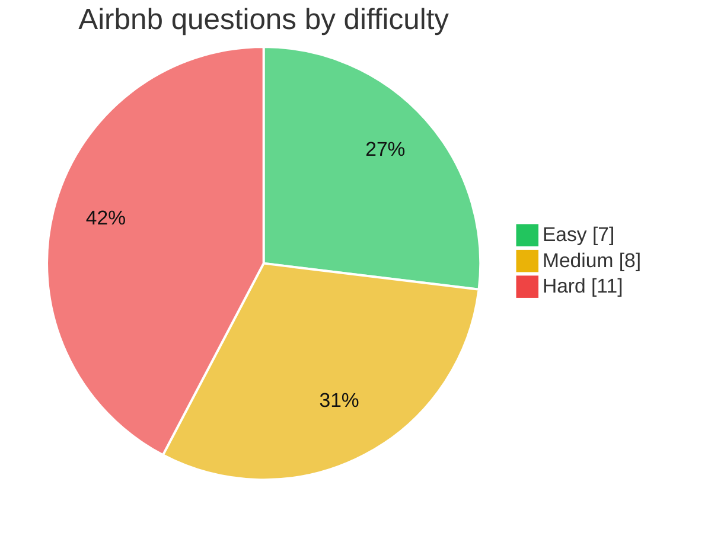

[← All companies](../README.md) · [Most asked across companies](../most-asked.md)

# Airbnb Coding Questions

   

**26 Airbnb coding questions** — 7 easy, 8 medium and 11 hard. Each one links to a free page where you can solve it in 13 languages, with hints and an editorial.

26 problems the CodeKairo catalogue tags as commonly asked in Airbnb's coding rounds — 7 easy, 8 medium and 11 hard — each judged by hidden tests in 13 languages. The most common topics among them are Arrays (16), Strings (9) and Hash Table (7). Tagged for Airbnb and no other company: Cheapest Flights Within K Stops and Regular Expression Matching. The tag is the catalogue's own annotation of where a problem tends to come up — not a list published by Airbnb, which CodeKairo is not affiliated with.

**Practise on CodeKairo:** [All 26 Airbnb questions](https://codekairo.com/challenges/company/airbnb?utm_source=github)

## Contents

- [Start with these 10](#start-with-these-10)
- [Topics Airbnb asks most](#topics-airbnb-asks-most)
- 🟢 [Easy (7)](#easy-7)
- 🟡 [Medium (8)](#medium-8)
- 🔴 [Hard (11)](#hard-11)

## Start with these 10

The Airbnb questions most other companies ask too — the patterns worth knowing first.

1. 🟢 [Two Sum](https://codekairo.com/problems/two-sum?utm_source=github) — also asked at 18 other companies
2. 🟢 [Valid Parentheses](https://codekairo.com/problems/valid-parentheses?utm_source=github) — also asked at 14 other companies
3. 🔴 [Text Justification](https://codekairo.com/problems/text-justification?utm_source=github) — also asked at 9 other companies
4. 🔴 [Trapping Rain Water](https://codekairo.com/problems/trapping-rain-water?utm_source=github) — also asked at 7 other companies
5. 🔴 [Word Search II](https://codekairo.com/problems/word-search-ii?utm_source=github) — also asked at 7 other companies
6. 🟡 [Basic Calculator II](https://codekairo.com/problems/basic-calculator-ii?utm_source=github) — also asked at 6 other companies
7. 🟢 [Happy Number](https://codekairo.com/problems/happy-number?utm_source=github) — also asked at 5 other companies
8. 🟡 [Maximal Square](https://codekairo.com/problems/maximal-square?utm_source=github) — also asked at 5 other companies
9. 🔴 [Maximum Profit in Job Scheduling](https://codekairo.com/problems/maximum-profit-in-job-scheduling?utm_source=github) — also asked at 5 other companies
10. 🟢 [Add Strings](https://codekairo.com/problems/add-strings?utm_source=github) — also asked at 4 other companies

## Topics Airbnb asks most

[Arrays](https://codekairo.com/challenges/arrays?utm_source=github) (16) · [Strings](https://codekairo.com/challenges/strings?utm_source=github) (9) · [Dynamic Programming](https://codekairo.com/challenges/dynamic-programming?utm_source=github) (7) · [Hash Table](https://codekairo.com/challenges/hash-table?utm_source=github) (7) · [Breadth-First Search](https://codekairo.com/challenges/breadth-first-search?utm_source=github) (5) · [Matrix](https://codekairo.com/challenges/matrix?utm_source=github) (5) · [Math](https://codekairo.com/challenges/math?utm_source=github) (4) · [Bit Manipulation](https://codekairo.com/challenges/bit-manipulation?utm_source=github) (3) · [Graph](https://codekairo.com/challenges/graph?utm_source=github) (3) · [Simulation](https://codekairo.com/challenges/simulation?utm_source=github) (3)

## Easy (7)

| # | Question | Topics | Acceptance |
|---:|---|---|---:|
| 1 | 🟢 [Two Sum](https://codekairo.com/problems/two-sum?utm_source=github) | Arrays, Hash Table | — |
| 4 | 🟢 [Valid Parentheses](https://codekairo.com/problems/valid-parentheses?utm_source=github) | Strings, Stack | — |
| 10 | 🟢 [Contains Duplicate](https://codekairo.com/problems/contains-duplicate?utm_source=github) | Arrays, Hash Table, Sorting | — |
| 19 | 🟢 [Single Number](https://codekairo.com/problems/single-number?utm_source=github) | Arrays, Bit Manipulation | — |
| 151 | 🟢 [Happy Number](https://codekairo.com/problems/happy-number?utm_source=github) | Hash Table, Math, Two Pointers | — |
| 163 | 🟢 [Add Strings](https://codekairo.com/problems/add-strings?utm_source=github) | Math, Strings, Simulation | — |
| 180 | 🟢 [Contains Duplicate II](https://codekairo.com/problems/contains-duplicate-ii?utm_source=github) | Arrays, Hash Table, Sliding Window | — |

## Medium (8)

| # | Question | Topics | Acceptance |
|---:|---|---|---:|
| 88 | 🟡 [House Robber](https://codekairo.com/problems/house-robber?utm_source=github) | Arrays, Dynamic Programming | — |
| 90 | 🟡 [Coin Change](https://codekairo.com/problems/coin-change?utm_source=github) | Arrays, Dynamic Programming, Breadth-First Search | — |
| 141 | 🟡 [Cheapest Flights Within K Stops](https://codekairo.com/problems/cheapest-flights-within-k-stops?utm_source=github) | Graph, Dynamic Programming, Shortest Path | — |
| 148 | 🟡 [Combination Sum](https://codekairo.com/problems/combination-sum?utm_source=github) | Arrays, Backtracking | — |
| 290 | 🟡 [Maximal Square](https://codekairo.com/problems/maximal-square?utm_source=github) | Arrays, Dynamic Programming, Matrix | — |
| 389 | 🟡 [Basic Calculator II](https://codekairo.com/problems/basic-calculator-ii?utm_source=github) | Math, Strings, Stack | — |
| 448 | 🟡 [Minimum Number of Vertices to Reach All Nodes](https://codekairo.com/problems/minimum-number-of-vertices-to-reach-all-nodes?utm_source=github) | Graph | — |
| 1286 | 🟡 [Robot Bounded In Circle](https://codekairo.com/problems/robot-bounded-in-circle?utm_source=github) | Math, Strings, Simulation | — |

## Hard (11)

| # | Question | Topics | Acceptance |
|---:|---|---|---:|
| 26 | 🔴 [Trapping Rain Water](https://codekairo.com/problems/trapping-rain-water?utm_source=github) | Arrays, Two Pointers, Dynamic Programming | — |
| 40 | 🔴 [Minimum Window Substring](https://codekairo.com/problems/minimum-window-substring?utm_source=github) | Strings, Sliding Window, Hash Table | — |
| 42 | 🔴 [Regular Expression Matching](https://codekairo.com/problems/regular-expression-matching?utm_source=github) | Strings, Dynamic Programming, Recursion | — |
| 941 | 🔴 [Sliding Puzzle](https://codekairo.com/problems/sliding-puzzle?utm_source=github) | Arrays, Matrix, Breadth-First Search | — |
| 1249 | 🔴 [Text Justification](https://codekairo.com/problems/text-justification?utm_source=github) | Arrays, Strings, Simulation | — |
| 1269 | 🔴 [Palindrome Pairs](https://codekairo.com/problems/palindrome-pairs?utm_source=github) | Arrays, Hash Table, Strings | — |
| 1506 | 🔴 [Maximum Profit in Job Scheduling](https://codekairo.com/problems/maximum-profit-in-job-scheduling?utm_source=github) | Arrays, Binary Search, Dynamic Programming | — |
| 1546 | 🔴 [Shortest Path to Get All Keys](https://codekairo.com/problems/shortest-path-to-get-all-keys?utm_source=github) | Arrays, Bit Manipulation, Breadth-First Search | — |
| 1573 | 🔴 [Word Search II](https://codekairo.com/problems/word-search-ii?utm_source=github) | Strings, Backtracking, Trie | — |
| 1694 | 🔴 [Minimum Number of Flips to Convert Binary Matrix to Zero Matrix](https://codekairo.com/problems/minimum-number-of-flips-to-convert-binary-matrix-to-zero-matrix?utm_source=github) | Arrays, Hash Table, Bit Manipulation | — |
| 1695 | 🔴 [Maximum Candies You Can Get from Boxes](https://codekairo.com/problems/maximum-candies-you-can-get-from-boxes?utm_source=github) | Arrays, Breadth-First Search, Graph | — |

---

[← All companies](../README.md) · Rebuilt every night from [codekairo.com](https://codekairo.com/challenges/company/airbnb?utm_source=github). Last refreshed: November 2026. ⭐ [Star the repo](https://github.com/ayaanp14/company-wise-coding-questions) if it helps.
