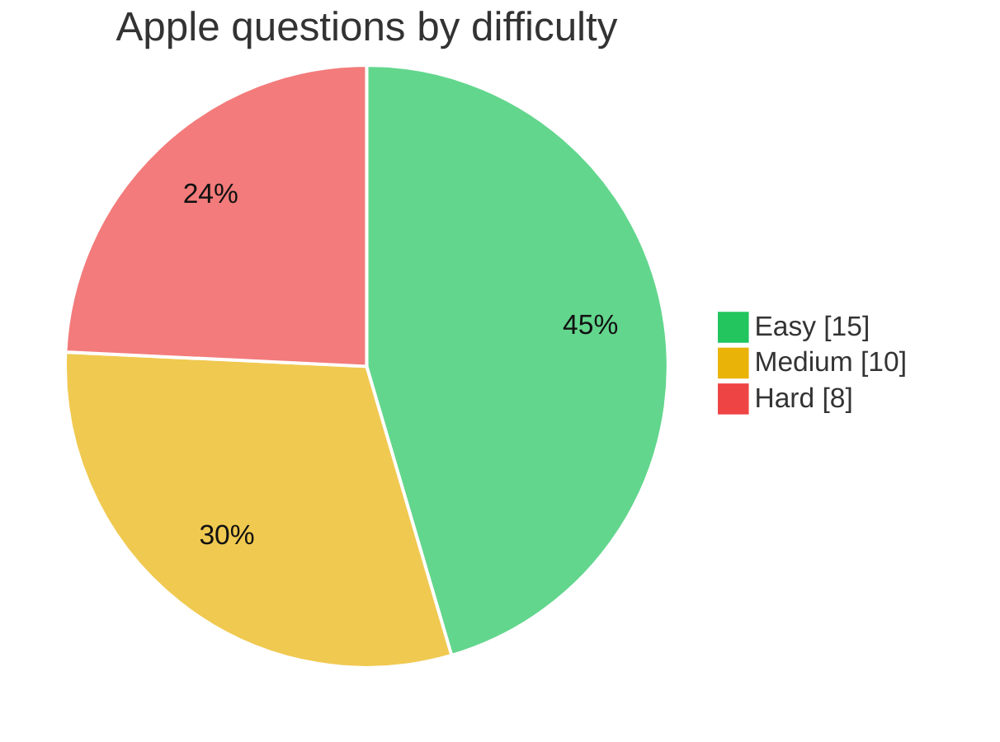

[← All companies](../README.md) · [Most asked across companies](../most-asked.md)

# Apple Coding Questions

   

**33 Apple coding questions** — 15 easy, 10 medium and 8 hard. Each one links to a free page where you can solve it in 13 languages, with hints and an editorial.

33 problems the CodeKairo catalogue tags as commonly asked in Apple's coding rounds — 15 easy, 10 medium and 8 hard — each judged by hidden tests in 13 languages. The most common topics among them are Math (12), Arrays (10) and Bit Manipulation (8). CodeKairo's Apple — Coding Assessment mock covers the Apple coding assessment pattern, the least standardised in this catalogue because it is set team by team. The tag is the catalogue's own annotation of where a problem tends to come up — not a list published by Apple, which CodeKairo is not affiliated with.

**Practise on CodeKairo:** [All 33 Apple questions](https://codekairo.com/challenges/company/apple?utm_source=github) · [Apple — Coding Assessment mock test](https://codekairo.com/tests/apple-coding-assessment?utm_source=github) · [Apple hiring process, round by round](https://codekairo.com/simulations/apple?utm_source=github)

## Contents

- [Start with these 10](#start-with-these-10)
- [Topics Apple asks most](#topics-apple-asks-most)
- 🟢 [Easy (15)](#easy-15)
- 🟡 [Medium (10)](#medium-10)
- 🔴 [Hard (8)](#hard-8)

## Start with these 10

The Apple questions most other companies ask too — the patterns worth knowing first.

1. 🟢 [Reverse String](https://codekairo.com/problems/reverse-string?utm_source=github) — also asked at 7 other companies
2. 🟡 [Valid Sudoku](https://codekairo.com/problems/valid-sudoku?utm_source=github) — also asked at 7 other companies
3. 🟢 [Plus One](https://codekairo.com/problems/plus-one?utm_source=github) — also asked at 6 other companies
4. 🟡 [Maximal Square](https://codekairo.com/problems/maximal-square?utm_source=github) — also asked at 5 other companies
5. 🟢 [Power of Two](https://codekairo.com/problems/power-of-two?utm_source=github) — also asked at 4 other companies
6. 🟢 [Ransom Note](https://codekairo.com/problems/ransom-note?utm_source=github) — also asked at 4 other companies
7. 🟢 [Counting Bits](https://codekairo.com/problems/counting-bits?utm_source=github) — also asked at 4 other companies
8. 🟡 [Sum of Two Integers](https://codekairo.com/problems/sum-of-two-integers?utm_source=github) — also asked at 4 other companies
9. 🟡 [Divide Two Integers](https://codekairo.com/problems/divide-two-integers?utm_source=github) — also asked at 4 other companies
10. 🔴 [Max Points on a Line](https://codekairo.com/problems/max-points-on-a-line?utm_source=github) — also asked at 4 other companies

## Topics Apple asks most

[Math](https://codekairo.com/challenges/math?utm_source=github) (12) · [Arrays](https://codekairo.com/challenges/arrays?utm_source=github) (10) · [Bit Manipulation](https://codekairo.com/challenges/bit-manipulation?utm_source=github) (8) · [Hash Table](https://codekairo.com/challenges/hash-table?utm_source=github) (6) · [Binary Search](https://codekairo.com/challenges/binary-search?utm_source=github) (5) · Linked List (5) · [Matrix](https://codekairo.com/challenges/matrix?utm_source=github) (5) · [Two Pointers](https://codekairo.com/challenges/two-pointers?utm_source=github) (5) · [Strings](https://codekairo.com/challenges/strings?utm_source=github) (4) · Design (3)

## Easy (15)

| # | Question | Topics | Acceptance |
|---:|---|---|---:|
| 2 | 🟢 [Reverse String](https://codekairo.com/problems/reverse-string?utm_source=github) | Two Pointers, Strings | — |
| 154 | 🟢 [Power of Two](https://codekairo.com/problems/power-of-two?utm_source=github) | Math, Bit Manipulation | — |
| 162 | 🟢 [Plus One](https://codekairo.com/problems/plus-one?utm_source=github) | Arrays, Math | — |
| 214 | 🟢 [Ransom Note](https://codekairo.com/problems/ransom-note?utm_source=github) | Hash Table, Strings, Counting | — |
| 409 | 🟢 [Number of 1 Bits](https://codekairo.com/problems/number-of-1-bits?utm_source=github) | Divide and Conquer, Bit Manipulation | — |
| 410 | 🟢 [Counting Bits](https://codekairo.com/problems/counting-bits?utm_source=github) | Dynamic Programming, Bit Manipulation | — |
| 417 | 🟢 [Number Complement](https://codekairo.com/problems/number-complement?utm_source=github) | Bit Manipulation | — |
| 1562 | 🟢 [Available Captures for Rook](https://codekairo.com/problems/available-captures-for-rook?utm_source=github) | Arrays, Matrix, Simulation | — |
| 1879 | 🟢 [Search in a Binary Search Tree](https://codekairo.com/problems/search-in-a-binary-search-tree?utm_source=github) | Trees, Binary Search | — |
| 1986 | 🟢 [Merge Two Sorted Lists](https://codekairo.com/problems/merge-two-sorted-lists?utm_source=github) | Linked List, Recursion, Two Pointers | — |
| 1989 | 🟢 [Reverse Linked List](https://codekairo.com/problems/reverse-linked-list?utm_source=github) | Linked List, Recursion | — |
| 1990 | 🟢 [Palindrome Linked List](https://codekairo.com/problems/palindrome-linked-list?utm_source=github) | Linked List, Two Pointers, Stack | — |
| 1992 | 🟢 [Convert Binary Number in a Linked List to Integer](https://codekairo.com/problems/convert-binary-number-in-a-linked-list-to-integer?utm_source=github) | Linked List, Math, Bit Manipulation | — |
| 2037 | 🟢 [Implement Queue using Stacks](https://codekairo.com/problems/implement-queue-using-stacks?utm_source=github) | Stack, Queue, Design | — |
| 2039 | 🟢 [Design HashSet](https://codekairo.com/problems/design-hashset?utm_source=github) | Arrays, Hash Table, Design | — |

## Medium (10)

| # | Question | Topics | Acceptance |
|---:|---|---|---:|
| 290 | 🟡 [Maximal Square](https://codekairo.com/problems/maximal-square?utm_source=github) | Arrays, Dynamic Programming, Matrix | — |
| 303 | 🟡 [Valid Sudoku](https://codekairo.com/problems/valid-sudoku?utm_source=github) | Arrays, Hash Table, Matrix | — |
| 415 | 🟡 [Sum of Two Integers](https://codekairo.com/problems/sum-of-two-integers?utm_source=github) | Math, Bit Manipulation | — |
| 431 | 🟡 [Divide Two Integers](https://codekairo.com/problems/divide-two-integers?utm_source=github) | Math, Bit Manipulation | — |
| 472 | 🟡 [Pacific Atlantic Water Flow](https://codekairo.com/problems/pacific-atlantic-water-flow?utm_source=github) | Arrays, Depth-First Search, Breadth-First Search | — |
| 1124 | 🟡 [Array Nesting](https://codekairo.com/problems/array-nesting?utm_source=github) | Arrays, Depth-First Search | — |
| 1205 | 🟡 [Complex Number Multiplication](https://codekairo.com/problems/complex-number-multiplication?utm_source=github) | Math, Strings, Simulation | — |
| 1285 | 🟡 [Powerful Integers](https://codekairo.com/problems/powerful-integers?utm_source=github) | Hash Table, Math, Enumeration | — |
| 2007 | 🟡 [Reverse Linked List II](https://codekairo.com/problems/reverse-linked-list-ii?utm_source=github) | Linked List, Two Pointers | — |
| 2054 | 🟡 [Design Circular Queue](https://codekairo.com/problems/design-circular-queue?utm_source=github) | Arrays, Queue, Design | — |

## Hard (8)

| # | Question | Topics | Acceptance |
|---:|---|---|---:|
| 686 | 🔴 [Max Points on a Line](https://codekairo.com/problems/max-points-on-a-line?utm_source=github) | Hash Table, Math, Geometry | — |
| 715 | 🔴 [Nth Magical Number](https://codekairo.com/problems/nth-magical-number?utm_source=github) | Math, Binary Search, Number Theory | — |
| 718 | 🔴 [Smallest Good Base](https://codekairo.com/problems/smallest-good-base?utm_source=github) | Math, Binary Search, Number Theory | — |
| 744 | 🔴 [Minimum One Bit Operations to Make Integers Zero](https://codekairo.com/problems/minimum-one-bit-operations-to-make-integers-zero?utm_source=github) | Bit Manipulation, Math, Dynamic Programming | — |
| 775 | 🔴 [Find K-th Smallest Pair Distance](https://codekairo.com/problems/find-k-th-smallest-pair-distance?utm_source=github) | Arrays, Two Pointers, Binary Search | — |
| 833 | 🔴 [Kth Smallest Number in Multiplication Table](https://codekairo.com/problems/kth-smallest-number-in-multiplication-table?utm_source=github) | Math, Binary Search | — |
| 941 | 🔴 [Sliding Puzzle](https://codekairo.com/problems/sliding-puzzle?utm_source=github) | Arrays, Matrix, Breadth-First Search | — |
| 1422 | 🔴 [Number of Atoms](https://codekairo.com/problems/number-of-atoms?utm_source=github) | Hash Table, Strings, Stack | — |

---

[← All companies](../README.md) · Rebuilt every night from [codekairo.com](https://codekairo.com/challenges/company/apple?utm_source=github). Last refreshed: November 2026. ⭐ [Star the repo](https://github.com/ayaanp14/company-wise-coding-questions) if it helps.
