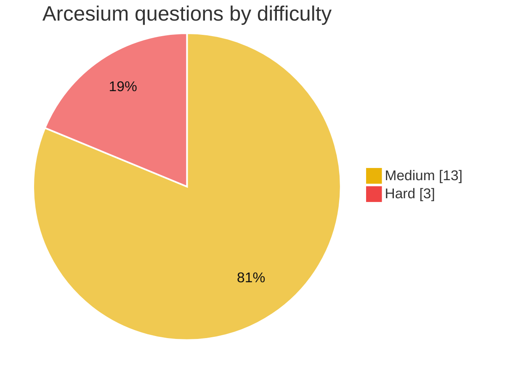

[← All companies](../README.md) · [Most asked across companies](../most-asked.md)

# Arcesium Coding Questions

   

**16 Arcesium coding questions** — 13 medium and 3 hard. Each one links to a free page where you can solve it in 13 languages, with hints and an editorial.

16 problems the CodeKairo catalogue tags as commonly asked in Arcesium's coding rounds — 13 medium and 3 hard — each judged by hidden tests in 13 languages. The most common topics among them are Arrays (10), Binary Search (5) and Greedy (5). The tag is the catalogue's own annotation of where a problem tends to come up — not a list published by Arcesium, which CodeKairo is not affiliated with.

**Practise on CodeKairo:** [All 16 Arcesium questions](https://codekairo.com/challenges/company/arcesium?utm_source=github)

## Contents

- [Start with these 10](#start-with-these-10)
- [Topics Arcesium asks most](#topics-arcesium-asks-most)
- 🟡 [Medium (13)](#medium-13)
- 🔴 [Hard (3)](#hard-3)

## Start with these 10

The Arcesium questions most other companies ask too — the patterns worth knowing first.

1. 🟡 [Longest Substring Without Repeating Characters](https://codekairo.com/problems/longest-substring-without-repeating-characters?utm_source=github) — also asked at 13 other companies
2. 🔴 [Word Ladder](https://codekairo.com/problems/word-ladder?utm_source=github) — also asked at 9 other companies
3. 🟡 [Maximum Subarray](https://codekairo.com/problems/maximum-subarray?utm_source=github) — also asked at 6 other companies
4. 🔴 [Maximal Rectangle](https://codekairo.com/problems/maximal-rectangle?utm_source=github) — also asked at 5 other companies
5. 🟡 [Broken Calculator](https://codekairo.com/problems/broken-calculator?utm_source=github) — also asked at 4 other companies
6. 🟡 [Maximize the Confusion of an Exam](https://codekairo.com/problems/maximize-the-confusion-of-an-exam?utm_source=github) — also asked at 3 other companies
7. 🟡 [Minimum Swaps to Group All 1's Together II](https://codekairo.com/problems/minimum-swaps-to-group-all-1s-together-ii?utm_source=github) — also asked at 3 other companies
8. 🟡 [House Robber IV](https://codekairo.com/problems/house-robber-iv?utm_source=github) — also asked at 3 other companies
9. 🟡 [Count Collisions on a Road](https://codekairo.com/problems/count-collisions-on-a-road?utm_source=github) — also asked at 3 other companies
10. 🟡 [Number of People Aware of a Secret](https://codekairo.com/problems/number-of-people-aware-of-a-secret?utm_source=github) — also asked at 3 other companies

## Topics Arcesium asks most

[Arrays](https://codekairo.com/challenges/arrays?utm_source=github) (10) · [Binary Search](https://codekairo.com/challenges/binary-search?utm_source=github) (5) · [Greedy](https://codekairo.com/challenges/greedy?utm_source=github) (5) · [Dynamic Programming](https://codekairo.com/challenges/dynamic-programming?utm_source=github) (4) · [Sliding Window](https://codekairo.com/challenges/sliding-window?utm_source=github) (4) · [Strings](https://codekairo.com/challenges/strings?utm_source=github) (4) · [Bit Manipulation](https://codekairo.com/challenges/bit-manipulation?utm_source=github) (2) · [Hash Table](https://codekairo.com/challenges/hash-table?utm_source=github) (2) · [Prefix Sum](https://codekairo.com/challenges/prefix-sum?utm_source=github) (2) · [Simulation](https://codekairo.com/challenges/simulation?utm_source=github) (2)

## Medium (13)

| # | Question | Topics | Acceptance |
|---:|---|---|---:|
| 8 | 🟡 [Maximum Subarray](https://codekairo.com/problems/maximum-subarray?utm_source=github) | Arrays, Dynamic Programming, Divide and Conquer | — |
| 29 | 🟡 [Longest Substring Without Repeating Characters](https://codekairo.com/problems/longest-substring-without-repeating-characters?utm_source=github) | Strings, Sliding Window, Hash Table | — |
| 47 | 🟡 [Minimum Size Subarray Sum](https://codekairo.com/problems/minimum-size-subarray-sum?utm_source=github) | Arrays, Sliding Window, Prefix Sum | — |
| 62 | 🟡 [Koko Eating Bananas](https://codekairo.com/problems/koko-eating-bananas?utm_source=github) | Arrays, Binary Search | — |
| 792 | 🟡 [Maximize the Confusion of an Exam](https://codekairo.com/problems/maximize-the-confusion-of-an-exam?utm_source=github) | Strings, Sliding Window, Prefix Sum | — |
| 801 | 🟡 [Minimum Swaps to Group All 1's Together II](https://codekairo.com/problems/minimum-swaps-to-group-all-1s-together-ii?utm_source=github) | Arrays, Sliding Window | — |
| 825 | 🟡 [Minimize the Maximum Difference of Pairs](https://codekairo.com/problems/minimize-the-maximum-difference-of-pairs?utm_source=github) | Arrays, Binary Search, Greedy | — |
| 826 | 🟡 [House Robber IV](https://codekairo.com/problems/house-robber-iv?utm_source=github) | Arrays, Binary Search, Greedy | — |
| 852 | 🟡 [Count Collisions on a Road](https://codekairo.com/problems/count-collisions-on-a-road?utm_source=github) | Strings, Stack, Simulation | — |
| 864 | 🟡 [Minimum Impossible OR](https://codekairo.com/problems/minimum-impossible-or?utm_source=github) | Arrays, Bit Manipulation, Brainteaser | — |
| 876 | 🟡 [Number of People Aware of a Secret](https://codekairo.com/problems/number-of-people-aware-of-a-secret?utm_source=github) | Queue, Dynamic Programming, Simulation | — |
| 1350 | 🟡 [Maximum Length of Subarray With Positive Product](https://codekairo.com/problems/maximum-length-of-subarray-with-positive-product?utm_source=github) | Arrays, Dynamic Programming, Greedy | — |
| 1454 | 🟡 [Broken Calculator](https://codekairo.com/problems/broken-calculator?utm_source=github) | Math, Greedy | — |

## Hard (3)

| # | Question | Topics | Acceptance |
|---:|---|---|---:|
| 470 | 🔴 [Word Ladder](https://codekairo.com/problems/word-ladder?utm_source=github) | Hash Table, Strings, Breadth-First Search | — |
| 919 | 🔴 [Maximal Rectangle](https://codekairo.com/problems/maximal-rectangle?utm_source=github) | Arrays, Matrix, Stack | — |
| 1466 | 🔴 [Partition Array Into Two Arrays to Minimize Sum Difference](https://codekairo.com/problems/partition-array-into-two-arrays-to-minimize-sum-difference?utm_source=github) | Arrays, Binary Search, Bit Manipulation | — |

---

[← All companies](../README.md) · Rebuilt every night from [codekairo.com](https://codekairo.com/challenges/company/arcesium?utm_source=github). Last refreshed: November 2026. ⭐ [Star the repo](https://github.com/ayaanp14/company-wise-coding-questions) if it helps.
