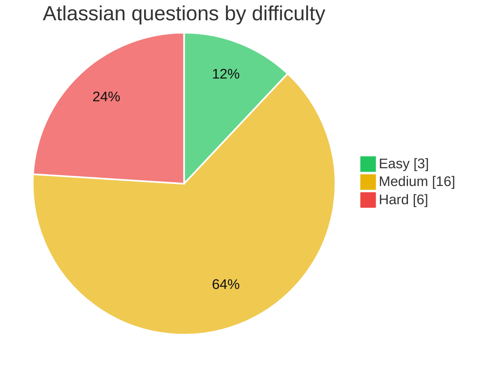

[← All companies](../README.md) · [Most asked across companies](../most-asked.md)

# Atlassian Coding Questions

   

**25 Atlassian coding questions** — 3 easy, 16 medium and 6 hard. Each one links to a free page where you can solve it in 13 languages, with hints and an editorial.

25 problems the CodeKairo catalogue tags as commonly asked in Atlassian's coding rounds — 3 easy, 16 medium and 6 hard — each judged by hidden tests in 13 languages. The most common topics among them are Arrays (22), Hash Table (9) and Dynamic Programming (6). The tag is the catalogue's own annotation of where a problem tends to come up — not a list published by Atlassian, which CodeKairo is not affiliated with.

**Practise on CodeKairo:** [All 25 Atlassian questions](https://codekairo.com/challenges/company/atlassian?utm_source=github)

## Contents

- [Start with these 10](#start-with-these-10)
- [Topics Atlassian asks most](#topics-atlassian-asks-most)
- 🟢 [Easy (3)](#easy-3)
- 🟡 [Medium (16)](#medium-16)
- 🔴 [Hard (6)](#hard-6)

## Start with these 10

The Atlassian questions most other companies ask too — the patterns worth knowing first.

1. 🟢 [Two Sum](https://codekairo.com/problems/two-sum?utm_source=github) — also asked at 18 other companies
2. 🟡 [Longest Substring Without Repeating Characters](https://codekairo.com/problems/longest-substring-without-repeating-characters?utm_source=github) — also asked at 13 other companies
3. 🟡 [Merge Intervals](https://codekairo.com/problems/merge-intervals?utm_source=github) — also asked at 12 other companies
4. 🔴 [Text Justification](https://codekairo.com/problems/text-justification?utm_source=github) — also asked at 9 other companies
5. 🟡 [Word Search](https://codekairo.com/problems/word-search?utm_source=github) — also asked at 8 other companies
6. 🟢 [Best Time to Buy and Sell Stock](https://codekairo.com/problems/best-time-to-buy-and-sell-stock?utm_source=github) — also asked at 6 other companies
7. 🟡 [Maximum Subarray](https://codekairo.com/problems/maximum-subarray?utm_source=github) — also asked at 6 other companies
8. 🟢 [Can Place Flowers](https://codekairo.com/problems/can-place-flowers?utm_source=github) — also asked at 5 other companies
9. 🟡 [Top K Frequent Elements](https://codekairo.com/problems/top-k-frequent-elements?utm_source=github) — also asked at 5 other companies
10. 🟡 [Meeting Rooms II](https://codekairo.com/problems/meeting-rooms-ii?utm_source=github) — also asked at 5 other companies

## Topics Atlassian asks most

[Arrays](https://codekairo.com/challenges/arrays?utm_source=github) (22) · [Hash Table](https://codekairo.com/challenges/hash-table?utm_source=github) (9) · [Dynamic Programming](https://codekairo.com/challenges/dynamic-programming?utm_source=github) (6) · [Sorting](https://codekairo.com/challenges/sorting?utm_source=github) (5) · [Strings](https://codekairo.com/challenges/strings?utm_source=github) (5) · [Binary Search](https://codekairo.com/challenges/binary-search?utm_source=github) (4) · [Greedy](https://codekairo.com/challenges/greedy?utm_source=github) (4) · [Heap](https://codekairo.com/challenges/heap?utm_source=github) (4) · [Backtracking](https://codekairo.com/challenges/backtracking?utm_source=github) (2) · [Breadth-First Search](https://codekairo.com/challenges/breadth-first-search?utm_source=github) (2)

## Easy (3)

| # | Question | Topics | Acceptance |
|---:|---|---|---:|
| 1 | 🟢 [Two Sum](https://codekairo.com/problems/two-sum?utm_source=github) | Arrays, Hash Table | — |
| 11 | 🟢 [Best Time to Buy and Sell Stock](https://codekairo.com/problems/best-time-to-buy-and-sell-stock?utm_source=github) | Arrays, Dynamic Programming | — |
| 199 | 🟢 [Can Place Flowers](https://codekairo.com/problems/can-place-flowers?utm_source=github) | Arrays, Greedy | — |

## Medium (16)

| # | Question | Topics | Acceptance |
|---:|---|---|---:|
| 8 | 🟡 [Maximum Subarray](https://codekairo.com/problems/maximum-subarray?utm_source=github) | Arrays, Dynamic Programming, Divide and Conquer | — |
| 22 | 🟡 [Longest Consecutive Sequence](https://codekairo.com/problems/longest-consecutive-sequence?utm_source=github) | Arrays, Hash Table, Union Find | — |
| 29 | 🟡 [Longest Substring Without Repeating Characters](https://codekairo.com/problems/longest-substring-without-repeating-characters?utm_source=github) | Strings, Sliding Window, Hash Table | — |
| 62 | 🟡 [Koko Eating Bananas](https://codekairo.com/problems/koko-eating-bananas?utm_source=github) | Arrays, Binary Search | — |
| 78 | 🟡 [Jump Game II](https://codekairo.com/problems/jump-game-ii?utm_source=github) | Arrays, Greedy, Dynamic Programming | — |
| 102 | 🟡 [Top K Frequent Elements](https://codekairo.com/problems/top-k-frequent-elements?utm_source=github) | Arrays, Heap, Hash Table | — |
| 122 | 🟡 [Merge Intervals](https://codekairo.com/problems/merge-intervals?utm_source=github) | Arrays, Sorting, Intervals | — |
| 126 | 🟡 [Meeting Rooms II](https://codekairo.com/problems/meeting-rooms-ii?utm_source=github) | Arrays, Sorting, Heap | — |
| 473 | 🟡 [Word Search](https://codekairo.com/problems/word-search?utm_source=github) | Arrays, Strings, Backtracking | — |
| 799 | 🟡 [Maximum Beauty of an Array After Applying Operation](https://codekairo.com/problems/maximum-beauty-of-an-array-after-applying-operation?utm_source=github) | Arrays, Sliding Window, Sorting | — |
| 818 | 🟡 [Minimum Limit of Balls in a Bag](https://codekairo.com/problems/minimum-limit-of-balls-in-a-bag?utm_source=github) | Arrays, Binary Search | — |
| 858 | 🟡 [Smallest Missing Non-negative Integer After Operations](https://codekairo.com/problems/smallest-missing-non-negative-integer-after-operations?utm_source=github) | Arrays, Hash Table, Math | — |
| 875 | 🟡 [Longest Ideal Subsequence](https://codekairo.com/problems/longest-ideal-subsequence?utm_source=github) | Hash Table, Strings, Dynamic Programming | — |
| 1129 | 🟡 [Pairs of Songs With Total Durations Divisible by 60](https://codekairo.com/problems/pairs-of-songs-with-total-durations-divisible-by-60?utm_source=github) | Arrays, Hash Table, Counting | — |
| 1531 | 🟡 [The Time When the Network Becomes Idle](https://codekairo.com/problems/the-time-when-the-network-becomes-idle?utm_source=github) | Arrays, Graph, Breadth-First Search | — |
| 2075 | 🟡 [Stock Price Fluctuation](https://codekairo.com/problems/stock-price-fluctuation?utm_source=github) | Hash Table, Design, Heap | — |

## Hard (6)

| # | Question | Topics | Acceptance |
|---:|---|---|---:|
| 836 | 🔴 [Russian Doll Envelopes](https://codekairo.com/problems/russian-doll-envelopes?utm_source=github) | Arrays, Binary Search, Dynamic Programming | — |
| 898 | 🔴 [Minimum Difficulty of a Job Schedule](https://codekairo.com/problems/minimum-difficulty-of-a-job-schedule?utm_source=github) | Arrays, Dynamic Programming | — |
| 957 | 🔴 [Minimum Time to Visit a Cell In a Grid](https://codekairo.com/problems/minimum-time-to-visit-a-cell-in-a-grid?utm_source=github) | Arrays, Matrix, Graph | — |
| 1249 | 🔴 [Text Justification](https://codekairo.com/problems/text-justification?utm_source=github) | Arrays, Strings, Simulation | — |
| 1469 | 🔴 [Rearranging Fruits](https://codekairo.com/problems/rearranging-fruits?utm_source=github) | Arrays, Hash Table, Greedy | — |
| 1586 | 🔴 [Verbal Arithmetic Puzzle](https://codekairo.com/problems/verbal-arithmetic-puzzle?utm_source=github) | Arrays, Math, Strings | — |

---

[← All companies](../README.md) · Rebuilt every night from [codekairo.com](https://codekairo.com/challenges/company/atlassian?utm_source=github). Last refreshed: November 2026. ⭐ [Star the repo](https://github.com/ayaanp14/company-wise-coding-questions) if it helps.
