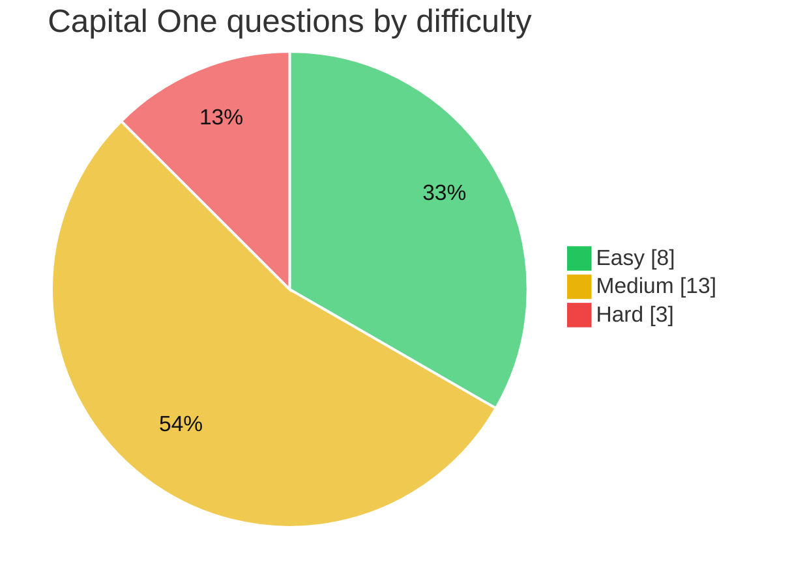

[← All companies](../README.md) · [Most asked across companies](../most-asked.md)

# Capital One Coding Questions

   

**24 Capital One coding questions** — 8 easy, 13 medium and 3 hard. Each one links to a free page where you can solve it in 13 languages, with hints and an editorial.

24 problems the CodeKairo catalogue tags as commonly asked in Capital One's coding rounds — 8 easy, 13 medium and 3 hard — each judged by hidden tests in 13 languages. The most common topics among them are Arrays (18), Math (8) and Strings (7). Tagged for Capital One and no other company: Simplify Path. The tag is the catalogue's own annotation of where a problem tends to come up — not a list published by Capital One, which CodeKairo is not affiliated with.

**Practise on CodeKairo:** [All 24 Capital One questions](https://codekairo.com/challenges/company/capital-one?utm_source=github)

## Contents

- [Start with these 10](#start-with-these-10)
- [Topics Capital One asks most](#topics-capital-one-asks-most)
- 🟢 [Easy (8)](#easy-8)
- 🟡 [Medium (13)](#medium-13)
- 🔴 [Hard (3)](#hard-3)

## Start with these 10

The Capital One questions most other companies ask too — the patterns worth knowing first.

1. 🟢 [Two Sum](https://codekairo.com/problems/two-sum?utm_source=github) — also asked at 18 other companies
2. 🟡 [Merge Intervals](https://codekairo.com/problems/merge-intervals?utm_source=github) — also asked at 12 other companies
3. 🟡 [Number of Islands](https://codekairo.com/problems/number-of-islands?utm_source=github) — also asked at 9 other companies
4. 🔴 [Text Justification](https://codekairo.com/problems/text-justification?utm_source=github) — also asked at 9 other companies
5. 🟡 [Spiral Matrix](https://codekairo.com/problems/spiral-matrix?utm_source=github) — also asked at 7 other companies
6. 🟢 [Best Time to Buy and Sell Stock](https://codekairo.com/problems/best-time-to-buy-and-sell-stock?utm_source=github) — also asked at 6 other companies
7. 🟡 [Container With Most Water](https://codekairo.com/problems/container-with-most-water?utm_source=github) — also asked at 6 other companies
8. 🟢 [Palindrome Number](https://codekairo.com/problems/palindrome-number?utm_source=github) — also asked at 5 other companies
9. 🟢 [Add Strings](https://codekairo.com/problems/add-strings?utm_source=github) — also asked at 4 other companies
10. 🟡 [Minimum Time Difference](https://codekairo.com/problems/minimum-time-difference?utm_source=github) — also asked at 4 other companies

## Topics Capital One asks most

[Arrays](https://codekairo.com/challenges/arrays?utm_source=github) (18) · [Math](https://codekairo.com/challenges/math?utm_source=github) (8) · [Strings](https://codekairo.com/challenges/strings?utm_source=github) (7) · [Simulation](https://codekairo.com/challenges/simulation?utm_source=github) (6) · [Matrix](https://codekairo.com/challenges/matrix?utm_source=github) (5) · [Dynamic Programming](https://codekairo.com/challenges/dynamic-programming?utm_source=github) (2) · [Hash Table](https://codekairo.com/challenges/hash-table?utm_source=github) (2) · [Ordered Set](https://codekairo.com/challenges/ordered-set?utm_source=github) (2) · [Sorting](https://codekairo.com/challenges/sorting?utm_source=github) (2) · [Stack](https://codekairo.com/challenges/stack?utm_source=github) (2)

## Easy (8)

| # | Question | Topics | Acceptance |
|---:|---|---|---:|
| 1 | 🟢 [Two Sum](https://codekairo.com/problems/two-sum?utm_source=github) | Arrays, Hash Table | — |
| 3 | 🟢 [Palindrome Number](https://codekairo.com/problems/palindrome-number?utm_source=github) | Math | — |
| 5 | 🟢 [Fizz Buzz](https://codekairo.com/problems/fizz-buzz?utm_source=github) | Math, Strings, Simulation | — |
| 11 | 🟢 [Best Time to Buy and Sell Stock](https://codekairo.com/problems/best-time-to-buy-and-sell-stock?utm_source=github) | Arrays, Dynamic Programming | — |
| 163 | 🟢 [Add Strings](https://codekairo.com/problems/add-strings?utm_source=github) | Math, Strings, Simulation | — |
| 231 | 🟢 [License Key Formatting](https://codekairo.com/problems/license-key-formatting?utm_source=github) | Strings | — |
| 481 | 🟢 [Monotonic Array](https://codekairo.com/problems/monotonic-array?utm_source=github) | Arrays | — |
| 503 | 🟢 [Count Operations to Obtain Zero](https://codekairo.com/problems/count-operations-to-obtain-zero?utm_source=github) | Math, Simulation | — |

## Medium (13)

| # | Question | Topics | Acceptance |
|---:|---|---|---:|
| 44 | 🟡 [Container With Most Water](https://codekairo.com/problems/container-with-most-water?utm_source=github) | Arrays, Two Pointers, Greedy | — |
| 73 | 🟡 [Simplify Path](https://codekairo.com/problems/simplify-path?utm_source=github) | Strings, Stack | — |
| 109 | 🟡 [Rotate Image](https://codekairo.com/problems/rotate-image?utm_source=github) | Arrays, Matrix, Math | — |
| 110 | 🟡 [Spiral Matrix](https://codekairo.com/problems/spiral-matrix?utm_source=github) | Arrays, Matrix, Simulation | — |
| 118 | 🟡 [Number of Islands](https://codekairo.com/problems/number-of-islands?utm_source=github) | Arrays, Matrix, Depth-First Search | — |
| 122 | 🟡 [Merge Intervals](https://codekairo.com/problems/merge-intervals?utm_source=github) | Arrays, Sorting, Intervals | — |
| 872 | 🟡 [Count Alternating Subarrays](https://codekairo.com/problems/count-alternating-subarrays?utm_source=github) | Arrays, Math, Dynamic Programming | — |
| 907 | 🟡 [Rotating the Box](https://codekairo.com/problems/rotating-the-box?utm_source=github) | Arrays, Matrix, Two Pointers | — |
| 1206 | 🟡 [Minimum Time Difference](https://codekairo.com/problems/minimum-time-difference?utm_source=github) | Arrays, Math, Strings | — |
| 1292 | 🟡 [Four Divisors](https://codekairo.com/problems/four-divisors?utm_source=github) | Arrays, Math, Number Theory | — |
| 1349 | 🟡 [Longest Continuous Subarray With Absolute Diff Less Than or Equal to Limit](https://codekairo.com/problems/longest-continuous-subarray-with-absolute-diff-less-than-or-equal-to-limit?utm_source=github) | Arrays, Sliding Window, Monotonic Queue | — |
| 1394 | 🟡 [Minimum Absolute Difference Between Elements With Constraint](https://codekairo.com/problems/minimum-absolute-difference-between-elements-with-constraint?utm_source=github) | Arrays, Binary Search, Ordered Set | — |
| 1552 | 🟡 [Minimum Operations to Write the Letter Y on a Grid](https://codekairo.com/problems/minimum-operations-to-write-the-letter-y-on-a-grid?utm_source=github) | Arrays, Hash Table, Matrix | — |

## Hard (3)

| # | Question | Topics | Acceptance |
|---:|---|---|---:|
| 72 | 🔴 [Largest Rectangle in Histogram](https://codekairo.com/problems/largest-rectangle-in-histogram?utm_source=github) | Arrays, Stack, Monotonic Stack | — |
| 1249 | 🔴 [Text Justification](https://codekairo.com/problems/text-justification?utm_source=github) | Arrays, Strings, Simulation | — |
| 1332 | 🔴 [Count Prefix and Suffix Pairs II](https://codekairo.com/problems/count-prefix-and-suffix-pairs-ii?utm_source=github) | Arrays, Strings, Trie | — |

---

[← All companies](../README.md) · Rebuilt every night from [codekairo.com](https://codekairo.com/challenges/company/capital-one?utm_source=github). Last refreshed: November 2026. ⭐ [Star the repo](https://github.com/ayaanp14/company-wise-coding-questions) if it helps.
