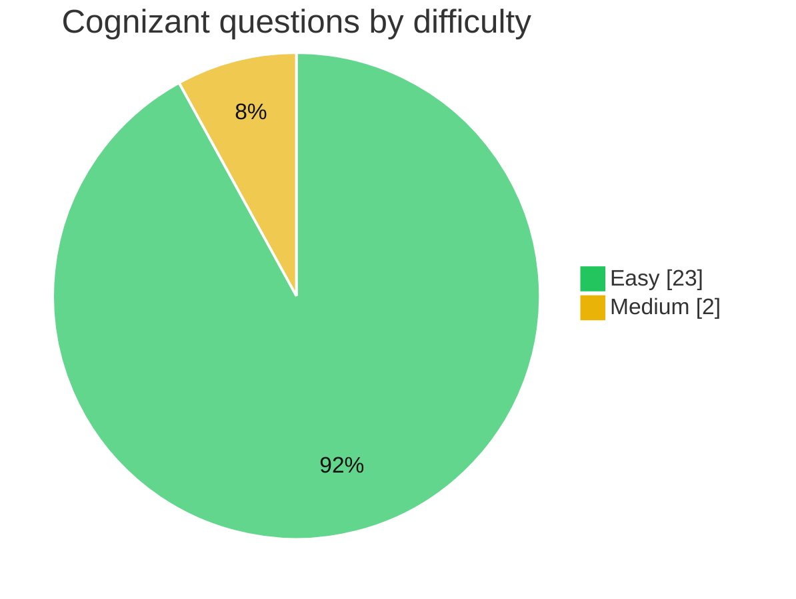

[← All companies](../README.md) · [Most asked across companies](../most-asked.md)

# Cognizant Coding Questions

   

**25 Cognizant coding questions** — 23 easy and 2 medium. Each one links to a free page where you can solve it in 13 languages, with hints and an editorial.

25 problems the CodeKairo catalogue tags as commonly asked in Cognizant's coding rounds — 23 easy and 2 medium, no hard ones — each judged by hidden tests in 13 languages. The most common topics among them are Strings (13), Arrays (9) and Hash Table (8). CodeKairo's Cognizant GenC — Aptitude mock covers the aptitude round of the Cognizant GenC assessment, a long paper in which reasoning outweighs everything else. The tag is the catalogue's own annotation of where a problem tends to come up — not a list published by Cognizant, which CodeKairo is not affiliated with.

**Practise on CodeKairo:** [All 25 Cognizant questions](https://codekairo.com/challenges/company/cognizant?utm_source=github) · [Cognizant GenC — Aptitude mock test](https://codekairo.com/tests/cognizant-genc-aptitude?utm_source=github) · [Cognizant hiring process, round by round](https://codekairo.com/simulations/cognizant?utm_source=github)

## Contents

- [Start with these 10](#start-with-these-10)
- [Topics Cognizant asks most](#topics-cognizant-asks-most)
- 🟢 [Easy (23)](#easy-23)
- 🟡 [Medium (2)](#medium-2)

## Start with these 10

The Cognizant questions most other companies ask too — the patterns worth knowing first.

1. 🟢 [Add Digits](https://codekairo.com/problems/add-digits?utm_source=github) — also asked at 4 other companies
2. 🟢 [Existence of a Substring in a String and Its Reverse](https://codekairo.com/problems/existence-of-a-substring-in-a-string-and-its-reverse?utm_source=github) — also asked at 3 other companies
3. 🟢 [Automorphic Number](https://codekairo.com/problems/automorphic-number?utm_source=github) — also asked at 2 other companies
4. 🟢 [Self Dividing Numbers](https://codekairo.com/problems/self-dividing-numbers?utm_source=github) — also asked at 2 other companies
5. 🟢 [Number of Steps to Reduce a Number to Zero](https://codekairo.com/problems/number-of-steps-to-reduce-a-number-to-zero?utm_source=github) — also asked at 2 other companies
6. 🟢 [Number of Good Pairs](https://codekairo.com/problems/number-of-good-pairs?utm_source=github) — also asked at 2 other companies
7. 🟢 [Detect Capital](https://codekairo.com/problems/detect-capital?utm_source=github) — also asked at 2 other companies
8. 🟢 [Convert Array Into Zig-Zag Fashion](https://codekairo.com/problems/convert-array-into-zig-zag-fashion?utm_source=github) — also asked at 2 other companies
9. 🟢 [Student Attendance Record I](https://codekairo.com/problems/student-attendance-record-i?utm_source=github) — also asked at 2 other companies
10. 🟢 [Count the Number of Vowel Strings in Range](https://codekairo.com/problems/count-the-number-of-vowel-strings-in-range?utm_source=github) — also asked at 2 other companies

## Topics Cognizant asks most

[Strings](https://codekairo.com/challenges/strings?utm_source=github) (13) · [Arrays](https://codekairo.com/challenges/arrays?utm_source=github) (9) · [Hash Table](https://codekairo.com/challenges/hash-table?utm_source=github) (8) · [Math](https://codekairo.com/challenges/math?utm_source=github) (8) · [Simulation](https://codekairo.com/challenges/simulation?utm_source=github) (4) · [Counting](https://codekairo.com/challenges/counting?utm_source=github) (3) · [Greedy](https://codekairo.com/challenges/greedy?utm_source=github) (3) · [Sliding Window](https://codekairo.com/challenges/sliding-window?utm_source=github) (3) · [Bit Manipulation](https://codekairo.com/challenges/bit-manipulation?utm_source=github) (2) · [Dynamic Programming](https://codekairo.com/challenges/dynamic-programming?utm_source=github) (1)

## Easy (23)

| # | Question | Topics | Acceptance |
|---:|---|---|---:|
| 153 | 🟢 [Add Digits](https://codekairo.com/problems/add-digits?utm_source=github) | Math, Simulation, Number Theory | — |
| 168 | 🟢 [Automorphic Number](https://codekairo.com/problems/automorphic-number?utm_source=github) | Math, Strings | — |
| 175 | 🟢 [Self Dividing Numbers](https://codekairo.com/problems/self-dividing-numbers?utm_source=github) | Math | — |
| 176 | 🟢 [Number of Steps to Reduce a Number to Zero](https://codekairo.com/problems/number-of-steps-to-reduce-a-number-to-zero?utm_source=github) | Math, Bit Manipulation | — |
| 189 | 🟢 [Number of Good Pairs](https://codekairo.com/problems/number-of-good-pairs?utm_source=github) | Arrays, Hash Table, Math | — |
| 216 | 🟢 [Detect Capital](https://codekairo.com/problems/detect-capital?utm_source=github) | Strings | — |
| 228 | 🟢 [Truncate Sentence](https://codekairo.com/problems/truncate-sentence?utm_source=github) | Arrays, Strings | — |
| 524 | 🟢 [Maximum Number of Words You Can Type](https://codekairo.com/problems/maximum-number-of-words-you-can-type?utm_source=github) | Strings, Hash Table | — |
| 600 | 🟢 [The Two Sneaky Numbers of Digitville](https://codekairo.com/problems/the-two-sneaky-numbers-of-digitville?utm_source=github) | Arrays, Hash Table | — |
| 615 | 🟢 [Convert Array Into Zig-Zag Fashion](https://codekairo.com/problems/convert-array-into-zig-zag-fashion?utm_source=github) | Arrays, Greedy | — |
| 631 | 🟢 [Student Attendance Record I](https://codekairo.com/problems/student-attendance-record-i?utm_source=github) | Strings | — |
| 637 | 🟢 [Count the Number of Vowel Strings in Range](https://codekairo.com/problems/count-the-number-of-vowel-strings-in-range?utm_source=github) | Strings, Arrays | — |
| 663 | 🟢 [Divide a String Into Groups of Size k](https://codekairo.com/problems/divide-a-string-into-groups-of-size-k?utm_source=github) | Strings, Simulation | — |
| 667 | 🟢 [Check if The Number is Fascinating](https://codekairo.com/problems/check-if-the-number-is-fascinating?utm_source=github) | Math, Hash Table, Strings | — |
| 690 | 🟢 [Number of Even and Odd Bits](https://codekairo.com/problems/number-of-even-and-odd-bits?utm_source=github) | Bit Manipulation, Math | — |
| 696 | 🟢 [Check if Number Has Equal Digit Count and Digit Value](https://codekairo.com/problems/check-if-number-has-equal-digit-count-and-digit-value?utm_source=github) | Hash Table, Strings, Counting | — |
| 781 | 🟢 [Substrings of Size Three with Distinct Characters](https://codekairo.com/problems/substrings-of-size-three-with-distinct-characters?utm_source=github) | Strings, Hash Table, Sliding Window | — |
| 847 | 🟢 [Minimum Moves to Convert String](https://codekairo.com/problems/minimum-moves-to-convert-string?utm_source=github) | Strings, Greedy | — |
| 899 | 🟢 [Matrix Similarity After Cyclic Shifts](https://codekairo.com/problems/matrix-similarity-after-cyclic-shifts?utm_source=github) | Arrays, Matrix, Simulation | — |
| 983 | 🟢 [Find the Child Who Has the Ball After K Seconds](https://codekairo.com/problems/find-the-child-who-has-the-ball-after-k-seconds?utm_source=github) | Math, Simulation | — |
| 995 | 🟢 [Apple Redistribution into Boxes](https://codekairo.com/problems/apple-redistribution-into-boxes?utm_source=github) | Arrays, Greedy, Sorting | — |
| 1013 | 🟢 [Existence of a Substring in a String and Its Reverse](https://codekairo.com/problems/existence-of-a-substring-in-a-string-and-its-reverse?utm_source=github) | Strings, Hash Table | — |
| 1078 | 🟢 [Special Array I](https://codekairo.com/problems/special-array-i?utm_source=github) | Arrays | — |

## Medium (2)

| # | Question | Topics | Acceptance |
|---:|---|---|---:|
| 802 | 🟡 [Max Consecutive Ones II](https://codekairo.com/problems/max-consecutive-ones-ii?utm_source=github) | Arrays, Sliding Window, Dynamic Programming | — |
| 1030 | 🟡 [Count Vowel Substrings of a String](https://codekairo.com/problems/count-vowel-substrings-of-a-string?utm_source=github) | Hash Table, Strings, Sliding Window | — |

---

[← All companies](../README.md) · Rebuilt every night from [codekairo.com](https://codekairo.com/challenges/company/cognizant?utm_source=github). Last refreshed: November 2026. ⭐ [Star the repo](https://github.com/ayaanp14/company-wise-coding-questions) if it helps.
