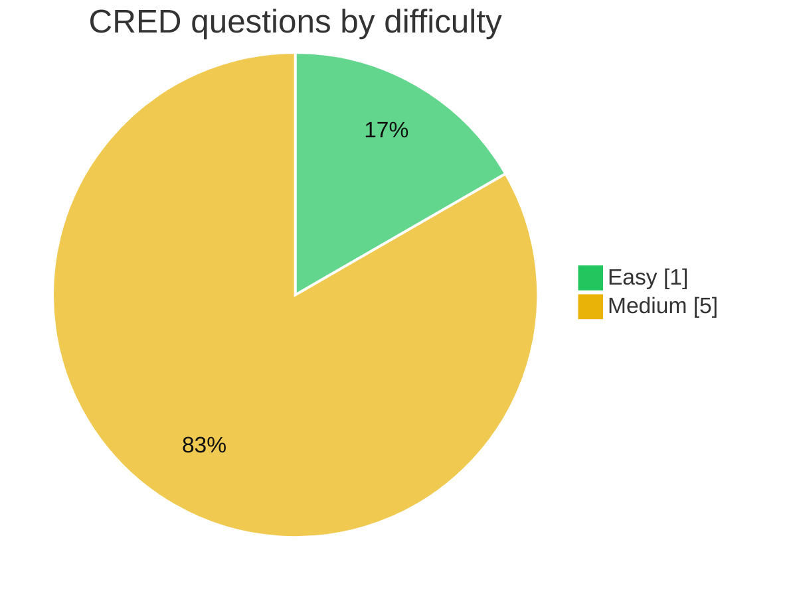

[← All companies](../README.md) · [Most asked across companies](../most-asked.md)

# CRED Coding Questions

   

**6 CRED coding questions** — 1 easy and 5 medium. Each one links to a free page where you can solve it in 13 languages, with hints and an editorial.

6 problems the CodeKairo catalogue tags as commonly asked in CRED's coding rounds — 1 easy and 5 medium, no hard ones — each judged by hidden tests in 13 languages. The most common topics among them are Arrays (5), Hash Table (2) and Heap (2). Tagged for CRED and no other company: Longest Repeating Character Replacement. The tag is the catalogue's own annotation of where a problem tends to come up — not a list published by CRED, which CodeKairo is not affiliated with.

**Practise on CodeKairo:** [All 6 CRED questions](https://codekairo.com/challenges/company/cred?utm_source=github)

## Contents

- [Start with these 6](#start-with-these-6)
- [Topics CRED asks most](#topics-cred-asks-most)
- 🟢 [Easy (1)](#easy-1)
- 🟡 [Medium (5)](#medium-5)

## Start with these 6

The CRED questions most other companies ask too — the patterns worth knowing first.

1. 🟡 [Total Cost to Hire K Workers](https://codekairo.com/problems/total-cost-to-hire-k-workers?utm_source=github) — also asked at 3 other companies
2. 🟢 [Count Elements With Maximum Frequency](https://codekairo.com/problems/count-elements-with-maximum-frequency?utm_source=github) — also asked at 2 other companies
3. 🟡 [Maximum Candies Allocated to K Children](https://codekairo.com/problems/maximum-candies-allocated-to-k-children?utm_source=github) — also asked at 2 other companies
4. 🟡 [Minimum Operations to Make Median of Array Equal to K](https://codekairo.com/problems/minimum-operations-to-make-median-of-array-equal-to-k?utm_source=github) — also asked at 2 other companies
5. 🟡 [The Number of the Smallest Unoccupied Chair](https://codekairo.com/problems/the-number-of-the-smallest-unoccupied-chair?utm_source=github) — also asked at 2 other companies
6. 🟡 [Longest Repeating Character Replacement](https://codekairo.com/problems/longest-repeating-character-replacement?utm_source=github)

## Topics CRED asks most

[Arrays](https://codekairo.com/challenges/arrays?utm_source=github) (5) · [Hash Table](https://codekairo.com/challenges/hash-table?utm_source=github) (2) · [Heap](https://codekairo.com/challenges/heap?utm_source=github) (2) · [Binary Search](https://codekairo.com/challenges/binary-search?utm_source=github) (1) · [Counting](https://codekairo.com/challenges/counting?utm_source=github) (1) · [Greedy](https://codekairo.com/challenges/greedy?utm_source=github) (1) · [Ordered Set](https://codekairo.com/challenges/ordered-set?utm_source=github) (1) · [Simulation](https://codekairo.com/challenges/simulation?utm_source=github) (1) · [Sliding Window](https://codekairo.com/challenges/sliding-window?utm_source=github) (1) · [Sorting](https://codekairo.com/challenges/sorting?utm_source=github) (1)

## Easy (1)

| # | Question | Topics | Acceptance |
|---:|---|---|---:|
| 591 | 🟢 [Count Elements With Maximum Frequency](https://codekairo.com/problems/count-elements-with-maximum-frequency?utm_source=github) | Arrays, Hash Table, Counting | — |

## Medium (5)

| # | Question | Topics | Acceptance |
|---:|---|---|---:|
| 32 | 🟡 [Longest Repeating Character Replacement](https://codekairo.com/problems/longest-repeating-character-replacement?utm_source=github) | Strings, Sliding Window | — |
| 824 | 🟡 [Maximum Candies Allocated to K Children](https://codekairo.com/problems/maximum-candies-allocated-to-k-children?utm_source=github) | Arrays, Binary Search | — |
| 860 | 🟡 [Minimum Operations to Make Median of Array Equal to K](https://codekairo.com/problems/minimum-operations-to-make-median-of-array-equal-to-k?utm_source=github) | Arrays, Greedy, Sorting | — |
| 963 | 🟡 [The Number of the Smallest Unoccupied Chair](https://codekairo.com/problems/the-number-of-the-smallest-unoccupied-chair?utm_source=github) | Arrays, Hash Table, Heap | — |
| 969 | 🟡 [Total Cost to Hire K Workers](https://codekairo.com/problems/total-cost-to-hire-k-workers?utm_source=github) | Arrays, Two Pointers, Simulation | — |

---

[← All companies](../README.md) · Rebuilt every night from [codekairo.com](https://codekairo.com/challenges/company/cred?utm_source=github). Last refreshed: November 2026. ⭐ [Star the repo](https://github.com/ayaanp14/company-wise-coding-questions) if it helps.
