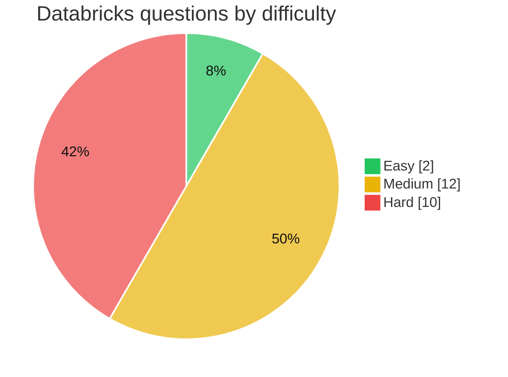

[← All companies](../README.md) · [Most asked across companies](../most-asked.md)

# Databricks Coding Questions

   

**24 Databricks coding questions** — 2 easy, 12 medium and 10 hard. Each one links to a free page where you can solve it in 13 languages, with hints and an editorial.

24 problems the CodeKairo catalogue tags as commonly asked in Databricks's coding rounds — 2 easy, 12 medium and 10 hard — each judged by hidden tests in 13 languages. The most common topics among them are Arrays (20), Strings (6) and Hash Table (6). Tagged for Databricks and no other company: Decode Ways, House Robber II and Permutation in String. The tag is the catalogue's own annotation of where a problem tends to come up — not a list published by Databricks, which CodeKairo is not affiliated with.

**Practise on CodeKairo:** [All 24 Databricks questions](https://codekairo.com/challenges/company/databricks?utm_source=github)

## Contents

- [Start with these 10](#start-with-these-10)
- [Topics Databricks asks most](#topics-databricks-asks-most)
- 🟢 [Easy (2)](#easy-2)
- 🟡 [Medium (12)](#medium-12)
- 🔴 [Hard (10)](#hard-10)

## Start with these 10

The Databricks questions most other companies ask too — the patterns worth knowing first.

1. 🟢 [Two Sum](https://codekairo.com/problems/two-sum?utm_source=github) — also asked at 18 other companies
2. 🟡 [Merge Intervals](https://codekairo.com/problems/merge-intervals?utm_source=github) — also asked at 12 other companies
3. 🔴 [Text Justification](https://codekairo.com/problems/text-justification?utm_source=github) — also asked at 9 other companies
4. 🟡 [Spiral Matrix](https://codekairo.com/problems/spiral-matrix?utm_source=github) — also asked at 7 other companies
5. 🔴 [Trapping Rain Water](https://codekairo.com/problems/trapping-rain-water?utm_source=github) — also asked at 7 other companies
6. 🔴 [The Skyline Problem](https://codekairo.com/problems/the-skyline-problem?utm_source=github) — also asked at 7 other companies
7. 🟡 [House Robber](https://codekairo.com/problems/house-robber?utm_source=github) — also asked at 4 other companies
8. 🟡 [Rotting Oranges](https://codekairo.com/problems/rotting-oranges?utm_source=github) — also asked at 4 other companies
9. 🟡 [Shortest Path in Binary Matrix](https://codekairo.com/problems/shortest-path-in-binary-matrix?utm_source=github) — also asked at 4 other companies
10. 🔴 [Number of Flowers in Full Bloom](https://codekairo.com/problems/number-of-flowers-in-full-bloom?utm_source=github) — also asked at 4 other companies

## Topics Databricks asks most

[Arrays](https://codekairo.com/challenges/arrays?utm_source=github) (20) · [Dynamic Programming](https://codekairo.com/challenges/dynamic-programming?utm_source=github) (6) · [Hash Table](https://codekairo.com/challenges/hash-table?utm_source=github) (6) · [Strings](https://codekairo.com/challenges/strings?utm_source=github) (6) · [Matrix](https://codekairo.com/challenges/matrix?utm_source=github) (5) · [Sorting](https://codekairo.com/challenges/sorting?utm_source=github) (4) · [Breadth-First Search](https://codekairo.com/challenges/breadth-first-search?utm_source=github) (3) · [Sliding Window](https://codekairo.com/challenges/sliding-window?utm_source=github) (3) · [Two Pointers](https://codekairo.com/challenges/two-pointers?utm_source=github) (3) · [Binary Search](https://codekairo.com/challenges/binary-search?utm_source=github) (2)

## Easy (2)

| # | Question | Topics | Acceptance |
|---:|---|---|---:|
| 1 | 🟢 [Two Sum](https://codekairo.com/problems/two-sum?utm_source=github) | Arrays, Hash Table | — |
| 182 | 🟢 [Intersection of Two Arrays II](https://codekairo.com/problems/intersection-of-two-arrays-ii?utm_source=github) | Arrays, Hash Table, Two Pointers | — |

## Medium (12)

| # | Question | Topics | Acceptance |
|---:|---|---|---:|
| 33 | 🟡 [Find All Anagrams in a String](https://codekairo.com/problems/find-all-anagrams-in-a-string?utm_source=github) | Strings, Sliding Window, Hash Table | — |
| 36 | 🟡 [String to Integer (atoi)](https://codekairo.com/problems/string-to-integer-atoi?utm_source=github) | Strings, Math | — |
| 53 | 🟡 [Permutation in String](https://codekairo.com/problems/permutation-in-string?utm_source=github) | Strings, Sliding Window, Hash Table | — |
| 88 | 🟡 [House Robber](https://codekairo.com/problems/house-robber?utm_source=github) | Arrays, Dynamic Programming | — |
| 89 | 🟡 [House Robber II](https://codekairo.com/problems/house-robber-ii?utm_source=github) | Arrays, Dynamic Programming | — |
| 94 | 🟡 [Decode Ways](https://codekairo.com/problems/decode-ways?utm_source=github) | Strings, Dynamic Programming | — |
| 110 | 🟡 [Spiral Matrix](https://codekairo.com/problems/spiral-matrix?utm_source=github) | Arrays, Matrix, Simulation | — |
| 120 | 🟡 [Rotting Oranges](https://codekairo.com/problems/rotting-oranges?utm_source=github) | Arrays, Matrix, Breadth-First Search | — |
| 122 | 🟡 [Merge Intervals](https://codekairo.com/problems/merge-intervals?utm_source=github) | Arrays, Sorting, Intervals | — |
| 450 | 🟡 [Shortest Path in Binary Matrix](https://codekairo.com/problems/shortest-path-in-binary-matrix?utm_source=github) | Arrays, Breadth-First Search, Matrix | — |
| 766 | 🟡 [Longest Mountain in Array](https://codekairo.com/problems/longest-mountain-in-array?utm_source=github) | Arrays, Two Pointers, Dynamic Programming | — |
| 1233 | 🟡 [Longest Palindrome by Concatenating Two Letter Words](https://codekairo.com/problems/longest-palindrome-by-concatenating-two-letter-words?utm_source=github) | Arrays, Hash Table, Strings | — |

## Hard (10)

| # | Question | Topics | Acceptance |
|---:|---|---|---:|
| 25 | 🔴 [First Missing Positive](https://codekairo.com/problems/first-missing-positive?utm_source=github) | Arrays, Hash Table | — |
| 26 | 🔴 [Trapping Rain Water](https://codekairo.com/problems/trapping-rain-water?utm_source=github) | Arrays, Two Pointers, Dynamic Programming | — |
| 54 | 🔴 [Sliding Window Maximum](https://codekairo.com/problems/sliding-window-maximum?utm_source=github) | Arrays, Sliding Window, Monotonic Queue | — |
| 838 | 🔴 [Maximum Number of Tasks You Can Assign](https://codekairo.com/problems/maximum-number-of-tasks-you-can-assign?utm_source=github) | Arrays, Binary Search, Greedy | — |
| 886 | 🔴 [Tallest Billboard](https://codekairo.com/problems/tallest-billboard?utm_source=github) | Arrays, Dynamic Programming | — |
| 922 | 🔴 [Unique Paths III](https://codekairo.com/problems/unique-paths-iii?utm_source=github) | Arrays, Matrix, Backtracking | — |
| 1249 | 🔴 [Text Justification](https://codekairo.com/problems/text-justification?utm_source=github) | Arrays, Strings, Simulation | — |
| 1381 | 🔴 [Number of Flowers in Full Bloom](https://codekairo.com/problems/number-of-flowers-in-full-bloom?utm_source=github) | Arrays, Binary Search, Sorting | — |
| 1425 | 🔴 [The Skyline Problem](https://codekairo.com/problems/the-skyline-problem?utm_source=github) | Arrays, Divide and Conquer, Heap | — |
| 1569 | 🔴 [Shortest Path in a Grid with Obstacles Elimination](https://codekairo.com/problems/shortest-path-in-a-grid-with-obstacles-elimination?utm_source=github) | Arrays, Breadth-First Search, Matrix | — |

---

[← All companies](../README.md) · Rebuilt every night from [codekairo.com](https://codekairo.com/challenges/company/databricks?utm_source=github). Last refreshed: November 2026. ⭐ [Star the repo](https://github.com/ayaanp14/company-wise-coding-questions) if it helps.
