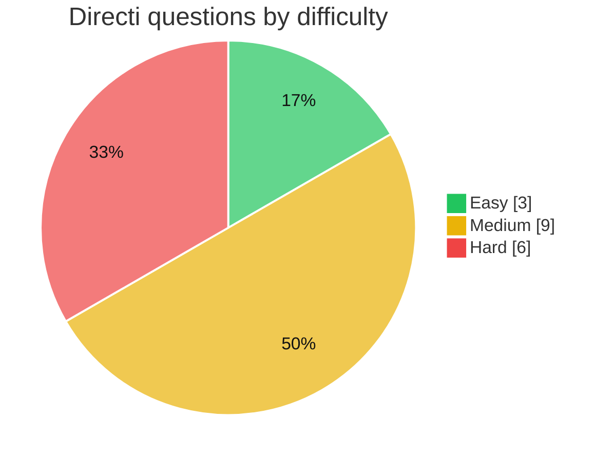

[← All companies](../README.md) · [Most asked across companies](../most-asked.md)

# Directi Coding Questions

   

**18 Directi coding questions** — 3 easy, 9 medium and 6 hard. Each one links to a free page where you can solve it in 13 languages, with hints and an editorial.

18 problems the CodeKairo catalogue tags as commonly asked in Directi's coding rounds — 3 easy, 9 medium and 6 hard — each judged by hidden tests in 13 languages. The most common topics among them are Arrays (11), Matrix (6) and Strings (5). Tagged for Directi and no other company: Min Cost to Connect All Points and Best Time to Buy and Sell Stock II. The tag is the catalogue's own annotation of where a problem tends to come up — not a list published by Directi, which CodeKairo is not affiliated with.

**Practise on CodeKairo:** [All 18 Directi questions](https://codekairo.com/challenges/company/directi?utm_source=github)

## Contents

- [Start with these 10](#start-with-these-10)
- [Topics Directi asks most](#topics-directi-asks-most)
- 🟢 [Easy (3)](#easy-3)
- 🟡 [Medium (9)](#medium-9)
- 🔴 [Hard (6)](#hard-6)

## Start with these 10

The Directi questions most other companies ask too — the patterns worth knowing first.

1. 🟢 [Valid Anagram](https://codekairo.com/problems/valid-anagram?utm_source=github) — also asked at 7 other companies
2. 🔴 [Word Search II](https://codekairo.com/problems/word-search-ii?utm_source=github) — also asked at 7 other companies
3. 🔴 [Sudoku Solver](https://codekairo.com/problems/sudoku-solver?utm_source=github) — also asked at 6 other companies
4. 🟢 [Excel Sheet Column Title](https://codekairo.com/problems/excel-sheet-column-title?utm_source=github) — also asked at 5 other companies
5. 🔴 [Maximal Rectangle](https://codekairo.com/problems/maximal-rectangle?utm_source=github) — also asked at 5 other companies
6. 🟡 [Search a 2D Matrix II](https://codekairo.com/problems/search-a-2d-matrix-ii?utm_source=github) — also asked at 4 other companies
7. 🟢 [Find Nth Root of M](https://codekairo.com/problems/find-nth-root-of-m?utm_source=github) — also asked at 3 other companies
8. 🟡 [Find the Winner of an Array Game](https://codekairo.com/problems/find-the-winner-of-an-array-game?utm_source=github) — also asked at 3 other companies
9. 🔴 [Minimum Number of Moves to Make Palindrome](https://codekairo.com/problems/minimum-number-of-moves-to-make-palindrome?utm_source=github) — also asked at 3 other companies
10. 🟡 [Number of Subarrays with Bounded Maximum](https://codekairo.com/problems/number-of-subarrays-with-bounded-maximum?utm_source=github) — also asked at 2 other companies

## Topics Directi asks most

[Arrays](https://codekairo.com/challenges/arrays?utm_source=github) (11) · [Matrix](https://codekairo.com/challenges/matrix?utm_source=github) (6) · [Strings](https://codekairo.com/challenges/strings?utm_source=github) (5) · [Greedy](https://codekairo.com/challenges/greedy?utm_source=github) (4) · [Math](https://codekairo.com/challenges/math?utm_source=github) (4) · [Binary Search](https://codekairo.com/challenges/binary-search?utm_source=github) (3) · [Dynamic Programming](https://codekairo.com/challenges/dynamic-programming?utm_source=github) (3) · [Hash Table](https://codekairo.com/challenges/hash-table?utm_source=github) (3) · [Backtracking](https://codekairo.com/challenges/backtracking?utm_source=github) (2) · [Counting](https://codekairo.com/challenges/counting?utm_source=github) (2)

## Easy (3)

| # | Question | Topics | Acceptance |
|---:|---|---|---:|
| 6 | 🟢 [Valid Anagram](https://codekairo.com/problems/valid-anagram?utm_source=github) | Hash Table, Strings, Sorting | — |
| 158 | 🟢 [Excel Sheet Column Title](https://codekairo.com/problems/excel-sheet-column-title?utm_source=github) | Math, Strings | — |
| 1396 | 🟢 [Find Nth Root of M](https://codekairo.com/problems/find-nth-root-of-m?utm_source=github) | Math, Binary Search | — |

## Medium (9)

| # | Question | Topics | Acceptance |
|---:|---|---|---:|
| 81 | 🟡 [Best Time to Buy and Sell Stock II](https://codekairo.com/problems/best-time-to-buy-and-sell-stock-ii?utm_source=github) | Arrays, Greedy, Dynamic Programming | — |
| 112 | 🟡 [Search a 2D Matrix](https://codekairo.com/problems/search-a-2d-matrix?utm_source=github) | Arrays, Matrix, Binary Search | — |
| 142 | 🟡 [Min Cost to Connect All Points](https://codekairo.com/problems/min-cost-to-connect-all-points?utm_source=github) | Graph, Minimum Spanning Tree, Union Find | — |
| 797 | 🟡 [Number of Subarrays with Bounded Maximum](https://codekairo.com/problems/number-of-subarrays-with-bounded-maximum?utm_source=github) | Arrays, Sliding Window, Two Pointers | — |
| 828 | 🟡 [Search a 2D Matrix II](https://codekairo.com/problems/search-a-2d-matrix-ii?utm_source=github) | Arrays, Matrix, Binary Search | — |
| 861 | 🟡 [Stone Game IX](https://codekairo.com/problems/stone-game-ix?utm_source=github) | Arrays, Math, Greedy | — |
| 1084 | 🟡 [Find the Winner of an Array Game](https://codekairo.com/problems/find-the-winner-of-an-array-game?utm_source=github) | Arrays, Simulation | — |
| 1137 | 🟡 [Number of Sub-arrays With Odd Sum](https://codekairo.com/problems/number-of-sub-arrays-with-odd-sum?utm_source=github) | Arrays, Math, Dynamic Programming | — |
| 1571 | 🟡 [Largest Submatrix With Rearrangements](https://codekairo.com/problems/largest-submatrix-with-rearrangements?utm_source=github) | Arrays, Greedy, Sorting | — |

## Hard (6)

| # | Question | Topics | Acceptance |
|---:|---|---|---:|
| 54 | 🔴 [Sliding Window Maximum](https://codekairo.com/problems/sliding-window-maximum?utm_source=github) | Arrays, Sliding Window, Monotonic Queue | — |
| 776 | 🔴 [Minimum Number of Moves to Make Palindrome](https://codekairo.com/problems/minimum-number-of-moves-to-make-palindrome?utm_source=github) | Strings, Two Pointers, Greedy | — |
| 919 | 🔴 [Maximal Rectangle](https://codekairo.com/problems/maximal-rectangle?utm_source=github) | Arrays, Matrix, Stack | — |
| 1256 | 🔴 [Find Longest Awesome Substring](https://codekairo.com/problems/find-longest-awesome-substring?utm_source=github) | Strings, Hash Table, Bit Manipulation | — |
| 1572 | 🔴 [Sudoku Solver](https://codekairo.com/problems/sudoku-solver?utm_source=github) | Arrays, Hash Table, Backtracking | — |
| 1573 | 🔴 [Word Search II](https://codekairo.com/problems/word-search-ii?utm_source=github) | Strings, Backtracking, Trie | — |

---

[← All companies](../README.md) · Rebuilt every night from [codekairo.com](https://codekairo.com/challenges/company/directi?utm_source=github). Last refreshed: November 2026. ⭐ [Star the repo](https://github.com/ayaanp14/company-wise-coding-questions) if it helps.
