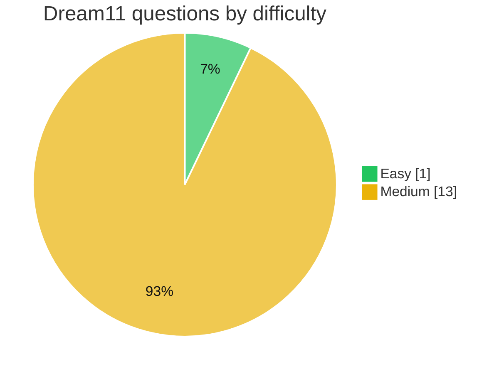

[← All companies](../README.md) · [Most asked across companies](../most-asked.md)

# Dream11 Coding Questions

   

**14 Dream11 coding questions** — 1 easy and 13 medium. Each one links to a free page where you can solve it in 13 languages, with hints and an editorial.

14 problems the CodeKairo catalogue tags as commonly asked in Dream11's coding rounds — 1 easy and 13 medium, no hard ones — each judged by hidden tests in 13 languages. The most common topics among them are Arrays (12), Greedy (4) and Dynamic Programming (4). Tagged for Dream11 and no other company: 3Sum Closest, Furthest Building You Can Reach and Partition Equal Subset Sum. The tag is the catalogue's own annotation of where a problem tends to come up — not a list published by Dream11, which CodeKairo is not affiliated with.

**Practise on CodeKairo:** [All 14 Dream11 questions](https://codekairo.com/challenges/company/dream11?utm_source=github)

## Contents

- [Start with these 10](#start-with-these-10)
- [Topics Dream11 asks most](#topics-dream11-asks-most)
- 🟢 [Easy (1)](#easy-1)
- 🟡 [Medium (13)](#medium-13)

## Start with these 10

The Dream11 questions most other companies ask too — the patterns worth knowing first.

1. 🟡 [Longest Substring Without Repeating Characters](https://codekairo.com/problems/longest-substring-without-repeating-characters?utm_source=github) — also asked at 13 other companies
2. 🟡 [Container With Most Water](https://codekairo.com/problems/container-with-most-water?utm_source=github) — also asked at 6 other companies
3. 🟡 [Asteroid Collision](https://codekairo.com/problems/asteroid-collision?utm_source=github) — also asked at 4 other companies
4. 🟡 [Rotting Oranges](https://codekairo.com/problems/rotting-oranges?utm_source=github) — also asked at 4 other companies
5. 🟡 [3Sum](https://codekairo.com/problems/3sum?utm_source=github) — also asked at 3 other companies
6. 🟡 [Minimum Falling Path Sum](https://codekairo.com/problems/minimum-falling-path-sum?utm_source=github) — also asked at 3 other companies
7. 🟡 [Destroy Sequential Targets](https://codekairo.com/problems/destroy-sequential-targets?utm_source=github) — also asked at 3 other companies
8. 🟡 [Number of Ways to Select Buildings](https://codekairo.com/problems/number-of-ways-to-select-buildings?utm_source=github) — also asked at 3 other companies
9. 🟡 [Minimum Number of Increments on Subarrays to Form a Target Array](https://codekairo.com/problems/minimum-number-of-increments-on-subarrays-to-form-a-target-array?utm_source=github) — also asked at 3 other companies
10. 🟢 [Final Prices With a Special Discount in a Shop](https://codekairo.com/problems/final-prices-with-a-special-discount-in-a-shop?utm_source=github) — also asked at 2 other companies

## Topics Dream11 asks most

[Arrays](https://codekairo.com/challenges/arrays?utm_source=github) (12) · [Dynamic Programming](https://codekairo.com/challenges/dynamic-programming?utm_source=github) (4) · [Greedy](https://codekairo.com/challenges/greedy?utm_source=github) (4) · [Stack](https://codekairo.com/challenges/stack?utm_source=github) (3) · [Two Pointers](https://codekairo.com/challenges/two-pointers?utm_source=github) (3) · [Hash Table](https://codekairo.com/challenges/hash-table?utm_source=github) (2) · [Matrix](https://codekairo.com/challenges/matrix?utm_source=github) (2) · [Monotonic Stack](https://codekairo.com/challenges/monotonic-stack?utm_source=github) (2) · [Sorting](https://codekairo.com/challenges/sorting?utm_source=github) (2) · [Strings](https://codekairo.com/challenges/strings?utm_source=github) (2)

## Easy (1)

| # | Question | Topics | Acceptance |
|---:|---|---|---:|
| 382 | 🟢 [Final Prices With a Special Discount in a Shop](https://codekairo.com/problems/final-prices-with-a-special-discount-in-a-shop?utm_source=github) | Arrays, Stack, Monotonic Stack | — |

## Medium (13)

| # | Question | Topics | Acceptance |
|---:|---|---|---:|
| 29 | 🟡 [Longest Substring Without Repeating Characters](https://codekairo.com/problems/longest-substring-without-repeating-characters?utm_source=github) | Strings, Sliding Window, Hash Table | — |
| 44 | 🟡 [Container With Most Water](https://codekairo.com/problems/container-with-most-water?utm_source=github) | Arrays, Two Pointers, Greedy | — |
| 75 | 🟡 [Asteroid Collision](https://codekairo.com/problems/asteroid-collision?utm_source=github) | Arrays, Stack, Simulation | — |
| 79 | 🟡 [Gas Station](https://codekairo.com/problems/gas-station?utm_source=github) | Arrays, Greedy | — |
| 96 | 🟡 [Partition Equal Subset Sum](https://codekairo.com/problems/partition-equal-subset-sum?utm_source=github) | Arrays, Dynamic Programming | — |
| 105 | 🟡 [Furthest Building You Can Reach](https://codekairo.com/problems/furthest-building-you-can-reach?utm_source=github) | Arrays, Heap, Greedy | — |
| 120 | 🟡 [Rotting Oranges](https://codekairo.com/problems/rotting-oranges?utm_source=github) | Arrays, Matrix, Breadth-First Search | — |
| 131 | 🟡 [3Sum](https://codekairo.com/problems/3sum?utm_source=github) | Arrays, Two Pointers, Sorting | — |
| 132 | 🟡 [3Sum Closest](https://codekairo.com/problems/3sum-closest?utm_source=github) | Arrays, Two Pointers, Sorting | — |
| 320 | 🟡 [Minimum Falling Path Sum](https://codekairo.com/problems/minimum-falling-path-sum?utm_source=github) | Arrays, Dynamic Programming, Matrix | — |
| 859 | 🟡 [Destroy Sequential Targets](https://codekairo.com/problems/destroy-sequential-targets?utm_source=github) | Arrays, Hash Table, Counting | — |
| 877 | 🟡 [Number of Ways to Select Buildings](https://codekairo.com/problems/number-of-ways-to-select-buildings?utm_source=github) | Strings, Dynamic Programming, Prefix Sum | — |
| 1085 | 🟡 [Minimum Number of Increments on Subarrays to Form a Target Array](https://codekairo.com/problems/minimum-number-of-increments-on-subarrays-to-form-a-target-array?utm_source=github) | Arrays, Greedy, Dynamic Programming | — |

---

[← All companies](../README.md) · Rebuilt every night from [codekairo.com](https://codekairo.com/challenges/company/dream11?utm_source=github). Last refreshed: November 2026. ⭐ [Star the repo](https://github.com/ayaanp14/company-wise-coding-questions) if it helps.
