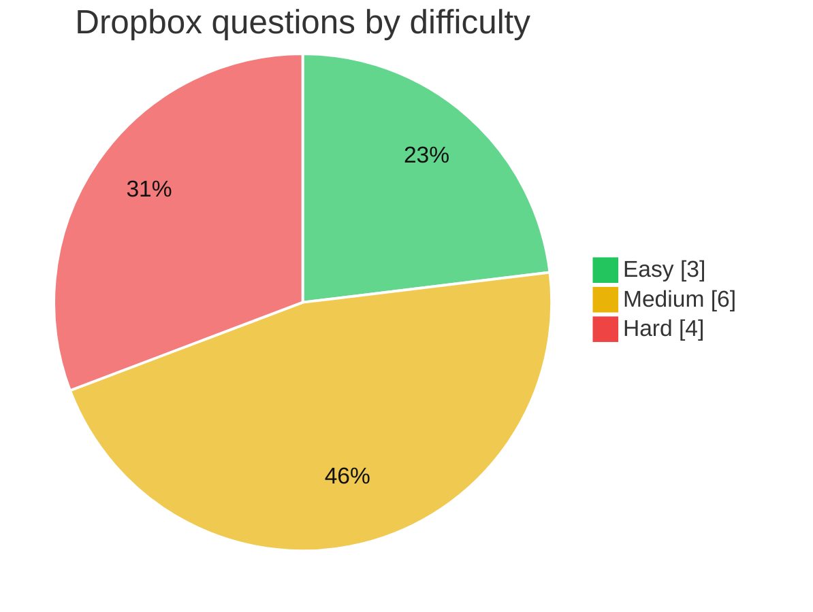

[← All companies](../README.md) · [Most asked across companies](../most-asked.md)

# Dropbox Coding Questions

   

**13 Dropbox coding questions** — 3 easy, 6 medium and 4 hard. Each one links to a free page where you can solve it in 13 languages, with hints and an editorial.

13 problems the CodeKairo catalogue tags as commonly asked in Dropbox's coding rounds — 3 easy, 6 medium and 4 hard — each judged by hidden tests in 13 languages. The most common topics among them are Arrays (8), Hash Table (7) and Strings (4). Tagged for Dropbox and no other company: Seat Reservation Manager, Find the Index of the First Occurrence in a String and Word Pattern. The tag is the catalogue's own annotation of where a problem tends to come up — not a list published by Dropbox, which CodeKairo is not affiliated with.

**Practise on CodeKairo:** [All 13 Dropbox questions](https://codekairo.com/challenges/company/dropbox?utm_source=github)

## Contents

- [Start with these 10](#start-with-these-10)
- [Topics Dropbox asks most](#topics-dropbox-asks-most)
- 🟢 [Easy (3)](#easy-3)
- 🟡 [Medium (6)](#medium-6)
- 🔴 [Hard (4)](#hard-4)

## Start with these 10

The Dropbox questions most other companies ask too — the patterns worth knowing first.

1. 🟢 [Two Sum](https://codekairo.com/problems/two-sum?utm_source=github) — also asked at 18 other companies
2. 🟡 [Merge Intervals](https://codekairo.com/problems/merge-intervals?utm_source=github) — also asked at 12 other companies
3. 🟡 [Game of Life](https://codekairo.com/problems/game-of-life?utm_source=github) — also asked at 7 other companies
4. 🟡 [Minimum Path Sum](https://codekairo.com/problems/minimum-path-sum?utm_source=github) — also asked at 5 other companies
5. 🔴 [Word Break II](https://codekairo.com/problems/word-break-ii?utm_source=github) — also asked at 5 other companies
6. 🟡 [Pairs of Songs With Total Durations Divisible by 60](https://codekairo.com/problems/pairs-of-songs-with-total-durations-divisible-by-60?utm_source=github) — also asked at 4 other companies
7. 🔴 [Grid Illumination](https://codekairo.com/problems/grid-illumination?utm_source=github) — also asked at 3 other companies
8. 🔴 [Minimize Malware Spread](https://codekairo.com/problems/minimize-malware-spread?utm_source=github) — also asked at 2 other companies
9. 🟡 [Letter Combinations of a Phone Number](https://codekairo.com/problems/letter-combinations-of-a-phone-number?utm_source=github) — also asked at 1 other company
10. 🔴 [Candy](https://codekairo.com/problems/candy?utm_source=github) — also asked at 1 other company

## Topics Dropbox asks most

[Arrays](https://codekairo.com/challenges/arrays?utm_source=github) (8) · [Hash Table](https://codekairo.com/challenges/hash-table?utm_source=github) (7) · [Strings](https://codekairo.com/challenges/strings?utm_source=github) (4) · [Matrix](https://codekairo.com/challenges/matrix?utm_source=github) (3) · [Backtracking](https://codekairo.com/challenges/backtracking?utm_source=github) (2) · [Dynamic Programming](https://codekairo.com/challenges/dynamic-programming?utm_source=github) (2) · [Counting](https://codekairo.com/challenges/counting?utm_source=github) (1) · [Depth-First Search](https://codekairo.com/challenges/depth-first-search?utm_source=github) (1) · Design (1) · [Graph](https://codekairo.com/challenges/graph?utm_source=github) (1)

## Easy (3)

| # | Question | Topics | Acceptance |
|---:|---|---|---:|
| 1 | 🟢 [Two Sum](https://codekairo.com/problems/two-sum?utm_source=github) | Arrays, Hash Table | — |
| 35 | 🟢 [Word Pattern](https://codekairo.com/problems/word-pattern?utm_source=github) | Strings, Hash Table | — |
| 38 | 🟢 [Find the Index of the First Occurrence in a String](https://codekairo.com/problems/find-first-occurrence-in-string?utm_source=github) | Strings, Two Pointers | — |

## Medium (6)

| # | Question | Topics | Acceptance |
|---:|---|---|---:|
| 122 | 🟡 [Merge Intervals](https://codekairo.com/problems/merge-intervals?utm_source=github) | Arrays, Sorting, Intervals | — |
| 143 | 🟡 [Letter Combinations of a Phone Number](https://codekairo.com/problems/letter-combinations-of-a-phone-number?utm_source=github) | Strings, Backtracking, Hash Table | — |
| 288 | 🟡 [Minimum Path Sum](https://codekairo.com/problems/minimum-path-sum?utm_source=github) | Arrays, Dynamic Programming, Matrix | — |
| 293 | 🟡 [Game of Life](https://codekairo.com/problems/game-of-life?utm_source=github) | Arrays, Matrix, Simulation | — |
| 1129 | 🟡 [Pairs of Songs With Total Durations Divisible by 60](https://codekairo.com/problems/pairs-of-songs-with-total-durations-divisible-by-60?utm_source=github) | Arrays, Hash Table, Counting | — |
| 2071 | 🟡 [Seat Reservation Manager](https://codekairo.com/problems/seat-reservation-manager?utm_source=github) | Heap, Design | — |

## Hard (4)

| # | Question | Topics | Acceptance |
|---:|---|---|---:|
| 83 | 🔴 [Candy](https://codekairo.com/problems/candy?utm_source=github) | Arrays, Greedy | — |
| 926 | 🔴 [Grid Illumination](https://codekairo.com/problems/grid-illumination?utm_source=github) | Arrays, Hash Table, Matrix | — |
| 1270 | 🔴 [Word Break II](https://codekairo.com/problems/word-break-ii?utm_source=github) | Hash Table, Strings, Dynamic Programming | — |
| 1545 | 🔴 [Minimize Malware Spread](https://codekairo.com/problems/minimize-malware-spread?utm_source=github) | Arrays, Hash Table, Graph | — |

---

[← All companies](../README.md) · Rebuilt every night from [codekairo.com](https://codekairo.com/challenges/company/dropbox?utm_source=github). Last refreshed: November 2026. ⭐ [Star the repo](https://github.com/ayaanp14/company-wise-coding-questions) if it helps.
