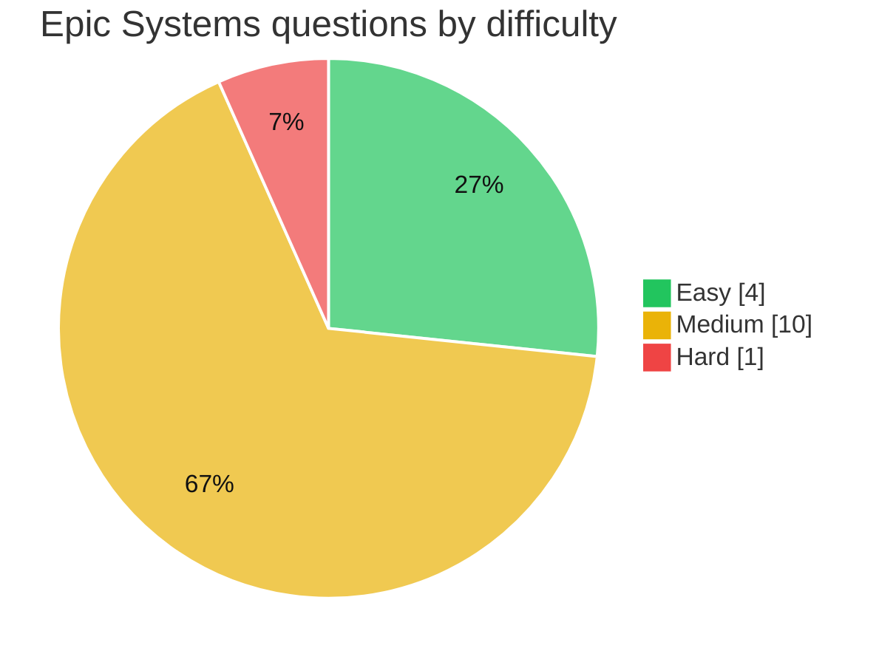

[← All companies](../README.md) · [Most asked across companies](../most-asked.md)

# Epic Systems Coding Questions

   

**15 Epic Systems coding questions** — 4 easy, 10 medium and 1 hard. Each one links to a free page where you can solve it in 13 languages, with hints and an editorial.

15 problems the CodeKairo catalogue tags as commonly asked in Epic Systems's coding rounds — 4 easy, 10 medium and 1 hard — each judged by hidden tests in 13 languages. The most common topics among them are Strings (9), Arrays (5) and Backtracking (4). The tag is the catalogue's own annotation of where a problem tends to come up — not a list published by Epic Systems, which CodeKairo is not affiliated with.

**Practise on CodeKairo:** [All 15 Epic Systems questions](https://codekairo.com/challenges/company/epic-systems?utm_source=github)

## Contents

- [Start with these 10](#start-with-these-10)
- [Topics Epic Systems asks most](#topics-epic-systems-asks-most)
- 🟢 [Easy (4)](#easy-4)
- 🟡 [Medium (10)](#medium-10)
- 🔴 [Hard (1)](#hard-1)

## Start with these 10

The Epic Systems questions most other companies ask too — the patterns worth knowing first.

1. 🟢 [Two Sum](https://codekairo.com/problems/two-sum?utm_source=github) — also asked at 18 other companies
2. 🟢 [Valid Parentheses](https://codekairo.com/problems/valid-parentheses?utm_source=github) — also asked at 14 other companies
3. 🟡 [Word Search](https://codekairo.com/problems/word-search?utm_source=github) — also asked at 8 other companies
4. 🟡 [Spiral Matrix](https://codekairo.com/problems/spiral-matrix?utm_source=github) — also asked at 7 other companies
5. 🟡 [Count Primes](https://codekairo.com/problems/count-primes?utm_source=github) — also asked at 7 other companies
6. 🟡 [Longest Palindromic Substring](https://codekairo.com/problems/longest-palindromic-substring?utm_source=github) — also asked at 6 other companies
7. 🟢 [Valid Palindrome](https://codekairo.com/problems/valid-palindrome?utm_source=github) — also asked at 4 other companies
8. 🟡 [Count and Say](https://codekairo.com/problems/count-and-say?utm_source=github) — also asked at 4 other companies
9. 🔴 [Longest Increasing Path in a Matrix](https://codekairo.com/problems/longest-increasing-path-in-a-matrix?utm_source=github) — also asked at 4 other companies
10. 🟡 [Bulls and Cows](https://codekairo.com/problems/bulls-and-cows?utm_source=github) — also asked at 3 other companies

## Topics Epic Systems asks most

[Strings](https://codekairo.com/challenges/strings?utm_source=github) (9) · [Arrays](https://codekairo.com/challenges/arrays?utm_source=github) (5) · [Backtracking](https://codekairo.com/challenges/backtracking?utm_source=github) (4) · [Dynamic Programming](https://codekairo.com/challenges/dynamic-programming?utm_source=github) (3) · [Hash Table](https://codekairo.com/challenges/hash-table?utm_source=github) (3) · [Matrix](https://codekairo.com/challenges/matrix?utm_source=github) (3) · [Depth-First Search](https://codekairo.com/challenges/depth-first-search?utm_source=github) (2) · [Math](https://codekairo.com/challenges/math?utm_source=github) (2) · [Simulation](https://codekairo.com/challenges/simulation?utm_source=github) (2) · [Counting](https://codekairo.com/challenges/counting?utm_source=github) (1)

## Easy (4)

| # | Question | Topics | Acceptance |
|---:|---|---|---:|
| 1 | 🟢 [Two Sum](https://codekairo.com/problems/two-sum?utm_source=github) | Arrays, Hash Table | — |
| 4 | 🟢 [Valid Parentheses](https://codekairo.com/problems/valid-parentheses?utm_source=github) | Strings, Stack | — |
| 27 | 🟢 [Valid Palindrome](https://codekairo.com/problems/valid-palindrome?utm_source=github) | Strings, Two Pointers | — |
| 175 | 🟢 [Self Dividing Numbers](https://codekairo.com/problems/self-dividing-numbers?utm_source=github) | Math | — |

## Medium (10)

| # | Question | Topics | Acceptance |
|---:|---|---|---:|
| 30 | 🟡 [Longest Palindromic Substring](https://codekairo.com/problems/longest-palindromic-substring?utm_source=github) | Strings, Dynamic Programming | — |
| 31 | 🟡 [Palindromic Substrings](https://codekairo.com/problems/palindromic-substrings?utm_source=github) | Strings, Dynamic Programming | — |
| 110 | 🟡 [Spiral Matrix](https://codekairo.com/problems/spiral-matrix?utm_source=github) | Arrays, Matrix, Simulation | — |
| 143 | 🟡 [Letter Combinations of a Phone Number](https://codekairo.com/problems/letter-combinations-of-a-phone-number?utm_source=github) | Strings, Backtracking, Hash Table | — |
| 146 | 🟡 [Permutations](https://codekairo.com/problems/permutations?utm_source=github) | Arrays, Backtracking | — |
| 150 | 🟡 [Count Primes](https://codekairo.com/problems/count-primes?utm_source=github) | Math, Sieve of Eratosthenes | — |
| 218 | 🟡 [Count and Say](https://codekairo.com/problems/count-and-say?utm_source=github) | Strings, Simulation | — |
| 473 | 🟡 [Word Search](https://codekairo.com/problems/word-search?utm_source=github) | Arrays, Strings, Backtracking | — |
| 1202 | 🟡 [Bulls and Cows](https://codekairo.com/problems/bulls-and-cows?utm_source=github) | Hash Table, Strings, Counting | — |
| 1203 | 🟡 [Additive Number](https://codekairo.com/problems/additive-number?utm_source=github) | Strings, Backtracking, Enumeration | — |

## Hard (1)

| # | Question | Topics | Acceptance |
|---:|---|---|---:|
| 920 | 🔴 [Longest Increasing Path in a Matrix](https://codekairo.com/problems/longest-increasing-path-in-a-matrix?utm_source=github) | Arrays, Matrix, Dynamic Programming | — |

---

[← All companies](../README.md) · Rebuilt every night from [codekairo.com](https://codekairo.com/challenges/company/epic-systems?utm_source=github). Last refreshed: November 2026. ⭐ [Star the repo](https://github.com/ayaanp14/company-wise-coding-questions) if it helps.
