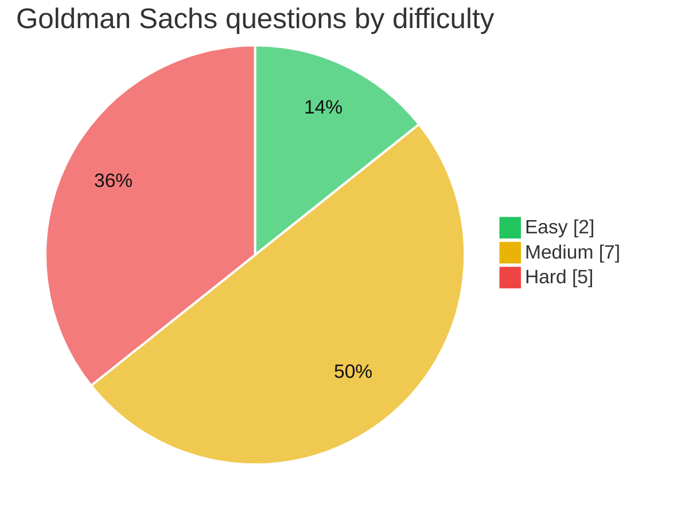

[← All companies](../README.md) · [Most asked across companies](../most-asked.md)

# Goldman Sachs Coding Questions

   

**14 Goldman Sachs coding questions** — 2 easy, 7 medium and 5 hard. Each one links to a free page where you can solve it in 13 languages, with hints and an editorial.

14 problems the CodeKairo catalogue tags as commonly asked in Goldman Sachs's coding rounds — 2 easy, 7 medium and 5 hard — each judged by hidden tests in 13 languages. The most common topics among them are Arrays (7), Math (5) and Dynamic Programming (5). CodeKairo's Goldman Sachs — Aptitude Test mock covers the Goldman Sachs aptitude test pattern, the one paper in this catalogue where a careless guess is a losing strategy. The tag is the catalogue's own annotation of where a problem tends to come up — not a list published by Goldman Sachs, which CodeKairo is not affiliated with.

**Practise on CodeKairo:** [All 14 Goldman Sachs questions](https://codekairo.com/challenges/company/goldman-sachs?utm_source=github) · [Goldman Sachs — Aptitude Test mock test](https://codekairo.com/tests/goldman-sachs-aptitude?utm_source=github) · [Goldman Sachs hiring process, round by round](https://codekairo.com/simulations/goldman-sachs?utm_source=github)

## Contents

- [Start with these 10](#start-with-these-10)
- [Topics Goldman Sachs asks most](#topics-goldman-sachs-asks-most)
- 🟢 [Easy (2)](#easy-2)
- 🟡 [Medium (7)](#medium-7)
- 🔴 [Hard (5)](#hard-5)

## Start with these 10

The Goldman Sachs questions most other companies ask too — the patterns worth knowing first.

1. 🟢 [First Unique Character in a String](https://codekairo.com/problems/first-unique-character-in-a-string?utm_source=github) — also asked at 7 other companies
2. 🟢 [Roman to Integer](https://codekairo.com/problems/roman-to-integer?utm_source=github) — also asked at 6 other companies
3. 🔴 [Best Time to Buy and Sell Stock III](https://codekairo.com/problems/best-time-to-buy-and-sell-stock-iii?utm_source=github) — also asked at 6 other companies
4. 🟡 [Minimum Path Sum](https://codekairo.com/problems/minimum-path-sum?utm_source=github) — also asked at 5 other companies
5. 🟡 [Pairs of Songs With Total Durations Divisible by 60](https://codekairo.com/problems/pairs-of-songs-with-total-durations-divisible-by-60?utm_source=github) — also asked at 4 other companies
6. 🔴 [Super Egg Drop](https://codekairo.com/problems/super-egg-drop?utm_source=github) — also asked at 3 other companies
7. 🟡 [Number of Ways to Split a String](https://codekairo.com/problems/number-of-ways-to-split-a-string?utm_source=github) — also asked at 2 other companies
8. 🟡 [Subarray Sums Divisible by K](https://codekairo.com/problems/subarray-sums-divisible-by-k?utm_source=github) — also asked at 2 other companies
9. 🟡 [Find Minimum in Rotated Sorted Array II](https://codekairo.com/problems/find-minimum-in-rotated-sorted-array-ii?utm_source=github) — also asked at 2 other companies
10. 🟡 [Construct Smallest Number From DI String](https://codekairo.com/problems/construct-smallest-number-from-di-string?utm_source=github) — also asked at 2 other companies

## Topics Goldman Sachs asks most

[Arrays](https://codekairo.com/challenges/arrays?utm_source=github) (7) · [Dynamic Programming](https://codekairo.com/challenges/dynamic-programming?utm_source=github) (5) · [Math](https://codekairo.com/challenges/math?utm_source=github) (5) · [Hash Table](https://codekairo.com/challenges/hash-table?utm_source=github) (4) · [Strings](https://codekairo.com/challenges/strings?utm_source=github) (4) · [Counting](https://codekairo.com/challenges/counting?utm_source=github) (3) · [Binary Search](https://codekairo.com/challenges/binary-search?utm_source=github) (2) · [Greedy](https://codekairo.com/challenges/greedy?utm_source=github) (2) · [Backtracking](https://codekairo.com/challenges/backtracking?utm_source=github) (1) · [Heap](https://codekairo.com/challenges/heap?utm_source=github) (1)

## Easy (2)

| # | Question | Topics | Acceptance |
|---:|---|---|---:|
| 159 | 🟢 [Roman to Integer](https://codekairo.com/problems/roman-to-integer?utm_source=github) | Hash Table, Math, Strings | — |
| 213 | 🟢 [First Unique Character in a String](https://codekairo.com/problems/first-unique-character-in-a-string?utm_source=github) | Hash Table, Strings, Queue | — |

## Medium (7)

| # | Question | Topics | Acceptance |
|---:|---|---|---:|
| 288 | 🟡 [Minimum Path Sum](https://codekairo.com/problems/minimum-path-sum?utm_source=github) | Arrays, Dynamic Programming, Matrix | — |
| 646 | 🟡 [Number of Ways to Split a String](https://codekairo.com/problems/number-of-ways-to-split-a-string?utm_source=github) | Strings, Math, Counting | — |
| 670 | 🟡 [Subarray Sums Divisible by K](https://codekairo.com/problems/subarray-sums-divisible-by-k?utm_source=github) | Arrays, Hash Table, Prefix Sum | — |
| 813 | 🟡 [Find Minimum in Rotated Sorted Array II](https://codekairo.com/problems/find-minimum-in-rotated-sorted-array-ii?utm_source=github) | Arrays, Binary Search | — |
| 1129 | 🟡 [Pairs of Songs With Total Durations Divisible by 60](https://codekairo.com/problems/pairs-of-songs-with-total-durations-divisible-by-60?utm_source=github) | Arrays, Hash Table, Counting | — |
| 1235 | 🟡 [Construct Smallest Number From DI String](https://codekairo.com/problems/construct-smallest-number-from-di-string?utm_source=github) | Strings, Stack, Greedy | — |
| 1625 | 🟡 [Egg Drop With 2 Eggs and N Floors](https://codekairo.com/problems/egg-drop-with-2-eggs-and-n-floors?utm_source=github) | Math, Dynamic Programming | — |

## Hard (5)

| # | Question | Topics | Acceptance |
|---:|---|---|---:|
| 311 | 🔴 [Best Time to Buy and Sell Stock III](https://codekairo.com/problems/best-time-to-buy-and-sell-stock-iii?utm_source=github) | Arrays, Dynamic Programming | — |
| 866 | 🔴 [IPO](https://codekairo.com/problems/ipo?utm_source=github) | Arrays, Greedy, Sorting | — |
| 885 | 🔴 [Best Time to Buy and Sell Stock IV](https://codekairo.com/problems/best-time-to-buy-and-sell-stock-iv?utm_source=github) | Arrays, Dynamic Programming | — |
| 1279 | 🔴 [Reaching Points](https://codekairo.com/problems/reaching-points?utm_source=github) | Math, Number Theory | — |
| 1502 | 🔴 [Super Egg Drop](https://codekairo.com/problems/super-egg-drop?utm_source=github) | Math, Binary Search, Dynamic Programming | — |

---

[← All companies](../README.md) · Rebuilt every night from [codekairo.com](https://codekairo.com/challenges/company/goldman-sachs?utm_source=github). Last refreshed: November 2026. ⭐ [Star the repo](https://github.com/ayaanp14/company-wise-coding-questions) if it helps.
