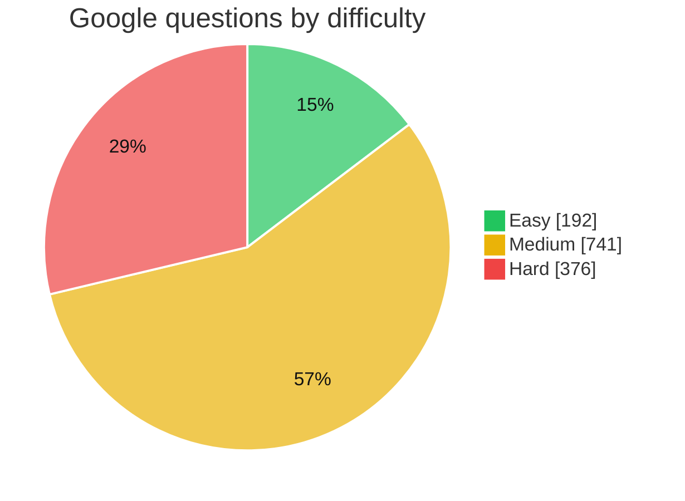

[← All companies](../README.md) · [Most asked across companies](../most-asked.md)

# Google Coding Questions

   

**1,309 Google coding questions** — 192 easy, 741 medium and 376 hard. Each one links to a free page where you can solve it in 13 languages, with hints and an editorial.

1309 problems the CodeKairo catalogue tags as commonly asked in Google's coding rounds — 192 easy, 741 medium and 376 hard — each judged by hidden tests in 13 languages. The most common topics among them are Arrays (785), Dynamic Programming (324) and Strings (320). Tagged for Google and no other company: Sequentially Ordinal Rank Tracker, Finding MK Average and Longest Uploaded Prefix. At 62% of the catalogue the tag is a broad net rather than a shortlist; its placement test pattern is the narrower place to start. CodeKairo's Google — Online Assessment mock covers the Google online assessment pattern for university candidates: two coding problems, one clock, and nothing else. The tag is the catalogue's own annotation of where a problem tends to come up — not a list published by Google, which CodeKairo is not affiliated with.

**Practise on CodeKairo:** [All 1,309 Google questions](https://codekairo.com/challenges/company/google?utm_source=github) · [Google — Online Assessment mock test](https://codekairo.com/tests/google-online-assessment?utm_source=github) · [Google hiring process, round by round](https://codekairo.com/simulations/google?utm_source=github)

## Contents

- [Start with these 10](#start-with-these-10)
- [Topics Google asks most](#topics-google-asks-most)
- 🟢 [Easy (192)](#easy-192)
- 🟡 [Medium (741)](#medium-741)
- 🔴 [Hard (376)](#hard-376)

## Start with these 10

The Google questions most other companies ask too — the patterns worth knowing first.

1. 🔴 [Word Ladder](https://codekairo.com/problems/word-ladder?utm_source=github) — also asked at 9 other companies
2. 🔴 [Text Justification](https://codekairo.com/problems/text-justification?utm_source=github) — also asked at 9 other companies
3. 🟡 [Word Search](https://codekairo.com/problems/word-search?utm_source=github) — also asked at 8 other companies
4. 🟢 [Find Pivot Index](https://codekairo.com/problems/find-pivot-index?utm_source=github) — also asked at 7 other companies
5. 🟡 [Count Primes](https://codekairo.com/problems/count-primes?utm_source=github) — also asked at 7 other companies
6. 🟡 [String Compression](https://codekairo.com/problems/string-compression?utm_source=github) — also asked at 7 other companies
7. 🟡 [Game of Life](https://codekairo.com/problems/game-of-life?utm_source=github) — also asked at 7 other companies
8. 🟡 [Valid Sudoku](https://codekairo.com/problems/valid-sudoku?utm_source=github) — also asked at 7 other companies
9. 🔴 [The Skyline Problem](https://codekairo.com/problems/the-skyline-problem?utm_source=github) — also asked at 7 other companies
10. 🔴 [Word Search II](https://codekairo.com/problems/word-search-ii?utm_source=github) — also asked at 7 other companies

## Topics Google asks most

[Arrays](https://codekairo.com/challenges/arrays?utm_source=github) (785) · [Dynamic Programming](https://codekairo.com/challenges/dynamic-programming?utm_source=github) (324) · [Strings](https://codekairo.com/challenges/strings?utm_source=github) (320) · [Hash Table](https://codekairo.com/challenges/hash-table?utm_source=github) (268) · [Math](https://codekairo.com/challenges/math?utm_source=github) (206) · [Greedy](https://codekairo.com/challenges/greedy?utm_source=github) (190) · [Sorting](https://codekairo.com/challenges/sorting?utm_source=github) (182) · [Binary Search](https://codekairo.com/challenges/binary-search?utm_source=github) (148) · [Depth-First Search](https://codekairo.com/challenges/depth-first-search?utm_source=github) (135) · [Matrix](https://codekairo.com/challenges/matrix?utm_source=github) (134)

## Easy (192)

| # | Question | Topics | Acceptance |
|---:|---|---|---:|
| 151 | 🟢 [Happy Number](https://codekairo.com/problems/happy-number?utm_source=github) | Hash Table, Math, Two Pointers | — |
| 154 | 🟢 [Power of Two](https://codekairo.com/problems/power-of-two?utm_source=github) | Math, Bit Manipulation | — |
| 155 | 🟢 [Power of Three](https://codekairo.com/problems/power-of-three?utm_source=github) | Math, Recursion | — |
| 161 | 🟢 [Add Binary](https://codekairo.com/problems/add-binary?utm_source=github) | Math, Strings, Bit Manipulation | — |
| 162 | 🟢 [Plus One](https://codekairo.com/problems/plus-one?utm_source=github) | Arrays, Math | — |
| 163 | 🟢 [Add Strings](https://codekairo.com/problems/add-strings?utm_source=github) | Math, Strings, Simulation | — |
| 165 | 🟢 [N-th Tribonacci Number](https://codekairo.com/problems/n-th-tribonacci-number?utm_source=github) | Math, Dynamic Programming, Memoization | — |
| 184 | 🟢 [Set Mismatch](https://codekairo.com/problems/set-mismatch?utm_source=github) | Arrays, Hash Table, Bit Manipulation | — |
| 186 | 🟢 [Find Pivot Index](https://codekairo.com/problems/find-pivot-index?utm_source=github) | Arrays, Prefix Sum | — |
| 188 | 🟢 [How Many Numbers Are Smaller Than the Current Number](https://codekairo.com/problems/how-many-numbers-are-smaller-than-the-current-number?utm_source=github) | Arrays, Hash Table, Counting Sort | — |
| 195 | 🟢 [Find the Highest Altitude](https://codekairo.com/problems/find-the-highest-altitude?utm_source=github) | Arrays, Prefix Sum | — |
| 196 | 🟢 [Sum of All Odd Length Subarrays](https://codekairo.com/problems/sum-of-all-odd-length-subarrays?utm_source=github) | Arrays, Math, Prefix Sum | — |
| 197 | 🟢 [Max Consecutive Ones](https://codekairo.com/problems/max-consecutive-ones?utm_source=github) | Arrays | — |
| 198 | 🟢 [Third Maximum Number](https://codekairo.com/problems/third-maximum-number?utm_source=github) | Arrays, Sorting | — |
| 212 | 🟢 [Reverse Vowels of a String](https://codekairo.com/problems/reverse-vowels-of-a-string?utm_source=github) | Two Pointers, Strings | — |
| 216 | 🟢 [Detect Capital](https://codekairo.com/problems/detect-capital?utm_source=github) | Strings | — |
| 217 | 🟢 [Repeated Substring Pattern](https://codekairo.com/problems/repeated-substring-pattern?utm_source=github) | Strings, String Matching | — |
| 220 | 🟢 [Longest Palindrome](https://codekairo.com/problems/longest-palindrome?utm_source=github) | Hash Table, Strings, Greedy | — |
| 223 | 🟢 [Jewels and Stones](https://codekairo.com/problems/jewels-and-stones?utm_source=github) | Hash Table, Strings | — |
| 231 | 🟢 [License Key Formatting](https://codekairo.com/problems/license-key-formatting?utm_source=github) | Strings | — |
| 233 | 🟢 [Buddy Strings](https://codekairo.com/problems/buddy-strings?utm_source=github) | Hash Table, Strings | — |
| 234 | 🟢 [Rotate String](https://codekairo.com/problems/rotate-string?utm_source=github) | Strings, String Matching | — |
| 235 | 🟢 [Unique Email Addresses](https://codekairo.com/problems/unique-email-addresses?utm_source=github) | Arrays, Hash Table, Strings | — |
| 241 | 🟢 [Count Binary Substrings](https://codekairo.com/problems/count-binary-substrings?utm_source=github) | Two Pointers, Strings | — |
| 254 | 🟢 [Merge Strings Alternately](https://codekairo.com/problems/merge-strings-alternately?utm_source=github) | Two Pointers, Strings | — |
| 256 | 🟢 [Shortest Distance to a Character](https://codekairo.com/problems/shortest-distance-to-a-character?utm_source=github) | Arrays, Two Pointers, Strings | — |
| 259 | 🟢 [Minimum Difference Between Highest and Lowest of K Scores](https://codekairo.com/problems/minimum-difference-between-highest-and-lowest-of-k-scores?utm_source=github) | Arrays, Sliding Window, Sorting | — |
| 260 | 🟢 [Array Partition](https://codekairo.com/problems/array-partition?utm_source=github) | Arrays, Greedy, Sorting | — |
| 264 | 🟢 [Special Array With X Elements Greater Than or Equal X](https://codekairo.com/problems/special-array-with-x-elements-greater-than-or-equal-x?utm_source=github) | Arrays, Binary Search, Sorting | — |
| 265 | 🟢 [Rearrange Spaces Between Words](https://codekairo.com/problems/rearrange-spaces-between-words?utm_source=github) | Strings | — |
| 268 | 🟢 [Count Pairs Whose Sum is Less than Target](https://codekairo.com/problems/count-pairs-whose-sum-is-less-than-target?utm_source=github) | Arrays, Two Pointers, Binary Search | — |
| 269 | 🟢 [Minimum Common Value](https://codekairo.com/problems/minimum-common-value?utm_source=github) | Arrays, Hash Table, Two Pointers | — |
| 273 | 🟢 [Number of Arithmetic Triplets](https://codekairo.com/problems/number-of-arithmetic-triplets?utm_source=github) | Arrays, Hash Table, Two Pointers | — |
| 277 | 🟢 [Toeplitz Matrix](https://codekairo.com/problems/toeplitz-matrix?utm_source=github) | Arrays, Matrix | — |
| 279 | 🟢 [Flipping an Image](https://codekairo.com/problems/flipping-an-image?utm_source=github) | Arrays, Two Pointers, Matrix | — |
| 281 | 🟢 [Count Negative Numbers in a Sorted Matrix](https://codekairo.com/problems/count-negative-numbers-in-a-sorted-matrix?utm_source=github) | Arrays, Binary Search, Matrix | — |
| 284 | 🟢 [The K Weakest Rows in a Matrix](https://codekairo.com/problems/the-k-weakest-rows-in-a-matrix?utm_source=github) | Arrays, Binary Search, Sorting | — |
| 306 | 🟢 [Projection Area of 3D Shapes](https://codekairo.com/problems/projection-area-of-3d-shapes?utm_source=github) | Arrays, Math, Geometry | — |
| 341 | 🟢 [Assign Cookies](https://codekairo.com/problems/assign-cookies?utm_source=github) | Arrays, Two Pointers, Greedy | — |
| 355 | 🟢 [Largest Perimeter Triangle](https://codekairo.com/problems/largest-perimeter-triangle?utm_source=github) | Arrays, Math, Greedy | — |
| 409 | 🟢 [Number of 1 Bits](https://codekairo.com/problems/number-of-1-bits?utm_source=github) | Divide and Conquer, Bit Manipulation | — |
| 410 | 🟢 [Counting Bits](https://codekairo.com/problems/counting-bits?utm_source=github) | Dynamic Programming, Bit Manipulation | — |
| 418 | 🟢 [Binary Gap](https://codekairo.com/problems/binary-gap?utm_source=github) | Bit Manipulation | — |
| 433 | 🟢 [Find the Difference](https://codekairo.com/problems/find-the-difference?utm_source=github) | Hash Table, Strings, Bit Manipulation | — |
| 483 | 🟢 [Fair Candy Swap](https://codekairo.com/problems/fair-candy-swap?utm_source=github) | Arrays, Hash Table | — |
| 484 | 🟢 [X of a Kind in a Deck of Cards](https://codekairo.com/problems/x-of-a-kind-in-a-deck-of-cards?utm_source=github) | Arrays, Math, Number Theory | — |
| 488 | 🟢 [Replace Elements with Greatest Element on Right Side](https://codekairo.com/problems/replace-elements-with-greatest-element-on-right-side?utm_source=github) | Arrays | — |
| 501 | 🟢 [Maximum Difference Between Increasing Elements](https://codekairo.com/problems/maximum-difference-between-increasing-elements?utm_source=github) | Arrays | — |
| 510 | 🟢 [Long Pressed Name](https://codekairo.com/problems/long-pressed-name?utm_source=github) | Strings, Two Pointers | — |
| 511 | 🟢 [Unique Morse Code Words](https://codekairo.com/problems/unique-morse-code-words?utm_source=github) | Arrays, Strings, Hash Table | — |
| 513 | 🟢 [Verifying an Alien Dictionary](https://codekairo.com/problems/verifying-an-alien-dictionary?utm_source=github) | Arrays, Strings, Hash Table | — |
| 514 | 🟢 [Greatest Common Divisor of Strings](https://codekairo.com/problems/greatest-common-divisor-of-strings?utm_source=github) | Strings, Math | — |
| 520 | 🟢 [Number of Different Integers in a String](https://codekairo.com/problems/number-of-different-integers-in-a-string?utm_source=github) | Strings, Hash Table | — |
| 526 | 🟢 [Remove Palindromic Subsequences](https://codekairo.com/problems/remove-palindromic-subsequences?utm_source=github) | Strings, Two Pointers | — |
| 540 | 🟢 [Permutation Difference between Two Strings](https://codekairo.com/problems/permutation-difference-between-two-strings?utm_source=github) | Strings, Hash Table | — |
| 541 | 🟢 [Add to Array-Form of Integer](https://codekairo.com/problems/add-to-array-form-of-integer?utm_source=github) | Arrays, Math | — |
| 555 | 🟢 [Check If It Is a Straight Line](https://codekairo.com/problems/check-if-it-is-a-straight-line?utm_source=github) | Arrays, Math, Geometry | — |
| 561 | 🟢 [Find the Winning Player in Coin Game](https://codekairo.com/problems/find-the-winning-player-in-coin-game?utm_source=github) | Math, Game Theory | — |
| 565 | 🟢 [Distribute Money to Maximum Children](https://codekairo.com/problems/distribute-money-to-maximum-children?utm_source=github) | Math, Greedy | — |
| 568 | 🟢 [Maximum Odd Binary Number](https://codekairo.com/problems/maximum-odd-binary-number?utm_source=github) | Strings, Greedy | — |
| 596 | 🟢 [Rank Transform of an Array](https://codekairo.com/problems/rank-transform-of-an-array?utm_source=github) | Arrays, Hash Table, Sorting | — |
| 632 | 🟢 [Valid Word Abbreviation](https://codekairo.com/problems/valid-word-abbreviation?utm_source=github) | Strings, Two Pointers | — |
| 783 | 🟢 [Minimum Recolors to Get K Consecutive Black Blocks](https://codekairo.com/problems/minimum-recolors-to-get-k-consecutive-black-blocks?utm_source=github) | Strings, Sliding Window | — |
| 810 | 🟢 [Kth Missing Positive Number](https://codekairo.com/problems/kth-missing-positive-number?utm_source=github) | Arrays, Binary Search | — |
| 840 | 🟢 [Minimum Amount of Time to Fill Cups](https://codekairo.com/problems/minimum-amount-of-time-to-fill-cups?utm_source=github) | Arrays, Greedy, Math | — |
| 929 | 🟢 [Find Champion I](https://codekairo.com/problems/find-champion-i?utm_source=github) | Arrays, Matrix, Graph | — |
| 930 | 🟢 [Find Champion II](https://codekairo.com/problems/find-champion-ii?utm_source=github) | Graph | — |
| 981 | 🟢 [Split the Array](https://codekairo.com/problems/split-the-array?utm_source=github) | Arrays, Hash Table, Counting | — |
| 982 | 🟢 [Minimum Time Visiting All Points](https://codekairo.com/problems/minimum-time-visiting-all-points?utm_source=github) | Arrays, Math, Geometry | — |
| 983 | 🟢 [Find the Child Who Has the Ball After K Seconds](https://codekairo.com/problems/find-the-child-who-has-the-ball-after-k-seconds?utm_source=github) | Math, Simulation | — |
| 984 | 🟢 [Separate the Digits in an Array](https://codekairo.com/problems/separate-the-digits-in-an-array?utm_source=github) | Arrays, Simulation | — |
| 985 | 🟢 [Kids With the Greatest Number of Candies](https://codekairo.com/problems/kids-with-the-greatest-number-of-candies?utm_source=github) | Arrays | — |
| 986 | 🟢 [Minimum Operations to Exceed Threshold Value I](https://codekairo.com/problems/minimum-operations-to-exceed-threshold-value-i?utm_source=github) | Arrays | — |
| 987 | 🟢 [Find the Integer Added to Array I](https://codekairo.com/problems/find-the-integer-added-to-array-i?utm_source=github) | Arrays, Math | — |
| 988 | 🟢 [Minimum Sum of Mountain Triplets I](https://codekairo.com/problems/minimum-sum-of-mountain-triplets-i?utm_source=github) | Arrays, Prefix Sum | — |
| 990 | 🟢 [Distribute Elements Into Two Arrays I](https://codekairo.com/problems/distribute-elements-into-two-arrays-i?utm_source=github) | Arrays, Simulation | — |
| 991 | 🟢 [Alternating Groups I](https://codekairo.com/problems/alternating-groups-i?utm_source=github) | Arrays, Sliding Window | — |
| 992 | 🟢 [Neither Minimum nor Maximum](https://codekairo.com/problems/neither-minimum-nor-maximum?utm_source=github) | Arrays, Sorting | — |
| 993 | 🟢 [Check if Array is Good](https://codekairo.com/problems/check-if-array-is-good?utm_source=github) | Arrays, Hash Table, Sorting | — |
| 994 | 🟢 [Number of Beautiful Pairs](https://codekairo.com/problems/number-of-beautiful-pairs?utm_source=github) | Arrays, Hash Table, Math | — |
| 995 | 🟢 [Apple Redistribution into Boxes](https://codekairo.com/problems/apple-redistribution-into-boxes?utm_source=github) | Arrays, Greedy, Sorting | — |
| 998 | 🟢 [Find the XOR of Numbers Which Appear Twice](https://codekairo.com/problems/find-the-xor-of-numbers-which-appear-twice?utm_source=github) | Arrays, Hash Table, Bit Manipulation | — |
| 999 | 🟢 [Number of Bit Changes to Make Two Integers Equal](https://codekairo.com/problems/number-of-bit-changes-to-make-two-integers-equal?utm_source=github) | Bit Manipulation | — |
| 1001 | 🟢 [Find the Power of K-Size Subarrays I](https://codekairo.com/problems/find-the-power-of-k-size-subarrays-i?utm_source=github) | Arrays, Sliding Window | — |
| 1003 | 🟢 [Modify the Matrix](https://codekairo.com/problems/modify-the-matrix?utm_source=github) | Arrays, Matrix | — |
| 1007 | 🟢 [Count the Number of Incremovable Subarrays I](https://codekairo.com/problems/count-the-number-of-incremovable-subarrays-i?utm_source=github) | Arrays, Two Pointers, Enumeration | — |
| 1011 | 🟢 [Find the Encrypted String](https://codekairo.com/problems/find-the-encrypted-string?utm_source=github) | Strings, Simulation | — |
| 1012 | 🟢 [Number of Changing Keys](https://codekairo.com/problems/number-of-changing-keys?utm_source=github) | Strings | — |
| 1013 | 🟢 [Existence of a Substring in a String and Its Reverse](https://codekairo.com/problems/existence-of-a-substring-in-a-string-and-its-reverse?utm_source=github) | Strings, Hash Table | — |
| 1014 | 🟢 [Count Asterisks](https://codekairo.com/problems/count-asterisks?utm_source=github) | Strings | — |
| 1015 | 🟢 [Count Prefixes of a Given String](https://codekairo.com/problems/count-prefixes-of-a-given-string?utm_source=github) | Arrays, Strings | — |
| 1016 | 🟢 [Decode the Message](https://codekairo.com/problems/decode-the-message?utm_source=github) | Hash Table, Strings | — |
| 1017 | 🟢 [Strong Password Checker II](https://codekairo.com/problems/strong-password-checker-ii?utm_source=github) | Strings | — |
| 1018 | 🟢 [Find Words Containing Character](https://codekairo.com/problems/find-words-containing-character?utm_source=github) | Arrays, Strings | — |
| 1019 | 🟢 [Number of Senior Citizens](https://codekairo.com/problems/number-of-senior-citizens?utm_source=github) | Arrays, Strings | — |
| 1020 | 🟢 [Circular Sentence](https://codekairo.com/problems/circular-sentence?utm_source=github) | Strings | — |
| 1021 | 🟢 [Number of Strings That Appear as Substrings in Word](https://codekairo.com/problems/number-of-strings-that-appear-as-substrings-in-word?utm_source=github) | Arrays, Strings | — |
| 1022 | 🟢 [Rearrange Characters to Make Target String](https://codekairo.com/problems/rearrange-characters-to-make-target-string?utm_source=github) | Hash Table, Strings, Counting | — |
| 1071 | 🟢 [Most Frequent Even Element](https://codekairo.com/problems/most-frequent-even-element?utm_source=github) | Arrays, Hash Table, Counting | — |
| 1072 | 🟢 [Calculate Delayed Arrival Time](https://codekairo.com/problems/calculate-delayed-arrival-time?utm_source=github) | Math | — |
| 1073 | 🟢 [The Employee That Worked on the Longest Task](https://codekairo.com/problems/the-employee-that-worked-on-the-longest-task?utm_source=github) | Arrays | — |
| 1074 | 🟢 [Delete Greatest Value in Each Row](https://codekairo.com/problems/delete-greatest-value-in-each-row?utm_source=github) | Arrays, Matrix, Sorting | — |
| 1075 | 🟢 [Form Smallest Number From Two Digit Arrays](https://codekairo.com/problems/form-smallest-number-from-two-digit-arrays?utm_source=github) | Arrays, Hash Table, Enumeration | — |
| 1076 | 🟢 [Find the Losers of the Circular Game](https://codekairo.com/problems/find-the-losers-of-the-circular-game?utm_source=github) | Arrays, Hash Table, Simulation | — |
| 1077 | 🟢 [Type of Triangle](https://codekairo.com/problems/type-of-triangle?utm_source=github) | Arrays, Math, Sorting | — |
| 1078 | 🟢 [Special Array I](https://codekairo.com/problems/special-array-i?utm_source=github) | Arrays | — |
| 1079 | 🟢 [Find the Original Typed String I](https://codekairo.com/problems/find-the-original-typed-string-i?utm_source=github) | Strings | — |
| 1099 | 🟢 [Largest Number At Least Twice of Others](https://codekairo.com/problems/largest-number-at-least-twice-of-others?utm_source=github) | Arrays, Sorting | — |
| 1100 | 🟢 [Valid Mountain Array](https://codekairo.com/problems/valid-mountain-array?utm_source=github) | Arrays, Two Pointers | — |
| 1101 | 🟢 [Distance Between Bus Stops](https://codekairo.com/problems/distance-between-bus-stops?utm_source=github) | Arrays, Prefix Sum | — |
| 1102 | 🟢 [Element Appearing More Than 25% In Sorted Array](https://codekairo.com/problems/element-appearing-more-than-25-in-sorted-array?utm_source=github) | Arrays, Binary Search | — |
| 1104 | 🟢 [Detect Pattern of Length M Repeated K or More Times](https://codekairo.com/problems/detect-pattern-of-length-m-repeated-k-or-more-times?utm_source=github) | Arrays, Enumeration | — |
| 1105 | 🟢 [Check Array Formation Through Concatenation](https://codekairo.com/problems/check-array-formation-through-concatenation?utm_source=github) | Arrays, Hash Table | — |
| 1106 | 🟢 [Get Maximum in Generated Array](https://codekairo.com/problems/get-maximum-in-generated-array?utm_source=github) | Arrays, Simulation | — |
| 1107 | 🟢 [Number Of Rectangles That Can Form The Largest Square](https://codekairo.com/problems/number-of-rectangles-that-can-form-the-largest-square?utm_source=github) | Arrays, Counting | — |
| 1108 | 🟢 [Check if Array Is Sorted and Rotated](https://codekairo.com/problems/check-if-array-is-sorted-and-rotated?utm_source=github) | Arrays, Sorting | — |
| 1109 | 🟢 [Find Nearest Point That Has the Same X or Y Coordinate](https://codekairo.com/problems/find-nearest-point-that-has-the-same-x-or-y-coordinate?utm_source=github) | Arrays, Geometry | — |
| 1110 | 🟢 [Check if All the Integers in a Range Are Covered](https://codekairo.com/problems/check-if-all-the-integers-in-a-range-are-covered?utm_source=github) | Arrays, Hash Table, Prefix Sum | — |
| 1111 | 🟢 [Remove One Element to Make the Array Strictly Increasing](https://codekairo.com/problems/remove-one-element-to-make-the-array-strictly-increasing?utm_source=github) | Arrays, Greedy | — |
| 1112 | 🟢 [Count Special Quadruplets](https://codekairo.com/problems/count-special-quadruplets?utm_source=github) | Arrays, Hash Table, Enumeration | — |
| 1113 | 🟢 [Final Value of Variable After Performing Operations](https://codekairo.com/problems/final-value-of-variable-after-performing-operations?utm_source=github) | Arrays, Strings, Simulation | — |
| 1114 | 🟢 [Two Out of Three](https://codekairo.com/problems/two-out-of-three?utm_source=github) | Arrays, Hash Table, Bit Manipulation | — |
| 1115 | 🟢 [Smallest Index With Equal Value](https://codekairo.com/problems/smallest-index-with-equal-value?utm_source=github) | Arrays, Math | — |
| 1116 | 🟢 [Two Furthest Houses With Different Colors](https://codekairo.com/problems/two-furthest-houses-with-different-colors?utm_source=github) | Arrays, Greedy | — |
| 1117 | 🟢 [Find Target Indices After Sorting Array](https://codekairo.com/problems/find-target-indices-after-sorting-array?utm_source=github) | Arrays, Binary Search, Sorting | — |
| 1118 | 🟢 [Finding 3-Digit Even Numbers](https://codekairo.com/problems/finding-3-digit-even-numbers?utm_source=github) | Arrays, Hash Table, Enumeration | — |
| 1119 | 🟢 [Check if Every Row and Column Contains All Numbers](https://codekairo.com/problems/check-if-every-row-and-column-contains-all-numbers?utm_source=github) | Arrays, Hash Table, Matrix | — |
| 1120 | 🟢 [Minimum Cost of Buying Candies With Discount](https://codekairo.com/problems/minimum-cost-of-buying-candies-with-discount?utm_source=github) | Arrays, Greedy, Sorting | — |
| 1121 | 🟢 [Count Elements With Strictly Smaller and Greater Elements](https://codekairo.com/problems/count-elements-with-strictly-smaller-and-greater-elements?utm_source=github) | Arrays, Sorting, Counting | — |
| 1122 | 🟢 [Keep Multiplying Found Values by Two](https://codekairo.com/problems/keep-multiplying-found-values-by-two?utm_source=github) | Arrays, Hash Table, Sorting | — |
| 1123 | 🟢 [Range Addition II](https://codekairo.com/problems/range-addition-ii?utm_source=github) | Arrays, Math | — |
| 1174 | 🟢 [Positions of Large Groups](https://codekairo.com/problems/positions-of-large-groups?utm_source=github) | Strings, Two Pointers | — |
| 1178 | 🟢 [Occurrences After Bigram](https://codekairo.com/problems/occurrences-after-bigram?utm_source=github) | Strings, Sliding Window | — |
| 1181 | 🟢 [Consecutive Characters](https://codekairo.com/problems/consecutive-characters?utm_source=github) | Strings, Two Pointers | — |
| 1182 | 🟢 [Path Crossing](https://codekairo.com/problems/path-crossing?utm_source=github) | Hash Table, Strings | — |
| 1185 | 🟢 [Reformat Phone Number](https://codekairo.com/problems/reformat-phone-number?utm_source=github) | Strings, Simulation | — |
| 1186 | 🟢 [Latest Time by Replacing Hidden Digits](https://codekairo.com/problems/latest-time-by-replacing-hidden-digits?utm_source=github) | Strings, Greedy | — |
| 1188 | 🟢 [Second Largest Digit in a String](https://codekairo.com/problems/second-largest-digit-in-a-string?utm_source=github) | Hash Table, Strings | — |
| 1190 | 🟢 [Minimum Time to Type Word Using Special Typewriter](https://codekairo.com/problems/minimum-time-to-type-word-using-special-typewriter?utm_source=github) | Strings, Greedy | — |
| 1193 | 🟢 [Kth Distinct String in an Array](https://codekairo.com/problems/kth-distinct-string-in-an-array?utm_source=github) | Arrays, Hash Table, Strings | — |
| 1194 | 🟢 [Check Whether Two Strings are Almost Equivalent](https://codekairo.com/problems/check-whether-two-strings-are-almost-equivalent?utm_source=github) | Hash Table, Strings, Counting | — |
| 1195 | 🟢 [Calculate Digit Sum of a String](https://codekairo.com/problems/calculate-digit-sum-of-a-string?utm_source=github) | Strings, Simulation | — |
| 1197 | 🟢 [Find Resultant Array After Removing Anagrams](https://codekairo.com/problems/find-resultant-array-after-removing-anagrams?utm_source=github) | Arrays, Hash Table, Strings | — |
| 1290 | 🟢 [Prime Arrangements](https://codekairo.com/problems/prime-arrangements?utm_source=github) | Math, Combinatorics | — |
| 1301 | 🟢 [Rectangle Overlap](https://codekairo.com/problems/rectangle-overlap?utm_source=github) | Math, Geometry | — |
| 1302 | 🟢 [Surface Area of 3D Shapes](https://codekairo.com/problems/surface-area-of-3d-shapes?utm_source=github) | Arrays, Math, Geometry | — |
| 1303 | 🟢 [Valid Boomerang](https://codekairo.com/problems/valid-boomerang?utm_source=github) | Arrays, Math, Geometry | — |
| 1370 | 🟢 [Find X-Sum of All K-Long Subarrays I](https://codekairo.com/problems/find-x-sum-of-all-k-long-subarrays-i?utm_source=github) | Arrays, Hash Table, Sliding Window | — |
| 1371 | 🟢 [Minimum Positive Sum Subarray](https://codekairo.com/problems/minimum-positive-sum-subarray?utm_source=github) | Arrays, Sliding Window, Prefix Sum | — |
| 1396 | 🟢 [Find Nth Root of M](https://codekairo.com/problems/find-nth-root-of-m?utm_source=github) | Math, Binary Search | — |
| 1436 | 🟢 [Maximize Sum Of Array After K Negations](https://codekairo.com/problems/maximize-sum-of-array-after-k-negations?utm_source=github) | Arrays, Greedy, Sorting | — |
| 1460 | 🟢 [Delete Columns to Make Sorted](https://codekairo.com/problems/delete-columns-to-make-sorted?utm_source=github) | Arrays, Strings | — |
| 1742 | 🟢 [Longest Uncommon Subsequence I](https://codekairo.com/problems/longest-uncommon-subsequence-i?utm_source=github) | Strings, Brainteaser | — |
| 1744 | 🟢 [Robot Return to Origin](https://codekairo.com/problems/robot-return-to-origin?utm_source=github) | Strings, Simulation | — |
| 1754 | 🟢 [Counting Words With a Given Prefix](https://codekairo.com/problems/counting-words-with-a-given-prefix?utm_source=github) | Arrays, Strings, String Matching | — |
| 1757 | 🟢 [Number of Valid Clock Times](https://codekairo.com/problems/number-of-valid-clock-times?utm_source=github) | Strings, Enumeration | — |
| 1758 | 🟢 [Determine if Two Events Have Conflict](https://codekairo.com/problems/determine-if-two-events-have-conflict?utm_source=github) | Arrays, Strings | — |
| 1759 | 🟢 [Check if a String Is an Acronym of Words](https://codekairo.com/problems/check-if-a-string-is-an-acronym-of-words?utm_source=github) | Arrays, Strings | — |
| 1760 | 🟢 [Check if Strings Can be Made Equal With Operations I](https://codekairo.com/problems/check-if-strings-can-be-made-equal-with-operations-i?utm_source=github) | Strings | — |
| 1769 | 🟢 [Valid Word](https://codekairo.com/problems/valid-word?utm_source=github) | Strings | — |
| 1775 | 🟢 [Substring Matching Pattern](https://codekairo.com/problems/substring-matching-pattern?utm_source=github) | Strings, String Matching | — |
| 1779 | 🟢 [Shortest Completing Word](https://codekairo.com/problems/shortest-completing-word?utm_source=github) | Arrays, Hash Table, Strings | — |
| 1791 | 🟢 [Most Frequent Number Following Key In an Array](https://codekairo.com/problems/most-frequent-number-following-key-in-an-array?utm_source=github) | Arrays, Hash Table, Counting | — |
| 1823 | 🟢 [Minimum Operations to Make Array Values Equal to K](https://codekairo.com/problems/minimum-operations-to-make-array-values-equal-to-k?utm_source=github) | Arrays, Hash Table | — |
| 1824 | 🟢 [Minimum Number of Operations to Make Elements in Array Distinct](https://codekairo.com/problems/minimum-number-of-operations-to-make-elements-in-array-distinct?utm_source=github) | Arrays, Hash Table | — |
| 1831 | 🟢 [Find Most Frequent Vowel and Consonant](https://codekairo.com/problems/find-most-frequent-vowel-and-consonant?utm_source=github) | Hash Table, Strings, Counting | — |
| 1835 | 🟢 [Longest Continuous Increasing Subsequence](https://codekairo.com/problems/longest-continuous-increasing-subsequence?utm_source=github) | Arrays | — |
| 1836 | 🟢 [1-bit and 2-bit Characters](https://codekairo.com/problems/1-bit-and-2-bit-characters?utm_source=github) | Arrays | — |
| 1842 | 🟢 [Maximum Area of Longest Diagonal Rectangle](https://codekairo.com/problems/maximum-area-of-longest-diagonal-rectangle?utm_source=github) | Arrays | — |
| 1843 | 🟢 [Longest Strictly Increasing or Strictly Decreasing Subarray](https://codekairo.com/problems/longest-strictly-increasing-or-strictly-decreasing-subarray?utm_source=github) | Arrays | — |
| 1845 | 🟢 [Adjacent Increasing Subarrays Detection I](https://codekairo.com/problems/adjacent-increasing-subarrays-detection-i?utm_source=github) | Arrays | — |
| 1859 | 🟢 [Binary Tree Inorder Traversal](https://codekairo.com/problems/binary-tree-inorder-traversal?utm_source=github) | Trees, Depth-First Search, Stack | — |
| 1860 | 🟢 [Binary Tree Preorder Traversal](https://codekairo.com/problems/binary-tree-preorder-traversal?utm_source=github) | Trees, Depth-First Search, Stack | — |
| 1861 | 🟢 [Binary Tree Postorder Traversal](https://codekairo.com/problems/binary-tree-postorder-traversal?utm_source=github) | Trees, Depth-First Search, Stack | — |
| 1864 | 🟢 [Maximum Depth of Binary Tree](https://codekairo.com/problems/maximum-depth-of-binary-tree?utm_source=github) | Trees, Depth-First Search, Breadth-First Search | — |
| 1866 | 🟢 [Balanced Binary Tree](https://codekairo.com/problems/balanced-binary-tree?utm_source=github) | Trees, Depth-First Search | — |
| 1868 | 🟢 [Invert Binary Tree](https://codekairo.com/problems/invert-binary-tree?utm_source=github) | Trees, Depth-First Search, Breadth-First Search | — |
| 1869 | 🟢 [Binary Tree Paths](https://codekairo.com/problems/binary-tree-paths?utm_source=github) | Trees, Depth-First Search, Backtracking | — |
| 1871 | 🟢 [Find Mode in Binary Search Tree](https://codekairo.com/problems/find-mode-in-binary-search-tree?utm_source=github) | Trees, Depth-First Search | — |
| 1872 | 🟢 [Minimum Absolute Difference in BST](https://codekairo.com/problems/minimum-absolute-difference-in-bst?utm_source=github) | Trees, Depth-First Search, Breadth-First Search | — |
| 1873 | 🟢 [Diameter of Binary Tree](https://codekairo.com/problems/diameter-of-binary-tree?utm_source=github) | Trees, Depth-First Search | — |
| 1875 | 🟢 [Subtree of Another Tree](https://codekairo.com/problems/subtree-of-another-tree?utm_source=github) | Trees, Depth-First Search, String Matching | — |
| 1880 | 🟢 [Leaf-Similar Trees](https://codekairo.com/problems/leaf-similar-trees?utm_source=github) | Trees, Depth-First Search | — |
| 1881 | 🟢 [Increasing Order Search Tree](https://codekairo.com/problems/increasing-order-search-tree?utm_source=github) | Trees, Depth-First Search, Stack | — |
| 1882 | 🟢 [Range Sum of BST](https://codekairo.com/problems/range-sum-of-bst?utm_source=github) | Trees, Depth-First Search, Binary Search | — |
| 1887 | 🟢 [Evaluate Boolean Binary Tree](https://codekairo.com/problems/evaluate-boolean-binary-tree?utm_source=github) | Trees, Depth-First Search | — |
| 1888 | 🟢 [Convert Sorted Array to Binary Search Tree](https://codekairo.com/problems/convert-sorted-array-to-binary-search-tree?utm_source=github) | Arrays, Divide and Conquer, Trees | — |
| 1889 | 🟢 [Count Complete Tree Nodes](https://codekairo.com/problems/count-complete-tree-nodes?utm_source=github) | Binary Search, Bit Manipulation, Trees | — |
| 2038 | 🟢 [Range Sum Query - Immutable](https://codekairo.com/problems/range-sum-query-immutable?utm_source=github) | Arrays, Prefix Sum, Design | — |
| 2039 | 🟢 [Design HashSet](https://codekairo.com/problems/design-hashset?utm_source=github) | Arrays, Hash Table, Design | — |
| 2040 | 🟢 [Design HashMap](https://codekairo.com/problems/design-hashmap?utm_source=github) | Arrays, Hash Table, Design | — |
| 2041 | 🟢 [Number of Recent Calls](https://codekairo.com/problems/number-of-recent-calls?utm_source=github) | Queue, Design | — |

## Medium (741)

| # | Question | Topics | Acceptance |
|---:|---|---|---:|
| 150 | 🟡 [Count Primes](https://codekairo.com/problems/count-primes?utm_source=github) | Math, Sieve of Eratosthenes | — |
| 156 | 🟡 [Factorial Trailing Zeroes](https://codekairo.com/problems/factorial-trailing-zeroes?utm_source=github) | Math | — |
| 183 | 🟡 [Find All Duplicates in an Array](https://codekairo.com/problems/find-all-duplicates-in-an-array?utm_source=github) | Arrays, Hash Table | — |
| 185 | 🟡 [Next Permutation](https://codekairo.com/problems/next-permutation?utm_source=github) | Arrays, Two Pointers | — |
| 203 | 🟡 [Shortest Unsorted Continuous Subarray](https://codekairo.com/problems/shortest-unsorted-continuous-subarray?utm_source=github) | Arrays, Two Pointers, Sorting | — |
| 207 | 🟡 [H-Index](https://codekairo.com/problems/h-index?utm_source=github) | Arrays, Sorting, Counting Sort | — |
| 208 | 🟡 [Increasing Triplet Subsequence](https://codekairo.com/problems/increasing-triplet-subsequence?utm_source=github) | Arrays, Greedy | — |
| 209 | 🟡 [Majority Element II](https://codekairo.com/problems/majority-element-ii?utm_source=github) | Arrays, Hash Table, Sorting | — |
| 218 | 🟡 [Count and Say](https://codekairo.com/problems/count-and-say?utm_source=github) | Strings, Simulation | — |
| 219 | 🟡 [String Compression](https://codekairo.com/problems/string-compression?utm_source=github) | Two Pointers, Strings | — |
| 221 | 🟡 [Valid Parenthesis String](https://codekairo.com/problems/valid-parenthesis-string?utm_source=github) | Strings, Dynamic Programming, Stack | — |
| 242 | 🟡 [Maximum Number of Vowels in a Substring of Given Length](https://codekairo.com/problems/maximum-number-of-vowels-in-a-substring-of-given-length?utm_source=github) | Strings, Sliding Window | — |
| 243 | 🟡 [Number of Sub-arrays of Size K and Average Greater than or Equal to Threshold](https://codekairo.com/problems/number-of-sub-arrays-of-size-k-and-average-greater-than-or-equal-to-threshold?utm_source=github) | Arrays, Sliding Window | — |
| 244 | 🟡 [Subarray Product Less Than K](https://codekairo.com/problems/subarray-product-less-than-k?utm_source=github) | Arrays, Sliding Window, Binary Search | — |
| 245 | 🟡 [Contiguous Array](https://codekairo.com/problems/contiguous-array?utm_source=github) | Arrays, Hash Table, Prefix Sum | — |
| 246 | 🟡 [Continuous Subarray Sum](https://codekairo.com/problems/continuous-subarray-sum?utm_source=github) | Arrays, Hash Table, Math | — |
| 247 | 🟡 [Longest Subarray of 1's After Deleting One Element](https://codekairo.com/problems/longest-subarray-of-1s-after-deleting-one-element?utm_source=github) | Arrays, Dynamic Programming, Sliding Window | — |
| 248 | 🟡 [Minimum Operations to Reduce X to Zero](https://codekairo.com/problems/minimum-operations-to-reduce-x-to-zero?utm_source=github) | Arrays, Hash Table, Binary Search | — |
| 249 | 🟡 [Maximum Erasure Value](https://codekairo.com/problems/maximum-erasure-value?utm_source=github) | Arrays, Hash Table, Sliding Window | — |
| 250 | 🟡 [Binary Subarrays With Sum](https://codekairo.com/problems/binary-subarrays-with-sum?utm_source=github) | Arrays, Hash Table, Sliding Window | — |
| 251 | 🟡 [Count Number of Nice Subarrays](https://codekairo.com/problems/count-number-of-nice-subarrays?utm_source=github) | Arrays, Hash Table, Math | — |
| 276 | 🟡 [Diagonal Traverse](https://codekairo.com/problems/diagonal-traverse?utm_source=github) | Arrays, Matrix, Simulation | — |
| 285 | 🟡 [Max Increase to Keep City Skyline](https://codekairo.com/problems/max-increase-to-keep-city-skyline?utm_source=github) | Arrays, Greedy, Matrix | — |
| 287 | 🟡 [Sort the Matrix Diagonally](https://codekairo.com/problems/sort-the-matrix-diagonally?utm_source=github) | Arrays, Sorting, Matrix | — |
| 288 | 🟡 [Minimum Path Sum](https://codekairo.com/problems/minimum-path-sum?utm_source=github) | Arrays, Dynamic Programming, Matrix | — |
| 289 | 🟡 [Unique Paths II](https://codekairo.com/problems/unique-paths-ii?utm_source=github) | Arrays, Dynamic Programming, Matrix | — |
| 290 | 🟡 [Maximal Square](https://codekairo.com/problems/maximal-square?utm_source=github) | Arrays, Dynamic Programming, Matrix | — |
| 291 | 🟡 [Count Square Submatrices with All Ones](https://codekairo.com/problems/count-square-submatrices-with-all-ones?utm_source=github) | Arrays, Dynamic Programming, Matrix | — |
| 293 | 🟡 [Game of Life](https://codekairo.com/problems/game-of-life?utm_source=github) | Arrays, Matrix, Simulation | — |
| 294 | 🟡 [Surrounded Regions](https://codekairo.com/problems/surrounded-regions?utm_source=github) | Arrays, Depth-First Search, Breadth-First Search | — |
| 295 | 🟡 [Number of Closed Islands](https://codekairo.com/problems/number-of-closed-islands?utm_source=github) | Arrays, Depth-First Search, Breadth-First Search | — |
| 303 | 🟡 [Valid Sudoku](https://codekairo.com/problems/valid-sudoku?utm_source=github) | Arrays, Hash Table, Matrix | — |
| 308 | 🟡 [Delete and Earn](https://codekairo.com/problems/delete-and-earn?utm_source=github) | Arrays, Hash Table, Dynamic Programming | — |
| 309 | 🟡 [Best Time to Buy and Sell Stock with Cooldown](https://codekairo.com/problems/best-time-to-buy-and-sell-stock-with-cooldown?utm_source=github) | Arrays, Dynamic Programming | — |
| 310 | 🟡 [Best Time to Buy and Sell Stock with Transaction Fee](https://codekairo.com/problems/best-time-to-buy-and-sell-stock-with-transaction-fee?utm_source=github) | Arrays, Dynamic Programming, Greedy | — |
| 312 | 🟡 [Maximum Length of Repeated Subarray](https://codekairo.com/problems/maximum-length-of-repeated-subarray?utm_source=github) | Arrays, Binary Search, Dynamic Programming | — |
| 313 | 🟡 [Longest Arithmetic Subsequence of Given Difference](https://codekairo.com/problems/longest-arithmetic-subsequence-of-given-difference?utm_source=github) | Arrays, Hash Table, Dynamic Programming | — |
| 314 | 🟡 [Number of Longest Increasing Subsequence](https://codekairo.com/problems/number-of-longest-increasing-subsequence?utm_source=github) | Arrays, Dynamic Programming, Binary Indexed Tree | — |
| 315 | 🟡 [Wiggle Subsequence](https://codekairo.com/problems/wiggle-subsequence?utm_source=github) | Arrays, Dynamic Programming, Greedy | — |
| 318 | 🟡 [Delete Operation for Two Strings](https://codekairo.com/problems/delete-operation-for-two-strings?utm_source=github) | Strings, Dynamic Programming | — |
| 319 | 🟡 [Interleaving String](https://codekairo.com/problems/interleaving-string?utm_source=github) | Strings, Dynamic Programming | — |
| 320 | 🟡 [Minimum Falling Path Sum](https://codekairo.com/problems/minimum-falling-path-sum?utm_source=github) | Arrays, Dynamic Programming, Matrix | — |
| 321 | 🟡 [Triangle](https://codekairo.com/problems/triangle?utm_source=github) | Arrays, Dynamic Programming | — |
| 322 | 🟡 [Perfect Squares](https://codekairo.com/problems/perfect-squares?utm_source=github) | Math, Dynamic Programming, Breadth-First Search | — |
| 323 | 🟡 [Integer Break](https://codekairo.com/problems/integer-break?utm_source=github) | Math, Dynamic Programming | — |
| 325 | 🟡 [Count Numbers with Unique Digits](https://codekairo.com/problems/count-numbers-with-unique-digits?utm_source=github) | Math, Dynamic Programming, Backtracking | — |
| 326 | 🟡 [Stone Game](https://codekairo.com/problems/stone-game?utm_source=github) | Arrays, Math, Dynamic Programming | — |
| 328 | 🟡 [Last Stone Weight II](https://codekairo.com/problems/last-stone-weight-ii?utm_source=github) | Arrays, Dynamic Programming | — |
| 329 | 🟡 [Ones and Zeroes](https://codekairo.com/problems/ones-and-zeroes?utm_source=github) | Arrays, Strings, Dynamic Programming | — |
| 330 | 🟡 [Combination Sum IV](https://codekairo.com/problems/combination-sum-iv?utm_source=github) | Arrays, Dynamic Programming | — |
| 331 | 🟡 [Longest String Chain](https://codekairo.com/problems/longest-string-chain?utm_source=github) | Arrays, Hash Table, Two Pointers | — |
| 332 | 🟡 [Minimum Cost For Tickets](https://codekairo.com/problems/minimum-cost-for-tickets?utm_source=github) | Arrays, Dynamic Programming | — |
| 333 | 🟡 [Maximum Sum Circular Subarray](https://codekairo.com/problems/maximum-sum-circular-subarray?utm_source=github) | Arrays, Divide and Conquer, Dynamic Programming | — |
| 334 | 🟡 [Best Sightseeing Pair](https://codekairo.com/problems/best-sightseeing-pair?utm_source=github) | Arrays, Dynamic Programming | — |
| 335 | 🟡 [Number of Dice Rolls With Target Sum](https://codekairo.com/problems/number-of-dice-rolls-with-target-sum?utm_source=github) | Dynamic Programming | — |
| 336 | 🟡 [Longest Turbulent Subarray](https://codekairo.com/problems/longest-turbulent-subarray?utm_source=github) | Arrays, Dynamic Programming, Sliding Window | — |
| 337 | 🟡 [Maximum Length of Pair Chain](https://codekairo.com/problems/maximum-length-of-pair-chain?utm_source=github) | Arrays, Dynamic Programming, Greedy | — |
| 338 | 🟡 [2 Keys Keyboard](https://codekairo.com/problems/2-keys-keyboard?utm_source=github) | Math, Dynamic Programming | — |
| 340 | 🟡 [Knight Dialer](https://codekairo.com/problems/knight-dialer?utm_source=github) | Dynamic Programming | — |
| 342 | 🟡 [Two City Scheduling](https://codekairo.com/problems/two-city-scheduling?utm_source=github) | Arrays, Greedy, Sorting | — |
| 343 | 🟡 [Queue Reconstruction by Height](https://codekairo.com/problems/queue-reconstruction-by-height?utm_source=github) | Arrays, Greedy, Sorting | — |
| 346 | 🟡 [Minimum Deletions to Make Character Frequencies Unique](https://codekairo.com/problems/minimum-deletions-to-make-character-frequencies-unique?utm_source=github) | Strings, Hash Table, Greedy | — |
| 348 | 🟡 [Remove Covered Intervals](https://codekairo.com/problems/remove-covered-intervals?utm_source=github) | Arrays, Greedy, Sorting | — |
| 356 | 🟡 [Valid Triangle Number](https://codekairo.com/problems/valid-triangle-number?utm_source=github) | Arrays, Two Pointers, Binary Search | — |
| 357 | 🟡 [Maximum Swap](https://codekairo.com/problems/maximum-swap?utm_source=github) | Math, Greedy | — |
| 358 | 🟡 [Monotone Increasing Digits](https://codekairo.com/problems/monotone-increasing-digits?utm_source=github) | Math, Greedy | — |
| 359 | 🟡 [Remove Duplicate Letters](https://codekairo.com/problems/remove-duplicate-letters?utm_source=github) | Strings, Stack, Greedy | — |
| 363 | 🟡 [Partition Array into Disjoint Intervals](https://codekairo.com/problems/partition-array-into-disjoint-intervals?utm_source=github) | Arrays, Greedy | — |
| 364 | 🟡 [K Closest Points to Origin](https://codekairo.com/problems/k-closest-points-to-origin?utm_source=github) | Arrays, Math, Divide and Conquer | — |
| 365 | 🟡 [Top K Frequent Words](https://codekairo.com/problems/top-k-frequent-words?utm_source=github) | Arrays, Hash Table, Strings | — |
| 367 | 🟡 [Kth Smallest Element in a Sorted Matrix](https://codekairo.com/problems/kth-smallest-element-in-a-sorted-matrix?utm_source=github) | Arrays, Binary Search, Sorting | — |
| 368 | 🟡 [Find K Closest Elements](https://codekairo.com/problems/find-k-closest-elements?utm_source=github) | Arrays, Two Pointers, Binary Search | — |
| 376 | 🟡 [Minimum Add to Make Parentheses Valid](https://codekairo.com/problems/minimum-add-to-make-parentheses-valid?utm_source=github) | Strings, Stack, Greedy | — |
| 377 | 🟡 [Minimum Remove to Make Valid Parentheses](https://codekairo.com/problems/minimum-remove-to-make-valid-parentheses?utm_source=github) | Strings, Stack | — |
| 378 | 🟡 [Score of Parentheses](https://codekairo.com/problems/score-of-parentheses?utm_source=github) | Strings, Stack | — |
| 379 | 🟡 [Check If Word Is Valid After Substitutions](https://codekairo.com/problems/check-if-word-is-valid-after-substitutions?utm_source=github) | Strings, Stack | — |
| 383 | 🟡 [Sum of Subarray Minimums](https://codekairo.com/problems/sum-of-subarray-minimums?utm_source=github) | Arrays, Dynamic Programming, Stack | — |
| 384 | 🟡 [132 Pattern](https://codekairo.com/problems/132-pattern?utm_source=github) | Arrays, Binary Search, Stack | — |
| 385 | 🟡 [Maximum Width Ramp](https://codekairo.com/problems/maximum-width-ramp?utm_source=github) | Arrays, Stack, Monotonic Stack | — |
| 386 | 🟡 [Next Greater Element III](https://codekairo.com/problems/next-greater-element-iii?utm_source=github) | Math, Two Pointers, Strings | — |
| 387 | 🟡 [Validate Stack Sequences](https://codekairo.com/problems/validate-stack-sequences?utm_source=github) | Arrays, Stack, Simulation | — |
| 389 | 🟡 [Basic Calculator II](https://codekairo.com/problems/basic-calculator-ii?utm_source=github) | Math, Strings, Stack | — |
| 390 | 🟡 [Reverse Substrings Between Each Pair of Parentheses](https://codekairo.com/problems/reverse-substrings-between-each-pair-of-parentheses?utm_source=github) | Strings, Stack | — |
| 392 | 🟡 [Reveal Cards In Increasing Order](https://codekairo.com/problems/reveal-cards-in-increasing-order?utm_source=github) | Arrays, Queue, Sorting | — |
| 397 | 🟡 [Sum of Subarray Ranges](https://codekairo.com/problems/sum-of-subarray-ranges?utm_source=github) | Arrays, Stack, Monotonic Stack | — |
| 398 | 🟡 [Max Chunks To Make Sorted](https://codekairo.com/problems/max-chunks-to-make-sorted?utm_source=github) | Arrays, Stack, Greedy | — |
| 401 | 🟡 [Minimum Number of Swaps to Make the String Balanced](https://codekairo.com/problems/minimum-number-of-swaps-to-make-the-string-balanced?utm_source=github) | Strings, Stack, Greedy | — |
| 402 | 🟡 [Maximum Score From Removing Substrings](https://codekairo.com/problems/maximum-score-from-removing-substrings?utm_source=github) | Strings, Stack, Greedy | — |
| 403 | 🟡 [The Number of Weak Characters in the Game](https://codekairo.com/problems/the-number-of-weak-characters-in-the-game?utm_source=github) | Arrays, Greedy, Sorting | — |
| 404 | 🟡 [Remove All Adjacent Duplicates in String II](https://codekairo.com/problems/remove-all-adjacent-duplicates-in-string-ii?utm_source=github) | Strings, Stack | — |
| 405 | 🟡 [Minimum Insertions to Balance a Parentheses String](https://codekairo.com/problems/minimum-insertions-to-balance-a-parentheses-string?utm_source=github) | Strings, Stack, Greedy | — |
| 407 | 🟡 [Single Number II](https://codekairo.com/problems/single-number-ii?utm_source=github) | Arrays, Bit Manipulation | — |
| 408 | 🟡 [Single Number III](https://codekairo.com/problems/single-number-iii?utm_source=github) | Arrays, Bit Manipulation | — |
| 412 | 🟡 [Total Hamming Distance](https://codekairo.com/problems/total-hamming-distance?utm_source=github) | Arrays, Math, Bit Manipulation | — |
| 414 | 🟡 [Bitwise AND of Numbers Range](https://codekairo.com/problems/bitwise-and-of-numbers-range?utm_source=github) | Bit Manipulation | — |
| 416 | 🟡 [Maximum XOR of Two Numbers in an Array](https://codekairo.com/problems/maximum-xor-of-two-numbers-in-an-array?utm_source=github) | Arrays, Hash Table, Bit Manipulation | — |
| 423 | 🟡 [Gray Code](https://codekairo.com/problems/gray-code?utm_source=github) | Math, Backtracking, Bit Manipulation | — |
| 424 | 🟡 [Minimum Flips to Make a OR b Equal to c](https://codekairo.com/problems/minimum-flips-to-make-a-or-b-equal-to-c?utm_source=github) | Bit Manipulation | — |
| 427 | 🟡 [Sort Integers by The Power Value](https://codekairo.com/problems/sort-integers-by-the-power-value?utm_source=github) | Dynamic Programming, Memoization, Sorting | — |
| 428 | 🟡 [Maximum Product of Word Lengths](https://codekairo.com/problems/maximum-product-of-word-lengths?utm_source=github) | Arrays, Strings, Bit Manipulation | — |
| 430 | 🟡 [Concatenation of Consecutive Binary Numbers](https://codekairo.com/problems/concatenation-of-consecutive-binary-numbers?utm_source=github) | Math, Bit Manipulation, Simulation | — |
| 435 | 🟡 [Count Triplets That Can Form Two Arrays of Equal XOR](https://codekairo.com/problems/count-triplets-that-can-form-two-arrays-of-equal-xor?utm_source=github) | Arrays, Hash Table, Math | — |
| 436 | 🟡 [Bulb Switcher](https://codekairo.com/problems/bulb-switcher?utm_source=github) | Math, Brainteaser | — |
| 437 | 🟡 [Nth Digit](https://codekairo.com/problems/nth-digit?utm_source=github) | Math, Binary Search | — |
| 438 | 🟡 [Rotate Function](https://codekairo.com/problems/rotate-function?utm_source=github) | Arrays, Math, Dynamic Programming | — |
| 442 | 🟡 [Number of Connected Components in an Undirected Graph](https://codekairo.com/problems/number-of-connected-components-in-an-undirected-graph?utm_source=github) | Depth-First Search, Breadth-First Search, Union Find | — |
| 443 | 🟡 [Graph Valid Tree](https://codekairo.com/problems/graph-valid-tree?utm_source=github) | Depth-First Search, Breadth-First Search, Union Find | — |
| 444 | 🟡 [Is Graph Bipartite?](https://codekairo.com/problems/is-graph-bipartite?utm_source=github) | Depth-First Search, Breadth-First Search, Union Find | — |
| 445 | 🟡 [Keys and Rooms](https://codekairo.com/problems/keys-and-rooms?utm_source=github) | Depth-First Search, Breadth-First Search, Graph | — |
| 446 | 🟡 [All Paths From Source to Target](https://codekairo.com/problems/all-paths-from-source-to-target?utm_source=github) | Backtracking, Depth-First Search, Breadth-First Search | — |
| 447 | 🟡 [Find Eventual Safe States](https://codekairo.com/problems/find-eventual-safe-states?utm_source=github) | Depth-First Search, Breadth-First Search, Graph | — |
| 448 | 🟡 [Minimum Number of Vertices to Reach All Nodes](https://codekairo.com/problems/minimum-number-of-vertices-to-reach-all-nodes?utm_source=github) | Graph | — |
| 449 | 🟡 [Number of Enclaves](https://codekairo.com/problems/number-of-enclaves?utm_source=github) | Arrays, Depth-First Search, Breadth-First Search | — |
| 450 | 🟡 [Shortest Path in Binary Matrix](https://codekairo.com/problems/shortest-path-in-binary-matrix?utm_source=github) | Arrays, Breadth-First Search, Matrix | — |
| 451 | 🟡 [As Far from Land as Possible](https://codekairo.com/problems/as-far-from-land-as-possible?utm_source=github) | Arrays, Dynamic Programming, Breadth-First Search | — |
| 452 | 🟡 [Count Sub Islands](https://codekairo.com/problems/count-sub-islands?utm_source=github) | Arrays, Depth-First Search, Breadth-First Search | — |
| 453 | 🟡 [Number of Operations to Make Network Connected](https://codekairo.com/problems/number-of-operations-to-make-network-connected?utm_source=github) | Depth-First Search, Breadth-First Search, Union Find | — |
| 454 | 🟡 [The Earliest Moment When Everyone Become Friends](https://codekairo.com/problems/the-earliest-moment-when-everyone-become-friends?utm_source=github) | Arrays, Union Find, Sorting | — |
| 455 | 🟡 [Shortest Bridge](https://codekairo.com/problems/shortest-bridge?utm_source=github) | Arrays, Depth-First Search, Breadth-First Search | — |
| 456 | 🟡 [Number of Distinct Islands](https://codekairo.com/problems/number-of-distinct-islands?utm_source=github) | Arrays, Hash Table, Depth-First Search | — |
| 457 | 🟡 [Detect Cycles in 2D Grid](https://codekairo.com/problems/detect-cycles-in-2d-grid?utm_source=github) | Arrays, Depth-First Search, Breadth-First Search | — |
| 458 | 🟡 [Minimum Height Trees](https://codekairo.com/problems/minimum-height-trees?utm_source=github) | Depth-First Search, Breadth-First Search, Graph | — |
| 459 | 🟡 [Possible Bipartition](https://codekairo.com/problems/possible-bipartition?utm_source=github) | Depth-First Search, Breadth-First Search, Union Find | — |
| 460 | 🟡 [Reorder Routes to Make All Paths Lead to the City Zero](https://codekairo.com/problems/reorder-routes-to-make-all-paths-lead-to-the-city-zero?utm_source=github) | Depth-First Search, Breadth-First Search, Graph | — |
| 461 | 🟡 [Time Needed to Inform All Employees](https://codekairo.com/problems/time-needed-to-inform-all-employees?utm_source=github) | Trees, Depth-First Search, Breadth-First Search | — |
| 462 | 🟡 [Path With Minimum Effort](https://codekairo.com/problems/path-with-minimum-effort?utm_source=github) | Arrays, Binary Search, Depth-First Search | — |
| 463 | 🟡 [Maximal Network Rank](https://codekairo.com/problems/maximal-network-rank?utm_source=github) | Graph | — |
| 465 | 🟡 [Find Closest Node to Given Two Nodes](https://codekairo.com/problems/find-closest-node-to-given-two-nodes?utm_source=github) | Depth-First Search, Graph | — |
| 466 | 🟡 [Maximum Total Importance of Roads](https://codekairo.com/problems/maximum-total-importance-of-roads?utm_source=github) | Graph, Greedy, Sorting | — |
| 467 | 🟡 [Count Unreachable Pairs of Nodes in an Undirected Graph](https://codekairo.com/problems/count-unreachable-pairs-of-nodes-in-an-undirected-graph?utm_source=github) | Depth-First Search, Breadth-First Search, Union Find | — |
| 468 | 🟡 [Jump Game III](https://codekairo.com/problems/jump-game-iii?utm_source=github) | Arrays, Depth-First Search, Breadth-First Search | — |
| 469 | 🟡 [Minimum Genetic Mutation](https://codekairo.com/problems/minimum-genetic-mutation?utm_source=github) | Hash Table, Strings, Breadth-First Search | — |
| 471 | 🟡 [Snakes and Ladders](https://codekairo.com/problems/snakes-and-ladders?utm_source=github) | Arrays, Breadth-First Search, Matrix | — |
| 472 | 🟡 [Pacific Atlantic Water Flow](https://codekairo.com/problems/pacific-atlantic-water-flow?utm_source=github) | Arrays, Depth-First Search, Breadth-First Search | — |
| 473 | 🟡 [Word Search](https://codekairo.com/problems/word-search?utm_source=github) | Arrays, Strings, Backtracking | — |
| 479 | 🟡 [Minimum Moves to Equal Array Elements II](https://codekairo.com/problems/minimum-moves-to-equal-array-elements-ii?utm_source=github) | Arrays, Math, Sorting | — |
| 480 | 🟡 [Non-decreasing Array](https://codekairo.com/problems/non-decreasing-array?utm_source=github) | Arrays, Greedy | — |
| 502 | 🟡 [Find Original Array From Doubled Array](https://codekairo.com/problems/find-original-array-from-doubled-array?utm_source=github) | Arrays, Greedy, Sorting | — |
| 543 | 🟡 [Number of Steps to Reduce a Number in Binary Representation to One](https://codekairo.com/problems/number-of-steps-to-reduce-a-number-in-binary-representation-to-one?utm_source=github) | Strings, Bit Manipulation, Simulation | — |
| 547 | 🟡 [Check if Number is a Sum of Powers of Three](https://codekairo.com/problems/check-if-number-is-a-sum-of-powers-of-three?utm_source=github) | Math, Number Theory | — |
| 551 | 🟡 [Reach a Number](https://codekairo.com/problems/reach-a-number?utm_source=github) | Math, Binary Search | — |
| 574 | 🟡 [Paint Fence](https://codekairo.com/problems/paint-fence?utm_source=github) | Dynamic Programming | — |
| 576 | 🟡 [Domino and Tromino Tiling](https://codekairo.com/problems/domino-and-tromino-tiling?utm_source=github) | Dynamic Programming | — |
| 577 | 🟡 [Unique Binary Search Trees](https://codekairo.com/problems/unique-binary-search-trees?utm_source=github) | Dynamic Programming, Math | — |
| 580 | 🟡 [Minimum ASCII Delete Sum for Two Strings](https://codekairo.com/problems/minimum-ascii-delete-sum-for-two-strings?utm_source=github) | Strings, Dynamic Programming | — |
| 581 | 🟡 [Uncrossed Lines](https://codekairo.com/problems/uncrossed-lines?utm_source=github) | Arrays, Dynamic Programming | — |
| 586 | 🟡 [Count Number of Teams](https://codekairo.com/problems/count-number-of-teams?utm_source=github) | Arrays, Dynamic Programming | — |
| 638 | 🟡 [Find and Replace Pattern](https://codekairo.com/problems/find-and-replace-pattern?utm_source=github) | Strings, Hash Table | — |
| 639 | 🟡 [Number of Matching Subsequences](https://codekairo.com/problems/number-of-matching-subsequences?utm_source=github) | Strings, Two Pointers, Binary Search | — |
| 640 | 🟡 [Longest Word in Dictionary Through Deleting](https://codekairo.com/problems/longest-word-in-dictionary-through-deleting?utm_source=github) | Strings, Two Pointers, Sorting | — |
| 641 | 🟡 [Count Words Obtained After Adding a Letter](https://codekairo.com/problems/count-words-obtained-after-adding-a-letter?utm_source=github) | Strings, Bit Manipulation, Hash Table | — |
| 642 | 🟡 [Maximum Length of a Concatenated String With Unique Characters](https://codekairo.com/problems/maximum-length-of-a-concatenated-string-with-unique-characters?utm_source=github) | Strings, Bit Manipulation, Backtracking | — |
| 643 | 🟡 [Count Substrings That Differ by One Character](https://codekairo.com/problems/count-substrings-that-differ-by-one-character?utm_source=github) | Strings, Dynamic Programming | — |
| 645 | 🟡 [Minimum Number of Frogs Croaking](https://codekairo.com/problems/minimum-number-of-frogs-croaking?utm_source=github) | Strings, Greedy, Counting | — |
| 646 | 🟡 [Number of Ways to Split a String](https://codekairo.com/problems/number-of-ways-to-split-a-string?utm_source=github) | Strings, Math, Counting | — |
| 647 | 🟡 [Maximum Number of Occurrences of a Substring](https://codekairo.com/problems/maximum-number-of-occurrences-of-a-substring?utm_source=github) | Strings, Sliding Window, Hash Table | — |
| 648 | 🟡 [Longest Substring With At Least K Repeating Characters](https://codekairo.com/problems/longest-substring-with-at-least-k-repeating-characters?utm_source=github) | Strings, Sliding Window, Divide and Conquer | — |
| 649 | 🟡 [Can Convert String in K Moves](https://codekairo.com/problems/can-convert-string-in-k-moves?utm_source=github) | Strings, Hash Table, Greedy | — |
| 651 | 🟡 [Number of Good Ways to Split a String](https://codekairo.com/problems/number-of-good-ways-to-split-a-string?utm_source=github) | Strings, Hash Table, Prefix Sum | — |
| 653 | 🟡 [Word Subsets](https://codekairo.com/problems/word-subsets?utm_source=github) | Strings, Hash Table, Counting | — |
| 654 | 🟡 [Longest Word in Dictionary](https://codekairo.com/problems/longest-word-in-dictionary?utm_source=github) | Strings, Trie, Hash Table | — |
| 655 | 🟡 [Replace Words](https://codekairo.com/problems/replace-words?utm_source=github) | Strings, Trie, Hash Table | — |
| 656 | 🟡 [Short Encoding of Words](https://codekairo.com/problems/short-encoding-of-words?utm_source=github) | Strings, Trie, Hash Table | — |
| 669 | 🟡 [Maximum Number of Integers to Choose From a Range I](https://codekairo.com/problems/maximum-number-of-integers-to-choose-from-a-range-i?utm_source=github) | Hash Table, Greedy, Binary Search | — |
| 670 | 🟡 [Subarray Sums Divisible by K](https://codekairo.com/problems/subarray-sums-divisible-by-k?utm_source=github) | Arrays, Hash Table, Prefix Sum | — |
| 671 | 🟡 [Longest Well-Performing Interval](https://codekairo.com/problems/longest-well-performing-interval?utm_source=github) | Arrays, Hash Table, Prefix Sum | — |
| 673 | 🟡 [Count Nice Pairs in an Array](https://codekairo.com/problems/count-nice-pairs-in-an-array?utm_source=github) | Arrays, Hash Table, Math | — |
| 674 | 🟡 [Number of Pairs of Interchangeable Rectangles](https://codekairo.com/problems/number-of-pairs-of-interchangeable-rectangles?utm_source=github) | Arrays, Hash Table, Math | — |
| 675 | 🟡 [Smallest String With Swaps](https://codekairo.com/problems/smallest-string-with-swaps?utm_source=github) | Union Find, Hash Table, Strings | — |
| 676 | 🟡 [Brick Wall](https://codekairo.com/problems/brick-wall?utm_source=github) | Hash Table, Arrays, Counting | — |
| 678 | 🟡 [Determine if Two Strings Are Close](https://codekairo.com/problems/determine-if-two-strings-are-close?utm_source=github) | Hash Table, Strings, Counting | — |
| 679 | 🟡 [Count Number of Bad Pairs](https://codekairo.com/problems/count-number-of-bad-pairs?utm_source=github) | Hash Table, Arrays, Counting | — |
| 680 | 🟡 [Optimal Partition of String](https://codekairo.com/problems/optimal-partition-of-string?utm_source=github) | Hash Table, Strings, Greedy | — |
| 681 | 🟡 [Group the People Given the Group Size They Belong To](https://codekairo.com/problems/group-the-people-given-the-group-size-they-belong-to?utm_source=github) | Hash Table, Arrays, Greedy | — |
| 682 | 🟡 [Number of Boomerangs](https://codekairo.com/problems/number-of-boomerangs?utm_source=github) | Hash Table, Math, Arrays | — |
| 683 | 🟡 [Minimum Area Rectangle](https://codekairo.com/problems/minimum-area-rectangle?utm_source=github) | Hash Table, Arrays, Geometry | — |
| 684 | 🟡 [Find Players With Zero or One Losses](https://codekairo.com/problems/find-players-with-zero-or-one-losses?utm_source=github) | Hash Table, Arrays, Sorting | — |
| 685 | 🟡 [4Sum II](https://codekairo.com/problems/4sum-ii?utm_source=github) | Hash Table, Arrays, Counting | — |
| 698 | 🟡 [Number of Zero-Filled Subarrays](https://codekairo.com/problems/number-of-zero-filled-subarrays?utm_source=github) | Arrays, Math, Counting | — |
| 700 | 🟡 [Minimum Number of Operations to Make Array Empty](https://codekairo.com/problems/minimum-number-of-operations-to-make-array-empty?utm_source=github) | Hash Table, Greedy, Counting | — |
| 701 | 🟡 [Prime Subtraction Operation](https://codekairo.com/problems/prime-subtraction-operation?utm_source=github) | Arrays, Math, Greedy | — |
| 702 | 🟡 [Maximum Product After K Increments](https://codekairo.com/problems/maximum-product-after-k-increments?utm_source=github) | Arrays, Greedy, Heap | — |
| 704 | 🟡 [Minimum Operations to Reduce an Integer to 0](https://codekairo.com/problems/minimum-operations-to-reduce-an-integer-to-0?utm_source=github) | Bit Manipulation, Greedy, Dynamic Programming | — |
| 705 | 🟡 [Reordered Power of 2](https://codekairo.com/problems/reordered-power-of-2?utm_source=github) | Math, Counting, Enumeration | — |
| 707 | 🟡 [Integer Replacement](https://codekairo.com/problems/integer-replacement?utm_source=github) | Bit Manipulation, Greedy, Dynamic Programming | — |
| 709 | 🟡 [Minimum Moves to Reach Target Score](https://codekairo.com/problems/minimum-moves-to-reach-target-score?utm_source=github) | Math, Greedy | — |
| 710 | 🟡 [Super Ugly Number](https://codekairo.com/problems/super-ugly-number?utm_source=github) | Dynamic Programming, Math, Heap | — |
| 712 | 🟡 [Maximum Value of an Ordered Triplet I](https://codekairo.com/problems/maximum-value-of-an-ordered-triplet-i?utm_source=github) | Arrays, Math, Prefix Sum | — |
| 713 | 🟡 [Minimum Time to Repair Cars](https://codekairo.com/problems/minimum-time-to-repair-cars?utm_source=github) | Arrays, Binary Search, Greedy | — |
| 722 | 🟡 [Bitwise XOR of All Pairings](https://codekairo.com/problems/bitwise-xor-of-all-pairings?utm_source=github) | Bit Manipulation, Arrays, Brainteaser | — |
| 723 | 🟡 [Find The Original Array of Prefix Xor](https://codekairo.com/problems/find-the-original-array-of-prefix-xor?utm_source=github) | Bit Manipulation, Arrays, Prefix Sum | — |
| 724 | 🟡 [Minimum Number of Operations to Make Array XOR Equal to K](https://codekairo.com/problems/minimum-number-of-operations-to-make-array-xor-equal-to-k?utm_source=github) | Bit Manipulation, Arrays | — |
| 725 | 🟡 [Longest Subarray With Maximum Bitwise AND](https://codekairo.com/problems/longest-subarray-with-maximum-bitwise-and?utm_source=github) | Bit Manipulation, Arrays, Brainteaser | — |
| 726 | 🟡 [Maximum XOR After Operations](https://codekairo.com/problems/maximum-xor-after-operations?utm_source=github) | Bit Manipulation, Arrays, Brainteaser | — |
| 727 | 🟡 [Find the Xor-Beauty of Array](https://codekairo.com/problems/find-the-xor-beauty-of-array?utm_source=github) | Bit Manipulation, Arrays, Math | — |
| 731 | 🟡 [Flip String to Monotone Increasing](https://codekairo.com/problems/flip-string-to-monotone-increasing?utm_source=github) | Strings, Dynamic Programming, Bit Manipulation | — |
| 732 | 🟡 [Minimize XOR](https://codekairo.com/problems/minimize-xor?utm_source=github) | Bit Manipulation, Greedy | — |
| 733 | 🟡 [Decode XORed Permutation](https://codekairo.com/problems/decode-xored-permutation?utm_source=github) | Bit Manipulation, Arrays, Brainteaser | — |
| 734 | 🟡 [XOR Queries of a Subarray](https://codekairo.com/problems/xor-queries-of-a-subarray?utm_source=github) | Bit Manipulation, Arrays, Prefix Sum | — |
| 735 | 🟡 [Count Number of Maximum Bitwise-OR Subsets](https://codekairo.com/problems/count-number-of-maximum-bitwise-or-subsets?utm_source=github) | Bit Manipulation, Backtracking, Enumeration | — |
| 736 | 🟡 [Maximum XOR for Each Query](https://codekairo.com/problems/maximum-xor-for-each-query?utm_source=github) | Bit Manipulation, Arrays, Prefix Sum | — |
| 737 | 🟡 [UTF-8 Validation](https://codekairo.com/problems/utf-8-validation?utm_source=github) | Bit Manipulation, Arrays | — |
| 738 | 🟡 [Longest Nice Subarray](https://codekairo.com/problems/longest-nice-subarray?utm_source=github) | Bit Manipulation, Arrays, Sliding Window | — |
| 739 | 🟡 [Find the Longest Substring Containing Vowels in Even Counts](https://codekairo.com/problems/find-the-longest-substring-containing-vowels-in-even-counts?utm_source=github) | Bit Manipulation, Hash Table, Strings | — |
| 740 | 🟡 [Bitwise ORs of Subarrays](https://codekairo.com/problems/bitwise-ors-of-subarrays?utm_source=github) | Bit Manipulation, Arrays, Dynamic Programming | — |
| 741 | 🟡 [Number of Wonderful Substrings](https://codekairo.com/problems/number-of-wonderful-substrings?utm_source=github) | Bit Manipulation, Hash Table, Strings | — |
| 742 | 🟡 [Minimum Array End](https://codekairo.com/problems/minimum-array-end?utm_source=github) | Bit Manipulation, Greedy | — |
| 743 | 🟡 [Maximum OR](https://codekairo.com/problems/maximum-or?utm_source=github) | Bit Manipulation, Arrays, Greedy | — |
| 758 | 🟡 [Sum of Square Numbers](https://codekairo.com/problems/sum-of-square-numbers?utm_source=github) | Math, Two Pointers, Binary Search | — |
| 759 | 🟡 [Maximum Distance Between a Pair of Values](https://codekairo.com/problems/maximum-distance-between-a-pair-of-values?utm_source=github) | Arrays, Two Pointers, Binary Search | — |
| 760 | 🟡 [4Sum](https://codekairo.com/problems/4sum?utm_source=github) | Arrays, Two Pointers, Sorting | — |
| 761 | 🟡 [Max Number of K-Sum Pairs](https://codekairo.com/problems/max-number-of-k-sum-pairs?utm_source=github) | Arrays, Two Pointers, Hash Table | — |
| 762 | 🟡 [Bag of Tokens](https://codekairo.com/problems/bag-of-tokens?utm_source=github) | Arrays, Two Pointers, Greedy | — |
| 763 | 🟡 [Sort Transformed Array](https://codekairo.com/problems/sort-transformed-array?utm_source=github) | Arrays, Two Pointers, Math | — |
| 764 | 🟡 [Partition Array Such That Maximum Difference Is K](https://codekairo.com/problems/partition-array-such-that-maximum-difference-is-k?utm_source=github) | Arrays, Greedy, Sorting | — |
| 766 | 🟡 [Longest Mountain in Array](https://codekairo.com/problems/longest-mountain-in-array?utm_source=github) | Arrays, Two Pointers, Dynamic Programming | — |
| 767 | 🟡 [Push Dominoes](https://codekairo.com/problems/push-dominoes?utm_source=github) | Strings, Two Pointers, Dynamic Programming | — |
| 768 | 🟡 [Most Profit Assigning Work](https://codekairo.com/problems/most-profit-assigning-work?utm_source=github) | Arrays, Two Pointers, Greedy | — |
| 769 | 🟡 [3Sum With Multiplicity](https://codekairo.com/problems/3sum-with-multiplicity?utm_source=github) | Arrays, Hash Table, Two Pointers | — |
| 771 | 🟡 [Number of Subsequences That Satisfy the Given Sum Condition](https://codekairo.com/problems/number-of-subsequences-that-satisfy-the-given-sum-condition?utm_source=github) | Arrays, Two Pointers, Sorting | — |
| 772 | 🟡 [Watering Plants II](https://codekairo.com/problems/watering-plants-ii?utm_source=github) | Arrays, Two Pointers, Simulation | — |
| 785 | 🟡 [Longest Substring with At Most Two Distinct Characters](https://codekairo.com/problems/longest-substring-with-at-most-two-distinct-characters?utm_source=github) | Strings, Hash Table, Sliding Window | — |
| 786 | 🟡 [Longest Substring with At Most K Distinct Characters](https://codekairo.com/problems/longest-substring-with-at-most-k-distinct-characters?utm_source=github) | Strings, Hash Table, Sliding Window | — |
| 787 | 🟡 [Number of Substrings Containing All Three Characters](https://codekairo.com/problems/number-of-substrings-containing-all-three-characters?utm_source=github) | Strings, Hash Table, Sliding Window | — |
| 788 | 🟡 [Grumpy Bookstore Owner](https://codekairo.com/problems/grumpy-bookstore-owner?utm_source=github) | Arrays, Sliding Window | — |
| 789 | 🟡 [Maximum Points You Can Obtain from Cards](https://codekairo.com/problems/maximum-points-you-can-obtain-from-cards?utm_source=github) | Arrays, Sliding Window, Prefix Sum | — |
| 791 | 🟡 [Frequency of the Most Frequent Element](https://codekairo.com/problems/frequency-of-the-most-frequent-element?utm_source=github) | Arrays, Sliding Window, Greedy | — |
| 792 | 🟡 [Maximize the Confusion of an Exam](https://codekairo.com/problems/maximize-the-confusion-of-an-exam?utm_source=github) | Strings, Sliding Window, Prefix Sum | — |
| 793 | 🟡 [Get Equal Substrings Within Budget](https://codekairo.com/problems/get-equal-substrings-within-budget?utm_source=github) | Strings, Sliding Window, Binary Search | — |
| 794 | 🟡 [Replace the Substring for Balanced String](https://codekairo.com/problems/replace-the-substring-for-balanced-string?utm_source=github) | Strings, Sliding Window, Two Pointers | — |
| 795 | 🟡 [Swap For Longest Repeated Character Substring](https://codekairo.com/problems/swap-for-longest-repeated-character-substring?utm_source=github) | Strings, Sliding Window, Hash Table | — |
| 796 | 🟡 [Count the Number of Good Subarrays](https://codekairo.com/problems/count-the-number-of-good-subarrays?utm_source=github) | Arrays, Hash Table, Sliding Window | — |
| 797 | 🟡 [Number of Subarrays with Bounded Maximum](https://codekairo.com/problems/number-of-subarrays-with-bounded-maximum?utm_source=github) | Arrays, Sliding Window, Two Pointers | — |
| 799 | 🟡 [Maximum Beauty of an Array After Applying Operation](https://codekairo.com/problems/maximum-beauty-of-an-array-after-applying-operation?utm_source=github) | Arrays, Sliding Window, Sorting | — |
| 800 | 🟡 [Length of Longest Subarray With at Most K Frequency](https://codekairo.com/problems/length-of-longest-subarray-with-at-most-k-frequency?utm_source=github) | Arrays, Hash Table, Sliding Window | — |
| 801 | 🟡 [Minimum Swaps to Group All 1's Together II](https://codekairo.com/problems/minimum-swaps-to-group-all-1s-together-ii?utm_source=github) | Arrays, Sliding Window | — |
| 812 | 🟡 [Search in Rotated Sorted Array II](https://codekairo.com/problems/search-in-rotated-sorted-array-ii?utm_source=github) | Arrays, Binary Search | — |
| 813 | 🟡 [Find Minimum in Rotated Sorted Array II](https://codekairo.com/problems/find-minimum-in-rotated-sorted-array-ii?utm_source=github) | Arrays, Binary Search | — |
| 815 | 🟡 [Capacity to Ship Packages Within D Days](https://codekairo.com/problems/capacity-to-ship-packages-within-d-days?utm_source=github) | Arrays, Binary Search | — |
| 816 | 🟡 [Minimum Number of Days to Make m Bouquets](https://codekairo.com/problems/minimum-number-of-days-to-make-m-bouquets?utm_source=github) | Arrays, Binary Search | — |
| 817 | 🟡 [Magnetic Force Between Two Balls](https://codekairo.com/problems/magnetic-force-between-two-balls?utm_source=github) | Arrays, Binary Search, Sorting | — |
| 818 | 🟡 [Minimum Limit of Balls in a Bag](https://codekairo.com/problems/minimum-limit-of-balls-in-a-bag?utm_source=github) | Arrays, Binary Search | — |
| 819 | 🟡 [Find the Student That Will Replace the Chalk](https://codekairo.com/problems/find-the-student-that-will-replace-the-chalk?utm_source=github) | Arrays, Binary Search, Prefix Sum | — |
| 820 | 🟡 [Maximum Value at a Given Index in a Bounded Array](https://codekairo.com/problems/maximum-value-at-a-given-index-in-a-bounded-array?utm_source=github) | Binary Search, Greedy, Math | — |
| 821 | 🟡 [Find the Smallest Divisor Given a Threshold](https://codekairo.com/problems/find-the-smallest-divisor-given-a-threshold?utm_source=github) | Arrays, Binary Search | — |
| 822 | 🟡 [H-Index II](https://codekairo.com/problems/h-index-ii?utm_source=github) | Arrays, Binary Search | — |
| 824 | 🟡 [Maximum Candies Allocated to K Children](https://codekairo.com/problems/maximum-candies-allocated-to-k-children?utm_source=github) | Arrays, Binary Search | — |
| 825 | 🟡 [Minimize the Maximum Difference of Pairs](https://codekairo.com/problems/minimize-the-maximum-difference-of-pairs?utm_source=github) | Arrays, Binary Search, Greedy | — |
| 826 | 🟡 [House Robber IV](https://codekairo.com/problems/house-robber-iv?utm_source=github) | Arrays, Binary Search, Greedy | — |
| 827 | 🟡 [Find Right Interval](https://codekairo.com/problems/find-right-interval?utm_source=github) | Arrays, Binary Search, Sorting | — |
| 828 | 🟡 [Search a 2D Matrix II](https://codekairo.com/problems/search-a-2d-matrix-ii?utm_source=github) | Arrays, Matrix, Binary Search | — |
| 829 | 🟡 [Successful Pairs of Spells and Potions](https://codekairo.com/problems/successful-pairs-of-spells-and-potions?utm_source=github) | Arrays, Binary Search, Sorting | — |
| 830 | 🟡 [Divide Chocolate](https://codekairo.com/problems/divide-chocolate?utm_source=github) | Arrays, Binary Search, Greedy | — |
| 831 | 🟡 [Maximum Number of Removable Characters](https://codekairo.com/problems/maximum-number-of-removable-characters?utm_source=github) | Arrays, Strings, Binary Search | — |
| 842 | 🟡 [Minimum Number of Arrows to Burst Balloons](https://codekairo.com/problems/minimum-number-of-arrows-to-burst-balloons?utm_source=github) | Arrays, Greedy, Sorting | — |
| 843 | 🟡 [Minimum Number of Operations to Move All Balls to Each Box](https://codekairo.com/problems/minimum-number-of-operations-to-move-all-balls-to-each-box?utm_source=github) | Arrays, Strings, Prefix Sum | — |
| 845 | 🟡 [Eliminate Maximum Number of Monsters](https://codekairo.com/problems/eliminate-maximum-number-of-monsters?utm_source=github) | Arrays, Greedy, Sorting | — |
| 846 | 🟡 [Video Stitching](https://codekairo.com/problems/video-stitching?utm_source=github) | Arrays, Greedy, Dynamic Programming | — |
| 852 | 🟡 [Count Collisions on a Road](https://codekairo.com/problems/count-collisions-on-a-road?utm_source=github) | Strings, Stack, Simulation | — |
| 855 | 🟡 [Maximum Split of Positive Even Integers](https://codekairo.com/problems/maximum-split-of-positive-even-integers?utm_source=github) | Math, Greedy | — |
| 856 | 🟡 [Find the Maximum Number of Marked Indices](https://codekairo.com/problems/find-the-maximum-number-of-marked-indices?utm_source=github) | Arrays, Two Pointers, Greedy | — |
| 857 | 🟡 [Separate Black and White Balls](https://codekairo.com/problems/separate-black-and-white-balls?utm_source=github) | Strings, Greedy, Two Pointers | — |
| 858 | 🟡 [Smallest Missing Non-negative Integer After Operations](https://codekairo.com/problems/smallest-missing-non-negative-integer-after-operations?utm_source=github) | Arrays, Hash Table, Math | — |
| 859 | 🟡 [Destroy Sequential Targets](https://codekairo.com/problems/destroy-sequential-targets?utm_source=github) | Arrays, Hash Table, Counting | — |
| 860 | 🟡 [Minimum Operations to Make Median of Array Equal to K](https://codekairo.com/problems/minimum-operations-to-make-median-of-array-equal-to-k?utm_source=github) | Arrays, Greedy, Sorting | — |
| 861 | 🟡 [Stone Game IX](https://codekairo.com/problems/stone-game-ix?utm_source=github) | Arrays, Math, Greedy | — |
| 862 | 🟡 [Partition String Into Substrings With Values at Most K](https://codekairo.com/problems/partition-string-into-substrings-with-values-at-most-k?utm_source=github) | Strings, Greedy, Dynamic Programming | — |
| 863 | 🟡 [Minimum Additions to Make Valid String](https://codekairo.com/problems/minimum-additions-to-make-valid-string?utm_source=github) | Strings, Greedy, Dynamic Programming | — |
| 864 | 🟡 [Minimum Impossible OR](https://codekairo.com/problems/minimum-impossible-or?utm_source=github) | Arrays, Bit Manipulation, Brainteaser | — |
| 869 | 🟡 [Coin Change II](https://codekairo.com/problems/coin-change-2?utm_source=github) | Arrays, Dynamic Programming | — |
| 870 | 🟡 [Longest Arithmetic Subsequence](https://codekairo.com/problems/longest-arithmetic-subsequence?utm_source=github) | Arrays, Hash Table, Dynamic Programming | — |
| 871 | 🟡 [Count Ways To Build Good Strings](https://codekairo.com/problems/count-ways-to-build-good-strings?utm_source=github) | Dynamic Programming | — |
| 873 | 🟡 [Predict the Winner](https://codekairo.com/problems/predict-the-winner?utm_source=github) | Arrays, Dynamic Programming, Recursion | — |
| 874 | 🟡 [Stone Game II](https://codekairo.com/problems/stone-game-ii?utm_source=github) | Arrays, Dynamic Programming, Prefix Sum | — |
| 875 | 🟡 [Longest Ideal Subsequence](https://codekairo.com/problems/longest-ideal-subsequence?utm_source=github) | Hash Table, Strings, Dynamic Programming | — |
| 876 | 🟡 [Number of People Aware of a Secret](https://codekairo.com/problems/number-of-people-aware-of-a-secret?utm_source=github) | Queue, Dynamic Programming, Simulation | — |
| 877 | 🟡 [Number of Ways to Select Buildings](https://codekairo.com/problems/number-of-ways-to-select-buildings?utm_source=github) | Strings, Dynamic Programming, Prefix Sum | — |
| 878 | 🟡 [Longest Binary Subsequence Less Than or Equal to K](https://codekairo.com/problems/longest-binary-subsequence-less-than-or-equal-to-k?utm_source=github) | Strings, Greedy, Dynamic Programming | — |
| 879 | 🟡 [The Number of Beautiful Subsets](https://codekairo.com/problems/the-number-of-beautiful-subsets?utm_source=github) | Arrays, Hash Table, Dynamic Programming | — |
| 880 | 🟡 [Minimum Cost Tree From Leaf Values](https://codekairo.com/problems/minimum-cost-tree-from-leaf-values?utm_source=github) | Arrays, Dynamic Programming, Stack | — |
| 902 | 🟡 [Maximum Matrix Sum](https://codekairo.com/problems/maximum-matrix-sum?utm_source=github) | Arrays, Matrix, Greedy | — |
| 903 | 🟡 [Where Will the Ball Fall](https://codekairo.com/problems/where-will-the-ball-fall?utm_source=github) | Arrays, Matrix, Simulation | — |
| 904 | 🟡 [Spiral Matrix III](https://codekairo.com/problems/spiral-matrix-iii?utm_source=github) | Arrays, Matrix, Simulation | — |
| 905 | 🟡 [Matrix Block Sum](https://codekairo.com/problems/matrix-block-sum?utm_source=github) | Arrays, Matrix, Prefix Sum | — |
| 906 | 🟡 [Find All Groups of Farmland](https://codekairo.com/problems/find-all-groups-of-farmland?utm_source=github) | Arrays, Matrix, Depth-First Search | — |
| 908 | 🟡 [First Completely Painted Row or Column](https://codekairo.com/problems/first-completely-painted-row-or-column?utm_source=github) | Arrays, Matrix, Hash Table | — |
| 909 | 🟡 [Check Knight Tour Configuration](https://codekairo.com/problems/check-knight-tour-configuration?utm_source=github) | Arrays, Matrix, Depth-First Search | — |
| 911 | 🟡 [Map of Highest Peak](https://codekairo.com/problems/map-of-highest-peak?utm_source=github) | Arrays, Matrix, Breadth-First Search | — |
| 912 | 🟡 [Maximum Number of Moves in a Grid](https://codekairo.com/problems/maximum-number-of-moves-in-a-grid?utm_source=github) | Arrays, Matrix, Dynamic Programming | — |
| 913 | 🟡 [Construct Product Matrix](https://codekairo.com/problems/construct-product-matrix?utm_source=github) | Arrays, Matrix, Prefix Sum | — |
| 915 | 🟡 [Magic Squares In Grid](https://codekairo.com/problems/magic-squares-in-grid?utm_source=github) | Arrays, Matrix, Simulation | — |
| 916 | 🟡 [Number of Corner Rectangles](https://codekairo.com/problems/number-of-corner-rectangles?utm_source=github) | Arrays, Matrix, Math | — |
| 917 | 🟡 [Remove All Ones With Row and Column Flips](https://codekairo.com/problems/remove-all-ones-with-row-and-column-flips?utm_source=github) | Arrays, Matrix, Bit Manipulation | — |
| 918 | 🟡 [Largest Plus Sign](https://codekairo.com/problems/largest-plus-sign?utm_source=github) | Arrays, Matrix, Dynamic Programming | — |
| 931 | 🟡 [Reachable Nodes With Restrictions](https://codekairo.com/problems/reachable-nodes-with-restrictions?utm_source=github) | Arrays, Trees, Graph | — |
| 932 | 🟡 [Minimum Score of a Path Between Two Cities](https://codekairo.com/problems/minimum-score-of-a-path-between-two-cities?utm_source=github) | Graph, Union Find, Depth-First Search | — |
| 933 | 🟡 [Count the Number of Complete Components](https://codekairo.com/problems/count-the-number-of-complete-components?utm_source=github) | Graph, Union Find, Depth-First Search | — |
| 934 | 🟡 [Maximum Star Sum of a Graph](https://codekairo.com/problems/maximum-star-sum-of-a-graph?utm_source=github) | Arrays, Graph, Greedy | — |
| 935 | 🟡 [Minimum Fuel Cost to Report to the Capital](https://codekairo.com/problems/minimum-fuel-cost-to-report-to-the-capital?utm_source=github) | Trees, Graph, Depth-First Search | — |
| 936 | 🟡 [Number of Nodes in the Sub-Tree With the Same Label](https://codekairo.com/problems/number-of-nodes-in-the-sub-tree-with-the-same-label?utm_source=github) | Hash Table, Trees, Graph | — |
| 937 | 🟡 [Shortest Path with Alternating Colors](https://codekairo.com/problems/shortest-path-with-alternating-colors?utm_source=github) | Graph, Breadth-First Search | — |
| 938 | 🟡 [Loud and Rich](https://codekairo.com/problems/loud-and-rich?utm_source=github) | Arrays, Graph, Topological Sort | — |
| 939 | 🟡 [Open the Lock](https://codekairo.com/problems/open-the-lock?utm_source=github) | Arrays, Strings, Breadth-First Search | — |
| 942 | 🟡 [The Maze II](https://codekairo.com/problems/the-maze-ii?utm_source=github) | Arrays, Matrix, Graph | — |
| 943 | 🟡 [Detonate the Maximum Bombs](https://codekairo.com/problems/detonate-the-maximum-bombs?utm_source=github) | Arrays, Math, Graph | — |
| 944 | 🟡 [Parallel Courses](https://codekairo.com/problems/parallel-courses?utm_source=github) | Graph, Topological Sort, Breadth-First Search | — |
| 945 | 🟡 [Course Schedule IV](https://codekairo.com/problems/course-schedule-iv?utm_source=github) | Graph, Topological Sort, Depth-First Search | — |
| 951 | 🟡 [Number of Ways to Arrive at Destination](https://codekairo.com/problems/number-of-ways-to-arrive-at-destination?utm_source=github) | Graph, Dynamic Programming, Shortest Path | — |
| 958 | 🟡 [Find the Safest Path in a Grid](https://codekairo.com/problems/find-the-safest-path-in-a-grid?utm_source=github) | Arrays, Matrix, Binary Search | — |
| 959 | 🟡 [Minimum Cost to Connect Sticks](https://codekairo.com/problems/minimum-cost-to-connect-sticks?utm_source=github) | Arrays, Greedy, Heap | — |
| 960 | 🟡 [Maximum Score From Removing Stones](https://codekairo.com/problems/maximum-score-from-removing-stones?utm_source=github) | Math, Greedy, Heap | — |
| 961 | 🟡 [Find the Kth Largest Integer in the Array](https://codekairo.com/problems/find-the-kth-largest-integer-in-the-array?utm_source=github) | Arrays, Strings, Sorting | — |
| 962 | 🟡 [Maximal Score After Applying K Operations](https://codekairo.com/problems/maximal-score-after-applying-k-operations?utm_source=github) | Arrays, Greedy, Heap | — |
| 963 | 🟡 [The Number of the Smallest Unoccupied Chair](https://codekairo.com/problems/the-number-of-the-smallest-unoccupied-chair?utm_source=github) | Arrays, Hash Table, Heap | — |
| 964 | 🟡 [Maximum Number of Events That Can Be Attended](https://codekairo.com/problems/maximum-number-of-events-that-can-be-attended?utm_source=github) | Arrays, Greedy, Sorting | — |
| 965 | 🟡 [Number of Orders in the Backlog](https://codekairo.com/problems/number-of-orders-in-the-backlog?utm_source=github) | Arrays, Simulation, Heap | — |
| 966 | 🟡 [Most Beautiful Item for Each Query](https://codekairo.com/problems/most-beautiful-item-for-each-query?utm_source=github) | Arrays, Binary Search, Sorting | — |
| 968 | 🟡 [Single-Threaded CPU](https://codekairo.com/problems/single-threaded-cpu?utm_source=github) | Arrays, Sorting, Heap | — |
| 969 | 🟡 [Total Cost to Hire K Workers](https://codekairo.com/problems/total-cost-to-hire-k-workers?utm_source=github) | Arrays, Two Pointers, Simulation | — |
| 970 | 🟡 [Maximum Subsequence Score](https://codekairo.com/problems/maximum-subsequence-score?utm_source=github) | Arrays, Greedy, Sorting | — |
| 972 | 🟡 [Find K Pairs with Smallest Sums](https://codekairo.com/problems/find-k-pairs-with-smallest-sums?utm_source=github) | Arrays, Heap | — |
| 973 | 🟡 [K-th Smallest Prime Fraction](https://codekairo.com/problems/k-th-smallest-prime-fraction?utm_source=github) | Arrays, Binary Search, Sorting | — |
| 978 | 🟡 [Maximum Number of Eaten Apples](https://codekairo.com/problems/maximum-number-of-eaten-apples?utm_source=github) | Arrays, Greedy, Heap | — |
| 979 | 🟡 [Process Tasks Using Servers](https://codekairo.com/problems/process-tasks-using-servers?utm_source=github) | Arrays, Simulation, Heap | — |
| 989 | 🟡 [Maximum Value of an Ordered Triplet II](https://codekairo.com/problems/maximum-value-of-an-ordered-triplet-ii?utm_source=github) | Arrays, Prefix Sum | — |
| 996 | 🟡 [Find the Value of the Partition](https://codekairo.com/problems/find-the-value-of-the-partition?utm_source=github) | Arrays, Sorting | — |
| 997 | 🟡 [Determine the Minimum Sum of a k-avoiding Array](https://codekairo.com/problems/determine-the-minimum-sum-of-a-k-avoiding-array?utm_source=github) | Arrays, Math, Greedy | — |
| 1000 | 🟡 [Water Bottles II](https://codekairo.com/problems/water-bottles-ii?utm_source=github) | Math, Simulation | — |
| 1002 | 🟡 [Count Days Without Meetings](https://codekairo.com/problems/count-days-without-meetings?utm_source=github) | Arrays, Sorting | — |
| 1004 | 🟡 [Minimum Sum of Mountain Triplets II](https://codekairo.com/problems/minimum-sum-of-mountain-triplets-ii?utm_source=github) | Arrays, Prefix Sum | — |
| 1005 | 🟡 [Alternating Groups II](https://codekairo.com/problems/alternating-groups-ii?utm_source=github) | Arrays, Sliding Window | — |
| 1006 | 🟡 [Sum of Digit Differences of All Pairs](https://codekairo.com/problems/sum-of-digit-differences-of-all-pairs?utm_source=github) | Arrays, Hash Table, Math | — |
| 1008 | 🟡 [Minimum Operations to Exceed Threshold Value II](https://codekairo.com/problems/minimum-operations-to-exceed-threshold-value-ii?utm_source=github) | Arrays, Heap, Simulation | — |
| 1009 | 🟡 [Find the Integer Added to Array II](https://codekairo.com/problems/find-the-integer-added-to-array-ii?utm_source=github) | Arrays, Two Pointers, Sorting | — |
| 1023 | 🟡 [Sort Vowels in a String](https://codekairo.com/problems/sort-vowels-in-a-string?utm_source=github) | Strings, Sorting | — |
| 1024 | 🟡 [Count Substrings Starting and Ending with Given Character](https://codekairo.com/problems/count-substrings-starting-and-ending-with-given-character?utm_source=github) | Math, Strings, Counting | — |
| 1025 | 🟡 [Lexicographically Minimum String After Removing Stars](https://codekairo.com/problems/lexicographically-minimum-string-after-removing-stars?utm_source=github) | Strings, Greedy, Heap | — |
| 1026 | 🟡 [Minimum Number of Changes to Make Binary String Beautiful](https://codekairo.com/problems/minimum-number-of-changes-to-make-binary-string-beautiful?utm_source=github) | Strings, Greedy | — |
| 1027 | 🟡 [Minimum Length of String After Operations](https://codekairo.com/problems/minimum-length-of-string-after-operations?utm_source=github) | Hash Table, Strings, Counting | — |
| 1028 | 🟡 [Minimum Deletions to Make String Balanced](https://codekairo.com/problems/minimum-deletions-to-make-string-balanced?utm_source=github) | Strings, Dynamic Programming, Stack | — |
| 1029 | 🟡 [Longest Substring of All Vowels in Order](https://codekairo.com/problems/longest-substring-of-all-vowels-in-order?utm_source=github) | Strings, Sliding Window | — |
| 1030 | 🟡 [Count Vowel Substrings of a String](https://codekairo.com/problems/count-vowel-substrings-of-a-string?utm_source=github) | Hash Table, Strings, Sliding Window | — |
| 1031 | 🟡 [Minimum Number of Steps to Make Two Strings Anagram II](https://codekairo.com/problems/minimum-number-of-steps-to-make-two-strings-anagram-ii?utm_source=github) | Hash Table, Strings, Counting | — |
| 1032 | 🟡 [Construct String With Repeat Limit](https://codekairo.com/problems/construct-string-with-repeat-limit?utm_source=github) | Hash Table, Strings, Greedy | — |
| 1033 | 🟡 [Count Number of Homogenous Substrings](https://codekairo.com/problems/count-number-of-homogenous-substrings?utm_source=github) | Math, Strings | — |
| 1034 | 🟡 [Delete Characters to Make Fancy String](https://codekairo.com/problems/delete-characters-to-make-fancy-string?utm_source=github) | Strings, Greedy | — |
| 1041 | 🟡 [Number of Ways to Reach a Position After Exactly k Steps](https://codekairo.com/problems/number-of-ways-to-reach-a-position-after-exactly-k-steps?utm_source=github) | Math, Dynamic Programming, Combinatorics | — |
| 1042 | 🟡 [Count Number of Texts](https://codekairo.com/problems/count-number-of-texts?utm_source=github) | Hash Table, Math, Strings | — |
| 1043 | 🟡 [Count Number of Ways to Place Houses](https://codekairo.com/problems/count-number-of-ways-to-place-houses?utm_source=github) | Math, Dynamic Programming | — |
| 1044 | 🟡 [Count Ways to Group Overlapping Ranges](https://codekairo.com/problems/count-ways-to-group-overlapping-ranges?utm_source=github) | Arrays, Sorting, Math | — |
| 1045 | 🟡 [Maximum Number of Non-overlapping Palindrome Substrings](https://codekairo.com/problems/maximum-number-of-non-overlapping-palindrome-substrings?utm_source=github) | Strings, Dynamic Programming, Greedy | — |
| 1046 | 🟡 [Number of Ways to Divide a Long Corridor](https://codekairo.com/problems/number-of-ways-to-divide-a-long-corridor?utm_source=github) | Math, Strings, Dynamic Programming | — |
| 1047 | 🟡 [Count Fertile Pyramids in a Land](https://codekairo.com/problems/count-fertile-pyramids-in-a-land?utm_source=github) | Arrays, Dynamic Programming, Matrix | — |
| 1048 | 🟡 [Minimum Number of Work Sessions to Finish the Tasks](https://codekairo.com/problems/minimum-number-of-work-sessions-to-finish-the-tasks?utm_source=github) | Arrays, Dynamic Programming, Bit Manipulation | — |
| 1049 | 🟡 [Stone Game VII](https://codekairo.com/problems/stone-game-vii?utm_source=github) | Arrays, Math, Dynamic Programming | — |
| 1053 | 🟡 [Partition Array for Maximum Sum](https://codekairo.com/problems/partition-array-for-maximum-sum?utm_source=github) | Arrays, Dynamic Programming | — |
| 1080 | 🟡 [Longest Subsequence With Limited Sum](https://codekairo.com/problems/longest-subsequence-with-limited-sum?utm_source=github) | Arrays, Binary Search, Greedy | — |
| 1081 | 🟡 [Find the Winner of the Circular Game](https://codekairo.com/problems/find-the-winner-of-the-circular-game?utm_source=github) | Arrays, Math, Recursion | — |
| 1082 | 🟡 [Corporate Flight Bookings](https://codekairo.com/problems/corporate-flight-bookings?utm_source=github) | Arrays, Prefix Sum | — |
| 1083 | 🟡 [Queries on a Permutation With Key](https://codekairo.com/problems/queries-on-a-permutation-with-key?utm_source=github) | Arrays, Binary Indexed Tree, Simulation | — |
| 1084 | 🟡 [Find the Winner of an Array Game](https://codekairo.com/problems/find-the-winner-of-an-array-game?utm_source=github) | Arrays, Simulation | — |
| 1085 | 🟡 [Minimum Number of Increments on Subarrays to Form a Target Array](https://codekairo.com/problems/minimum-number-of-increments-on-subarrays-to-form-a-target-array?utm_source=github) | Arrays, Greedy, Dynamic Programming | — |
| 1086 | 🟡 [Make Three Strings Equal](https://codekairo.com/problems/make-three-strings-equal?utm_source=github) | Strings | — |
| 1125 | 🟡 [Global and Local Inversions](https://codekairo.com/problems/global-and-local-inversions?utm_source=github) | Arrays, Math | — |
| 1128 | 🟡 [Array of Doubled Pairs](https://codekairo.com/problems/array-of-doubled-pairs?utm_source=github) | Arrays, Hash Table, Greedy | — |
| 1131 | 🟡 [Minimum Domino Rotations For Equal Row](https://codekairo.com/problems/minimum-domino-rotations-for-equal-row?utm_source=github) | Arrays, Greedy | — |
| 1132 | 🟡 [Maximum Sum of Two Non-Overlapping Subarrays](https://codekairo.com/problems/maximum-sum-of-two-non-overlapping-subarrays?utm_source=github) | Arrays, Dynamic Programming, Sliding Window | — |
| 1133 | 🟡 [Decrease Elements To Make Array Zigzag](https://codekairo.com/problems/decrease-elements-to-make-array-zigzag?utm_source=github) | Arrays, Greedy | — |
| 1134 | 🟡 [Number of Burgers with No Waste of Ingredients](https://codekairo.com/problems/number-of-burgers-with-no-waste-of-ingredients?utm_source=github) | Math | — |
| 1135 | 🟡 [Maximum Subarray Sum with One Deletion](https://codekairo.com/problems/maximum-subarray-sum-with-one-deletion?utm_source=github) | Arrays, Dynamic Programming | — |
| 1138 | 🟡 [Make Sum Divisible by P](https://codekairo.com/problems/make-sum-divisible-by-p?utm_source=github) | Arrays, Hash Table, Prefix Sum | — |
| 1139 | 🟡 [Ways to Make a Fair Array](https://codekairo.com/problems/ways-to-make-a-fair-array?utm_source=github) | Arrays, Prefix Sum | — |
| 1140 | 🟡 [Sum of Absolute Differences in a Sorted Array](https://codekairo.com/problems/sum-of-absolute-differences-in-a-sorted-array?utm_source=github) | Arrays, Math, Prefix Sum | — |
| 1141 | 🟡 [Count Good Meals](https://codekairo.com/problems/count-good-meals?utm_source=github) | Arrays, Hash Table | — |
| 1142 | 🟡 [Tuple with Same Product](https://codekairo.com/problems/tuple-with-same-product?utm_source=github) | Arrays, Hash Table, Counting | — |
| 1143 | 🟡 [Maximum Absolute Sum of Any Subarray](https://codekairo.com/problems/maximum-absolute-sum-of-any-subarray?utm_source=github) | Arrays, Dynamic Programming, Prefix Sum | — |
| 1145 | 🟡 [Reduction Operations to Make the Array Elements Equal](https://codekairo.com/problems/reduction-operations-to-make-the-array-elements-equal?utm_source=github) | Arrays, Sorting | — |
| 1146 | 🟡 [Maximum Alternating Subsequence Sum](https://codekairo.com/problems/maximum-alternating-subsequence-sum?utm_source=github) | Arrays, Dynamic Programming | — |
| 1147 | 🟡 [Grid Game](https://codekairo.com/problems/grid-game?utm_source=github) | Arrays, Matrix, Prefix Sum | — |
| 1148 | 🟡 [Minimum Operations to Make a Uni-Value Grid](https://codekairo.com/problems/minimum-operations-to-make-a-uni-value-grid?utm_source=github) | Arrays, Math, Sorting | — |
| 1149 | 🟡 [Find All Lonely Numbers in the Array](https://codekairo.com/problems/find-all-lonely-numbers-in-the-array?utm_source=github) | Arrays, Hash Table, Counting | — |
| 1151 | 🟡 [Minimum Rounds to Complete All Tasks](https://codekairo.com/problems/minimum-rounds-to-complete-all-tasks?utm_source=github) | Arrays, Hash Table, Greedy | — |
| 1154 | 🟡 [Maximum Bags With Full Capacity of Rocks](https://codekairo.com/problems/maximum-bags-with-full-capacity-of-rocks?utm_source=github) | Arrays, Greedy, Sorting | — |
| 1155 | 🟡 [Minimum Lines to Represent a Line Chart](https://codekairo.com/problems/minimum-lines-to-represent-a-line-chart?utm_source=github) | Arrays, Math, Geometry | — |
| 1156 | 🟡 [Replace Elements in an Array](https://codekairo.com/problems/replace-elements-in-an-array?utm_source=github) | Arrays, Hash Table, Simulation | — |
| 1157 | 🟡 [Maximum Number of Groups Entering a Competition](https://codekairo.com/problems/maximum-number-of-groups-entering-a-competition?utm_source=github) | Arrays, Math, Binary Search | — |
| 1158 | 🟡 [Task Scheduler II](https://codekairo.com/problems/task-scheduler-ii?utm_source=github) | Arrays, Hash Table, Simulation | — |
| 1159 | 🟡 [Check if There is a Valid Partition For The Array](https://codekairo.com/problems/check-if-there-is-a-valid-partition-for-the-array?utm_source=github) | Arrays, Dynamic Programming | — |
| 1160 | 🟡 [Node With Highest Edge Score](https://codekairo.com/problems/node-with-highest-edge-score?utm_source=github) | Hash Table, Graph | — |
| 1161 | 🟡 [Find All Good Indices](https://codekairo.com/problems/find-all-good-indices?utm_source=github) | Arrays, Dynamic Programming, Prefix Sum | — |
| 1162 | 🟡 [Minimize Maximum of Array](https://codekairo.com/problems/minimize-maximum-of-array?utm_source=github) | Arrays, Binary Search, Greedy | — |
| 1163 | 🟡 [Number of Subarrays With GCD Equal to K](https://codekairo.com/problems/number-of-subarrays-with-gcd-equal-to-k?utm_source=github) | Arrays, Math, Number Theory | — |
| 1164 | 🟡 [Number of Subarrays With LCM Equal to K](https://codekairo.com/problems/number-of-subarrays-with-lcm-equal-to-k?utm_source=github) | Arrays, Math, Number Theory | — |
| 1165 | 🟡 [Maximum Sum of Distinct Subarrays With Length K](https://codekairo.com/problems/maximum-sum-of-distinct-subarrays-with-length-k?utm_source=github) | Arrays, Hash Table, Sliding Window | — |
| 1166 | 🟡 [Divide Players Into Teams of Equal Skill](https://codekairo.com/problems/divide-players-into-teams-of-equal-skill?utm_source=github) | Arrays, Hash Table, Two Pointers | — |
| 1167 | 🟡 [Longest Square Streak in an Array](https://codekairo.com/problems/longest-square-streak-in-an-array?utm_source=github) | Arrays, Hash Table, Binary Search | — |
| 1168 | 🟡 [Rearrange Array to Maximize Prefix Score](https://codekairo.com/problems/rearrange-array-to-maximize-prefix-score?utm_source=github) | Arrays, Greedy, Sorting | — |
| 1169 | 🟡 [Count the Number of Beautiful Subarrays](https://codekairo.com/problems/count-the-number-of-beautiful-subarrays?utm_source=github) | Arrays, Hash Table, Bit Manipulation | — |
| 1170 | 🟡 [Maximize Greatness of an Array](https://codekairo.com/problems/maximize-greatness-of-an-array?utm_source=github) | Arrays, Two Pointers, Greedy | — |
| 1171 | 🟡 [Find Score of an Array After Marking All Elements](https://codekairo.com/problems/find-score-of-an-array-after-marking-all-elements?utm_source=github) | Arrays, Hash Table, Sorting | — |
| 1172 | 🟡 [Find the Prefix Common Array of Two Arrays](https://codekairo.com/problems/find-the-prefix-common-array-of-two-arrays?utm_source=github) | Arrays, Hash Table, Bit Manipulation | — |
| 1173 | 🟡 [Sum of Distances](https://codekairo.com/problems/sum-of-distances?utm_source=github) | Arrays, Hash Table, Prefix Sum | — |
| 1175 | 🟡 [Rotated Digits](https://codekairo.com/problems/rotated-digits?utm_source=github) | Math, Dynamic Programming | — |
| 1201 | 🟡 [Repeated DNA Sequences](https://codekairo.com/problems/repeated-dna-sequences?utm_source=github) | Hash Table, Strings, Sliding Window | — |
| 1202 | 🟡 [Bulls and Cows](https://codekairo.com/problems/bulls-and-cows?utm_source=github) | Hash Table, Strings, Counting | — |
| 1203 | 🟡 [Additive Number](https://codekairo.com/problems/additive-number?utm_source=github) | Strings, Backtracking, Enumeration | — |
| 1204 | 🟡 [Optimal Division](https://codekairo.com/problems/optimal-division?utm_source=github) | Arrays, Math, Dynamic Programming | — |
| 1206 | 🟡 [Minimum Time Difference](https://codekairo.com/problems/minimum-time-difference?utm_source=github) | Arrays, Math, Strings | — |
| 1207 | 🟡 [Expressive Words](https://codekairo.com/problems/expressive-words?utm_source=github) | Arrays, Two Pointers, Strings | — |
| 1208 | 🟡 [Subdomain Visit Count](https://codekairo.com/problems/subdomain-visit-count?utm_source=github) | Arrays, Hash Table, Strings | — |
| 1210 | 🟡 [Find And Replace in String](https://codekairo.com/problems/find-and-replace-in-string?utm_source=github) | Arrays, Hash Table, Strings | — |
| 1212 | 🟡 [Letter Tile Possibilities](https://codekairo.com/problems/letter-tile-possibilities?utm_source=github) | Hash Table, Strings, Backtracking | — |
| 1213 | 🟡 [Compare Strings by Frequency of the Smallest Character](https://codekairo.com/problems/compare-strings-by-frequency-of-the-smallest-character?utm_source=github) | Arrays, Hash Table, Strings | — |
| 1217 | 🟡 [Check If a String Contains All Binary Codes of Size K](https://codekairo.com/problems/check-if-a-string-contains-all-binary-codes-of-size-k?utm_source=github) | Hash Table, Strings, Bit Manipulation | — |
| 1218 | 🟡 [Number of Substrings With Only 1s](https://codekairo.com/problems/number-of-substrings-with-only-1s?utm_source=github) | Math, Strings | — |
| 1219 | 🟡 [Minimum Suffix Flips](https://codekairo.com/problems/minimum-suffix-flips?utm_source=github) | Strings, Greedy | — |
| 1220 | 🟡 [Find Kth Bit in Nth Binary String](https://codekairo.com/problems/find-kth-bit-in-nth-binary-string?utm_source=github) | Strings, Recursion, Simulation | — |
| 1221 | 🟡 [Split a String Into the Max Number of Unique Substrings](https://codekairo.com/problems/split-a-string-into-the-max-number-of-unique-substrings?utm_source=github) | Hash Table, Strings, Backtracking | — |
| 1223 | 🟡 [Maximum Binary String After Change](https://codekairo.com/problems/maximum-binary-string-after-change?utm_source=github) | Strings, Greedy | — |
| 1224 | 🟡 [Change Minimum Characters to Satisfy One of Three Conditions](https://codekairo.com/problems/change-minimum-characters-to-satisfy-one-of-three-conditions?utm_source=github) | Hash Table, Strings, Counting | — |
| 1225 | 🟡 [Largest Merge Of Two Strings](https://codekairo.com/problems/largest-merge-of-two-strings?utm_source=github) | Two Pointers, Strings, Greedy | — |
| 1228 | 🟡 [Number of Pairs of Strings With Concatenation Equal to Target](https://codekairo.com/problems/number-of-pairs-of-strings-with-concatenation-equal-to-target?utm_source=github) | Arrays, Hash Table, Strings | — |
| 1229 | 🟡 [Remove Colored Pieces if Both Neighbors are the Same Color](https://codekairo.com/problems/remove-colored-pieces-if-both-neighbors-are-the-same-color?utm_source=github) | Math, Strings, Greedy | — |
| 1230 | 🟡 [Plates Between Candles](https://codekairo.com/problems/plates-between-candles?utm_source=github) | Arrays, Strings, Binary Search | — |
| 1231 | 🟡 [Vowels of All Substrings](https://codekairo.com/problems/vowels-of-all-substrings?utm_source=github) | Math, Strings, Dynamic Programming | — |
| 1232 | 🟡 [Decode the Slanted Ciphertext](https://codekairo.com/problems/decode-the-slanted-ciphertext?utm_source=github) | Strings, Simulation | — |
| 1233 | 🟡 [Longest Palindrome by Concatenating Two Letter Words](https://codekairo.com/problems/longest-palindrome-by-concatenating-two-letter-words?utm_source=github) | Arrays, Hash Table, Strings | — |
| 1234 | 🟡 [Maximize Number of Subsequences in a String](https://codekairo.com/problems/maximize-number-of-subsequences-in-a-string?utm_source=github) | Strings, Greedy, Prefix Sum | — |
| 1235 | 🟡 [Construct Smallest Number From DI String](https://codekairo.com/problems/construct-smallest-number-from-di-string?utm_source=github) | Strings, Stack, Greedy | — |
| 1236 | 🟡 [Time Needed to Rearrange a Binary String](https://codekairo.com/problems/time-needed-to-rearrange-a-binary-string?utm_source=github) | Strings, Dynamic Programming, Simulation | — |
| 1237 | 🟡 [Shifting Letters II](https://codekairo.com/problems/shifting-letters-ii?utm_source=github) | Arrays, Strings, Prefix Sum | — |
| 1238 | 🟡 [Largest Palindromic Number](https://codekairo.com/problems/largest-palindromic-number?utm_source=github) | Hash Table, Strings, Greedy | — |
| 1239 | 🟡 [Minimum Amount of Time to Collect Garbage](https://codekairo.com/problems/minimum-amount-of-time-to-collect-garbage?utm_source=github) | Arrays, Strings, Prefix Sum | — |
| 1240 | 🟡 [Length of the Longest Alphabetical Continuous Substring](https://codekairo.com/problems/length-of-the-longest-alphabetical-continuous-substring?utm_source=github) | Strings, Sliding Window | — |
| 1241 | 🟡 [Using a Robot to Print the Lexicographically Smallest String](https://codekairo.com/problems/using-a-robot-to-print-the-lexicographically-smallest-string?utm_source=github) | Hash Table, Strings, Stack | — |
| 1242 | 🟡 [Minimum Penalty for a Shop](https://codekairo.com/problems/minimum-penalty-for-a-shop?utm_source=github) | Strings, Prefix Sum | — |
| 1243 | 🟡 [Append Characters to String to Make Subsequence](https://codekairo.com/problems/append-characters-to-string-to-make-subsequence?utm_source=github) | Two Pointers, Strings, Greedy | — |
| 1244 | 🟡 [Make Number of Distinct Characters Equal](https://codekairo.com/problems/make-number-of-distinct-characters-equal?utm_source=github) | Hash Table, Strings, Counting | — |
| 1245 | 🟡 [Find the Divisibility Array of a String](https://codekairo.com/problems/find-the-divisibility-array-of-a-string?utm_source=github) | Arrays, Math, Strings | — |
| 1246 | 🟡 [Find the Substring With Maximum Cost](https://codekairo.com/problems/find-the-substring-with-maximum-cost?utm_source=github) | Arrays, Hash Table, Strings | — |
| 1247 | 🟡 [Find the Longest Semi-Repetitive Substring](https://codekairo.com/problems/find-the-longest-semi-repetitive-substring?utm_source=github) | Strings, Sliding Window | — |
| 1248 | 🟡 [Lexicographically Smallest String After Substring Operation](https://codekairo.com/problems/lexicographically-smallest-string-after-substring-operation?utm_source=github) | Strings, Greedy | — |
| 1271 | 🟡 [Fraction to Recurring Decimal](https://codekairo.com/problems/fraction-to-recurring-decimal?utm_source=github) | Hash Table, Math, Strings | — |
| 1272 | 🟡 [Different Ways to Add Parentheses](https://codekairo.com/problems/different-ways-to-add-parentheses?utm_source=github) | Math, Strings, Recursion | — |
| 1274 | 🟡 [Bulb Switcher II](https://codekairo.com/problems/bulb-switcher-ii?utm_source=github) | Math, Bit Manipulation, Breadth-First Search | — |
| 1275 | 🟡 [Water and Jug Problem](https://codekairo.com/problems/water-and-jug-problem?utm_source=github) | Math, Depth-First Search, Breadth-First Search | — |
| 1278 | 🟡 [Smallest Range II](https://codekairo.com/problems/smallest-range-ii?utm_source=github) | Arrays, Math, Greedy | — |
| 1284 | 🟡 [Smallest Integer Divisible by K](https://codekairo.com/problems/smallest-integer-divisible-by-k?utm_source=github) | Hash Table, Math, Number Theory | — |
| 1286 | 🟡 [Robot Bounded In Circle](https://codekairo.com/problems/robot-bounded-in-circle?utm_source=github) | Math, Strings, Simulation | — |
| 1291 | 🟡 [Ugly Number III](https://codekairo.com/problems/ugly-number-iii?utm_source=github) | Math, Binary Search, Number Theory | — |
| 1292 | 🟡 [Four Divisors](https://codekairo.com/problems/four-divisors?utm_source=github) | Arrays, Math, Number Theory | — |
| 1295 | 🟡 [Simplified Fractions](https://codekairo.com/problems/simplified-fractions?utm_source=github) | Math, Strings, Number Theory | — |
| 1296 | 🟡 [Number of Sets of K Non-Overlapping Line Segments](https://codekairo.com/problems/number-of-sets-of-k-non-overlapping-line-segments?utm_source=github) | Math, Dynamic Programming, Combinatorics | — |
| 1297 | 🟡 [Maximum Number of Consecutive Values You Can Make](https://codekairo.com/problems/maximum-number-of-consecutive-values-you-can-make?utm_source=github) | Arrays, Greedy, Sorting | — |
| 1299 | 🟡 [Rectangle Area](https://codekairo.com/problems/rectangle-area?utm_source=github) | Math, Geometry | — |
| 1300 | 🟡 [Valid Square](https://codekairo.com/problems/valid-square?utm_source=github) | Math, Geometry | — |
| 1304 | 🟡 [Circle and Rectangle Overlapping](https://codekairo.com/problems/circle-and-rectangle-overlapping?utm_source=github) | Math, Geometry | — |
| 1305 | 🟡 [Queries on Number of Points Inside a Circle](https://codekairo.com/problems/queries-on-number-of-points-inside-a-circle?utm_source=github) | Arrays, Math, Geometry | — |
| 1313 | 🟡 [Count Good Numbers](https://codekairo.com/problems/count-good-numbers?utm_source=github) | Math, Recursion | — |
| 1314 | 🟡 [Minimum Non-Zero Product of the Array Elements](https://codekairo.com/problems/minimum-non-zero-product-of-the-array-elements?utm_source=github) | Math, Greedy, Recursion | — |
| 1315 | 🟡 [Sum of Number and Its Reverse](https://codekairo.com/problems/sum-of-number-and-its-reverse?utm_source=github) | Math, Enumeration | — |
| 1317 | 🟡 [Closest Prime Numbers in Range](https://codekairo.com/problems/closest-prime-numbers-in-range?utm_source=github) | Math, Number Theory | — |
| 1318 | 🟡 [Count Collisions of Monkeys on a Polygon](https://codekairo.com/problems/count-collisions-of-monkeys-on-a-polygon?utm_source=github) | Math, Recursion | — |
| 1319 | 🟡 [Minimize the Maximum of Two Arrays](https://codekairo.com/problems/minimize-the-maximum-of-two-arrays?utm_source=github) | Math, Binary Search, Number Theory | — |
| 1321 | 🟡 [Punishment Number of an Integer](https://codekairo.com/problems/punishment-number-of-an-integer?utm_source=github) | Math, Backtracking | — |
| 1322 | 🟡 [Minimum Operations to Make the Integer Zero](https://codekairo.com/problems/minimum-operations-to-make-the-integer-zero?utm_source=github) | Bit Manipulation, Brainteaser, Enumeration | — |
| 1323 | 🟡 [Prime Pairs With Target Sum](https://codekairo.com/problems/prime-pairs-with-target-sum?utm_source=github) | Arrays, Math, Enumeration | — |
| 1333 | 🟡 [Smallest Subarrays With Maximum Bitwise OR](https://codekairo.com/problems/smallest-subarrays-with-maximum-bitwise-or?utm_source=github) | Arrays, Binary Search, Bit Manipulation | — |
| 1334 | 🟡 [Maximum Xor Product](https://codekairo.com/problems/maximum-xor-product?utm_source=github) | Math, Greedy, Bit Manipulation | — |
| 1336 | 🟡 [Maximum Rows Covered by Columns](https://codekairo.com/problems/maximum-rows-covered-by-columns?utm_source=github) | Arrays, Bit Manipulation, Matrix | — |
| 1338 | 🟡 [Maximum Possible Number by Binary Concatenation](https://codekairo.com/problems/maximum-possible-number-by-binary-concatenation?utm_source=github) | Arrays, Bit Manipulation, Enumeration | — |
| 1339 | 🟡 [Substring XOR Queries](https://codekairo.com/problems/substring-xor-queries?utm_source=github) | Arrays, Hash Table, Strings | — |
| 1344 | 🟡 [Beautiful Arrangement](https://codekairo.com/problems/beautiful-arrangement?utm_source=github) | Dynamic Programming, Backtracking, Bit Manipulation | — |
| 1345 | 🟡 [Special Permutations](https://codekairo.com/problems/special-permutations?utm_source=github) | Arrays, Dynamic Programming, Bit Manipulation | — |
| 1346 | 🟡 [Maximum Compatibility Score Sum](https://codekairo.com/problems/maximum-compatibility-score-sum?utm_source=github) | Dynamic Programming, Backtracking, Bit Manipulation | — |
| 1348 | 🟡 [Fair Distribution of Cookies](https://codekairo.com/problems/fair-distribution-of-cookies?utm_source=github) | Dynamic Programming, Backtracking, Bit Manipulation | — |
| 1349 | 🟡 [Longest Continuous Subarray With Absolute Diff Less Than or Equal to Limit](https://codekairo.com/problems/longest-continuous-subarray-with-absolute-diff-less-than-or-equal-to-limit?utm_source=github) | Arrays, Sliding Window, Monotonic Queue | — |
| 1351 | 🟡 [Ways to Split Array Into Three Subarrays](https://codekairo.com/problems/ways-to-split-array-into-three-subarrays?utm_source=github) | Arrays, Two Pointers, Binary Search | — |
| 1352 | 🟡 [Minimum Moves to Make Array Complementary](https://codekairo.com/problems/minimum-moves-to-make-array-complementary?utm_source=github) | Arrays, Hash Table, Prefix Sum | — |
| 1356 | 🟡 [Shortest Subarray to be Removed to Make Array Sorted](https://codekairo.com/problems/shortest-subarray-to-be-removed-to-make-array-sorted?utm_source=github) | Arrays, Two Pointers, Binary Search | — |
| 1357 | 🟡 [Continuous Subarrays](https://codekairo.com/problems/continuous-subarrays?utm_source=github) | Arrays, Sliding Window, Monotonic Queue | — |
| 1358 | 🟡 [Count Subarrays Where Max Element Appears at Least K Times](https://codekairo.com/problems/count-subarrays-where-max-element-appears-at-least-k-times?utm_source=github) | Arrays, Sliding Window | — |
| 1359 | 🟡 [Maximum Sum of Almost Unique Subarray](https://codekairo.com/problems/maximum-sum-of-almost-unique-subarray?utm_source=github) | Arrays, Hash Table, Sliding Window | — |
| 1360 | 🟡 [Count of Interesting Subarrays](https://codekairo.com/problems/count-of-interesting-subarrays?utm_source=github) | Arrays, Hash Table, Prefix Sum | — |
| 1361 | 🟡 [Count the Number of Fair Pairs](https://codekairo.com/problems/count-the-number-of-fair-pairs?utm_source=github) | Arrays, Two Pointers, Binary Search | — |
| 1362 | 🟡 [K Divisible Elements Subarrays](https://codekairo.com/problems/k-divisible-elements-subarrays?utm_source=github) | Arrays, Hash Table, Trie | — |
| 1363 | 🟡 [Maximum White Tiles Covered by a Carpet](https://codekairo.com/problems/maximum-white-tiles-covered-by-a-carpet?utm_source=github) | Arrays, Sliding Window, Sorting | — |
| 1364 | 🟡 [Maximize Win From Two Segments](https://codekairo.com/problems/maximize-win-from-two-segments?utm_source=github) | Arrays, Binary Search, Sliding Window | — |
| 1366 | 🟡 [Shortest Subarray With OR at Least K II](https://codekairo.com/problems/shortest-subarray-with-or-at-least-k-ii?utm_source=github) | Arrays, Bit Manipulation, Sliding Window | — |
| 1367 | 🟡 [Count Substrings That Can Be Rearranged to Contain a String I](https://codekairo.com/problems/count-substrings-that-can-be-rearranged-to-contain-a-string-i?utm_source=github) | Hash Table, Strings, Sliding Window | — |
| 1368 | 🟡 [Count of Substrings Containing Every Vowel and K Consonants I](https://codekairo.com/problems/count-of-substrings-containing-every-vowel-and-k-consonants-i?utm_source=github) | Hash Table, Strings, Sliding Window | — |
| 1369 | 🟡 [Count Substrings With K-Frequency Characters I](https://codekairo.com/problems/count-substrings-with-k-frequency-characters-i?utm_source=github) | Hash Table, Strings, Sliding Window | — |
| 1372 | 🟡 [Number of Smooth Descent Periods of a Stock](https://codekairo.com/problems/number-of-smooth-descent-periods-of-a-stock?utm_source=github) | Arrays, Math, Dynamic Programming | — |
| 1374 | 🟡 [Heaters](https://codekairo.com/problems/heaters?utm_source=github) | Arrays, Binary Search, Sorting | — |
| 1375 | 🟡 [Sum of Mutated Array Closest to Target](https://codekairo.com/problems/sum-of-mutated-array-closest-to-target?utm_source=github) | Arrays, Binary Search, Sorting | — |
| 1376 | 🟡 [Maximum Side Length of a Square with Sum Less than or Equal to Threshold](https://codekairo.com/problems/maximum-side-length-of-a-square-with-sum-less-than-or-equal-to-threshold?utm_source=github) | Arrays, Binary Search, Matrix | — |
| 1377 | 🟡 [Minimum Absolute Difference Queries](https://codekairo.com/problems/minimum-absolute-difference-queries?utm_source=github) | Arrays, Hash Table, Binary Search | — |
| 1378 | 🟡 [Minimized Maximum of Products Distributed to Any Store](https://codekairo.com/problems/minimized-maximum-of-products-distributed-to-any-store?utm_source=github) | Arrays, Binary Search, Greedy | — |
| 1379 | 🟡 [Maximum Tastiness of Candy Basket](https://codekairo.com/problems/maximum-tastiness-of-candy-basket?utm_source=github) | Arrays, Binary Search, Greedy | — |
| 1382 | 🟡 [Count Number of Rectangles Containing Each Point](https://codekairo.com/problems/count-number-of-rectangles-containing-each-point?utm_source=github) | Arrays, Hash Table, Binary Search | — |
| 1383 | 🟡 [Minimum Absolute Sum Difference](https://codekairo.com/problems/minimum-absolute-sum-difference?utm_source=github) | Arrays, Binary Search, Sorting | — |
| 1386 | 🟡 [Minimum Operations to Make All Array Elements Equal](https://codekairo.com/problems/minimum-operations-to-make-all-array-elements-equal?utm_source=github) | Arrays, Binary Search, Sorting | — |
| 1387 | 🟡 [Maximum Number of Alloys](https://codekairo.com/problems/maximum-number-of-alloys?utm_source=github) | Arrays, Binary Search | — |
| 1388 | 🟡 [Minimum Number of Seconds to Make Mountain Height Zero](https://codekairo.com/problems/minimum-number-of-seconds-to-make-mountain-height-zero?utm_source=github) | Arrays, Math, Binary Search | — |
| 1390 | 🟡 [Median in a Row-Wise Sorted Matrix](https://codekairo.com/problems/median-in-a-row-wise-sorted-matrix?utm_source=github) | Arrays, Binary Search, Matrix | — |
| 1391 | 🟡 [Earliest Second to Mark Indices I](https://codekairo.com/problems/earliest-second-to-mark-indices-i?utm_source=github) | Arrays, Binary Search, Greedy | — |
| 1392 | 🟡 [Minimum Sum of Squared Difference](https://codekairo.com/problems/minimum-sum-of-squared-difference?utm_source=github) | Arrays, Binary Search, Greedy | — |
| 1394 | 🟡 [Minimum Absolute Difference Between Elements With Constraint](https://codekairo.com/problems/minimum-absolute-difference-between-elements-with-constraint?utm_source=github) | Arrays, Binary Search, Ordered Set | — |
| 1397 | 🟡 [K-th Element of Two Sorted Arrays](https://codekairo.com/problems/k-th-element-of-two-sorted-arrays?utm_source=github) | Arrays, Binary Search, Divide and Conquer | — |
| 1401 | 🟡 [Steps to Make Array Non-decreasing](https://codekairo.com/problems/steps-to-make-array-non-decreasing?utm_source=github) | Arrays, Stack, Monotonic Stack | — |
| 1405 | 🟡 [Maximum Subarray Min-Product](https://codekairo.com/problems/maximum-subarray-min-product?utm_source=github) | Arrays, Stack, Monotonic Stack | — |
| 1406 | 🟡 [Count Submatrices With All Ones](https://codekairo.com/problems/count-submatrices-with-all-ones?utm_source=github) | Arrays, Stack, Matrix | — |
| 1407 | 🟡 [Largest Number After Mutating Substring](https://codekairo.com/problems/largest-number-after-mutating-substring?utm_source=github) | Arrays, Strings, Greedy | — |
| 1408 | 🟡 [Find the Most Competitive Subsequence](https://codekairo.com/problems/find-the-most-competitive-subsequence?utm_source=github) | Arrays, Stack, Greedy | — |
| 1411 | 🟡 [Beautiful Towers II](https://codekairo.com/problems/beautiful-towers-ii?utm_source=github) | Arrays, Stack, Monotonic Stack | — |
| 1413 | 🟡 [Check if a Parentheses String Can Be Valid](https://codekairo.com/problems/check-if-a-parentheses-string-can-be-valid?utm_source=github) | Strings, Stack, Greedy | — |
| 1414 | 🟡 [Jump Game VI](https://codekairo.com/problems/jump-game-vi?utm_source=github) | Arrays, Dynamic Programming, Queue | — |
| 1418 | 🟡 [The Celebrity Problem](https://codekairo.com/problems/the-celebrity-problem?utm_source=github) | Arrays, Stack, Two Pointers | — |
| 1424 | 🟡 [Remove Stones to Minimize the Total](https://codekairo.com/problems/remove-stones-to-minimize-the-total?utm_source=github) | Arrays, Greedy, Heap | — |
| 1428 | 🟡 [Mark Elements on Array by Performing Queries](https://codekairo.com/problems/mark-elements-on-array-by-performing-queries?utm_source=github) | Arrays, Hash Table, Sorting | — |
| 1429 | 🟡 [Reward Top K Students](https://codekairo.com/problems/reward-top-k-students?utm_source=github) | Hash Table, Strings, Sorting | — |
| 1433 | 🟡 [Choose K Elements With Maximum Sum](https://codekairo.com/problems/choose-k-elements-with-maximum-sum?utm_source=github) | Arrays, Sorting, Heap | — |
| 1437 | 🟡 [Range Sum of Sorted Subarray Sums](https://codekairo.com/problems/range-sum-of-sorted-subarray-sums?utm_source=github) | Arrays, Two Pointers, Binary Search | — |
| 1440 | 🟡 [Describe the Painting](https://codekairo.com/problems/describe-the-painting?utm_source=github) | Arrays, Hash Table, Sorting | — |
| 1442 | 🟡 [Divide Intervals Into Minimum Number of Groups](https://codekairo.com/problems/divide-intervals-into-minimum-number-of-groups?utm_source=github) | Arrays, Greedy, Sorting | — |
| 1443 | 🟡 [Two Best Non-Overlapping Events](https://codekairo.com/problems/two-best-non-overlapping-events?utm_source=github) | Arrays, Binary Search, Dynamic Programming | — |
| 1444 | 🟡 [Minimum Number of Coins to be Added](https://codekairo.com/problems/minimum-number-of-coins-to-be-added?utm_source=github) | Arrays, Greedy, Sorting | — |
| 1445 | 🟡 [Maximum Element After Decreasing and Rearranging](https://codekairo.com/problems/maximum-element-after-decreasing-and-rearranging?utm_source=github) | Arrays, Greedy, Sorting | — |
| 1448 | 🟡 [Maximum Matching of Players With Trainers](https://codekairo.com/problems/maximum-matching-of-players-with-trainers?utm_source=github) | Arrays, Two Pointers, Greedy | — |
| 1449 | 🟡 [Minimum Number of Groups to Create a Valid Assignment](https://codekairo.com/problems/minimum-number-of-groups-to-create-a-valid-assignment?utm_source=github) | Arrays, Hash Table, Greedy | — |
| 1450 | 🟡 [Minimum Increment Operations to Make Array Beautiful](https://codekairo.com/problems/minimum-increment-operations-to-make-array-beautiful?utm_source=github) | Arrays, Dynamic Programming | — |
| 1452 | 🟡 [Minimum Cost to Make Array Equalindromic](https://codekairo.com/problems/minimum-cost-to-make-array-equalindromic?utm_source=github) | Arrays, Math, Greedy | — |
| 1453 | 🟡 [Construct the Longest New String](https://codekairo.com/problems/construct-the-longest-new-string?utm_source=github) | Math, Greedy, Brainteaser | — |
| 1454 | 🟡 [Broken Calculator](https://codekairo.com/problems/broken-calculator?utm_source=github) | Math, Greedy | — |
| 1455 | 🟡 [Score After Flipping Matrix](https://codekairo.com/problems/score-after-flipping-matrix?utm_source=github) | Arrays, Greedy, Bit Manipulation | — |
| 1461 | 🟡 [Delete Columns to Make Sorted II](https://codekairo.com/problems/delete-columns-to-make-sorted-ii?utm_source=github) | Arrays, Strings, Greedy | — |
| 1464 | 🟡 [Maximum Number of Weeks for Which You Can Work](https://codekairo.com/problems/maximum-number-of-weeks-for-which-you-can-work?utm_source=github) | Arrays, Greedy | — |
| 1465 | 🟡 [Minimum Cost to Set Cooking Time](https://codekairo.com/problems/minimum-cost-to-set-cooking-time?utm_source=github) | Math, Enumeration | — |
| 1468 | 🟡 [Minimum Cost to Make All Characters Equal](https://codekairo.com/problems/minimum-cost-to-make-all-characters-equal?utm_source=github) | Strings, Greedy, Dynamic Programming | — |
| 1470 | 🟡 [Maximum Strength of a Group](https://codekairo.com/problems/maximum-strength-of-a-group?utm_source=github) | Arrays, Greedy, Sorting | — |
| 1472 | 🟡 [Minimize Maximum Pair Sum in Array](https://codekairo.com/problems/minimize-maximum-pair-sum-in-array?utm_source=github) | Arrays, Two Pointers, Greedy | — |
| 1474 | 🟡 [Out of Boundary Paths](https://codekairo.com/problems/out-of-boundary-paths?utm_source=github) | Dynamic Programming, Matrix | — |
| 1475 | 🟡 [Partition to K Equal Sum Subsets](https://codekairo.com/problems/partition-to-k-equal-sum-subsets?utm_source=github) | Dynamic Programming, Backtracking, Bitmask | — |
| 1476 | 🟡 [Binary Trees With Factors](https://codekairo.com/problems/binary-trees-with-factors?utm_source=github) | Arrays, Hash Table, Dynamic Programming | — |
| 1477 | 🟡 [Length of Longest Fibonacci Subsequence](https://codekairo.com/problems/length-of-longest-fibonacci-subsequence?utm_source=github) | Arrays, Hash Table, Dynamic Programming | — |
| 1478 | 🟡 [Minimum Score Triangulation of Polygon](https://codekairo.com/problems/minimum-score-triangulation-of-polygon?utm_source=github) | Arrays, Dynamic Programming | — |
| 1479 | 🟡 [Filling Bookcase Shelves](https://codekairo.com/problems/filling-bookcase-shelves?utm_source=github) | Arrays, Dynamic Programming | — |
| 1480 | 🟡 [Guess Number Higher or Lower II](https://codekairo.com/problems/guess-number-higher-or-lower-ii?utm_source=github) | Math, Dynamic Programming, Game Theory | — |
| 1481 | 🟡 [Stone Game VI](https://codekairo.com/problems/stone-game-vi?utm_source=github) | Arrays, Greedy, Sorting | — |
| 1483 | 🟡 [Closest Dessert Cost](https://codekairo.com/problems/closest-dessert-cost?utm_source=github) | Arrays, Dynamic Programming, Backtracking | — |
| 1484 | 🟡 [Minimum Sideway Jumps](https://codekairo.com/problems/minimum-sideway-jumps?utm_source=github) | Arrays, Dynamic Programming, Greedy | — |
| 1485 | 🟡 [Minimum Total Space Wasted With K Resizing Operations](https://codekairo.com/problems/minimum-total-space-wasted-with-k-resizing-operations?utm_source=github) | Arrays, Dynamic Programming | — |
| 1486 | 🟡 [Minimize the Difference Between Target and Chosen Elements](https://codekairo.com/problems/minimize-the-difference-between-target-and-chosen-elements?utm_source=github) | Arrays, Dynamic Programming, Matrix | — |
| 1488 | 🟡 [Solving Questions With Brainpower](https://codekairo.com/problems/solving-questions-with-brainpower?utm_source=github) | Arrays, Dynamic Programming | — |
| 1489 | 🟡 [Extra Characters in a String](https://codekairo.com/problems/extra-characters-in-a-string?utm_source=github) | Strings, Hash Table, Dynamic Programming | — |
| 1490 | 🟡 [Maximize the Profit as the Salesman](https://codekairo.com/problems/maximize-the-profit-as-the-salesman?utm_source=github) | Arrays, Dynamic Programming, Sorting | — |
| 1491 | 🟡 [Ways to Split Array Into Good Subarrays](https://codekairo.com/problems/ways-to-split-array-into-good-subarrays?utm_source=github) | Arrays, Math, Dynamic Programming | — |
| 1492 | 🟡 [Maximum Number of Operations With the Same Score II](https://codekairo.com/problems/maximum-number-of-operations-with-the-same-score-ii?utm_source=github) | Arrays, Dynamic Programming, Memoization | — |
| 1493 | 🟡 [Find All Possible Stable Binary Arrays I](https://codekairo.com/problems/find-all-possible-stable-binary-arrays-i?utm_source=github) | Dynamic Programming, Prefix Sum, Combinatorics | — |
| 1494 | 🟡 [Find the Maximum Length of a Good Subsequence I](https://codekairo.com/problems/find-the-maximum-length-of-a-good-subsequence-i?utm_source=github) | Arrays, Hash Table, Dynamic Programming | — |
| 1495 | 🟡 [Maximum Energy Boost From Two Drinks](https://codekairo.com/problems/maximum-energy-boost-from-two-drinks?utm_source=github) | Arrays, Dynamic Programming | — |
| 1496 | 🟡 [Maximum Multiplication Score](https://codekairo.com/problems/maximum-multiplication-score?utm_source=github) | Arrays, Dynamic Programming | — |
| 1497 | 🟡 [Visit Array Positions to Maximize Score](https://codekairo.com/problems/visit-array-positions-to-maximize-score?utm_source=github) | Arrays, Dynamic Programming | — |
| 1525 | 🟡 [Most Stones Removed with Same Row or Column](https://codekairo.com/problems/most-stones-removed-with-same-row-or-column?utm_source=github) | Graph, Union Find, Depth-First Search | — |
| 1526 | 🟡 [Find the City With the Smallest Number of Neighbors at a Threshold Distance](https://codekairo.com/problems/find-the-city-with-the-smallest-number-of-neighbors-at-a-threshold-distance?utm_source=github) | Graph, Shortest Path, Dynamic Programming | — |
| 1527 | 🟡 [Check if There is a Valid Path in a Grid](https://codekairo.com/problems/check-if-there-is-a-valid-path-in-a-grid?utm_source=github) | Matrix, Breadth-First Search, Depth-First Search | — |
| 1528 | 🟡 [Minimize Hamming Distance After Swap Operations](https://codekairo.com/problems/minimize-hamming-distance-after-swap-operations?utm_source=github) | Arrays, Union Find, Depth-First Search | — |
| 1530 | 🟡 [Nearest Exit from Entrance in Maze](https://codekairo.com/problems/nearest-exit-from-entrance-in-maze?utm_source=github) | Arrays, Matrix, Breadth-First Search | — |
| 1531 | 🟡 [The Time When the Network Becomes Idle](https://codekairo.com/problems/the-time-when-the-network-becomes-idle?utm_source=github) | Arrays, Graph, Breadth-First Search | — |
| 1535 | 🟡 [All Ancestors of a Node in a Directed Acyclic Graph](https://codekairo.com/problems/all-ancestors-of-a-node-in-a-directed-acyclic-graph?utm_source=github) | Graph, Depth-First Search, Breadth-First Search | — |
| 1539 | 🟡 [Most Profitable Path in a Tree](https://codekairo.com/problems/most-profitable-path-in-a-tree?utm_source=github) | Arrays, Trees, Depth-First Search | — |
| 1541 | 🟡 [Count Nodes With the Highest Score](https://codekairo.com/problems/count-nodes-with-the-highest-score?utm_source=github) | Arrays, Trees, Depth-First Search | — |
| 1542 | 🟡 [Minimum Jumps to Reach Home](https://codekairo.com/problems/minimum-jumps-to-reach-home?utm_source=github) | Arrays, Dynamic Programming, Breadth-First Search | — |
| 1543 | 🟡 [Lexicographically Smallest Equivalent String](https://codekairo.com/problems/lexicographically-smallest-equivalent-string?utm_source=github) | Strings, Union Find | — |
| 1549 | 🟡 [Diagonal Traverse II](https://codekairo.com/problems/diagonal-traverse-ii?utm_source=github) | Arrays, Sorting, Matrix | — |
| 1550 | 🟡 [Maximum Sum of an Hourglass](https://codekairo.com/problems/maximum-sum-of-an-hourglass?utm_source=github) | Arrays, Matrix, Prefix Sum | — |
| 1552 | 🟡 [Minimum Operations to Write the Letter Y on a Grid](https://codekairo.com/problems/minimum-operations-to-write-the-letter-y-on-a-grid?utm_source=github) | Arrays, Hash Table, Matrix | — |
| 1554 | 🟡 [Maximum Non Negative Product in a Matrix](https://codekairo.com/problems/maximum-non-negative-product-in-a-matrix?utm_source=github) | Arrays, Dynamic Programming, Matrix | — |
| 1557 | 🟡 [Image Overlap](https://codekairo.com/problems/image-overlap?utm_source=github) | Arrays, Matrix, Enumeration | — |
| 1558 | 🟡 [Largest 1-Bordered Square](https://codekairo.com/problems/largest-1-bordered-square?utm_source=github) | Arrays, Dynamic Programming, Matrix | — |
| 1561 | 🟡 [Minesweeper](https://codekairo.com/problems/minesweeper?utm_source=github) | Arrays, Breadth-First Search, Depth-First Search | — |
| 1566 | 🟡 [Get Biggest Three Rhombus Sums in a Grid](https://codekairo.com/problems/get-biggest-three-rhombus-sums-in-a-grid?utm_source=github) | Arrays, Matrix, Prefix Sum | — |
| 1567 | 🟡 [Largest Magic Square](https://codekairo.com/problems/largest-magic-square?utm_source=github) | Arrays, Matrix, Prefix Sum | — |
| 1568 | 🟡 [Count Unguarded Cells in the Grid](https://codekairo.com/problems/count-unguarded-cells-in-the-grid?utm_source=github) | Arrays, Matrix, Simulation | — |
| 1571 | 🟡 [Largest Submatrix With Rearrangements](https://codekairo.com/problems/largest-submatrix-with-rearrangements?utm_source=github) | Arrays, Greedy, Sorting | — |
| 1577 | 🟡 [Combination Sum III](https://codekairo.com/problems/combination-sum-iii?utm_source=github) | Arrays, Backtracking | — |
| 1582 | 🟡 [Splitting a String Into Descending Consecutive Values](https://codekairo.com/problems/splitting-a-string-into-descending-consecutive-values?utm_source=github) | Strings, Backtracking, Enumeration | — |
| 1585 | 🟡 [Construct the Lexicographically Largest Valid Sequence](https://codekairo.com/problems/construct-the-lexicographically-largest-valid-sequence?utm_source=github) | Arrays, Backtracking | — |
| 1590 | 🟡 [Generate Binary Strings Without Adjacent Zeros](https://codekairo.com/problems/generate-binary-strings-without-adjacent-zeros?utm_source=github) | Strings, Backtracking, Bit Manipulation | — |
| 1593 | 🟡 [Ambiguous Coordinates](https://codekairo.com/problems/ambiguous-coordinates?utm_source=github) | Strings, Backtracking, Enumeration | — |
| 1599 | 🟡 [Lexicographical Numbers](https://codekairo.com/problems/lexicographical-numbers?utm_source=github) | Depth-First Search, Trie | — |
| 1601 | 🟡 [Rod Cutting](https://codekairo.com/problems/rod-cutting?utm_source=github) | Arrays, Dynamic Programming | — |
| 1611 | 🟡 [Longest Bitonic Subsequence](https://codekairo.com/problems/longest-bitonic-subsequence?utm_source=github) | Arrays, Dynamic Programming | — |
| 1615 | 🟡 [Can I Win](https://codekairo.com/problems/can-i-win?utm_source=github) | Math, Dynamic Programming, Bit Manipulation | — |
| 1620 | 🟡 [Best Team With No Conflicts](https://codekairo.com/problems/best-team-with-no-conflicts?utm_source=github) | Arrays, Dynamic Programming, Sorting | — |
| 1625 | 🟡 [Egg Drop With 2 Eggs and N Floors](https://codekairo.com/problems/egg-drop-with-2-eggs-and-n-floors?utm_source=github) | Math, Dynamic Programming | — |
| 1627 | 🟡 [First Day Where You Have Been in All the Rooms](https://codekairo.com/problems/first-day-where-you-have-been-in-all-the-rooms?utm_source=github) | Arrays, Dynamic Programming | — |
| 1640 | 🟡 [Apply Operations to Make Two Strings Equal](https://codekairo.com/problems/apply-operations-to-make-two-strings-equal?utm_source=github) | Strings, Dynamic Programming | — |
| 1644 | 🟡 [Maximum Score After Applying Operations on a Tree](https://codekairo.com/problems/maximum-score-after-applying-operations-on-a-tree?utm_source=github) | Dynamic Programming, Trees, Depth-First Search | — |
| 1645 | 🟡 [Number of Strings Which Can Be Rearranged to Contain Substring](https://codekairo.com/problems/number-of-strings-which-can-be-rearranged-to-contain-substring?utm_source=github) | Math, Dynamic Programming, Combinatorics | — |
| 1655 | 🟡 [Maximum Difference Score in a Grid](https://codekairo.com/problems/maximum-difference-score-in-a-grid?utm_source=github) | Arrays, Dynamic Programming, Matrix | — |
| 1663 | 🟡 [Find Maximum Removals From Source String](https://codekairo.com/problems/find-maximum-removals-from-source-string?utm_source=github) | Arrays, Hash Table, Two Pointers | — |
| 1667 | 🟡 [Total Characters in String After Transformations I](https://codekairo.com/problems/total-characters-in-string-after-transformations-i?utm_source=github) | Hash Table, Math, Strings | — |
| 1670 | 🟡 [Minimum Array Sum](https://codekairo.com/problems/minimum-array-sum?utm_source=github) | Arrays, Dynamic Programming | — |
| 1671 | 🟡 [Count Beautiful Splits in an Array](https://codekairo.com/problems/count-beautiful-splits-in-an-array?utm_source=github) | Arrays, Dynamic Programming | — |
| 1672 | 🟡 [Count Paths With the Given XOR Value](https://codekairo.com/problems/count-paths-with-the-given-xor-value?utm_source=github) | Arrays, Dynamic Programming, Bit Manipulation | — |
| 1673 | 🟡 [Maximum Amount of Money Robot Can Earn](https://codekairo.com/problems/maximum-amount-of-money-robot-can-earn?utm_source=github) | Arrays, Dynamic Programming, Matrix | — |
| 1674 | 🟡 [Maximum Frequency After Subarray Operation](https://codekairo.com/problems/maximum-frequency-after-subarray-operation?utm_source=github) | Arrays, Hash Table, Dynamic Programming | — |
| 1676 | 🟡 [Longest Palindromic Subsequence After at Most K Operations](https://codekairo.com/problems/longest-palindromic-subsequence-after-at-most-k-operations?utm_source=github) | Strings, Dynamic Programming | — |
| 1699 | 🟡 [Minimum Operations to Convert Number](https://codekairo.com/problems/minimum-operations-to-convert-number?utm_source=github) | Arrays, Breadth-First Search | — |
| 1700 | 🟡 [K Highest Ranked Items Within a Price Range](https://codekairo.com/problems/k-highest-ranked-items-within-a-price-range?utm_source=github) | Arrays, Breadth-First Search, Sorting | — |
| 1706 | 🟡 [Disconnect Path in a Binary Matrix by at Most One Flip](https://codekairo.com/problems/disconnect-path-in-a-binary-matrix-by-at-most-one-flip?utm_source=github) | Arrays, Dynamic Programming, Depth-First Search | — |
| 1711 | 🟡 [Minimum Cost of a Path With Special Roads](https://codekairo.com/problems/minimum-cost-of-a-path-with-special-roads?utm_source=github) | Arrays, Graph, Heap | — |
| 1718 | 🟡 [Minimum Cost to Convert String I](https://codekairo.com/problems/minimum-cost-to-convert-string-i?utm_source=github) | Arrays, Strings, Graph | — |
| 1720 | 🟡 [Shortest Distance After Road Addition Queries I](https://codekairo.com/problems/shortest-distance-after-road-addition-queries-i?utm_source=github) | Arrays, Breadth-First Search, Graph | — |
| 1722 | 🟡 [Count the Number of Good Nodes](https://codekairo.com/problems/count-the-number-of-good-nodes?utm_source=github) | Trees, Depth-First Search | — |
| 1723 | 🟡 [Find a Safe Walk Through a Grid](https://codekairo.com/problems/find-a-safe-walk-through-a-grid?utm_source=github) | Arrays, Breadth-First Search, Graph | — |
| 1725 | 🟡 [Find Subtree Sizes After Changes](https://codekairo.com/problems/find-subtree-sizes-after-changes?utm_source=github) | Arrays, Hash Table, Strings | — |
| 1726 | 🟡 [Find Minimum Time to Reach Last Room I](https://codekairo.com/problems/find-minimum-time-to-reach-last-room-i?utm_source=github) | Arrays, Graph, Heap | — |
| 1727 | 🟡 [Find Minimum Time to Reach Last Room II](https://codekairo.com/problems/find-minimum-time-to-reach-last-room-ii?utm_source=github) | Arrays, Graph, Heap | — |
| 1728 | 🟡 [Maximize the Number of Target Nodes After Connecting Trees I](https://codekairo.com/problems/maximize-the-number-of-target-nodes-after-connecting-trees-i?utm_source=github) | Trees, Depth-First Search, Breadth-First Search | — |
| 1730 | 🟡 [Digit Operations to Make Two Integers Equal](https://codekairo.com/problems/digit-operations-to-make-two-integers-equal?utm_source=github) | Math, Graph, Heap | — |
| 1732 | 🟡 [Minimum Increments to Equalize Leaf Paths](https://codekairo.com/problems/minimum-increments-to-equalize-leaf-paths?utm_source=github) | Arrays, Dynamic Programming, Trees | — |
| 1733 | 🟡 [Minimum Time to Reach Destination in Directed Graph](https://codekairo.com/problems/minimum-time-to-reach-destination-in-directed-graph?utm_source=github) | Graph, Heap, Shortest Path | — |
| 1740 | 🟡 [Minimum Time for K Connected Components](https://codekairo.com/problems/minimum-time-for-k-connected-components?utm_source=github) | Binary Search, Union Find, Graph | — |
| 1743 | 🟡 [Longest Uncommon Subsequence II](https://codekairo.com/problems/longest-uncommon-subsequence-ii?utm_source=github) | Arrays, Hash Table, Two Pointers | — |
| 1745 | 🟡 [Repeated String Match](https://codekairo.com/problems/repeated-string-match?utm_source=github) | Strings, String Matching, Rolling Hash | — |
| 1746 | 🟡 [Shifting Letters](https://codekairo.com/problems/shifting-letters?utm_source=github) | Arrays, Strings, Prefix Sum | — |
| 1747 | 🟡 [Largest Time for Given Digits](https://codekairo.com/problems/largest-time-for-given-digits?utm_source=github) | Arrays, Strings, Enumeration | — |
| 1748 | 🟡 [Binary String With Substrings Representing 1 To N](https://codekairo.com/problems/binary-string-with-substrings-representing-1-to-n?utm_source=github) | Hash Table, Strings, Bit Manipulation | — |
| 1751 | 🟡 [Remove Sub-Folders from the Filesystem](https://codekairo.com/problems/remove-sub-folders-from-the-filesystem?utm_source=github) | Arrays, Strings, Depth-First Search | — |
| 1752 | 🟡 [Sum of Beauty of All Substrings](https://codekairo.com/problems/sum-of-beauty-of-all-substrings?utm_source=github) | Hash Table, Strings, Counting | — |
| 1762 | 🟡 [Find Longest Special Substring That Occurs Thrice I](https://codekairo.com/problems/find-longest-special-substring-that-occurs-thrice-i?utm_source=github) | Hash Table, Strings, Binary Search | — |
| 1763 | 🟡 [Minimum Time to Revert Word to Initial State I](https://codekairo.com/problems/minimum-time-to-revert-word-to-initial-state-i?utm_source=github) | Strings, Rolling Hash, String Matching | — |
| 1767 | 🟡 [Shortest Uncommon Substring in an Array](https://codekairo.com/problems/shortest-uncommon-substring-in-an-array?utm_source=github) | Arrays, Hash Table, Strings | — |
| 1770 | 🟡 [String Compression III](https://codekairo.com/problems/string-compression-iii?utm_source=github) | Strings | — |
| 1771 | 🟡 [Hash Divided String](https://codekairo.com/problems/hash-divided-string?utm_source=github) | Strings, Simulation | — |
| 1774 | 🟡 [Find the Lexicographically Largest String From the Box I](https://codekairo.com/problems/find-the-lexicographically-largest-string-from-the-box-i?utm_source=github) | Two Pointers, Strings, Enumeration | — |
| 1778 | 🟡 [Maximize Active Section with Trade I](https://codekairo.com/problems/maximize-active-section-with-trade-i?utm_source=github) | Strings, Enumeration | — |
| 1780 | 🟡 [Rabbits in Forest](https://codekairo.com/problems/rabbits-in-forest?utm_source=github) | Arrays, Hash Table, Math | — |
| 1781 | 🟡 [Card Flipping Game](https://codekairo.com/problems/card-flipping-game?utm_source=github) | Arrays, Hash Table | — |
| 1782 | 🟡 [Vowel Spellchecker](https://codekairo.com/problems/vowel-spellchecker?utm_source=github) | Arrays, Hash Table, Strings | — |
| 1783 | 🟡 [Flip Columns For Maximum Number of Equal Rows](https://codekairo.com/problems/flip-columns-for-maximum-number-of-equal-rows?utm_source=github) | Arrays, Hash Table, Matrix | — |
| 1787 | 🟡 [Check If Array Pairs Are Divisible by k](https://codekairo.com/problems/check-if-array-pairs-are-divisible-by-k?utm_source=github) | Arrays, Hash Table, Counting | — |
| 1788 | 🟡 [Number of Ways Where Square of Number Is Equal to Product of Two Numbers](https://codekairo.com/problems/number-of-ways-where-square-of-number-is-equal-to-product-of-two-numbers?utm_source=github) | Arrays, Hash Table, Math | — |
| 1792 | 🟡 [Count Artifacts That Can Be Extracted](https://codekairo.com/problems/count-artifacts-that-can-be-extracted?utm_source=github) | Arrays, Hash Table, Simulation | — |
| 1794 | 🟡 [Max Sum of a Pair With Equal Sum of Digits](https://codekairo.com/problems/max-sum-of-a-pair-with-equal-sum-of-digits?utm_source=github) | Arrays, Hash Table, Sorting | — |
| 1803 | 🟡 [Minimum Index of a Valid Split](https://codekairo.com/problems/minimum-index-of-a-valid-split?utm_source=github) | Arrays, Hash Table, Sorting | — |
| 1806 | 🟡 [Check if Strings Can be Made Equal With Operations II](https://codekairo.com/problems/check-if-strings-can-be-made-equal-with-operations-ii?utm_source=github) | Hash Table, Strings, Sorting | — |
| 1807 | 🟡 [Count Pairs of Points With Distance k](https://codekairo.com/problems/count-pairs-of-points-with-distance-k?utm_source=github) | Arrays, Hash Table, Bit Manipulation | — |
| 1810 | 🟡 [Maximum Square Area by Removing Fences From a Field](https://codekairo.com/problems/maximum-square-area-by-removing-fences-from-a-field?utm_source=github) | Arrays, Hash Table, Enumeration | — |
| 1812 | 🟡 [Find the Maximum Number of Elements in Subset](https://codekairo.com/problems/find-the-maximum-number-of-elements-in-subset?utm_source=github) | Arrays, Hash Table, Enumeration | — |
| 1813 | 🟡 [Find the Length of the Longest Common Prefix](https://codekairo.com/problems/find-the-length-of-the-longest-common-prefix?utm_source=github) | Arrays, Hash Table, Strings | — |
| 1816 | 🟡 [Minimum Number of Operations to Make Word K-Periodic](https://codekairo.com/problems/minimum-number-of-operations-to-make-word-k-periodic?utm_source=github) | Hash Table, Strings, Counting | — |
| 1817 | 🟡 [Minimum Length of Anagram Concatenation](https://codekairo.com/problems/minimum-length-of-anagram-concatenation?utm_source=github) | Hash Table, Strings, Counting | — |
| 1820 | 🟡 [Report Spam Message](https://codekairo.com/problems/report-spam-message?utm_source=github) | Arrays, Hash Table, Strings | — |
| 1822 | 🟡 [Identify the Largest Outlier in an Array](https://codekairo.com/problems/identify-the-largest-outlier-in-an-array?utm_source=github) | Arrays, Hash Table, Counting | — |
| 1825 | 🟡 [Count Special Subsequences](https://codekairo.com/problems/count-special-subsequences?utm_source=github) | Arrays, Hash Table, Math | — |
| 1829 | 🟡 [Closest Equal Element Queries](https://codekairo.com/problems/closest-equal-element-queries?utm_source=github) | Arrays, Hash Table, Binary Search | — |
| 1830 | 🟡 [Count Covered Buildings](https://codekairo.com/problems/count-covered-buildings?utm_source=github) | Arrays, Hash Table, Sorting | — |
| 1832 | 🟡 [Count Special Triplets](https://codekairo.com/problems/count-special-triplets?utm_source=github) | Arrays, Hash Table, Counting | — |
| 1837 | 🟡 [Maximize Distance to Closest Person](https://codekairo.com/problems/maximize-distance-to-closest-person?utm_source=github) | Arrays, Two Pointers | — |
| 1839 | 🟡 [Number of Adjacent Elements With the Same Color](https://codekairo.com/problems/number-of-adjacent-elements-with-the-same-color?utm_source=github) | Arrays, Simulation | — |
| 1846 | 🟡 [Adjacent Increasing Subarrays Detection II](https://codekairo.com/problems/adjacent-increasing-subarrays-detection-ii?utm_source=github) | Arrays, Binary Search | — |
| 1852 | 🟡 [Maximum Number of Non-Overlapping Subarrays With Sum Equals Target](https://codekairo.com/problems/maximum-number-of-non-overlapping-subarrays-with-sum-equals-target?utm_source=github) | Arrays, Hash Table, Greedy | — |
| 1854 | 🟡 [Find Good Days to Rob the Bank](https://codekairo.com/problems/find-good-days-to-rob-the-bank?utm_source=github) | Arrays, Dynamic Programming, Prefix Sum | — |
| 1855 | 🟡 [Intervals Between Identical Elements](https://codekairo.com/problems/intervals-between-identical-elements?utm_source=github) | Arrays, Hash Table, Prefix Sum | — |
| 1857 | 🟡 [Count the Hidden Sequences](https://codekairo.com/problems/count-the-hidden-sequences?utm_source=github) | Arrays, Prefix Sum | — |
| 1858 | 🟡 [All Divisions With the Highest Score of a Binary Array](https://codekairo.com/problems/all-divisions-with-the-highest-score-of-a-binary-array?utm_source=github) | Arrays, Prefix Sum | — |
| 1907 | 🟡 [Construct Binary Tree from Preorder and Inorder Traversal](https://codekairo.com/problems/construct-binary-tree-from-preorder-and-inorder-traversal?utm_source=github) | Trees, Arrays, Hash Table | — |
| 1908 | 🟡 [Construct Binary Tree from Inorder and Postorder Traversal](https://codekairo.com/problems/construct-binary-tree-from-inorder-and-postorder-traversal?utm_source=github) | Trees, Arrays, Hash Table | — |
| 1910 | 🟡 [Path Sum II](https://codekairo.com/problems/path-sum-ii?utm_source=github) | Trees, Depth-First Search, Backtracking | — |
| 1912 | 🟡 [Sum Root to Leaf Numbers](https://codekairo.com/problems/sum-root-to-leaf-numbers?utm_source=github) | Trees, Depth-First Search | — |
| 1914 | 🟡 [Kth Smallest Element in a BST](https://codekairo.com/problems/kth-smallest-element-in-a-bst?utm_source=github) | Trees, Depth-First Search | — |
| 1916 | 🟡 [Lowest Common Ancestor of a Binary Tree](https://codekairo.com/problems/lowest-common-ancestor-of-a-binary-tree?utm_source=github) | Trees, Depth-First Search | — |
| 1917 | 🟡 [House Robber III](https://codekairo.com/problems/house-robber-iii?utm_source=github) | Trees, Depth-First Search, Dynamic Programming | — |
| 1918 | 🟡 [Path Sum III](https://codekairo.com/problems/path-sum-iii?utm_source=github) | Trees, Depth-First Search, Prefix Sum | — |
| 1920 | 🟡 [Most Frequent Subtree Sum](https://codekairo.com/problems/most-frequent-subtree-sum?utm_source=github) | Hash Table, Trees, Depth-First Search | — |
| 1921 | 🟡 [Find Bottom Left Tree Value](https://codekairo.com/problems/find-bottom-left-tree-value?utm_source=github) | Trees, Depth-First Search, Breadth-First Search | — |
| 1924 | 🟡 [Add One Row to Tree](https://codekairo.com/problems/add-one-row-to-tree?utm_source=github) | Trees, Depth-First Search, Breadth-First Search | — |
| 1926 | 🟡 [Maximum Width of Binary Tree](https://codekairo.com/problems/maximum-width-of-binary-tree?utm_source=github) | Trees, Depth-First Search, Breadth-First Search | — |
| 1928 | 🟡 [Longest Univalue Path](https://codekairo.com/problems/longest-univalue-path?utm_source=github) | Trees, Depth-First Search | — |
| 1929 | 🟡 [Insert into a Binary Search Tree](https://codekairo.com/problems/insert-into-a-binary-search-tree?utm_source=github) | Trees, Binary Search | — |
| 1930 | 🟡 [Binary Tree Pruning](https://codekairo.com/problems/binary-tree-pruning?utm_source=github) | Trees, Depth-First Search | — |
| 1931 | 🟡 [All Nodes Distance K in Binary Tree](https://codekairo.com/problems/all-nodes-distance-k-in-binary-tree?utm_source=github) | Hash Table, Trees, Depth-First Search | — |
| 1932 | 🟡 [Smallest Subtree with all the Deepest Nodes](https://codekairo.com/problems/smallest-subtree-with-all-the-deepest-nodes?utm_source=github) | Hash Table, Trees, Depth-First Search | — |
| 1933 | 🟡 [Flip Equivalent Binary Trees](https://codekairo.com/problems/flip-equivalent-binary-trees?utm_source=github) | Trees, Depth-First Search | — |
| 1935 | 🟡 [Distribute Coins in Binary Tree](https://codekairo.com/problems/distribute-coins-in-binary-tree?utm_source=github) | Trees, Depth-First Search | — |
| 1936 | 🟡 [Smallest String Starting From Leaf](https://codekairo.com/problems/smallest-string-starting-from-leaf?utm_source=github) | Strings, Backtracking, Trees | — |
| 1939 | 🟡 [Maximum Difference Between Node and Ancestor](https://codekairo.com/problems/maximum-difference-between-node-and-ancestor?utm_source=github) | Trees, Depth-First Search | — |
| 1940 | 🟡 [Insufficient Nodes in Root to Leaf Paths](https://codekairo.com/problems/insufficient-nodes-in-root-to-leaf-paths?utm_source=github) | Trees, Depth-First Search | — |
| 1941 | 🟡 [Binary Tree Coloring Game](https://codekairo.com/problems/binary-tree-coloring-game?utm_source=github) | Trees, Depth-First Search | — |
| 1942 | 🟡 [Maximum Level Sum of a Binary Tree](https://codekairo.com/problems/maximum-level-sum-of-a-binary-tree?utm_source=github) | Trees, Breadth-First Search | — |
| 1943 | 🟡 [Deepest Leaves Sum](https://codekairo.com/problems/deepest-leaves-sum?utm_source=github) | Trees, Breadth-First Search, Depth-First Search | — |
| 1946 | 🟡 [Delete Leaves With a Given Value](https://codekairo.com/problems/delete-leaves-with-a-given-value?utm_source=github) | Trees, Depth-First Search | — |
| 1947 | 🟡 [Maximum Product of Splitted Binary Tree](https://codekairo.com/problems/maximum-product-of-splitted-binary-tree?utm_source=github) | Trees, Depth-First Search | — |
| 1948 | 🟡 [Linked List in Binary Tree](https://codekairo.com/problems/linked-list-in-binary-tree?utm_source=github) | Trees, Depth-First Search | — |
| 1949 | 🟡 [Longest ZigZag Path in a Binary Tree](https://codekairo.com/problems/longest-zigzag-path-in-a-binary-tree?utm_source=github) | Trees, Depth-First Search, Dynamic Programming | — |
| 1950 | 🟡 [Count Good Nodes in Binary Tree](https://codekairo.com/problems/count-good-nodes-in-binary-tree?utm_source=github) | Trees, Depth-First Search, Breadth-First Search | — |
| 1951 | 🟡 [Pseudo-Palindromic Paths in a Binary Tree](https://codekairo.com/problems/pseudo-palindromic-paths-in-a-binary-tree?utm_source=github) | Trees, Depth-First Search, Bit Manipulation | — |
| 1952 | 🟡 [Number of Good Leaf Nodes Pairs](https://codekairo.com/problems/number-of-good-leaf-nodes-pairs?utm_source=github) | Trees, Depth-First Search | — |
| 1954 | 🟡 [Step-By-Step Directions From a Binary Tree Node to Another](https://codekairo.com/problems/step-by-step-directions-from-a-binary-tree-node-to-another?utm_source=github) | Trees, Depth-First Search, Strings | — |
| 1955 | 🟡 [Create Binary Tree From Descriptions](https://codekairo.com/problems/create-binary-tree-from-descriptions?utm_source=github) | Trees, Hash Table, Arrays | — |
| 1956 | 🟡 [Count Nodes Equal to Average of Subtree](https://codekairo.com/problems/count-nodes-equal-to-average-of-subtree?utm_source=github) | Trees, Depth-First Search | — |
| 1957 | 🟡 [Amount of Time for Binary Tree to Be Infected](https://codekairo.com/problems/amount-of-time-for-binary-tree-to-be-infected?utm_source=github) | Trees, Breadth-First Search, Depth-First Search | — |
| 1958 | 🟡 [Reverse Odd Levels of Binary Tree](https://codekairo.com/problems/reverse-odd-levels-of-binary-tree?utm_source=github) | Trees, Depth-First Search, Breadth-First Search | — |
| 1977 | 🟡 [K-th Largest Perfect Subtree Size in Binary Tree](https://codekairo.com/problems/k-th-largest-perfect-subtree-size-in-binary-tree?utm_source=github) | Trees, Depth-First Search, Sorting | — |
| 2001 | 🟡 [Add Two Numbers](https://codekairo.com/problems/add-two-numbers?utm_source=github) | Linked List, Math, Recursion | — |
| 2002 | 🟡 [Remove Nth Node From End of List](https://codekairo.com/problems/remove-nth-node-from-end-of-list?utm_source=github) | Linked List, Two Pointers | — |
| 2014 | 🟡 [Linked List Components](https://codekairo.com/problems/linked-list-components?utm_source=github) | Linked List, Hash Table, Arrays | — |
| 2019 | 🟡 [Reverse Nodes in Even Length Groups](https://codekairo.com/problems/reverse-nodes-in-even-length-groups?utm_source=github) | Linked List, Simulation | — |
| 2020 | 🟡 [Delete the Middle Node of a Linked List](https://codekairo.com/problems/delete-the-middle-node-of-a-linked-list?utm_source=github) | Linked List, Two Pointers | — |
| 2022 | 🟡 [Merge Nodes in Between Zeros](https://codekairo.com/problems/merge-nodes-in-between-zeros?utm_source=github) | Linked List, Simulation | — |
| 2025 | 🟡 [Insert Greatest Common Divisors in Linked List](https://codekairo.com/problems/insert-greatest-common-divisors-in-linked-list?utm_source=github) | Linked List, Math, Number Theory | — |
| 2026 | 🟡 [Double a Number Represented as a Linked List](https://codekairo.com/problems/double-a-number-represented-as-a-linked-list?utm_source=github) | Linked List, Math, Stack | — |
| 2027 | 🟡 [Delete Nodes From Linked List Present in Array](https://codekairo.com/problems/delete-nodes-from-linked-list-present-in-array?utm_source=github) | Arrays, Hash Table, Linked List | — |
| 2045 | 🟡 [LRU Cache](https://codekairo.com/problems/lru-cache?utm_source=github) | Hash Table, Design | — |
| 2046 | 🟡 [Min Stack](https://codekairo.com/problems/min-stack?utm_source=github) | Stack, Design | — |
| 2047 | 🟡 [Implement Trie (Prefix Tree)](https://codekairo.com/problems/implement-trie-prefix-tree?utm_source=github) | Hash Table, Strings, Trie | — |
| 2048 | 🟡 [Design Add and Search Words Data Structure](https://codekairo.com/problems/design-add-and-search-words-data-structure?utm_source=github) | Strings, Depth-First Search, Trie | — |
| 2049 | 🟡 [Range Sum Query 2D - Immutable](https://codekairo.com/problems/range-sum-query-2d-immutable?utm_source=github) | Arrays, Matrix, Prefix Sum | — |
| 2050 | 🟡 [Range Sum Query - Mutable](https://codekairo.com/problems/range-sum-query-mutable?utm_source=github) | Arrays, Binary Indexed Tree, Segment Tree | — |
| 2051 | 🟡 [Implement Magic Dictionary](https://codekairo.com/problems/implement-magic-dictionary?utm_source=github) | Hash Table, Strings, Depth-First Search | — |
| 2052 | 🟡 [Map Sum Pairs](https://codekairo.com/problems/map-sum-pairs?utm_source=github) | Hash Table, Strings, Trie | — |
| 2053 | 🟡 [Design Twitter](https://codekairo.com/problems/design-twitter?utm_source=github) | Hash Table, Heap, Design | — |
| 2055 | 🟡 [Design Circular Deque](https://codekairo.com/problems/design-circular-deque?utm_source=github) | Arrays, Queue, Design | — |
| 2056 | 🟡 [Design Linked List](https://codekairo.com/problems/design-linked-list?utm_source=github) | Linked List, Simulation, Design | — |
| 2057 | 🟡 [My Calendar I](https://codekairo.com/problems/my-calendar-i?utm_source=github) | Arrays, Binary Search, Ordered Set | — |
| 2058 | 🟡 [My Calendar II](https://codekairo.com/problems/my-calendar-ii?utm_source=github) | Arrays, Binary Search, Ordered Set | — |
| 2059 | 🟡 [RLE Iterator](https://codekairo.com/problems/rle-iterator?utm_source=github) | Arrays, Counting, Design | — |
| 2060 | 🟡 [Online Election](https://codekairo.com/problems/online-election?utm_source=github) | Arrays, Hash Table, Binary Search | — |
| 2061 | 🟡 [Time Based Key-Value Store](https://codekairo.com/problems/time-based-key-value-store?utm_source=github) | Hash Table, Strings, Binary Search | — |
| 2062 | 🟡 [Snapshot Array](https://codekairo.com/problems/snapshot-array?utm_source=github) | Arrays, Hash Table, Binary Search | — |
| 2063 | 🟡 [Iterator for Combination](https://codekairo.com/problems/iterator-for-combination?utm_source=github) | Strings, Backtracking, Design | — |
| 2065 | 🟡 [Product of the Last K Numbers](https://codekairo.com/problems/product-of-the-last-k-numbers?utm_source=github) | Arrays, Math, Prefix Sum | — |
| 2067 | 🟡 [Design Browser History](https://codekairo.com/problems/design-browser-history?utm_source=github) | Arrays, Linked List, Stack | — |
| 2074 | 🟡 [Detect Squares](https://codekairo.com/problems/detect-squares?utm_source=github) | Arrays, Hash Table, Counting | — |
| 2075 | 🟡 [Stock Price Fluctuation](https://codekairo.com/problems/stock-price-fluctuation?utm_source=github) | Hash Table, Design, Heap | — |
| 2079 | 🟡 [Design Bitset](https://codekairo.com/problems/design-bitset?utm_source=github) | Arrays, Hash Table, Strings | — |
| 2081 | 🟡 [Smallest Number in Infinite Set](https://codekairo.com/problems/smallest-number-in-infinite-set?utm_source=github) | Hash Table, Heap, Ordered Set | — |
| 2084 | 🟡 [Longest Uploaded Prefix](https://codekairo.com/problems/longest-uploaded-prefix?utm_source=github) | Hash Table, Binary Search, Union Find | — |

## Hard (376)

| # | Question | Topics | Acceptance |
|---:|---|---|---:|
| 311 | 🔴 [Best Time to Buy and Sell Stock III](https://codekairo.com/problems/best-time-to-buy-and-sell-stock-iii?utm_source=github) | Arrays, Dynamic Programming | — |
| 339 | 🔴 [Count Vowels Permutation](https://codekairo.com/problems/count-vowels-permutation?utm_source=github) | Dynamic Programming | — |
| 388 | 🔴 [Longest Valid Parentheses](https://codekairo.com/problems/longest-valid-parentheses?utm_source=github) | Strings, Dynamic Programming, Stack | — |
| 399 | 🔴 [Number of Visible People in a Queue](https://codekairo.com/problems/number-of-visible-people-in-a-queue?utm_source=github) | Arrays, Stack, Monotonic Stack | — |
| 464 | 🔴 [Longest Cycle in a Graph](https://codekairo.com/problems/longest-cycle-in-a-graph?utm_source=github) | Depth-First Search, Graph, Topological Sort | — |
| 470 | 🔴 [Word Ladder](https://codekairo.com/problems/word-ladder?utm_source=github) | Hash Table, Strings, Breadth-First Search | — |
| 474 | 🔴 [Swim in Rising Water](https://codekairo.com/problems/swim-in-rising-water?utm_source=github) | Arrays, Binary Search, Depth-First Search | — |
| 579 | 🔴 [Minimum Insertion Steps to Make a String Palindrome](https://codekairo.com/problems/minimum-insertion-steps-to-make-a-string-palindrome?utm_source=github) | Strings, Dynamic Programming | — |
| 582 | 🔴 [Max Dot Product Between Two Subsequences](https://codekairo.com/problems/max-dot-product-of-two-subsequences?utm_source=github) | Arrays, Dynamic Programming | — |
| 583 | 🔴 [Distinct Subsequences](https://codekairo.com/problems/distinct-subsequences?utm_source=github) | Strings, Dynamic Programming | — |
| 584 | 🔴 [Wildcard Matching](https://codekairo.com/problems/wildcard-matching?utm_source=github) | Strings, Dynamic Programming, Greedy | — |
| 585 | 🔴 [Palindrome Partitioning II](https://codekairo.com/problems/palindrome-partitioning-ii?utm_source=github) | Strings, Dynamic Programming | — |
| 587 | 🔴 [Stone Game III](https://codekairo.com/problems/stone-game-iii?utm_source=github) | Arrays, Dynamic Programming, Game Theory | — |
| 588 | 🔴 [Stone Game IV](https://codekairo.com/problems/stone-game-iv?utm_source=github) | Math, Dynamic Programming, Game Theory | — |
| 621 | 🔴 [Count of Smaller Numbers After Self](https://codekairo.com/problems/count-of-smaller-numbers-after-self?utm_source=github) | Arrays, Binary Indexed Tree, Divide and Conquer | — |
| 622 | 🔴 [Max Value of Equation](https://codekairo.com/problems/max-value-of-equation?utm_source=github) | Arrays, Monotonic Queue, Sliding Window | — |
| 652 | 🔴 [Shortest Palindrome](https://codekairo.com/problems/shortest-palindrome?utm_source=github) | Strings, KMP Algorithm, Rolling Hash | — |
| 657 | 🔴 [Count Unique Characters of All Substrings of a Given String](https://codekairo.com/problems/count-unique-characters-of-all-substrings?utm_source=github) | Strings, Hash Table, Counting | — |
| 658 | 🔴 [Longest Happy Prefix](https://codekairo.com/problems/longest-happy-prefix?utm_source=github) | Strings, KMP Algorithm, Rolling Hash | — |
| 686 | 🔴 [Max Points on a Line](https://codekairo.com/problems/max-points-on-a-line?utm_source=github) | Hash Table, Math, Geometry | — |
| 687 | 🔴 [Substring with Concatenation of All Words](https://codekairo.com/problems/substring-with-concatenation-of-all-words?utm_source=github) | Hash Table, Strings, Sliding Window | — |
| 688 | 🔴 [Count of Range Sum](https://codekairo.com/problems/count-of-range-sum?utm_source=github) | Binary Indexed Tree, Divide and Conquer, Prefix Sum | — |
| 714 | 🔴 [Largest Multiple of Three](https://codekairo.com/problems/largest-multiple-of-three?utm_source=github) | Arrays, Greedy, Dynamic Programming | — |
| 715 | 🔴 [Nth Magical Number](https://codekairo.com/problems/nth-magical-number?utm_source=github) | Math, Binary Search, Number Theory | — |
| 716 | 🔴 [Preimage Size of Factorial Zeroes Function](https://codekairo.com/problems/preimage-size-of-factorial-zeroes-function?utm_source=github) | Math, Binary Search, Number Theory | — |
| 717 | 🔴 [Number of Digit One](https://codekairo.com/problems/number-of-digit-one?utm_source=github) | Math, Digit DP, Recursion | — |
| 718 | 🔴 [Smallest Good Base](https://codekairo.com/problems/smallest-good-base?utm_source=github) | Math, Binary Search, Number Theory | — |
| 744 | 🔴 [Minimum One Bit Operations to Make Integers Zero](https://codekairo.com/problems/minimum-one-bit-operations-to-make-integers-zero?utm_source=github) | Bit Manipulation, Math, Dynamic Programming | — |
| 745 | 🔴 [Find Subarray With Bitwise OR Closest to K](https://codekairo.com/problems/find-subarray-with-bitwise-or-closest-to-k?utm_source=github) | Bit Manipulation, Arrays, Binary Search | — |
| 746 | 🔴 [Maximum AND Sum of Array](https://codekairo.com/problems/maximum-and-sum-of-array?utm_source=github) | Bit Manipulation, Dynamic Programming, Bitmask | — |
| 747 | 🔴 [Count the Number of Square-Free Subsets](https://codekairo.com/problems/count-the-number-of-square-free-subsets?utm_source=github) | Bit Manipulation, Dynamic Programming, Bitmask | — |
| 748 | 🔴 [Shortest Path Visiting All Nodes](https://codekairo.com/problems/shortest-path-visiting-all-nodes?utm_source=github) | Bit Manipulation, Breadth-First Search, Graph | — |
| 774 | 🔴 [Subarrays with K Different Integers](https://codekairo.com/problems/subarrays-with-k-different-integers?utm_source=github) | Arrays, Hash Table, Sliding Window | — |
| 775 | 🔴 [Find K-th Smallest Pair Distance](https://codekairo.com/problems/find-k-th-smallest-pair-distance?utm_source=github) | Arrays, Two Pointers, Binary Search | — |
| 776 | 🔴 [Minimum Number of Moves to Make Palindrome](https://codekairo.com/problems/minimum-number-of-moves-to-make-palindrome?utm_source=github) | Strings, Two Pointers, Greedy | — |
| 777 | 🔴 [Minimum Window Subsequence](https://codekairo.com/problems/minimum-window-subsequence?utm_source=github) | Strings, Two Pointers, Dynamic Programming | — |
| 778 | 🔴 [Maximum Number of Robots Within Budget](https://codekairo.com/problems/maximum-number-of-robots-within-budget?utm_source=github) | Arrays, Sliding Window, Two Pointers | — |
| 804 | 🔴 [Count Subarrays With Fixed Bounds](https://codekairo.com/problems/count-subarrays-with-fixed-bounds?utm_source=github) | Arrays, Sliding Window, Two Pointers | — |
| 805 | 🔴 [Shortest Subarray with Sum at Least K](https://codekairo.com/problems/shortest-subarray-with-sum-at-least-k?utm_source=github) | Arrays, Prefix Sum, Sliding Window | — |
| 806 | 🔴 [Minimum Number of K Consecutive Bit Flips](https://codekairo.com/problems/minimum-number-of-k-consecutive-bit-flips?utm_source=github) | Arrays, Sliding Window, Prefix Sum | — |
| 807 | 🔴 [Take K of Each Character From Left and Right](https://codekairo.com/problems/take-k-of-each-character-from-left-and-right?utm_source=github) | Strings, Hash Table, Sliding Window | — |
| 808 | 🔴 [Minimum Number of Flips to Make the Binary String Alternating](https://codekairo.com/problems/minimum-number-of-flips-to-make-binary-string-alternating?utm_source=github) | Strings, Sliding Window, Dynamic Programming | — |
| 832 | 🔴 [Split Array Largest Sum](https://codekairo.com/problems/split-array-largest-sum?utm_source=github) | Arrays, Binary Search, Greedy | — |
| 833 | 🔴 [Kth Smallest Number in Multiplication Table](https://codekairo.com/problems/kth-smallest-number-in-multiplication-table?utm_source=github) | Math, Binary Search | — |
| 834 | 🔴 [Minimum Time to Complete Trips](https://codekairo.com/problems/minimum-time-to-complete-trips?utm_source=github) | Arrays, Binary Search | — |
| 835 | 🔴 [Maximum Running Time of N Computers](https://codekairo.com/problems/maximum-running-time-of-n-computers?utm_source=github) | Arrays, Binary Search, Greedy | — |
| 836 | 🔴 [Russian Doll Envelopes](https://codekairo.com/problems/russian-doll-envelopes?utm_source=github) | Arrays, Binary Search, Dynamic Programming | — |
| 837 | 🔴 [Find the Kth Smallest Sum of a Matrix With Sorted Rows](https://codekairo.com/problems/find-the-kth-smallest-sum-of-a-matrix-with-sorted-rows?utm_source=github) | Arrays, Matrix, Binary Search | — |
| 838 | 🔴 [Maximum Number of Tasks You Can Assign](https://codekairo.com/problems/maximum-number-of-tasks-you-can-assign?utm_source=github) | Arrays, Binary Search, Greedy | — |
| 865 | 🔴 [Minimum Number of Taps to Open to Water a Garden](https://codekairo.com/problems/minimum-number-of-taps-to-open-to-water-a-garden?utm_source=github) | Arrays, Greedy, Dynamic Programming | — |
| 866 | 🔴 [IPO](https://codekairo.com/problems/ipo?utm_source=github) | Arrays, Greedy, Sorting | — |
| 867 | 🔴 [Minimum Number of Refueling Stops](https://codekairo.com/problems/minimum-number-of-refueling-stops?utm_source=github) | Arrays, Greedy, Dynamic Programming | — |
| 868 | 🔴 [Minimum Time to Complete All Tasks](https://codekairo.com/problems/minimum-time-to-complete-all-tasks?utm_source=github) | Arrays, Greedy, Sorting | — |
| 881 | 🔴 [Dungeon Game](https://codekairo.com/problems/dungeon-game?utm_source=github) | Arrays, Matrix, Dynamic Programming | — |
| 882 | 🔴 [Minimum Falling Path Sum II](https://codekairo.com/problems/minimum-falling-path-sum-ii?utm_source=github) | Arrays, Matrix, Dynamic Programming | — |
| 883 | 🔴 [Frog Jump](https://codekairo.com/problems/frog-jump?utm_source=github) | Arrays, Hash Table, Dynamic Programming | — |
| 884 | 🔴 [Burst Balloons](https://codekairo.com/problems/burst-balloons?utm_source=github) | Arrays, Dynamic Programming | — |
| 885 | 🔴 [Best Time to Buy and Sell Stock IV](https://codekairo.com/problems/best-time-to-buy-and-sell-stock-iv?utm_source=github) | Arrays, Dynamic Programming | — |
| 886 | 🔴 [Tallest Billboard](https://codekairo.com/problems/tallest-billboard?utm_source=github) | Arrays, Dynamic Programming | — |
| 887 | 🔴 [Number of Ways to Paint N × 3 Grid](https://codekairo.com/problems/number-of-ways-to-paint-n-3-grid?utm_source=github) | Dynamic Programming | — |
| 888 | 🔴 [Cherry Pickup](https://codekairo.com/problems/cherry-pickup?utm_source=github) | Arrays, Matrix, Dynamic Programming | — |
| 890 | 🔴 [Distinct Subsequences II](https://codekairo.com/problems/distinct-subsequences-ii?utm_source=github) | Strings, Dynamic Programming | — |
| 891 | 🔴 [Profitable Schemes](https://codekairo.com/problems/profitable-schemes?utm_source=github) | Arrays, Dynamic Programming | — |
| 892 | 🔴 [Number of Music Playlists](https://codekairo.com/problems/number-of-music-playlists?utm_source=github) | Math, Dynamic Programming, Combinatorics | — |
| 893 | 🔴 [Scramble String](https://codekairo.com/problems/scramble-string?utm_source=github) | Strings, Dynamic Programming | — |
| 894 | 🔴 [Number of Ways to Earn Points](https://codekairo.com/problems/number-of-ways-to-earn-points?utm_source=github) | Arrays, Dynamic Programming | — |
| 895 | 🔴 [Maximum Number of Groups With Increasing Length](https://codekairo.com/problems/maximum-number-of-groups-with-increasing-length?utm_source=github) | Arrays, Greedy, Sorting | — |
| 896 | 🔴 [Minimum White Tiles After Covering With Carpets](https://codekairo.com/problems/minimum-white-tiles-after-covering-with-carpets?utm_source=github) | Strings, Dynamic Programming, Prefix Sum | — |
| 897 | 🔴 [Minimum Cost to Cut a Stick](https://codekairo.com/problems/minimum-cost-to-cut-a-stick?utm_source=github) | Arrays, Dynamic Programming, Sorting | — |
| 898 | 🔴 [Minimum Difficulty of a Job Schedule](https://codekairo.com/problems/minimum-difficulty-of-a-job-schedule?utm_source=github) | Arrays, Dynamic Programming | — |
| 919 | 🔴 [Maximal Rectangle](https://codekairo.com/problems/maximal-rectangle?utm_source=github) | Arrays, Matrix, Stack | — |
| 920 | 🔴 [Longest Increasing Path in a Matrix](https://codekairo.com/problems/longest-increasing-path-in-a-matrix?utm_source=github) | Arrays, Matrix, Dynamic Programming | — |
| 921 | 🔴 [Number of Submatrices That Sum to Target](https://codekairo.com/problems/number-of-submatrices-that-sum-to-target?utm_source=github) | Arrays, Matrix, Hash Table | — |
| 922 | 🔴 [Unique Paths III](https://codekairo.com/problems/unique-paths-iii?utm_source=github) | Arrays, Matrix, Backtracking | — |
| 923 | 🔴 [Making A Large Island](https://codekairo.com/problems/making-a-large-island?utm_source=github) | Arrays, Matrix, Depth-First Search | — |
| 924 | 🔴 [Minimum Moves to Spread Stones Over Grid](https://codekairo.com/problems/minimum-moves-to-spread-stones-over-grid?utm_source=github) | Arrays, Matrix, Dynamic Programming | — |
| 925 | 🔴 [Shortest Distance from All Buildings](https://codekairo.com/problems/shortest-distance-from-all-buildings?utm_source=github) | Arrays, Matrix, Breadth-First Search | — |
| 926 | 🔴 [Grid Illumination](https://codekairo.com/problems/grid-illumination?utm_source=github) | Arrays, Hash Table, Matrix | — |
| 927 | 🔴 [Escape the Spreading Fire](https://codekairo.com/problems/escape-the-spreading-fire?utm_source=github) | Arrays, Matrix, Binary Search | — |
| 928 | 🔴 [Trapping Rain Water II](https://codekairo.com/problems/trapping-rain-water-ii?utm_source=github) | Arrays, Matrix, Heap | — |
| 940 | 🔴 [Jump Game IV](https://codekairo.com/problems/jump-game-iv?utm_source=github) | Arrays, Hash Table, Breadth-First Search | — |
| 941 | 🔴 [Sliding Puzzle](https://codekairo.com/problems/sliding-puzzle?utm_source=github) | Arrays, Matrix, Breadth-First Search | — |
| 946 | 🔴 [Number of Restricted Paths From First to Last Node](https://codekairo.com/problems/number-of-restricted-paths-from-first-to-last-node?utm_source=github) | Graph, Dynamic Programming, Shortest Path | — |
| 947 | 🔴 [Bus Routes](https://codekairo.com/problems/bus-routes?utm_source=github) | Arrays, Hash Table, Breadth-First Search | — |
| 948 | 🔴 [Critical Connections in a Network](https://codekairo.com/problems/critical-connections-in-a-network?utm_source=github) | Graph, Depth-First Search, Biconnected Component | — |
| 949 | 🔴 [Largest Component Size by Common Factor](https://codekairo.com/problems/largest-component-size-by-common-factor?utm_source=github) | Arrays, Math, Union Find | — |
| 950 | 🔴 [Number of Good Paths](https://codekairo.com/problems/number-of-good-paths?utm_source=github) | Arrays, Trees, Graph | — |
| 952 | 🔴 [Minimum Obstacle Removal to Reach Corner](https://codekairo.com/problems/minimum-obstacle-removal-to-reach-corner?utm_source=github) | Arrays, Matrix, Graph | — |
| 953 | 🔴 [Find All People With Secret](https://codekairo.com/problems/find-all-people-with-secret?utm_source=github) | Graph, Union Find, Depth-First Search | — |
| 954 | 🔴 [Checking Existence of Edge Length Limited Paths](https://codekairo.com/problems/checking-existence-of-edge-length-limited-paths?utm_source=github) | Arrays, Union Find, Graph | — |
| 955 | 🔴 [Number of Increasing Paths in a Grid](https://codekairo.com/problems/number-of-increasing-paths-in-a-grid?utm_source=github) | Arrays, Matrix, Dynamic Programming | — |
| 956 | 🔴 [Minimum Number of Days to Disconnect Island](https://codekairo.com/problems/minimum-number-of-days-to-disconnect-island?utm_source=github) | Arrays, Matrix, Depth-First Search | — |
| 957 | 🔴 [Minimum Time to Visit a Cell In a Grid](https://codekairo.com/problems/minimum-time-to-visit-a-cell-in-a-grid?utm_source=github) | Arrays, Matrix, Graph | — |
| 967 | 🔴 [Put Marbles in Bags](https://codekairo.com/problems/put-marbles-in-bags?utm_source=github) | Arrays, Greedy, Sorting | — |
| 971 | 🔴 [Minimum Number of Operations to Make Array Continuous](https://codekairo.com/problems/minimum-number-of-operations-to-make-array-continuous?utm_source=github) | Arrays, Hash Table, Binary Search | — |
| 974 | 🔴 [Construct Target Array With Multiple Sums](https://codekairo.com/problems/construct-target-array-with-multiple-sums?utm_source=github) | Arrays, Heap, Math | — |
| 975 | 🔴 [Maximum Performance of a Team](https://codekairo.com/problems/maximum-performance-of-a-team?utm_source=github) | Arrays, Greedy, Sorting | — |
| 976 | 🔴 [Minimize Deviation in Array](https://codekairo.com/problems/minimize-deviation-in-array?utm_source=github) | Arrays, Greedy, Heap | — |
| 977 | 🔴 [Smallest Range Covering Elements from K Lists](https://codekairo.com/problems/smallest-range-covering-elements-from-k-lists?utm_source=github) | Arrays, Hash Table, Greedy | — |
| 980 | 🔴 [Meeting Rooms III](https://codekairo.com/problems/meeting-rooms-iii?utm_source=github) | Arrays, Sorting, Simulation | — |
| 1010 | 🔴 [Apply Operations to Maximize Score](https://codekairo.com/problems/apply-operations-to-maximize-score?utm_source=github) | Arrays, Math, Stack | — |
| 1035 | 🔴 [String Compression II](https://codekairo.com/problems/string-compression-ii?utm_source=github) | Strings, Dynamic Programming | — |
| 1036 | 🔴 [Count Anagrams](https://codekairo.com/problems/count-anagrams?utm_source=github) | Hash Table, Math, Strings | — |
| 1037 | 🔴 [Valid Palindrome III](https://codekairo.com/problems/valid-palindrome-iii?utm_source=github) | Strings, Dynamic Programming | — |
| 1038 | 🔴 [Smallest K-Length Subsequence With Occurrences of a Letter](https://codekairo.com/problems/smallest-k-length-subsequence-with-occurrences-of-a-letter?utm_source=github) | Strings, Stack, Greedy | — |
| 1039 | 🔴 [Count Different Palindromic Subsequences](https://codekairo.com/problems/count-different-palindromic-subsequences?utm_source=github) | Strings, Dynamic Programming | — |
| 1040 | 🔴 [Special Binary String](https://codekairo.com/problems/special-binary-string?utm_source=github) | Strings, Recursion, Divide and Conquer | — |
| 1050 | 🔴 [Paths in Matrix Whose Sum Is Divisible by K](https://codekairo.com/problems/paths-in-matrix-whose-sum-is-divisible-by-k?utm_source=github) | Arrays, Dynamic Programming, Matrix | — |
| 1051 | 🔴 [Minimum Cost to Split an Array](https://codekairo.com/problems/minimum-cost-to-split-an-array?utm_source=github) | Arrays, Hash Table, Dynamic Programming | — |
| 1052 | 🔴 [Number of Great Partitions](https://codekairo.com/problems/number-of-great-partitions?utm_source=github) | Arrays, Dynamic Programming | — |
| 1054 | 🔴 [Count Special Integers](https://codekairo.com/problems/count-special-integers?utm_source=github) | Math, Dynamic Programming, Combinatorics | — |
| 1055 | 🔴 [Maximum Value of K Coins From Piles](https://codekairo.com/problems/maximum-value-of-k-coins-from-piles?utm_source=github) | Arrays, Dynamic Programming, Prefix Sum | — |
| 1056 | 🔴 [Number of Ways to Stay in the Same Place After Some Steps](https://codekairo.com/problems/number-of-ways-to-stay-in-the-same-place-after-some-steps?utm_source=github) | Dynamic Programming | — |
| 1057 | 🔴 [Strange Printer](https://codekairo.com/problems/strange-printer?utm_source=github) | Strings, Dynamic Programming | — |
| 1058 | 🔴 [Cherry Pickup II](https://codekairo.com/problems/cherry-pickup-ii?utm_source=github) | Arrays, Dynamic Programming, Matrix | — |
| 1059 | 🔴 [Maximum Height by Stacking Cuboids](https://codekairo.com/problems/maximum-height-by-stacking-cuboids?utm_source=github) | Arrays, Dynamic Programming, Sorting | — |
| 1060 | 🔴 [Count All Valid Pickup and Delivery Options](https://codekairo.com/problems/count-all-valid-pickup-and-delivery-options?utm_source=github) | Math, Dynamic Programming, Combinatorics | — |
| 1061 | 🔴 [Restore the Array](https://codekairo.com/problems/restore-the-array?utm_source=github) | Strings, Dynamic Programming | — |
| 1062 | 🔴 [Constrained Subsequence Sum](https://codekairo.com/problems/constrained-subsequence-sum?utm_source=github) | Arrays, Dynamic Programming, Queue | — |
| 1063 | 🔴 [Allocate Mailboxes](https://codekairo.com/problems/allocate-mailboxes?utm_source=github) | Arrays, Math, Dynamic Programming | — |
| 1064 | 🔴 [Stone Game VIII](https://codekairo.com/problems/stone-game-viii?utm_source=github) | Arrays, Math, Dynamic Programming | — |
| 1065 | 🔴 [Build Array Where You Can Find The Maximum Exactly K Comparisons](https://codekairo.com/problems/build-array-where-you-can-find-the-maximum-exactly-k-comparisons?utm_source=github) | Dynamic Programming, Prefix Sum | — |
| 1066 | 🔴 [Form Largest Integer With Digits That Add up to Target](https://codekairo.com/problems/form-largest-integer-with-digits-that-add-up-to-target?utm_source=github) | Arrays, Strings, Dynamic Programming | — |
| 1067 | 🔴 [Number of Distinct Roll Sequences](https://codekairo.com/problems/number-of-distinct-roll-sequences?utm_source=github) | Dynamic Programming, Memoization | — |
| 1068 | 🔴 [Minimum Incompatibility](https://codekairo.com/problems/minimum-incompatibility?utm_source=github) | Arrays, Dynamic Programming, Bit Manipulation | — |
| 1069 | 🔴 [Painting a Grid With Three Different Colors](https://codekairo.com/problems/painting-a-grid-with-three-different-colors?utm_source=github) | Dynamic Programming, Bitmask | — |
| 1070 | 🔴 [Number of Ways to Separate Numbers](https://codekairo.com/problems/number-of-ways-to-separate-numbers?utm_source=github) | Strings, Dynamic Programming, Suffix Array | — |
| 1087 | 🔴 [Reverse Pairs](https://codekairo.com/problems/reverse-pairs?utm_source=github) | Arrays, Binary Search, Divide and Conquer | — |
| 1088 | 🔴 [Painting the Walls](https://codekairo.com/problems/painting-the-walls?utm_source=github) | Arrays, Dynamic Programming | — |
| 1089 | 🔴 [Create Sorted Array Through Instructions](https://codekairo.com/problems/create-sorted-array-through-instructions?utm_source=github) | Arrays, Binary Search, Divide and Conquer | — |
| 1090 | 🔴 [Minimum Replacements to Sort the Array](https://codekairo.com/problems/minimum-replacements-to-sort-the-array?utm_source=github) | Arrays, Math, Greedy | — |
| 1091 | 🔴 [Maximum Number of Events That Can Be Attended II](https://codekairo.com/problems/maximum-number-of-events-that-can-be-attended-ii?utm_source=github) | Arrays, Binary Search, Dynamic Programming | — |
| 1092 | 🔴 [Odd Even Jump](https://codekairo.com/problems/odd-even-jump?utm_source=github) | Arrays, Dynamic Programming, Stack | — |
| 1093 | 🔴 [Make Array Strictly Increasing](https://codekairo.com/problems/make-array-strictly-increasing?utm_source=github) | Arrays, Binary Search, Dynamic Programming | — |
| 1094 | 🔴 [Number of Ways to Reorder Array to Get Same BST](https://codekairo.com/problems/number-of-ways-to-reorder-array-to-get-same-bst?utm_source=github) | Arrays, Math, Divide and Conquer | — |
| 1095 | 🔴 [The Number of Good Subsets](https://codekairo.com/problems/the-number-of-good-subsets?utm_source=github) | Arrays, Math, Dynamic Programming | — |
| 1096 | 🔴 [Number of Ways to Rearrange Sticks With K Sticks Visible](https://codekairo.com/problems/number-of-ways-to-rearrange-sticks-with-k-sticks-visible?utm_source=github) | Math, Dynamic Programming, Combinatorics | — |
| 1097 | 🔴 [Count the Number of Ideal Arrays](https://codekairo.com/problems/count-the-number-of-ideal-arrays?utm_source=github) | Math, Dynamic Programming, Combinatorics | — |
| 1098 | 🔴 [Count Ways to Make Array With Product](https://codekairo.com/problems/count-ways-to-make-array-with-product?utm_source=github) | Arrays, Math, Dynamic Programming | — |
| 1249 | 🔴 [Text Justification](https://codekairo.com/problems/text-justification?utm_source=github) | Arrays, Strings, Simulation | — |
| 1252 | 🔴 [Remove Invalid Parentheses](https://codekairo.com/problems/remove-invalid-parentheses?utm_source=github) | Strings, Backtracking, Breadth-First Search | — |
| 1253 | 🔴 [Student Attendance Record II](https://codekairo.com/problems/student-attendance-record-ii?utm_source=github) | Dynamic Programming, Combinatorics | — |
| 1254 | 🔴 [Last Substring in Lexicographical Order](https://codekairo.com/problems/last-substring-in-lexicographical-order?utm_source=github) | Strings, Two Pointers | — |
| 1255 | 🔴 [Parsing A Boolean Expression](https://codekairo.com/problems/parsing-a-boolean-expression?utm_source=github) | Strings, Stack, Recursion | — |
| 1257 | 🔴 [Sum of Scores of Built Strings](https://codekairo.com/problems/sum-of-scores-of-built-strings?utm_source=github) | Strings, String Matching, Rolling Hash | — |
| 1258 | 🔴 [Total Appeal of A String](https://codekairo.com/problems/total-appeal-of-a-string?utm_source=github) | Strings, Hash Table, Dynamic Programming | — |
| 1259 | 🔴 [Naming a Company](https://codekairo.com/problems/naming-a-company?utm_source=github) | Hash Table, Strings, Bit Manipulation | — |
| 1260 | 🔴 [Sum of Prefix Scores of Strings](https://codekairo.com/problems/sum-of-prefix-scores-of-strings?utm_source=github) | Arrays, Strings, Trie | — |
| 1261 | 🔴 [Count Palindromic Subsequences](https://codekairo.com/problems/count-palindromic-subsequences?utm_source=github) | Strings, Dynamic Programming, Counting | — |
| 1262 | 🔴 [Subsequence With the Minimum Score](https://codekairo.com/problems/subsequence-with-the-minimum-score?utm_source=github) | Strings, Two Pointers, Binary Search | — |
| 1263 | 🔴 [Lexicographically Smallest Beautiful String](https://codekairo.com/problems/lexicographically-smallest-beautiful-string?utm_source=github) | Strings, Greedy | — |
| 1264 | 🔴 [Length of the Longest Valid Substring](https://codekairo.com/problems/length-of-the-longest-valid-substring?utm_source=github) | Arrays, Hash Table, Strings | — |
| 1265 | 🔴 [Count Complete Substrings](https://codekairo.com/problems/count-complete-substrings?utm_source=github) | Hash Table, Strings, Sliding Window | — |
| 1266 | 🔴 [Find the String with LCP](https://codekairo.com/problems/find-the-string-with-lcp?utm_source=github) | Strings, Dynamic Programming, Greedy | — |
| 1267 | 🔴 [Distinct Echo Substrings](https://codekairo.com/problems/distinct-echo-substrings?utm_source=github) | Strings, Trie, Rolling Hash | — |
| 1268 | 🔴 [Concatenated Words](https://codekairo.com/problems/concatenated-words?utm_source=github) | Strings, Dynamic Programming, Depth-First Search | — |
| 1269 | 🔴 [Palindrome Pairs](https://codekairo.com/problems/palindrome-pairs?utm_source=github) | Arrays, Hash Table, Strings | — |
| 1270 | 🔴 [Word Break II](https://codekairo.com/problems/word-break-ii?utm_source=github) | Hash Table, Strings, Dynamic Programming | — |
| 1273 | 🔴 [Palindrome Partitioning IV](https://codekairo.com/problems/palindrome-partitioning-iv?utm_source=github) | Strings, Dynamic Programming | — |
| 1277 | 🔴 [Poor Pigs](https://codekairo.com/problems/poor-pigs?utm_source=github) | Math, Dynamic Programming, Combinatorics | — |
| 1279 | 🔴 [Reaching Points](https://codekairo.com/problems/reaching-points?utm_source=github) | Math, Number Theory | — |
| 1280 | 🔴 [Consecutive Numbers Sum](https://codekairo.com/problems/consecutive-numbers-sum?utm_source=github) | Math, Enumeration | — |
| 1283 | 🔴 [Numbers At Most N Given Digit Set](https://codekairo.com/problems/numbers-at-most-n-given-digit-set?utm_source=github) | Math, Dynamic Programming, Digit DP | — |
| 1298 | 🔴 [Numbers With Repeated Digits](https://codekairo.com/problems/numbers-with-repeated-digits?utm_source=github) | Math, Dynamic Programming, Digit DP | — |
| 1307 | 🔴 [Rectangle Area II](https://codekairo.com/problems/rectangle-area-ii?utm_source=github) | Arrays, Math, Geometry | — |
| 1308 | 🔴 [Perfect Rectangle](https://codekairo.com/problems/perfect-rectangle?utm_source=github) | Arrays, Hash Table, Math | — |
| 1309 | 🔴 [Erect the Fence](https://codekairo.com/problems/erect-the-fence?utm_source=github) | Arrays, Math, Geometry | — |
| 1310 | 🔴 [Self Crossing](https://codekairo.com/problems/self-crossing?utm_source=github) | Arrays, Math, Geometry | — |
| 1311 | 🔴 [Largest Palindrome Product](https://codekairo.com/problems/largest-palindrome-product?utm_source=github) | Math, Enumeration | — |
| 1312 | 🔴 [Sum of Floored Pairs](https://codekairo.com/problems/sum-of-floored-pairs?utm_source=github) | Arrays, Math, Binary Search | — |
| 1320 | 🔴 [Check if Point Is Reachable](https://codekairo.com/problems/check-if-point-is-reachable?utm_source=github) | Math, Number Theory | — |
| 1324 | 🔴 [Find XOR Sum of All Pairs Bitwise AND](https://codekairo.com/problems/find-xor-sum-of-all-pairs-bitwise-and?utm_source=github) | Arrays, Math, Bit Manipulation | — |
| 1326 | 🔴 [Count Pairs With XOR in a Range](https://codekairo.com/problems/count-pairs-with-xor-in-a-range?utm_source=github) | Arrays, Bit Manipulation, Trie | — |
| 1327 | 🔴 [Maximum XOR With an Element From Array](https://codekairo.com/problems/maximum-xor-with-an-element-from-array?utm_source=github) | Arrays, Bit Manipulation, Trie | — |
| 1329 | 🔴 [Maximum Score Words Formed by Letters](https://codekairo.com/problems/maximum-score-words-formed-by-letters?utm_source=github) | Arrays, Strings, Backtracking | — |
| 1330 | 🔴 [Number of Excellent Pairs](https://codekairo.com/problems/number-of-excellent-pairs?utm_source=github) | Arrays, Hash Table, Binary Search | — |
| 1331 | 🔴 [Maximum Strong Pair XOR II](https://codekairo.com/problems/maximum-strong-pair-xor-ii?utm_source=github) | Arrays, Bit Manipulation, Trie | — |
| 1332 | 🔴 [Count Prefix and Suffix Pairs II](https://codekairo.com/problems/count-prefix-and-suffix-pairs-ii?utm_source=github) | Arrays, Strings, Trie | — |
| 1335 | 🔴 [Apply Operations on Array to Maximize Sum of Squares](https://codekairo.com/problems/apply-operations-on-array-to-maximize-sum-of-squares?utm_source=github) | Arrays, Hash Table, Greedy | — |
| 1337 | 🔴 [Number of Subarrays With AND Value of K](https://codekairo.com/problems/number-of-subarrays-with-and-value-of-k?utm_source=github) | Arrays, Binary Search, Bit Manipulation | — |
| 1340 | 🔴 [Minimum XOR Sum of Two Arrays](https://codekairo.com/problems/minimum-xor-sum-of-two-arrays?utm_source=github) | Arrays, Dynamic Programming, Bit Manipulation | — |
| 1341 | 🔴 [Maximum Students Taking Exam](https://codekairo.com/problems/maximum-students-taking-exam?utm_source=github) | Dynamic Programming, Bit Manipulation, Matrix | — |
| 1342 | 🔴 [Number of Ways to Wear Different Hats to Each Other](https://codekairo.com/problems/number-of-ways-to-wear-different-hats-to-each-other?utm_source=github) | Arrays, Dynamic Programming, Bit Manipulation | — |
| 1343 | 🔴 [Parallel Courses II](https://codekairo.com/problems/parallel-courses-ii?utm_source=github) | Dynamic Programming, Bit Manipulation, Graph | — |
| 1347 | 🔴 [Maximize Score After N Operations](https://codekairo.com/problems/maximize-score-after-n-operations?utm_source=github) | Math, Dynamic Programming, Number Theory | — |
| 1353 | 🔴 [Count Subarrays With Median K](https://codekairo.com/problems/count-subarrays-with-median-k?utm_source=github) | Arrays, Hash Table, Prefix Sum | — |
| 1354 | 🔴 [Count Subarrays With Score Less Than K](https://codekairo.com/problems/count-subarrays-with-score-less-than-k?utm_source=github) | Arrays, Binary Search, Sliding Window | — |
| 1365 | 🔴 [Maximum Fruits Harvested After at Most K Steps](https://codekairo.com/problems/maximum-fruits-harvested-after-at-most-k-steps?utm_source=github) | Arrays, Binary Search, Sliding Window | — |
| 1373 | 🔴 [Apply Operations to Maximize Frequency Score](https://codekairo.com/problems/apply-operations-to-maximize-frequency-score?utm_source=github) | Arrays, Sliding Window, Sorting | — |
| 1380 | 🔴 [Kth Smallest Product of Two Sorted Arrays](https://codekairo.com/problems/kth-smallest-product-of-two-sorted-arrays?utm_source=github) | Arrays, Binary Search, Two Pointers | — |
| 1381 | 🔴 [Number of Flowers in Full Bloom](https://codekairo.com/problems/number-of-flowers-in-full-bloom?utm_source=github) | Arrays, Binary Search, Sorting | — |
| 1384 | 🔴 [Maximize the Minimum Powered City](https://codekairo.com/problems/maximize-the-minimum-powered-city?utm_source=github) | Arrays, Binary Search, Greedy | — |
| 1385 | 🔴 [Minimum Cost to Make Array Equal](https://codekairo.com/problems/minimum-cost-to-make-array-equal?utm_source=github) | Arrays, Binary Search, Greedy | — |
| 1389 | 🔴 [Longest Increasing Subsequence II](https://codekairo.com/problems/longest-increasing-subsequence-ii?utm_source=github) | Arrays, Dynamic Programming, Segment Tree | — |
| 1393 | 🔴 [Find Building Where Alice and Bob Can Meet](https://codekairo.com/problems/find-building-where-alice-and-bob-can-meet?utm_source=github) | Arrays, Binary Search, Monotonic Stack | — |
| 1395 | 🔴 [Minimum Operations to Make a Subsequence](https://codekairo.com/problems/minimum-operations-to-make-a-subsequence?utm_source=github) | Arrays, Hash Table, Binary Search | — |
| 1398 | 🔴 [Maximum Sum Queries](https://codekairo.com/problems/maximum-sum-queries?utm_source=github) | Arrays, Binary Search, Sorting | — |
| 1402 | 🔴 [Next Greater Element IV](https://codekairo.com/problems/next-greater-element-iv?utm_source=github) | Arrays, Stack, Monotonic Stack | — |
| 1403 | 🔴 [Maximum Score of a Good Subarray](https://codekairo.com/problems/maximum-score-of-a-good-subarray?utm_source=github) | Arrays, Two Pointers, Stack | — |
| 1404 | 🔴 [Sum of Total Strength of Wizards](https://codekairo.com/problems/sum-of-total-strength-of-wizards?utm_source=github) | Arrays, Stack, Monotonic Stack | — |
| 1409 | 🔴 [Replace Non-Coprime Numbers in Array](https://codekairo.com/problems/replace-non-coprime-numbers-in-array?utm_source=github) | Arrays, Math, Stack | — |
| 1410 | 🔴 [Max Chunks To Make Sorted II](https://codekairo.com/problems/max-chunks-to-make-sorted-ii?utm_source=github) | Arrays, Stack, Greedy | — |
| 1412 | 🔴 [Robot Collisions](https://codekairo.com/problems/robot-collisions?utm_source=github) | Arrays, Stack, Sorting | — |
| 1415 | 🔴 [Find the Number of Subarrays Where Boundary Elements Are Maximum](https://codekairo.com/problems/find-the-number-of-subarrays-where-boundary-elements-are-maximum?utm_source=github) | Arrays, Binary Search, Stack | — |
| 1421 | 🔴 [Basic Calculator](https://codekairo.com/problems/basic-calculator?utm_source=github) | Math, Strings, Stack | — |
| 1422 | 🔴 [Number of Atoms](https://codekairo.com/problems/number-of-atoms?utm_source=github) | Hash Table, Strings, Stack | — |
| 1423 | 🔴 [Brace Expansion II](https://codekairo.com/problems/brace-expansion-ii?utm_source=github) | Strings, Stack, Backtracking | — |
| 1425 | 🔴 [The Skyline Problem](https://codekairo.com/problems/the-skyline-problem?utm_source=github) | Arrays, Divide and Conquer, Heap | — |
| 1426 | 🔴 [Minimum Interval to Include Each Query](https://codekairo.com/problems/minimum-interval-to-include-each-query?utm_source=github) | Arrays, Binary Search, Sorting | — |
| 1427 | 🔴 [Course Schedule III](https://codekairo.com/problems/course-schedule-iii?utm_source=github) | Arrays, Greedy, Sorting | — |
| 1430 | 🔴 [Maximum Number of Points From Grid Queries](https://codekairo.com/problems/maximum-number-of-points-from-grid-queries?utm_source=github) | Arrays, Breadth-First Search, Matrix | — |
| 1431 | 🔴 [Minimum Difference in Sums After Removal of Elements](https://codekairo.com/problems/minimum-difference-in-sums-after-removal-of-elements?utm_source=github) | Arrays, Dynamic Programming, Heap | — |
| 1432 | 🔴 [Earliest Possible Day of Full Bloom](https://codekairo.com/problems/earliest-possible-day-of-full-bloom?utm_source=github) | Arrays, Greedy, Sorting | — |
| 1434 | 🔴 [Maximum Spending After Buying Items](https://codekairo.com/problems/maximum-spending-after-buying-items?utm_source=github) | Arrays, Greedy, Sorting | — |
| 1435 | 🔴 [Minimum Amount of Damage Dealt to Bob](https://codekairo.com/problems/minimum-amount-of-damage-dealt-to-bob?utm_source=github) | Arrays, Greedy, Sorting | — |
| 1438 | 🔴 [Kth Smallest Instructions](https://codekairo.com/problems/kth-smallest-instructions?utm_source=github) | Arrays, Math, Dynamic Programming | — |
| 1439 | 🔴 [My Calendar III](https://codekairo.com/problems/my-calendar-iii?utm_source=github) | Binary Search, Segment Tree, Prefix Sum | — |
| 1441 | 🔴 [Set Intersection Size At Least Two](https://codekairo.com/problems/set-intersection-size-at-least-two?utm_source=github) | Arrays, Greedy, Sorting | — |
| 1446 | 🔴 [Minimum Time to Finish the Race](https://codekairo.com/problems/minimum-time-to-finish-the-race?utm_source=github) | Arrays, Dynamic Programming | — |
| 1447 | 🔴 [Minimum Deletions to Make Array Divisible](https://codekairo.com/problems/minimum-deletions-to-make-array-divisible?utm_source=github) | Arrays, Math, Sorting | — |
| 1456 | 🔴 [Patching Array](https://codekairo.com/problems/patching-array?utm_source=github) | Arrays, Greedy | — |
| 1457 | 🔴 [Create Maximum Number](https://codekairo.com/problems/create-maximum-number?utm_source=github) | Arrays, Greedy, Stack | — |
| 1458 | 🔴 [Couples Holding Hands](https://codekairo.com/problems/couples-holding-hands?utm_source=github) | Greedy, Union Find, Graph | — |
| 1459 | 🔴 [Orderly Queue](https://codekairo.com/problems/orderly-queue?utm_source=github) | Math, Strings, Sorting | — |
| 1462 | 🔴 [Delete Columns to Make Sorted III](https://codekairo.com/problems/delete-columns-to-make-sorted-iii?utm_source=github) | Arrays, Strings, Dynamic Programming | — |
| 1463 | 🔴 [Minimum Initial Energy to Finish Tasks](https://codekairo.com/problems/minimum-initial-energy-to-finish-tasks?utm_source=github) | Arrays, Greedy, Sorting | — |
| 1466 | 🔴 [Partition Array Into Two Arrays to Minimize Sum Difference](https://codekairo.com/problems/partition-array-into-two-arrays-to-minimize-sum-difference?utm_source=github) | Arrays, Binary Search, Bit Manipulation | — |
| 1469 | 🔴 [Rearranging Fruits](https://codekairo.com/problems/rearranging-fruits?utm_source=github) | Arrays, Hash Table, Greedy | — |
| 1471 | 🔴 [Minimum Operations to Form Subsequence With Target Sum](https://codekairo.com/problems/minimum-operations-to-form-subsequence-with-target-sum?utm_source=github) | Arrays, Greedy, Bit Manipulation | — |
| 1473 | 🔴 [Maximum Score Of Spliced Array](https://codekairo.com/problems/maximum-score-of-spliced-array?utm_source=github) | Arrays, Dynamic Programming | — |
| 1482 | 🔴 [Maximum Score from Performing Multiplication Operations](https://codekairo.com/problems/maximum-score-from-performing-multiplication-operations?utm_source=github) | Arrays, Dynamic Programming | — |
| 1498 | 🔴 [Minimum Swaps To Make Sequences Increasing](https://codekairo.com/problems/minimum-swaps-to-make-sequences-increasing?utm_source=github) | Arrays, Dynamic Programming | — |
| 1499 | 🔴 [Decode Ways II](https://codekairo.com/problems/decode-ways-ii?utm_source=github) | Strings, Dynamic Programming | — |
| 1500 | 🔴 [Arithmetic Slices II - Subsequence](https://codekairo.com/problems/arithmetic-slices-ii-subsequence?utm_source=github) | Arrays, Dynamic Programming, Hash Table | — |
| 1501 | 🔴 [Maximum Sum of 3 Non-Overlapping Subarrays](https://codekairo.com/problems/maximum-sum-of-3-non-overlapping-subarrays?utm_source=github) | Arrays, Dynamic Programming, Prefix Sum | — |
| 1502 | 🔴 [Super Egg Drop](https://codekairo.com/problems/super-egg-drop?utm_source=github) | Math, Binary Search, Dynamic Programming | — |
| 1503 | 🔴 [Minimum Cost to Merge Stones](https://codekairo.com/problems/minimum-cost-to-merge-stones?utm_source=github) | Arrays, Dynamic Programming, Prefix Sum | — |
| 1504 | 🔴 [Stone Game V](https://codekairo.com/problems/stone-game-v?utm_source=github) | Arrays, Math, Dynamic Programming | — |
| 1505 | 🔴 [Dice Roll Simulation](https://codekairo.com/problems/dice-roll-simulation?utm_source=github) | Arrays, Dynamic Programming | — |
| 1506 | 🔴 [Maximum Profit in Job Scheduling](https://codekairo.com/problems/maximum-profit-in-job-scheduling?utm_source=github) | Arrays, Binary Search, Dynamic Programming | — |
| 1507 | 🔴 [Minimum Distance to Type a Word Using Two Fingers](https://codekairo.com/problems/minimum-distance-to-type-a-word-using-two-fingers?utm_source=github) | Strings, Dynamic Programming | — |
| 1508 | 🔴 [Jump Game V](https://codekairo.com/problems/jump-game-v?utm_source=github) | Arrays, Dynamic Programming, Sorting | — |
| 1509 | 🔴 [Pizza With 3n Slices](https://codekairo.com/problems/pizza-with-3n-slices?utm_source=github) | Arrays, Dynamic Programming, Greedy | — |
| 1510 | 🔴 [Number of Ways of Cutting a Pizza](https://codekairo.com/problems/number-of-ways-of-cutting-a-pizza?utm_source=github) | Arrays, Dynamic Programming, Matrix | — |
| 1511 | 🔴 [Paint House III](https://codekairo.com/problems/paint-house-iii?utm_source=github) | Arrays, Dynamic Programming | — |
| 1512 | 🔴 [Minimum Number of Days to Eat N Oranges](https://codekairo.com/problems/minimum-number-of-days-to-eat-n-oranges?utm_source=github) | Dynamic Programming, Memoization | — |
| 1513 | 🔴 [Count All Possible Routes](https://codekairo.com/problems/count-all-possible-routes?utm_source=github) | Arrays, Dynamic Programming, Memoization | — |
| 1514 | 🔴 [Number of Ways to Form a Target String Given a Dictionary](https://codekairo.com/problems/number-of-ways-to-form-a-target-string-given-a-dictionary?utm_source=github) | Arrays, Strings, Dynamic Programming | — |
| 1515 | 🔴 [Maximize Palindrome Length From Subsequences](https://codekairo.com/problems/maximize-palindrome-length-from-subsequences?utm_source=github) | Strings, Dynamic Programming | — |
| 1516 | 🔴 [Minimum Skips to Arrive at Meeting On Time](https://codekairo.com/problems/minimum-skips-to-arrive-at-meeting-on-time?utm_source=github) | Arrays, Dynamic Programming | — |
| 1517 | 🔴 [Count Number of Special Subsequences](https://codekairo.com/problems/count-number-of-special-subsequences?utm_source=github) | Arrays, Dynamic Programming | — |
| 1518 | 🔴 [Number of Unique Good Subsequences](https://codekairo.com/problems/number-of-unique-good-subsequences?utm_source=github) | Strings, Dynamic Programming | — |
| 1519 | 🔴 [Minimum Operations to Make the Array K-Increasing](https://codekairo.com/problems/minimum-operations-to-make-the-array-k-increasing?utm_source=github) | Arrays, Binary Search, Dynamic Programming | — |
| 1520 | 🔴 [Minimum Time to Remove All Cars Containing Illegal Goods](https://codekairo.com/problems/minimum-time-to-remove-all-cars-containing-illegal-goods?utm_source=github) | Strings, Dynamic Programming, Prefix Sum | — |
| 1521 | 🔴 [Selling Pieces of Wood](https://codekairo.com/problems/selling-pieces-of-wood?utm_source=github) | Arrays, Dynamic Programming, Memoization | — |
| 1522 | 🔴 [Number of Beautiful Partitions](https://codekairo.com/problems/number-of-beautiful-partitions?utm_source=github) | Strings, Dynamic Programming, Prefix Sum | — |
| 1523 | 🔴 [Palindrome Partitioning III](https://codekairo.com/problems/palindrome-partitioning-iii?utm_source=github) | Strings, Dynamic Programming | — |
| 1524 | 🔴 [Redundant Connection II](https://codekairo.com/problems/redundant-connection-ii?utm_source=github) | Graph, Union Find, Depth-First Search | — |
| 1529 | 🔴 [Largest Color Value in a Directed Graph](https://codekairo.com/problems/largest-color-value-in-a-directed-graph?utm_source=github) | Graph, Topological Sort, Dynamic Programming | — |
| 1532 | 🔴 [Parallel Courses III](https://codekairo.com/problems/parallel-courses-iii?utm_source=github) | Arrays, Graph, Topological Sort | — |
| 1533 | 🔴 [Second Minimum Time to Reach Destination](https://codekairo.com/problems/second-minimum-time-to-reach-destination?utm_source=github) | Graph, Breadth-First Search, Shortest Path | — |
| 1534 | 🔴 [Maximum Employees to Be Invited to a Meeting](https://codekairo.com/problems/maximum-employees-to-be-invited-to-a-meeting?utm_source=github) | Graph, Topological Sort, Depth-First Search | — |
| 1536 | 🔴 [Longest Path With Different Adjacent Characters](https://codekairo.com/problems/longest-path-with-different-adjacent-characters?utm_source=github) | Arrays, Strings, Trees | — |
| 1537 | 🔴 [Divide Nodes Into the Maximum Number of Groups](https://codekairo.com/problems/divide-nodes-into-the-maximum-number-of-groups?utm_source=github) | Graph, Breadth-First Search, Union Find | — |
| 1538 | 🔴 [Shortest Cycle in a Graph](https://codekairo.com/problems/shortest-cycle-in-a-graph?utm_source=github) | Graph, Breadth-First Search | — |
| 1540 | 🔴 [Sum of Distances in Tree](https://codekairo.com/problems/sum-of-distances-in-tree?utm_source=github) | Trees, Depth-First Search, Graph | — |
| 1544 | 🔴 [Similar String Groups](https://codekairo.com/problems/similar-string-groups?utm_source=github) | Arrays, Hash Table, Strings | — |
| 1545 | 🔴 [Minimize Malware Spread](https://codekairo.com/problems/minimize-malware-spread?utm_source=github) | Arrays, Hash Table, Graph | — |
| 1546 | 🔴 [Shortest Path to Get All Keys](https://codekairo.com/problems/shortest-path-to-get-all-keys?utm_source=github) | Arrays, Bit Manipulation, Breadth-First Search | — |
| 1547 | 🔴 [Find Critical and Pseudo-Critical Edges in Minimum Spanning Tree](https://codekairo.com/problems/find-critical-and-pseudo-critical-edges-in-minimum-spanning-tree?utm_source=github) | Graph, Union Find, Minimum Spanning Tree | — |
| 1548 | 🔴 [Remove Max Number of Edges to Keep Graph Fully Traversable](https://codekairo.com/problems/remove-max-number-of-edges-to-keep-graph-fully-traversable?utm_source=github) | Graph, Union Find, Greedy | — |
| 1553 | 🔴 [Max Sum of Rectangle No Larger Than K](https://codekairo.com/problems/max-sum-of-rectangle-no-larger-than-k?utm_source=github) | Arrays, Binary Search, Matrix | — |
| 1555 | 🔴 [Number of Paths with Max Score](https://codekairo.com/problems/number-of-paths-with-max-score?utm_source=github) | Arrays, Dynamic Programming, Matrix | — |
| 1556 | 🔴 [Minimum Moves to Reach Target with Rotations](https://codekairo.com/problems/minimum-moves-to-reach-target-with-rotations?utm_source=github) | Arrays, Breadth-First Search, Matrix | — |
| 1565 | 🔴 [Transform to Chessboard](https://codekairo.com/problems/transform-to-chessboard?utm_source=github) | Arrays, Math, Bit Manipulation | — |
| 1569 | 🔴 [Shortest Path in a Grid with Obstacles Elimination](https://codekairo.com/problems/shortest-path-in-a-grid-with-obstacles-elimination?utm_source=github) | Arrays, Breadth-First Search, Matrix | — |
| 1570 | 🔴 [Minimum Cost to Make at Least One Valid Path in a Grid](https://codekairo.com/problems/minimum-cost-to-make-at-least-one-valid-path-in-a-grid?utm_source=github) | Breadth-First Search, Graph, Matrix | — |
| 1572 | 🔴 [Sudoku Solver](https://codekairo.com/problems/sudoku-solver?utm_source=github) | Arrays, Hash Table, Backtracking | — |
| 1573 | 🔴 [Word Search II](https://codekairo.com/problems/word-search-ii?utm_source=github) | Strings, Backtracking, Trie | — |
| 1578 | 🔴 [N-Queens II](https://codekairo.com/problems/n-queens-ii?utm_source=github) | Backtracking, Bit Manipulation | — |
| 1579 | 🔴 [Expression Add Operators](https://codekairo.com/problems/expression-add-operators?utm_source=github) | Math, Strings, Backtracking | — |
| 1584 | 🔴 [Distribute Repeating Integers](https://codekairo.com/problems/distribute-repeating-integers?utm_source=github) | Arrays, Backtracking, Bitmask | — |
| 1586 | 🔴 [Verbal Arithmetic Puzzle](https://codekairo.com/problems/verbal-arithmetic-puzzle?utm_source=github) | Arrays, Math, Strings | — |
| 1587 | 🔴 [24 Game](https://codekairo.com/problems/24-game?utm_source=github) | Arrays, Math, Backtracking | — |
| 1588 | 🔴 [Tiling a Rectangle with the Fewest Squares](https://codekairo.com/problems/tiling-a-rectangle-with-the-fewest-squares?utm_source=github) | Backtracking, Recursion | — |
| 1589 | 🔴 [Stickers to Spell Word](https://codekairo.com/problems/stickers-to-spell-word?utm_source=github) | Strings, Dynamic Programming, Backtracking | — |
| 1594 | 🔴 [Maximum Number of Achievable Transfer Requests](https://codekairo.com/problems/maximum-number-of-achievable-transfer-requests?utm_source=github) | Arrays, Backtracking, Bit Manipulation | — |
| 1595 | 🔴 [Closest Subsequence Sum](https://codekairo.com/problems/closest-subsequence-sum?utm_source=github) | Arrays, Two Pointers, Bitmask | — |
| 1596 | 🔴 [Number of Squareful Arrays](https://codekairo.com/problems/number-of-squareful-arrays?utm_source=github) | Arrays, Math, Backtracking | — |
| 1597 | 🔴 [Remove Boxes](https://codekairo.com/problems/remove-boxes?utm_source=github) | Arrays, Dynamic Programming, Memoization | — |
| 1598 | 🔴 [Zuma Game](https://codekairo.com/problems/zuma-game?utm_source=github) | Strings, Dynamic Programming, Breadth-First Search | — |
| 1602 | 🔴 [Matrix Chain Multiplication](https://codekairo.com/problems/matrix-chain-multiplication?utm_source=github) | Arrays, Dynamic Programming | — |
| 1616 | 🔴 [Freedom Trail](https://codekairo.com/problems/freedom-trail?utm_source=github) | Strings, Dynamic Programming, Depth-First Search | — |
| 1617 | 🔴 [Non-negative Integers without Consecutive Ones](https://codekairo.com/problems/non-negative-integers-without-consecutive-ones?utm_source=github) | Dynamic Programming, Digit DP, Bit Manipulation | — |
| 1618 | 🔴 [K Inverse Pairs Array](https://codekairo.com/problems/k-inverse-pairs-array?utm_source=github) | Dynamic Programming, Prefix Sum | — |
| 1619 | 🔴 [Minimum Cost to Connect Two Groups of Points](https://codekairo.com/problems/minimum-cost-to-connect-two-groups-of-points?utm_source=github) | Arrays, Dynamic Programming, Bit Manipulation | — |
| 1621 | 🔴 [Minimum Number of Removals to Make Mountain Array](https://codekairo.com/problems/minimum-number-of-removals-to-make-mountain-array?utm_source=github) | Arrays, Binary Search, Dynamic Programming | — |
| 1623 | 🔴 [Make the XOR of All Segments Equal to Zero](https://codekairo.com/problems/make-the-xor-of-all-segments-equal-to-zero?utm_source=github) | Arrays, Dynamic Programming, Bit Manipulation | — |
| 1624 | 🔴 [Maximum Number of Groups Getting Fresh Donuts](https://codekairo.com/problems/maximum-number-of-groups-getting-fresh-donuts?utm_source=github) | Arrays, Dynamic Programming, Bit Manipulation | — |
| 1626 | 🔴 [The Earliest and Latest Rounds Where Players Compete](https://codekairo.com/problems/the-earliest-and-latest-rounds-where-players-compete?utm_source=github) | Dynamic Programming, Memoization | — |
| 1628 | 🔴 [Check if There Is a Valid Parentheses String Path](https://codekairo.com/problems/check-if-there-is-a-valid-parentheses-string-path?utm_source=github) | Arrays, Dynamic Programming, Matrix | — |
| 1631 | 🔴 [Maximum Deletions on a String](https://codekairo.com/problems/maximum-deletions-on-a-string?utm_source=github) | Strings, Dynamic Programming, Rolling Hash | — |
| 1632 | 🔴 [Minimum Total Distance Traveled](https://codekairo.com/problems/minimum-total-distance-traveled?utm_source=github) | Arrays, Dynamic Programming, Sorting | — |
| 1634 | 🔴 [Maximum Strictly Increasing Cells in a Matrix](https://codekairo.com/problems/maximum-strictly-increasing-cells-in-a-matrix?utm_source=github) | Arrays, Hash Table, Binary Search | — |
| 1635 | 🔴 [Count of Integers](https://codekairo.com/problems/count-of-integers?utm_source=github) | Math, Strings, Dynamic Programming | — |
| 1639 | 🔴 [Number of Beautiful Integers in the Range](https://codekairo.com/problems/number-of-beautiful-integers-in-the-range?utm_source=github) | Math, Dynamic Programming, Digit DP | — |
| 1641 | 🔴 [Count of Sub-Multisets With Bounded Sum](https://codekairo.com/problems/count-of-sub-multisets-with-bounded-sum?utm_source=github) | Arrays, Hash Table, Dynamic Programming | — |
| 1643 | 🔴 [Maximum Points After Collecting Coins From All Nodes](https://codekairo.com/problems/maximum-points-after-collecting-coins-from-all-nodes?utm_source=github) | Arrays, Dynamic Programming, Bit Manipulation | — |
| 1646 | 🔴 [Find Maximum Non-decreasing Array Length](https://codekairo.com/problems/find-maximum-non-decreasing-array-length?utm_source=github) | Arrays, Binary Search, Dynamic Programming | — |
| 1647 | 🔴 [Count the Number of Powerful Integers](https://codekairo.com/problems/count-the-number-of-powerful-integers?utm_source=github) | Math, Strings, Dynamic Programming | — |
| 1648 | 🔴 [Maximize the Number of Partitions After Operations](https://codekairo.com/problems/maximize-the-number-of-partitions-after-operations?utm_source=github) | Strings, Dynamic Programming, Bit Manipulation | — |
| 1649 | 🔴 [Maximize Consecutive Elements in an Array After Modification](https://codekairo.com/problems/maximize-consecutive-elements-in-an-array-after-modification?utm_source=github) | Arrays, Dynamic Programming, Sorting | — |
| 1650 | 🔴 [Find the Sum of the Power of All Subsequences](https://codekairo.com/problems/find-the-sum-of-the-power-of-all-subsequences?utm_source=github) | Arrays, Dynamic Programming | — |
| 1651 | 🔴 [Find the Sum of Subsequence Powers](https://codekairo.com/problems/find-the-sum-of-subsequence-powers?utm_source=github) | Arrays, Dynamic Programming, Sorting | — |
| 1652 | 🔴 [Minimum Sum of Values by Dividing Array](https://codekairo.com/problems/minimum-sum-of-values-by-dividing-array?utm_source=github) | Arrays, Binary Search, Dynamic Programming | — |
| 1656 | 🔴 [Find the Maximum Length of a Good Subsequence II](https://codekairo.com/problems/find-the-maximum-length-of-a-good-subsequence-ii?utm_source=github) | Arrays, Hash Table, Dynamic Programming | — |
| 1659 | 🔴 [Find the Count of Monotonic Pairs I](https://codekairo.com/problems/find-the-count-of-monotonic-pairs-i?utm_source=github) | Arrays, Math, Dynamic Programming | — |
| 1660 | 🔴 [Select Cells in Grid With Maximum Score](https://codekairo.com/problems/select-cells-in-grid-with-maximum-score?utm_source=github) | Arrays, Dynamic Programming, Bit Manipulation | — |
| 1662 | 🔴 [Find the Maximum Sequence Value of Array](https://codekairo.com/problems/find-the-maximum-sequence-value-of-array?utm_source=github) | Arrays, Dynamic Programming, Bit Manipulation | — |
| 1666 | 🔴 [Find the Original Typed String II](https://codekairo.com/problems/find-the-original-typed-string-ii?utm_source=github) | Strings, Dynamic Programming, Prefix Sum | — |
| 1668 | 🔴 [Find the Number of Subsequences With Equal GCD](https://codekairo.com/problems/find-the-number-of-subsequences-with-equal-gcd?utm_source=github) | Arrays, Math, Dynamic Programming | — |
| 1675 | 🔴 [Length of Longest V-Shaped Diagonal Segment](https://codekairo.com/problems/length-of-longest-v-shaped-diagonal-segment?utm_source=github) | Arrays, Dynamic Programming, Memoization | — |
| 1685 | 🔴 [Cut Off Trees for Golf Event](https://codekairo.com/problems/cut-off-trees-for-golf-event?utm_source=github) | Arrays, Breadth-First Search, Heap | — |
| 1686 | 🔴 [Contain Virus](https://codekairo.com/problems/contain-virus?utm_source=github) | Arrays, Depth-First Search, Breadth-First Search | — |
| 1687 | 🔴 [K-Similar Strings](https://codekairo.com/problems/k-similar-strings?utm_source=github) | Strings, Breadth-First Search | — |
| 1688 | 🔴 [Reachable Nodes In Subdivided Graph](https://codekairo.com/problems/reachable-nodes-in-subdivided-graph?utm_source=github) | Graph, Heap, Shortest Path | — |
| 1689 | 🔴 [Cat and Mouse](https://codekairo.com/problems/cat-and-mouse?utm_source=github) | Graph, Topological Sort, Memoization | — |
| 1690 | 🔴 [Minimize Malware Spread II](https://codekairo.com/problems/minimize-malware-spread-ii?utm_source=github) | Arrays, Hash Table, Depth-First Search | — |
| 1692 | 🔴 [Escape a Large Maze](https://codekairo.com/problems/escape-a-large-maze?utm_source=github) | Arrays, Hash Table, Depth-First Search | — |
| 1693 | 🔴 [Minimum Moves to Move a Box to Their Target Location](https://codekairo.com/problems/minimum-moves-to-move-a-box-to-their-target-location?utm_source=github) | Arrays, Breadth-First Search, Heap | — |
| 1694 | 🔴 [Minimum Number of Flips to Convert Binary Matrix to Zero Matrix](https://codekairo.com/problems/minimum-number-of-flips-to-convert-binary-matrix-to-zero-matrix?utm_source=github) | Arrays, Hash Table, Bit Manipulation | — |
| 1697 | 🔴 [Strange Printer II](https://codekairo.com/problems/strange-printer-ii?utm_source=github) | Arrays, Graph, Topological Sort | — |
| 1701 | 🔴 [Minimum Weighted Subgraph With the Required Paths](https://codekairo.com/problems/minimum-weighted-subgraph-with-the-required-paths?utm_source=github) | Graph, Shortest Path, Heap | — |
| 1702 | 🔴 [Maximum Score of a Node Sequence](https://codekairo.com/problems/maximum-score-of-a-node-sequence?utm_source=github) | Arrays, Graph, Sorting | — |
| 1703 | 🔴 [Minimum Score After Removals on a Tree](https://codekairo.com/problems/minimum-score-after-removals-on-a-tree?utm_source=github) | Arrays, Bit Manipulation, Trees | — |
| 1704 | 🔴 [Create Components With Same Value](https://codekairo.com/problems/create-components-with-same-value?utm_source=github) | Arrays, Math, Trees | — |
| 1705 | 🔴 [Add Edges to Make Degrees of All Nodes Even](https://codekairo.com/problems/add-edges-to-make-degrees-of-all-nodes-even?utm_source=github) | Hash Table, Graph | — |
| 1707 | 🔴 [Collect Coins in a Tree](https://codekairo.com/problems/collect-coins-in-a-tree?utm_source=github) | Arrays, Trees, Graph | — |
| 1708 | 🔴 [Minimum Reverse Operations](https://codekairo.com/problems/minimum-reverse-operations?utm_source=github) | Arrays, Breadth-First Search, Ordered Set | — |
| 1709 | 🔴 [Minimum Number of Visited Cells in a Grid](https://codekairo.com/problems/minimum-number-of-visited-cells-in-a-grid?utm_source=github) | Arrays, Dynamic Programming, Stack | — |
| 1710 | 🔴 [Minimize the Total Price of the Trips](https://codekairo.com/problems/minimize-the-total-price-of-the-trips?utm_source=github) | Arrays, Dynamic Programming, Trees | — |
| 1712 | 🔴 [Minimum Edge Weight Equilibrium Queries in a Tree](https://codekairo.com/problems/minimum-edge-weight-equilibrium-queries-in-a-tree?utm_source=github) | Arrays, Trees, Graph | — |
| 1713 | 🔴 [Minimum Edge Reversals So Every Node Is Reachable](https://codekairo.com/problems/minimum-edge-reversals-so-every-node-is-reachable?utm_source=github) | Dynamic Programming, Depth-First Search, Breadth-First Search | — |
| 1714 | 🔴 [Count Valid Paths in a Tree](https://codekairo.com/problems/count-valid-paths-in-a-tree?utm_source=github) | Math, Dynamic Programming, Trees | — |
| 1715 | 🔴 [Maximum Number of K-Divisible Components](https://codekairo.com/problems/maximum-number-of-k-divisible-components?utm_source=github) | Trees, Depth-First Search | — |
| 1716 | 🔴 [Count Visited Nodes in a Directed Graph](https://codekairo.com/problems/count-visited-nodes-in-a-directed-graph?utm_source=github) | Dynamic Programming, Graph, Memoization | — |
| 1717 | 🔴 [Number of Possible Sets of Closing Branches](https://codekairo.com/problems/number-of-possible-sets-of-closing-branches?utm_source=github) | Bit Manipulation, Graph, Heap | — |
| 1719 | 🔴 [Time Taken to Mark All Nodes](https://codekairo.com/problems/time-taken-to-mark-all-nodes?utm_source=github) | Trees, Depth-First Search, Graph | — |
| 1721 | 🔴 [Shortest Distance After Road Addition Queries II](https://codekairo.com/problems/shortest-distance-after-road-addition-queries-ii?utm_source=github) | Arrays, Graph, Ordered Set | — |
| 1729 | 🔴 [Maximize the Number of Target Nodes After Connecting Trees II](https://codekairo.com/problems/maximize-the-number-of-target-nodes-after-connecting-trees-ii?utm_source=github) | Trees, Depth-First Search, Breadth-First Search | — |
| 1735 | 🔴 [Bricks Falling When Hit](https://codekairo.com/problems/bricks-falling-when-hit?utm_source=github) | Arrays, Union Find, Matrix | — |
| 1736 | 🔴 [Last Day Where You Can Still Cross](https://codekairo.com/problems/last-day-where-you-can-still-cross?utm_source=github) | Arrays, Binary Search, Depth-First Search | — |
| 1737 | 🔴 [Rank Transform of a Matrix](https://codekairo.com/problems/rank-transform-of-a-matrix?utm_source=github) | Arrays, Union Find, Graph | — |
| 1738 | 🔴 [GCD Sort of an Array](https://codekairo.com/problems/gcd-sort-of-an-array?utm_source=github) | Arrays, Math, Union Find | — |
| 1749 | 🔴 [Longest Chunked Palindrome Decomposition](https://codekairo.com/problems/longest-chunked-palindrome-decomposition?utm_source=github) | Two Pointers, Strings, Dynamic Programming | — |
| 1753 | 🔴 [Maximum Product of the Length of Two Palindromic Substrings](https://codekairo.com/problems/maximum-product-of-the-length-of-two-palindromic-substrings?utm_source=github) | Strings, Rolling Hash, Hash Table | — |
| 1764 | 🔴 [Minimum Time to Revert Word to Initial State II](https://codekairo.com/problems/minimum-time-to-revert-word-to-initial-state-ii?utm_source=github) | Strings, Rolling Hash, String Matching | — |
| 1800 | 🔴 [Sum of Imbalance Numbers of All Subarrays](https://codekairo.com/problems/sum-of-imbalance-numbers-of-all-subarrays?utm_source=github) | Arrays, Hash Table, Ordered Set | — |
| 1851 | 🔴 [Smallest Rotation with Highest Score](https://codekairo.com/problems/smallest-rotation-with-highest-score?utm_source=github) | Arrays, Prefix Sum | — |
| 1853 | 🔴 [Maximum Number of Ways to Partition an Array](https://codekairo.com/problems/maximum-number-of-ways-to-partition-an-array?utm_source=github) | Arrays, Hash Table, Counting | — |
| 1856 | 🔴 [Stamping the Grid](https://codekairo.com/problems/stamping-the-grid?utm_source=github) | Arrays, Greedy, Matrix | — |
| 1979 | 🔴 [Binary Tree Maximum Path Sum](https://codekairo.com/problems/binary-tree-maximum-path-sum?utm_source=github) | Trees, Depth-First Search, Dynamic Programming | — |
| 1980 | 🔴 [Binary Tree Cameras](https://codekairo.com/problems/binary-tree-cameras?utm_source=github) | Trees, Depth-First Search, Dynamic Programming | — |
| 1981 | 🔴 [Vertical Order Traversal of a Binary Tree](https://codekairo.com/problems/vertical-order-traversal-of-a-binary-tree?utm_source=github) | Trees, Depth-First Search, Breadth-First Search | — |
| 1982 | 🔴 [Recover a Tree From Preorder Traversal](https://codekairo.com/problems/recover-a-tree-from-preorder-traversal?utm_source=github) | Trees, Depth-First Search, Strings | — |
| 1983 | 🔴 [Maximum Sum BST in Binary Tree](https://codekairo.com/problems/maximum-sum-bst-in-binary-tree?utm_source=github) | Trees, Depth-First Search, Dynamic Programming | — |
| 1984 | 🔴 [Height of Binary Tree After Subtree Removal Queries](https://codekairo.com/problems/height-of-binary-tree-after-subtree-removal-queries?utm_source=github) | Trees, Depth-First Search, Breadth-First Search | — |
| 2033 | 🔴 [Merge k Sorted Lists](https://codekairo.com/problems/merge-k-sorted-lists?utm_source=github) | Linked List, Divide and Conquer, Heap | — |
| 2034 | 🔴 [Reverse Nodes in k-Group](https://codekairo.com/problems/reverse-nodes-in-k-group?utm_source=github) | Linked List, Recursion | — |
| 2090 | 🔴 [Data Stream as Disjoint Intervals](https://codekairo.com/problems/data-stream-as-disjoint-intervals?utm_source=github) | Binary Search, Design, Ordered Set | — |
| 2091 | 🔴 [LFU Cache](https://codekairo.com/problems/lfu-cache?utm_source=github) | Hash Table, Linked List, Design | — |
| 2092 | 🔴 [Range Module](https://codekairo.com/problems/range-module?utm_source=github) | Segment Tree, Ordered Set, Design | — |
| 2093 | 🔴 [Prefix and Suffix Search](https://codekairo.com/problems/prefix-and-suffix-search?utm_source=github) | Arrays, Hash Table, Strings | — |
| 2095 | 🔴 [Design Skiplist](https://codekairo.com/problems/design-skiplist?utm_source=github) | Linked List, Design | — |
| 2096 | 🔴 [Finding MK Average](https://codekairo.com/problems/finding-mk-average?utm_source=github) | Queue, Heap, Ordered Set | — |
| 2098 | 🔴 [Sequentially Ordinal Rank Tracker](https://codekairo.com/problems/sequentially-ordinal-rank-tracker?utm_source=github) | Design, Heap, Ordered Set | — |

---

[← All companies](../README.md) · Rebuilt every night from [codekairo.com](https://codekairo.com/challenges/company/google?utm_source=github). Last refreshed: November 2026. ⭐ [Star the repo](https://github.com/ayaanp14/company-wise-coding-questions) if it helps.
