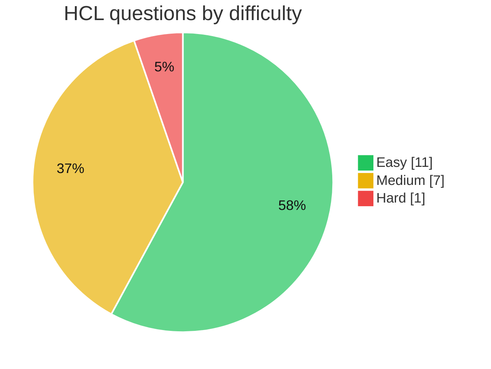

[← All companies](../README.md) · [Most asked across companies](../most-asked.md)

# HCL Coding Questions

   

**19 HCL coding questions** — 11 easy, 7 medium and 1 hard. Each one links to a free page where you can solve it in 13 languages, with hints and an editorial.

19 problems the CodeKairo catalogue tags as commonly asked in HCL's coding rounds — 11 easy, 7 medium and 1 hard — each judged by hidden tests in 13 languages. The most common topics among them are Arrays (9), Strings (7) and Dynamic Programming (6). Tagged for HCL and no other company: Valid Perfect Square. CodeKairo's HCLTech — Written Test mock covers the HCLTech written test, the most regular pattern in this catalogue: four sections of fifteen questions, fifteen minutes each. The tag is the catalogue's own annotation of where a problem tends to come up — not a list published by HCL, which CodeKairo is not affiliated with.

**Practise on CodeKairo:** [All 19 HCL questions](https://codekairo.com/challenges/company/hcl?utm_source=github) · [HCLTech — Written Test mock test](https://codekairo.com/tests/hcltech-aptitude-technical?utm_source=github) · [HCL hiring process, round by round](https://codekairo.com/simulations/hcltech?utm_source=github)

## Contents

- [Start with these 10](#start-with-these-10)
- [Topics HCL asks most](#topics-hcl-asks-most)
- 🟢 [Easy (11)](#easy-11)
- 🟡 [Medium (7)](#medium-7)
- 🔴 [Hard (1)](#hard-1)

## Start with these 10

The HCL questions most other companies ask too — the patterns worth knowing first.

1. 🟢 [Two Sum](https://codekairo.com/problems/two-sum?utm_source=github) — also asked at 18 other companies
2. 🟢 [Valid Parentheses](https://codekairo.com/problems/valid-parentheses?utm_source=github) — also asked at 14 other companies
3. 🟡 [Longest Substring Without Repeating Characters](https://codekairo.com/problems/longest-substring-without-repeating-characters?utm_source=github) — also asked at 13 other companies
4. 🟢 [Reverse String](https://codekairo.com/problems/reverse-string?utm_source=github) — also asked at 7 other companies
5. 🟡 [Reverse Words in a String](https://codekairo.com/problems/reverse-words-in-a-string?utm_source=github) — also asked at 7 other companies
6. 🔴 [Trapping Rain Water](https://codekairo.com/problems/trapping-rain-water?utm_source=github) — also asked at 7 other companies
7. 🟢 [Best Time to Buy and Sell Stock](https://codekairo.com/problems/best-time-to-buy-and-sell-stock?utm_source=github) — also asked at 6 other companies
8. 🟡 [Maximum Subarray](https://codekairo.com/problems/maximum-subarray?utm_source=github) — also asked at 6 other companies
9. 🟡 [Longest Palindromic Substring](https://codekairo.com/problems/longest-palindromic-substring?utm_source=github) — also asked at 6 other companies
10. 🟢 [Palindrome Number](https://codekairo.com/problems/palindrome-number?utm_source=github) — also asked at 5 other companies

## Topics HCL asks most

[Arrays](https://codekairo.com/challenges/arrays?utm_source=github) (9) · [Strings](https://codekairo.com/challenges/strings?utm_source=github) (7) · [Dynamic Programming](https://codekairo.com/challenges/dynamic-programming?utm_source=github) (6) · [Two Pointers](https://codekairo.com/challenges/two-pointers?utm_source=github) (5) · [Math](https://codekairo.com/challenges/math?utm_source=github) (4) · [Hash Table](https://codekairo.com/challenges/hash-table?utm_source=github) (2) · [Sliding Window](https://codekairo.com/challenges/sliding-window?utm_source=github) (2) · [Stack](https://codekairo.com/challenges/stack?utm_source=github) (2) · [Binary Search](https://codekairo.com/challenges/binary-search?utm_source=github) (1) · [Bit Manipulation](https://codekairo.com/challenges/bit-manipulation?utm_source=github) (1)

## Easy (11)

| # | Question | Topics | Acceptance |
|---:|---|---|---:|
| 1 | 🟢 [Two Sum](https://codekairo.com/problems/two-sum?utm_source=github) | Arrays, Hash Table | — |
| 2 | 🟢 [Reverse String](https://codekairo.com/problems/reverse-string?utm_source=github) | Two Pointers, Strings | — |
| 3 | 🟢 [Palindrome Number](https://codekairo.com/problems/palindrome-number?utm_source=github) | Math | — |
| 4 | 🟢 [Valid Parentheses](https://codekairo.com/problems/valid-parentheses?utm_source=github) | Strings, Stack | — |
| 11 | 🟢 [Best Time to Buy and Sell Stock](https://codekairo.com/problems/best-time-to-buy-and-sell-stock?utm_source=github) | Arrays, Dynamic Programming | — |
| 17 | 🟢 [Missing Number](https://codekairo.com/problems/missing-number?utm_source=github) | Arrays, Math, Bit Manipulation | — |
| 24 | 🟢 [Merge Sorted Array](https://codekairo.com/problems/merge-sorted-array?utm_source=github) | Arrays, Two Pointers, Sorting | — |
| 27 | 🟢 [Valid Palindrome](https://codekairo.com/problems/valid-palindrome?utm_source=github) | Strings, Two Pointers | — |
| 57 | 🟢 [Valid Perfect Square](https://codekairo.com/problems/valid-perfect-square?utm_source=github) | Math, Binary Search | — |
| 173 | 🟢 [Prime Factorisation](https://codekairo.com/problems/prime-factors?utm_source=github) | Math, Number Theory | — |
| 986 | 🟢 [Minimum Operations to Exceed Threshold Value I](https://codekairo.com/problems/minimum-operations-to-exceed-threshold-value-i?utm_source=github) | Arrays | — |

## Medium (7)

| # | Question | Topics | Acceptance |
|---:|---|---|---:|
| 8 | 🟡 [Maximum Subarray](https://codekairo.com/problems/maximum-subarray?utm_source=github) | Arrays, Dynamic Programming, Divide and Conquer | — |
| 29 | 🟡 [Longest Substring Without Repeating Characters](https://codekairo.com/problems/longest-substring-without-repeating-characters?utm_source=github) | Strings, Sliding Window, Hash Table | — |
| 30 | 🟡 [Longest Palindromic Substring](https://codekairo.com/problems/longest-palindromic-substring?utm_source=github) | Strings, Dynamic Programming | — |
| 31 | 🟡 [Palindromic Substrings](https://codekairo.com/problems/palindromic-substrings?utm_source=github) | Strings, Dynamic Programming | — |
| 47 | 🟡 [Minimum Size Subarray Sum](https://codekairo.com/problems/minimum-size-subarray-sum?utm_source=github) | Arrays, Sliding Window, Prefix Sum | — |
| 210 | 🟡 [Reverse Words in a String](https://codekairo.com/problems/reverse-words-in-a-string?utm_source=github) | Two Pointers, Strings | — |
| 1053 | 🟡 [Partition Array for Maximum Sum](https://codekairo.com/problems/partition-array-for-maximum-sum?utm_source=github) | Arrays, Dynamic Programming | — |

## Hard (1)

| # | Question | Topics | Acceptance |
|---:|---|---|---:|
| 26 | 🔴 [Trapping Rain Water](https://codekairo.com/problems/trapping-rain-water?utm_source=github) | Arrays, Two Pointers, Dynamic Programming | — |

---

[← All companies](../README.md) · Rebuilt every night from [codekairo.com](https://codekairo.com/challenges/company/hcl?utm_source=github). Last refreshed: November 2026. ⭐ [Star the repo](https://github.com/ayaanp14/company-wise-coding-questions) if it helps.
