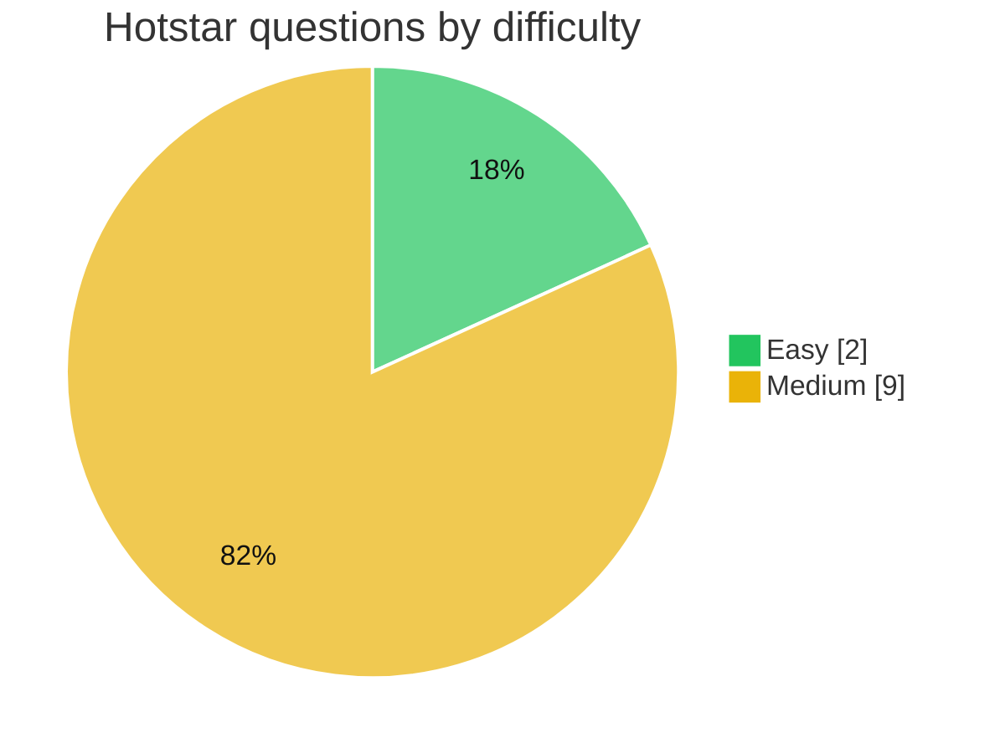

[← All companies](../README.md) · [Most asked across companies](../most-asked.md)

# Hotstar Coding Questions

   

**11 Hotstar coding questions** — 2 easy and 9 medium. Each one links to a free page where you can solve it in 13 languages, with hints and an editorial.

11 problems the CodeKairo catalogue tags as commonly asked in Hotstar's coding rounds — 2 easy and 9 medium, no hard ones — each judged by hidden tests in 13 languages. The most common topics among them are Arrays (7), Dynamic Programming (4) and Strings (3). The tag is the catalogue's own annotation of where a problem tends to come up — not a list published by Hotstar, which CodeKairo is not affiliated with.

**Practise on CodeKairo:** [All 11 Hotstar questions](https://codekairo.com/challenges/company/hotstar?utm_source=github)

## Contents

- [Start with these 10](#start-with-these-10)
- [Topics Hotstar asks most](#topics-hotstar-asks-most)
- 🟢 [Easy (2)](#easy-2)
- 🟡 [Medium (9)](#medium-9)

## Start with these 10

The Hotstar questions most other companies ask too — the patterns worth knowing first.

1. 🟢 [Valid Parentheses](https://codekairo.com/problems/valid-parentheses?utm_source=github) — also asked at 14 other companies
2. 🟡 [Longest Substring Without Repeating Characters](https://codekairo.com/problems/longest-substring-without-repeating-characters?utm_source=github) — also asked at 13 other companies
3. 🟡 [Valid Sudoku](https://codekairo.com/problems/valid-sudoku?utm_source=github) — also asked at 7 other companies
4. 🟡 [Largest Number](https://codekairo.com/problems/largest-number?utm_source=github) — also asked at 5 other companies
5. 🟡 [Asteroid Collision](https://codekairo.com/problems/asteroid-collision?utm_source=github) — also asked at 4 other companies
6. 🟡 [House Robber](https://codekairo.com/problems/house-robber?utm_source=github) — also asked at 4 other companies
7. 🟡 [Keys and Rooms](https://codekairo.com/problems/keys-and-rooms?utm_source=github) — also asked at 3 other companies
8. 🟡 [Find K Pairs with Smallest Sums](https://codekairo.com/problems/find-k-pairs-with-smallest-sums?utm_source=github) — also asked at 3 other companies
9. 🟡 [Maximum Sum of Two Non-Overlapping Subarrays](https://codekairo.com/problems/maximum-sum-of-two-non-overlapping-subarrays?utm_source=github) — also asked at 3 other companies
10. 🟡 [Video Stitching](https://codekairo.com/problems/video-stitching?utm_source=github) — also asked at 2 other companies

## Topics Hotstar asks most

[Arrays](https://codekairo.com/challenges/arrays?utm_source=github) (7) · [Dynamic Programming](https://codekairo.com/challenges/dynamic-programming?utm_source=github) (4) · [Strings](https://codekairo.com/challenges/strings?utm_source=github) (3) · [Greedy](https://codekairo.com/challenges/greedy?utm_source=github) (2) · [Hash Table](https://codekairo.com/challenges/hash-table?utm_source=github) (2) · [Sliding Window](https://codekairo.com/challenges/sliding-window?utm_source=github) (2) · [Stack](https://codekairo.com/challenges/stack?utm_source=github) (2) · [Breadth-First Search](https://codekairo.com/challenges/breadth-first-search?utm_source=github) (1) · [Depth-First Search](https://codekairo.com/challenges/depth-first-search?utm_source=github) (1) · [Graph](https://codekairo.com/challenges/graph?utm_source=github) (1)

## Easy (2)

| # | Question | Topics | Acceptance |
|---:|---|---|---:|
| 4 | 🟢 [Valid Parentheses](https://codekairo.com/problems/valid-parentheses?utm_source=github) | Strings, Stack | — |
| 7 | 🟢 [Climbing Stairs](https://codekairo.com/problems/climbing-stairs?utm_source=github) | Math, Dynamic Programming, Memoization | — |

## Medium (9)

| # | Question | Topics | Acceptance |
|---:|---|---|---:|
| 29 | 🟡 [Longest Substring Without Repeating Characters](https://codekairo.com/problems/longest-substring-without-repeating-characters?utm_source=github) | Strings, Sliding Window, Hash Table | — |
| 75 | 🟡 [Asteroid Collision](https://codekairo.com/problems/asteroid-collision?utm_source=github) | Arrays, Stack, Simulation | — |
| 88 | 🟡 [House Robber](https://codekairo.com/problems/house-robber?utm_source=github) | Arrays, Dynamic Programming | — |
| 303 | 🟡 [Valid Sudoku](https://codekairo.com/problems/valid-sudoku?utm_source=github) | Arrays, Hash Table, Matrix | — |
| 351 | 🟡 [Largest Number](https://codekairo.com/problems/largest-number?utm_source=github) | Arrays, Strings, Greedy | — |
| 445 | 🟡 [Keys and Rooms](https://codekairo.com/problems/keys-and-rooms?utm_source=github) | Depth-First Search, Breadth-First Search, Graph | — |
| 846 | 🟡 [Video Stitching](https://codekairo.com/problems/video-stitching?utm_source=github) | Arrays, Greedy, Dynamic Programming | — |
| 972 | 🟡 [Find K Pairs with Smallest Sums](https://codekairo.com/problems/find-k-pairs-with-smallest-sums?utm_source=github) | Arrays, Heap | — |
| 1132 | 🟡 [Maximum Sum of Two Non-Overlapping Subarrays](https://codekairo.com/problems/maximum-sum-of-two-non-overlapping-subarrays?utm_source=github) | Arrays, Dynamic Programming, Sliding Window | — |

---

[← All companies](../README.md) · Rebuilt every night from [codekairo.com](https://codekairo.com/challenges/company/hotstar?utm_source=github). Last refreshed: November 2026. ⭐ [Star the repo](https://github.com/ayaanp14/company-wise-coding-questions) if it helps.
