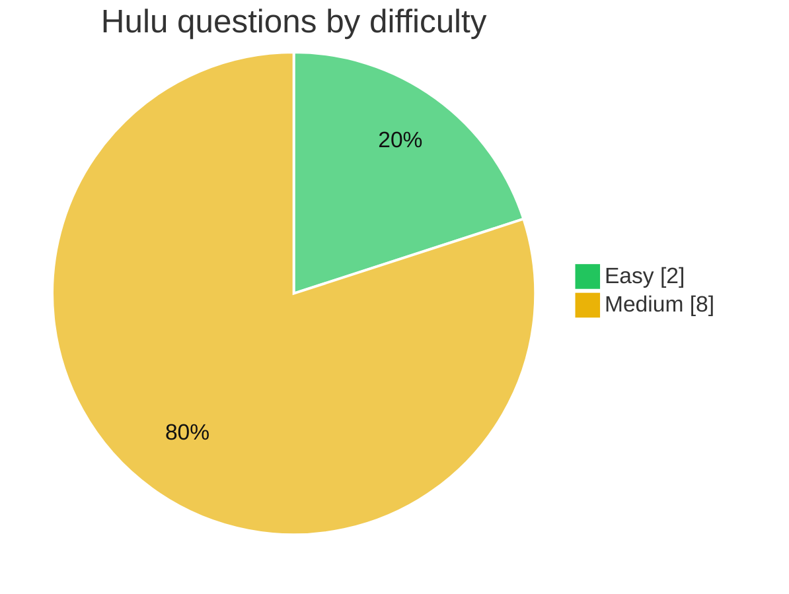

[← All companies](../README.md) · [Most asked across companies](../most-asked.md)

# Hulu Coding Questions

   

**10 Hulu coding questions** — 2 easy and 8 medium. Each one links to a free page where you can solve it in 13 languages, with hints and an editorial.

10 problems the CodeKairo catalogue tags as commonly asked in Hulu's coding rounds — 2 easy and 8 medium, no hard ones — each judged by hidden tests in 13 languages. The most common topics among them are Arrays (6), Matrix (3) and Strings (2). The tag is the catalogue's own annotation of where a problem tends to come up — not a list published by Hulu, which CodeKairo is not affiliated with.

**Practise on CodeKairo:** [All 10 Hulu questions](https://codekairo.com/challenges/company/hulu?utm_source=github)

## Contents

- [Start with these 10](#start-with-these-10)
- [Topics Hulu asks most](#topics-hulu-asks-most)
- 🟢 [Easy (2)](#easy-2)
- 🟡 [Medium (8)](#medium-8)

## Start with these 10

The Hulu questions most other companies ask too — the patterns worth knowing first.

1. 🟡 [Number of Islands](https://codekairo.com/problems/number-of-islands?utm_source=github) — also asked at 9 other companies
2. 🟡 [Spiral Matrix](https://codekairo.com/problems/spiral-matrix?utm_source=github) — also asked at 7 other companies
3. 🟡 [Decode String](https://codekairo.com/problems/decode-string?utm_source=github) — also asked at 5 other companies
4. 🟡 [Top K Frequent Elements](https://codekairo.com/problems/top-k-frequent-elements?utm_source=github) — also asked at 5 other companies
5. 🟡 [Sum of Subarray Minimums](https://codekairo.com/problems/sum-of-subarray-minimums?utm_source=github) — also asked at 4 other companies
6. 🟡 [Sum of Two Integers](https://codekairo.com/problems/sum-of-two-integers?utm_source=github) — also asked at 4 other companies
7. 🟡 [Snakes and Ladders](https://codekairo.com/problems/snakes-and-ladders?utm_source=github) — also asked at 4 other companies
8. 🟢 [Remove Duplicates from Sorted Array](https://codekairo.com/problems/remove-duplicates-from-sorted-array?utm_source=github) — also asked at 3 other companies
9. 🟡 [Word Break](https://codekairo.com/problems/word-break?utm_source=github) — also asked at 3 other companies
10. 🟢 [Power of Three](https://codekairo.com/problems/power-of-three?utm_source=github) — also asked at 2 other companies

## Topics Hulu asks most

[Arrays](https://codekairo.com/challenges/arrays?utm_source=github) (6) · [Matrix](https://codekairo.com/challenges/matrix?utm_source=github) (3) · [Breadth-First Search](https://codekairo.com/challenges/breadth-first-search?utm_source=github) (2) · [Dynamic Programming](https://codekairo.com/challenges/dynamic-programming?utm_source=github) (2) · [Hash Table](https://codekairo.com/challenges/hash-table?utm_source=github) (2) · [Math](https://codekairo.com/challenges/math?utm_source=github) (2) · [Recursion](https://codekairo.com/challenges/recursion?utm_source=github) (2) · [Stack](https://codekairo.com/challenges/stack?utm_source=github) (2) · [Strings](https://codekairo.com/challenges/strings?utm_source=github) (2) · [Bit Manipulation](https://codekairo.com/challenges/bit-manipulation?utm_source=github) (1)

## Easy (2)

| # | Question | Topics | Acceptance |
|---:|---|---|---:|
| 14 | 🟢 [Remove Duplicates from Sorted Array](https://codekairo.com/problems/remove-duplicates-from-sorted-array?utm_source=github) | Arrays, Two Pointers | — |
| 155 | 🟢 [Power of Three](https://codekairo.com/problems/power-of-three?utm_source=github) | Math, Recursion | — |

## Medium (8)

| # | Question | Topics | Acceptance |
|---:|---|---|---:|
| 74 | 🟡 [Decode String](https://codekairo.com/problems/decode-string?utm_source=github) | Strings, Stack, Recursion | — |
| 93 | 🟡 [Word Break](https://codekairo.com/problems/word-break?utm_source=github) | Strings, Dynamic Programming, Hash Table | — |
| 102 | 🟡 [Top K Frequent Elements](https://codekairo.com/problems/top-k-frequent-elements?utm_source=github) | Arrays, Heap, Hash Table | — |
| 110 | 🟡 [Spiral Matrix](https://codekairo.com/problems/spiral-matrix?utm_source=github) | Arrays, Matrix, Simulation | — |
| 118 | 🟡 [Number of Islands](https://codekairo.com/problems/number-of-islands?utm_source=github) | Arrays, Matrix, Depth-First Search | — |
| 383 | 🟡 [Sum of Subarray Minimums](https://codekairo.com/problems/sum-of-subarray-minimums?utm_source=github) | Arrays, Dynamic Programming, Stack | — |
| 415 | 🟡 [Sum of Two Integers](https://codekairo.com/problems/sum-of-two-integers?utm_source=github) | Math, Bit Manipulation | — |
| 471 | 🟡 [Snakes and Ladders](https://codekairo.com/problems/snakes-and-ladders?utm_source=github) | Arrays, Breadth-First Search, Matrix | — |

---

[← All companies](../README.md) · Rebuilt every night from [codekairo.com](https://codekairo.com/challenges/company/hulu?utm_source=github). Last refreshed: November 2026. ⭐ [Star the repo](https://github.com/ayaanp14/company-wise-coding-questions) if it helps.
