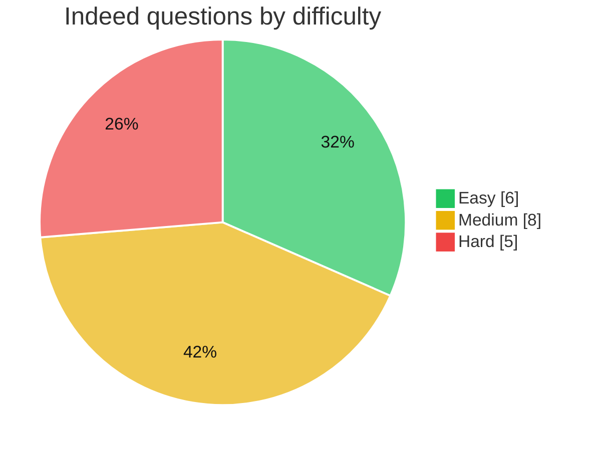

[← All companies](../README.md) · [Most asked across companies](../most-asked.md)

# Indeed Coding Questions

   

**19 Indeed coding questions** — 6 easy, 8 medium and 5 hard. Each one links to a free page where you can solve it in 13 languages, with hints and an editorial.

19 problems the CodeKairo catalogue tags as commonly asked in Indeed's coding rounds — 6 easy, 8 medium and 5 hard — each judged by hidden tests in 13 languages. The most common topics among them are Arrays (15), Hash Table (7) and Strings (5). Tagged for Indeed and no other company: Summary Ranges and Longest Common Subsequence. The tag is the catalogue's own annotation of where a problem tends to come up — not a list published by Indeed, which CodeKairo is not affiliated with.

**Practise on CodeKairo:** [All 19 Indeed questions](https://codekairo.com/challenges/company/indeed?utm_source=github)

## Contents

- [Start with these 10](#start-with-these-10)
- [Topics Indeed asks most](#topics-indeed-asks-most)
- 🟢 [Easy (6)](#easy-6)
- 🟡 [Medium (8)](#medium-8)
- 🔴 [Hard (5)](#hard-5)

## Start with these 10

The Indeed questions most other companies ask too — the patterns worth knowing first.

1. 🟢 [Two Sum](https://codekairo.com/problems/two-sum?utm_source=github) — also asked at 18 other companies
2. 🔴 [Text Justification](https://codekairo.com/problems/text-justification?utm_source=github) — also asked at 9 other companies
3. 🟢 [Find Pivot Index](https://codekairo.com/problems/find-pivot-index?utm_source=github) — also asked at 7 other companies
4. 🟡 [Basic Calculator II](https://codekairo.com/problems/basic-calculator-ii?utm_source=github) — also asked at 6 other companies
5. 🔴 [Maximal Rectangle](https://codekairo.com/problems/maximal-rectangle?utm_source=github) — also asked at 5 other companies
6. 🟡 [Maximum Length of Repeated Subarray](https://codekairo.com/problems/maximum-length-of-repeated-subarray?utm_source=github) — also asked at 4 other companies
7. 🟡 [Find Players With Zero or One Losses](https://codekairo.com/problems/find-players-with-zero-or-one-losses?utm_source=github) — also asked at 4 other companies
8. 🟡 [Subdomain Visit Count](https://codekairo.com/problems/subdomain-visit-count?utm_source=github) — also asked at 4 other companies
9. 🔴 [Basic Calculator](https://codekairo.com/problems/basic-calculator?utm_source=github) — also asked at 4 other companies
10. 🟢 [Intersection of Two Arrays](https://codekairo.com/problems/intersection-of-two-arrays?utm_source=github) — also asked at 3 other companies

## Topics Indeed asks most

[Arrays](https://codekairo.com/challenges/arrays?utm_source=github) (15) · [Hash Table](https://codekairo.com/challenges/hash-table?utm_source=github) (7) · [Strings](https://codekairo.com/challenges/strings?utm_source=github) (5) · [Dynamic Programming](https://codekairo.com/challenges/dynamic-programming?utm_source=github) (4) · [Math](https://codekairo.com/challenges/math?utm_source=github) (4) · [Counting](https://codekairo.com/challenges/counting?utm_source=github) (3) · [Sorting](https://codekairo.com/challenges/sorting?utm_source=github) (3) · [Stack](https://codekairo.com/challenges/stack?utm_source=github) (3) · [Matrix](https://codekairo.com/challenges/matrix?utm_source=github) (2) · [Prefix Sum](https://codekairo.com/challenges/prefix-sum?utm_source=github) (2)

## Easy (6)

| # | Question | Topics | Acceptance |
|---:|---|---|---:|
| 1 | 🟢 [Two Sum](https://codekairo.com/problems/two-sum?utm_source=github) | Arrays, Hash Table | — |
| 24 | 🟢 [Merge Sorted Array](https://codekairo.com/problems/merge-sorted-array?utm_source=github) | Arrays, Two Pointers, Sorting | — |
| 130 | 🟢 [Summary Ranges](https://codekairo.com/problems/summary-ranges?utm_source=github) | Arrays | — |
| 181 | 🟢 [Intersection of Two Arrays](https://codekairo.com/problems/intersection-of-two-arrays?utm_source=github) | Arrays, Hash Table, Two Pointers | — |
| 186 | 🟢 [Find Pivot Index](https://codekairo.com/problems/find-pivot-index?utm_source=github) | Arrays, Prefix Sum | — |
| 1119 | 🟢 [Check if Every Row and Column Contains All Numbers](https://codekairo.com/problems/check-if-every-row-and-column-contains-all-numbers?utm_source=github) | Arrays, Hash Table, Matrix | — |

## Medium (8)

| # | Question | Topics | Acceptance |
|---:|---|---|---:|
| 21 | 🟡 [Subarray Sum Equals K](https://codekairo.com/problems/subarray-sum-equals-k?utm_source=github) | Arrays, Hash Table, Prefix Sum | — |
| 97 | 🟡 [Longest Common Subsequence](https://codekairo.com/problems/longest-common-subsequence?utm_source=github) | Strings, Dynamic Programming | — |
| 312 | 🟡 [Maximum Length of Repeated Subarray](https://codekairo.com/problems/maximum-length-of-repeated-subarray?utm_source=github) | Arrays, Binary Search, Dynamic Programming | — |
| 389 | 🟡 [Basic Calculator II](https://codekairo.com/problems/basic-calculator-ii?utm_source=github) | Math, Strings, Stack | — |
| 478 | 🟡 [Minimum Moves to Equal Array Elements](https://codekairo.com/problems/minimum-moves-to-equal-array-elements?utm_source=github) | Arrays, Math | — |
| 684 | 🟡 [Find Players With Zero or One Losses](https://codekairo.com/problems/find-players-with-zero-or-one-losses?utm_source=github) | Hash Table, Arrays, Sorting | — |
| 1208 | 🟡 [Subdomain Visit Count](https://codekairo.com/problems/subdomain-visit-count?utm_source=github) | Arrays, Hash Table, Strings | — |
| 1838 | 🟡 [Sum of Even Numbers After Queries](https://codekairo.com/problems/sum-of-even-numbers-after-queries?utm_source=github) | Arrays, Simulation | — |

## Hard (5)

| # | Question | Topics | Acceptance |
|---:|---|---|---:|
| 919 | 🔴 [Maximal Rectangle](https://codekairo.com/problems/maximal-rectangle?utm_source=github) | Arrays, Matrix, Stack | — |
| 1051 | 🔴 [Minimum Cost to Split an Array](https://codekairo.com/problems/minimum-cost-to-split-an-array?utm_source=github) | Arrays, Hash Table, Dynamic Programming | — |
| 1249 | 🔴 [Text Justification](https://codekairo.com/problems/text-justification?utm_source=github) | Arrays, Strings, Simulation | — |
| 1280 | 🔴 [Consecutive Numbers Sum](https://codekairo.com/problems/consecutive-numbers-sum?utm_source=github) | Math, Enumeration | — |
| 1421 | 🔴 [Basic Calculator](https://codekairo.com/problems/basic-calculator?utm_source=github) | Math, Strings, Stack | — |

---

[← All companies](../README.md) · Rebuilt every night from [codekairo.com](https://codekairo.com/challenges/company/indeed?utm_source=github). Last refreshed: November 2026. ⭐ [Star the repo](https://github.com/ayaanp14/company-wise-coding-questions) if it helps.
