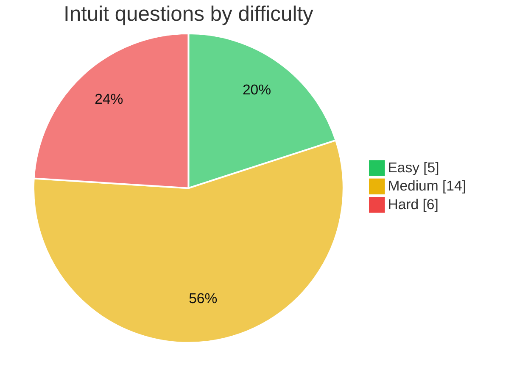

[← All companies](../README.md) · [Most asked across companies](../most-asked.md)

# Intuit Coding Questions

   

**25 Intuit coding questions** — 5 easy, 14 medium and 6 hard. Each one links to a free page where you can solve it in 13 languages, with hints and an editorial.

25 problems the CodeKairo catalogue tags as commonly asked in Intuit's coding rounds — 5 easy, 14 medium and 6 hard — each judged by hidden tests in 13 languages. The most common topics among them are Arrays (19), Hash Table (8) and Dynamic Programming (7). Tagged for Intuit and no other company: Find Consecutive Integers from a Data Stream, Max Area of Island and Longest Increasing Subsequence. The tag is the catalogue's own annotation of where a problem tends to come up — not a list published by Intuit, which CodeKairo is not affiliated with.

**Practise on CodeKairo:** [All 25 Intuit questions](https://codekairo.com/challenges/company/intuit?utm_source=github)

## Contents

- [Start with these 10](#start-with-these-10)
- [Topics Intuit asks most](#topics-intuit-asks-most)
- 🟢 [Easy (5)](#easy-5)
- 🟡 [Medium (14)](#medium-14)
- 🔴 [Hard (6)](#hard-6)

## Start with these 10

The Intuit questions most other companies ask too — the patterns worth knowing first.

1. 🟢 [Two Sum](https://codekairo.com/problems/two-sum?utm_source=github) — also asked at 18 other companies
2. 🟢 [Valid Parentheses](https://codekairo.com/problems/valid-parentheses?utm_source=github) — also asked at 14 other companies
3. 🟡 [Merge Intervals](https://codekairo.com/problems/merge-intervals?utm_source=github) — also asked at 12 other companies
4. 🔴 [Text Justification](https://codekairo.com/problems/text-justification?utm_source=github) — also asked at 9 other companies
5. 🟢 [Plus One](https://codekairo.com/problems/plus-one?utm_source=github) — also asked at 6 other companies
6. 🟡 [Rotting Oranges](https://codekairo.com/problems/rotting-oranges?utm_source=github) — also asked at 4 other companies
7. 🟡 [Subdomain Visit Count](https://codekairo.com/problems/subdomain-visit-count?utm_source=github) — also asked at 4 other companies
8. 🔴 [Russian Doll Envelopes](https://codekairo.com/problems/russian-doll-envelopes?utm_source=github) — also asked at 4 other companies
9. 🟢 [Unique Email Addresses](https://codekairo.com/problems/unique-email-addresses?utm_source=github) — also asked at 3 other companies
10. 🟢 [Maximum Product of Three Numbers](https://codekairo.com/problems/maximum-product-of-three-numbers?utm_source=github) — also asked at 3 other companies

## Topics Intuit asks most

[Arrays](https://codekairo.com/challenges/arrays?utm_source=github) (19) · [Hash Table](https://codekairo.com/challenges/hash-table?utm_source=github) (8) · [Dynamic Programming](https://codekairo.com/challenges/dynamic-programming?utm_source=github) (7) · [Strings](https://codekairo.com/challenges/strings?utm_source=github) (6) · [Binary Search](https://codekairo.com/challenges/binary-search?utm_source=github) (5) · [Sorting](https://codekairo.com/challenges/sorting?utm_source=github) (4) · [Counting](https://codekairo.com/challenges/counting?utm_source=github) (3) · [Matrix](https://codekairo.com/challenges/matrix?utm_source=github) (3) · [Breadth-First Search](https://codekairo.com/challenges/breadth-first-search?utm_source=github) (2) · [Depth-First Search](https://codekairo.com/challenges/depth-first-search?utm_source=github) (2)

## Easy (5)

| # | Question | Topics | Acceptance |
|---:|---|---|---:|
| 1 | 🟢 [Two Sum](https://codekairo.com/problems/two-sum?utm_source=github) | Arrays, Hash Table | — |
| 4 | 🟢 [Valid Parentheses](https://codekairo.com/problems/valid-parentheses?utm_source=github) | Strings, Stack | — |
| 162 | 🟢 [Plus One](https://codekairo.com/problems/plus-one?utm_source=github) | Arrays, Math | — |
| 235 | 🟢 [Unique Email Addresses](https://codekairo.com/problems/unique-email-addresses?utm_source=github) | Arrays, Hash Table, Strings | — |
| 370 | 🟢 [Maximum Product of Three Numbers](https://codekairo.com/problems/maximum-product-of-three-numbers?utm_source=github) | Arrays, Math, Sorting | — |

## Medium (14)

| # | Question | Topics | Acceptance |
|---:|---|---|---:|
| 67 | 🟡 [Daily Temperatures](https://codekairo.com/problems/daily-temperatures?utm_source=github) | Arrays, Stack, Monotonic Stack | — |
| 90 | 🟡 [Coin Change](https://codekairo.com/problems/coin-change?utm_source=github) | Arrays, Dynamic Programming, Breadth-First Search | — |
| 92 | 🟡 [Longest Increasing Subsequence](https://codekairo.com/problems/longest-increasing-subsequence?utm_source=github) | Arrays, Dynamic Programming, Binary Search | — |
| 93 | 🟡 [Word Break](https://codekairo.com/problems/word-break?utm_source=github) | Strings, Dynamic Programming, Hash Table | — |
| 119 | 🟡 [Max Area of Island](https://codekairo.com/problems/max-area-of-island?utm_source=github) | Arrays, Matrix, Depth-First Search | — |
| 120 | 🟡 [Rotting Oranges](https://codekairo.com/problems/rotting-oranges?utm_source=github) | Arrays, Matrix, Breadth-First Search | — |
| 122 | 🟡 [Merge Intervals](https://codekairo.com/problems/merge-intervals?utm_source=github) | Arrays, Sorting, Intervals | — |
| 138 | 🟡 [Course Schedule II](https://codekairo.com/problems/course-schedule-ii?utm_source=github) | Graph, Topological Sort, Heap | — |
| 795 | 🟡 [Swap For Longest Repeated Character Substring](https://codekairo.com/problems/swap-for-longest-repeated-character-substring?utm_source=github) | Strings, Sliding Window, Hash Table | — |
| 859 | 🟡 [Destroy Sequential Targets](https://codekairo.com/problems/destroy-sequential-targets?utm_source=github) | Arrays, Hash Table, Counting | — |
| 879 | 🟡 [The Number of Beautiful Subsets](https://codekairo.com/problems/the-number-of-beautiful-subsets?utm_source=github) | Arrays, Hash Table, Dynamic Programming | — |
| 1208 | 🟡 [Subdomain Visit Count](https://codekairo.com/problems/subdomain-visit-count?utm_source=github) | Arrays, Hash Table, Strings | — |
| 1539 | 🟡 [Most Profitable Path in a Tree](https://codekairo.com/problems/most-profitable-path-in-a-tree?utm_source=github) | Arrays, Trees, Depth-First Search | — |
| 2086 | 🟡 [Find Consecutive Integers from a Data Stream](https://codekairo.com/problems/find-consecutive-integers-from-a-data-stream?utm_source=github) | Hash Table, Queue, Counting | — |

## Hard (6)

| # | Question | Topics | Acceptance |
|---:|---|---|---:|
| 835 | 🔴 [Maximum Running Time of N Computers](https://codekairo.com/problems/maximum-running-time-of-n-computers?utm_source=github) | Arrays, Binary Search, Greedy | — |
| 836 | 🔴 [Russian Doll Envelopes](https://codekairo.com/problems/russian-doll-envelopes?utm_source=github) | Arrays, Binary Search, Dynamic Programming | — |
| 881 | 🔴 [Dungeon Game](https://codekairo.com/problems/dungeon-game?utm_source=github) | Arrays, Matrix, Dynamic Programming | — |
| 887 | 🔴 [Number of Ways to Paint N × 3 Grid](https://codekairo.com/problems/number-of-ways-to-paint-n-3-grid?utm_source=github) | Dynamic Programming | — |
| 1087 | 🔴 [Reverse Pairs](https://codekairo.com/problems/reverse-pairs?utm_source=github) | Arrays, Binary Search, Divide and Conquer | — |
| 1249 | 🔴 [Text Justification](https://codekairo.com/problems/text-justification?utm_source=github) | Arrays, Strings, Simulation | — |

---

[← All companies](../README.md) · Rebuilt every night from [codekairo.com](https://codekairo.com/challenges/company/intuit?utm_source=github). Last refreshed: November 2026. ⭐ [Star the repo](https://github.com/ayaanp14/company-wise-coding-questions) if it helps.
