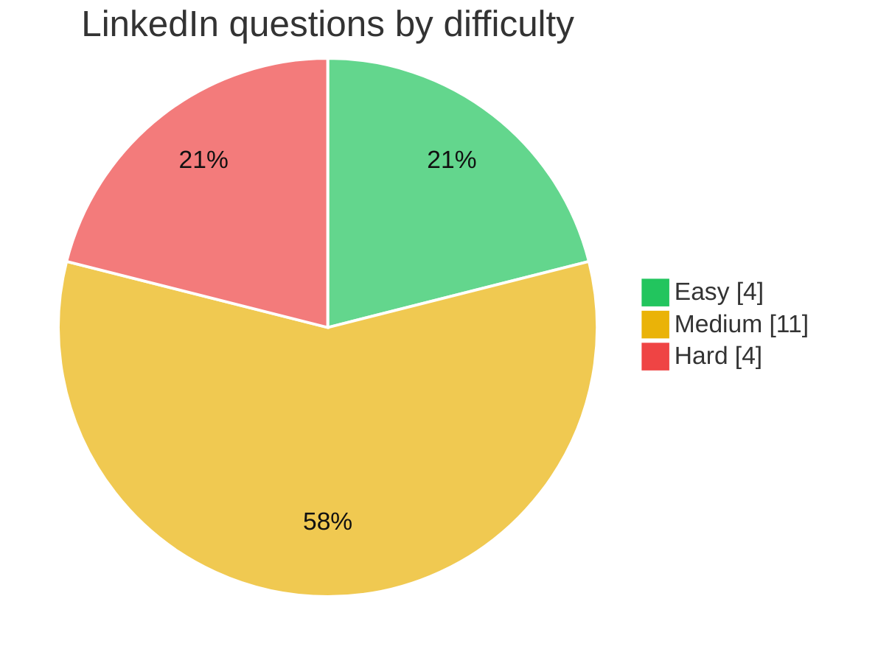

[← All companies](../README.md) · [Most asked across companies](../most-asked.md)

# LinkedIn Coding Questions

   

**19 LinkedIn coding questions** — 4 easy, 11 medium and 4 hard. Each one links to a free page where you can solve it in 13 languages, with hints and an editorial.

19 problems the CodeKairo catalogue tags as commonly asked in LinkedIn's coding rounds — 4 easy, 11 medium and 4 hard — each judged by hidden tests in 13 languages. The most common topics among them are Arrays (7), Depth-First Search (6) and Trees (5). The tag is the catalogue's own annotation of where a problem tends to come up — not a list published by LinkedIn, which CodeKairo is not affiliated with.

**Practise on CodeKairo:** [All 19 LinkedIn questions](https://codekairo.com/challenges/company/linkedin?utm_source=github)

## Contents

- [Start with these 10](#start-with-these-10)
- [Topics LinkedIn asks most](#topics-linkedin-asks-most)
- 🟢 [Easy (4)](#easy-4)
- 🟡 [Medium (11)](#medium-11)
- 🔴 [Hard (4)](#hard-4)

## Start with these 10

The LinkedIn questions most other companies ask too — the patterns worth knowing first.

1. 🔴 [Word Ladder](https://codekairo.com/problems/word-ladder?utm_source=github) — also asked at 9 other companies
2. 🔴 [Text Justification](https://codekairo.com/problems/text-justification?utm_source=github) — also asked at 9 other companies
3. 🟢 [Can Place Flowers](https://codekairo.com/problems/can-place-flowers?utm_source=github) — also asked at 5 other companies
4. 🟢 [Symmetric Tree](https://codekairo.com/problems/symmetric-tree?utm_source=github) — also asked at 3 other companies
5. 🟢 [Maximum Depth of Binary Tree](https://codekairo.com/problems/maximum-depth-of-binary-tree?utm_source=github) — also asked at 3 other companies
6. 🟡 [Graph Valid Tree](https://codekairo.com/problems/graph-valid-tree?utm_source=github) — also asked at 3 other companies
7. 🟡 [Find K Pairs with Smallest Sums](https://codekairo.com/problems/find-k-pairs-with-smallest-sums?utm_source=github) — also asked at 3 other companies
8. 🟡 [Exclusive Time of Functions](https://codekairo.com/problems/exclusive-time-of-functions?utm_source=github) — also asked at 3 other companies
9. 🟡 [Partition to K Equal Sum Subsets](https://codekairo.com/problems/partition-to-k-equal-sum-subsets?utm_source=github) — also asked at 3 other companies
10. 🟡 [Lowest Common Ancestor of a Binary Search Tree](https://codekairo.com/problems/lowest-common-ancestor-of-a-binary-search-tree?utm_source=github) — also asked at 3 other companies

## Topics LinkedIn asks most

[Arrays](https://codekairo.com/challenges/arrays?utm_source=github) (7) · [Depth-First Search](https://codekairo.com/challenges/depth-first-search?utm_source=github) (6) · [Breadth-First Search](https://codekairo.com/challenges/breadth-first-search?utm_source=github) (5) · [Trees](https://codekairo.com/challenges/trees?utm_source=github) (5) · [Strings](https://codekairo.com/challenges/strings?utm_source=github) (4) · [Dynamic Programming](https://codekairo.com/challenges/dynamic-programming?utm_source=github) (3) · [Hash Table](https://codekairo.com/challenges/hash-table?utm_source=github) (3) · [Backtracking](https://codekairo.com/challenges/backtracking?utm_source=github) (2) · [Bitmask](https://codekairo.com/challenges/bitmask?utm_source=github) (2) · [Greedy](https://codekairo.com/challenges/greedy?utm_source=github) (2)

## Easy (4)

| # | Question | Topics | Acceptance |
|---:|---|---|---:|
| 199 | 🟢 [Can Place Flowers](https://codekairo.com/problems/can-place-flowers?utm_source=github) | Arrays, Greedy | — |
| 1863 | 🟢 [Symmetric Tree](https://codekairo.com/problems/symmetric-tree?utm_source=github) | Trees, Depth-First Search, Breadth-First Search | — |
| 1864 | 🟢 [Maximum Depth of Binary Tree](https://codekairo.com/problems/maximum-depth-of-binary-tree?utm_source=github) | Trees, Depth-First Search, Breadth-First Search | — |
| 1878 | 🟢 [Second Minimum Node In a Binary Tree](https://codekairo.com/problems/second-minimum-node-in-a-binary-tree?utm_source=github) | Trees, Depth-First Search | — |

## Medium (11)

| # | Question | Topics | Acceptance |
|---:|---|---|---:|
| 443 | 🟡 [Graph Valid Tree](https://codekairo.com/problems/graph-valid-tree?utm_source=github) | Depth-First Search, Breadth-First Search, Union Find | — |
| 575 | 🟡 [Paint House](https://codekairo.com/problems/paint-house?utm_source=github) | Arrays, Dynamic Programming | — |
| 972 | 🟡 [Find K Pairs with Smallest Sums](https://codekairo.com/problems/find-k-pairs-with-smallest-sums?utm_source=github) | Arrays, Heap | — |
| 1201 | 🟡 [Repeated DNA Sequences](https://codekairo.com/problems/repeated-dna-sequences?utm_source=github) | Hash Table, Strings, Sliding Window | — |
| 1400 | 🟡 [Exclusive Time of Functions](https://codekairo.com/problems/exclusive-time-of-functions?utm_source=github) | Arrays, Stack | — |
| 1475 | 🟡 [Partition to K Equal Sum Subsets](https://codekairo.com/problems/partition-to-k-equal-sum-subsets?utm_source=github) | Dynamic Programming, Backtracking, Bitmask | — |
| 1576 | 🟡 [Combination Sum II](https://codekairo.com/problems/combination-sum-ii?utm_source=github) | Arrays, Backtracking | — |
| 1615 | 🟡 [Can I Win](https://codekairo.com/problems/can-i-win?utm_source=github) | Math, Dynamic Programming, Bit Manipulation | — |
| 1915 | 🟡 [Lowest Common Ancestor of a Binary Search Tree](https://codekairo.com/problems/lowest-common-ancestor-of-a-binary-search-tree?utm_source=github) | Trees, Binary Search, Depth-First Search | — |
| 1922 | 🟡 [Find Largest Value in Each Tree Row](https://codekairo.com/problems/find-largest-value-in-each-tree-row?utm_source=github) | Trees, Depth-First Search, Breadth-First Search | — |
| 2004 | 🟡 [Rotate List](https://codekairo.com/problems/rotate-list?utm_source=github) | Linked List, Two Pointers | — |

## Hard (4)

| # | Question | Topics | Acceptance |
|---:|---|---|---:|
| 470 | 🔴 [Word Ladder](https://codekairo.com/problems/word-ladder?utm_source=github) | Hash Table, Strings, Breadth-First Search | — |
| 977 | 🔴 [Smallest Range Covering Elements from K Lists](https://codekairo.com/problems/smallest-range-covering-elements-from-k-lists?utm_source=github) | Arrays, Hash Table, Greedy | — |
| 1249 | 🔴 [Text Justification](https://codekairo.com/problems/text-justification?utm_source=github) | Arrays, Strings, Simulation | — |
| 1250 | 🔴 [Valid Number](https://codekairo.com/problems/valid-number?utm_source=github) | Strings, Simulation | — |

---

[← All companies](../README.md) · Rebuilt every night from [codekairo.com](https://codekairo.com/challenges/company/linkedin?utm_source=github). Last refreshed: November 2026. ⭐ [Star the repo](https://github.com/ayaanp14/company-wise-coding-questions) if it helps.
