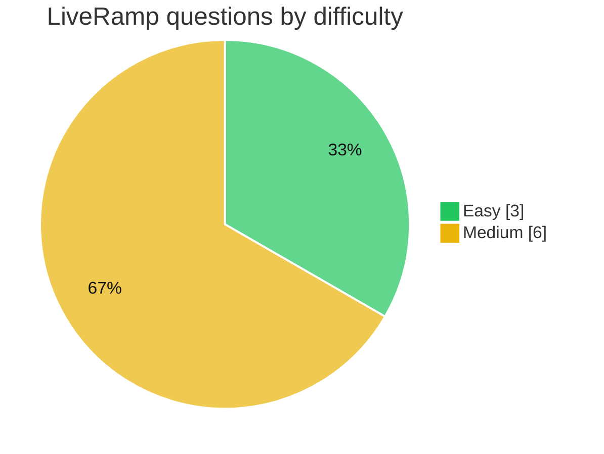

[← All companies](../README.md) · [Most asked across companies](../most-asked.md)

# LiveRamp Coding Questions

   

**9 LiveRamp coding questions** — 3 easy and 6 medium. Each one links to a free page where you can solve it in 13 languages, with hints and an editorial.

9 problems the CodeKairo catalogue tags as commonly asked in LiveRamp's coding rounds — 3 easy and 6 medium, no hard ones — each judged by hidden tests in 13 languages. The most common topics among them are Arrays (6), Depth-First Search (4) and Matrix (3). The tag is the catalogue's own annotation of where a problem tends to come up — not a list published by LiveRamp, which CodeKairo is not affiliated with.

**Practise on CodeKairo:** [All 9 LiveRamp questions](https://codekairo.com/challenges/company/liveramp?utm_source=github)

## Contents

- [Start with these 9](#start-with-these-9)
- [Topics LiveRamp asks most](#topics-liveramp-asks-most)
- 🟢 [Easy (3)](#easy-3)
- 🟡 [Medium (6)](#medium-6)

## Start with these 9

The LiveRamp questions most other companies ask too — the patterns worth knowing first.

1. 🟢 [Valid Parentheses](https://codekairo.com/problems/valid-parentheses?utm_source=github) — also asked at 14 other companies
2. 🟡 [Number of Islands](https://codekairo.com/problems/number-of-islands?utm_source=github) — also asked at 9 other companies
3. 🟡 [Spiral Matrix](https://codekairo.com/problems/spiral-matrix?utm_source=github) — also asked at 7 other companies
4. 🟡 [Shortest Unsorted Continuous Subarray](https://codekairo.com/problems/shortest-unsorted-continuous-subarray?utm_source=github) — also asked at 3 other companies
5. 🟡 [Is Graph Bipartite?](https://codekairo.com/problems/is-graph-bipartite?utm_source=github) — also asked at 3 other companies
6. 🟡 [Minesweeper](https://codekairo.com/problems/minesweeper?utm_source=github) — also asked at 3 other companies
7. 🟢 [Distribute Candies](https://codekairo.com/problems/distribute-candies?utm_source=github) — also asked at 2 other companies
8. 🟡 [Course Schedule](https://codekairo.com/problems/course-schedule?utm_source=github) — also asked at 2 other companies
9. 🟢 [Longest Harmonious Subsequence](https://codekairo.com/problems/longest-harmonious-subsequence?utm_source=github) — also asked at 1 other company

## Topics LiveRamp asks most

[Arrays](https://codekairo.com/challenges/arrays?utm_source=github) (6) · [Depth-First Search](https://codekairo.com/challenges/depth-first-search?utm_source=github) (4) · [Breadth-First Search](https://codekairo.com/challenges/breadth-first-search?utm_source=github) (3) · [Matrix](https://codekairo.com/challenges/matrix?utm_source=github) (3) · [Graph](https://codekairo.com/challenges/graph?utm_source=github) (2) · [Hash Table](https://codekairo.com/challenges/hash-table?utm_source=github) (2) · [Sorting](https://codekairo.com/challenges/sorting?utm_source=github) (2) · [Union Find](https://codekairo.com/challenges/union-find?utm_source=github) (2) · [Greedy](https://codekairo.com/challenges/greedy?utm_source=github) (1) · [Monotonic Stack](https://codekairo.com/challenges/monotonic-stack?utm_source=github) (1)

## Easy (3)

| # | Question | Topics | Acceptance |
|---:|---|---|---:|
| 4 | 🟢 [Valid Parentheses](https://codekairo.com/problems/valid-parentheses?utm_source=github) | Strings, Stack | — |
| 201 | 🟢 [Longest Harmonious Subsequence](https://codekairo.com/problems/longest-harmonious-subsequence?utm_source=github) | Arrays, Hash Table, Sorting | — |
| 202 | 🟢 [Distribute Candies](https://codekairo.com/problems/distribute-candies?utm_source=github) | Arrays, Hash Table, Greedy | — |

## Medium (6)

| # | Question | Topics | Acceptance |
|---:|---|---|---:|
| 110 | 🟡 [Spiral Matrix](https://codekairo.com/problems/spiral-matrix?utm_source=github) | Arrays, Matrix, Simulation | — |
| 118 | 🟡 [Number of Islands](https://codekairo.com/problems/number-of-islands?utm_source=github) | Arrays, Matrix, Depth-First Search | — |
| 137 | 🟡 [Course Schedule](https://codekairo.com/problems/course-schedule?utm_source=github) | Graph, Topological Sort, Depth-First Search | — |
| 203 | 🟡 [Shortest Unsorted Continuous Subarray](https://codekairo.com/problems/shortest-unsorted-continuous-subarray?utm_source=github) | Arrays, Two Pointers, Sorting | — |
| 444 | 🟡 [Is Graph Bipartite?](https://codekairo.com/problems/is-graph-bipartite?utm_source=github) | Depth-First Search, Breadth-First Search, Union Find | — |
| 1561 | 🟡 [Minesweeper](https://codekairo.com/problems/minesweeper?utm_source=github) | Arrays, Breadth-First Search, Depth-First Search | — |

---

[← All companies](../README.md) · Rebuilt every night from [codekairo.com](https://codekairo.com/challenges/company/liveramp?utm_source=github). Last refreshed: November 2026. ⭐ [Star the repo](https://github.com/ayaanp14/company-wise-coding-questions) if it helps.
