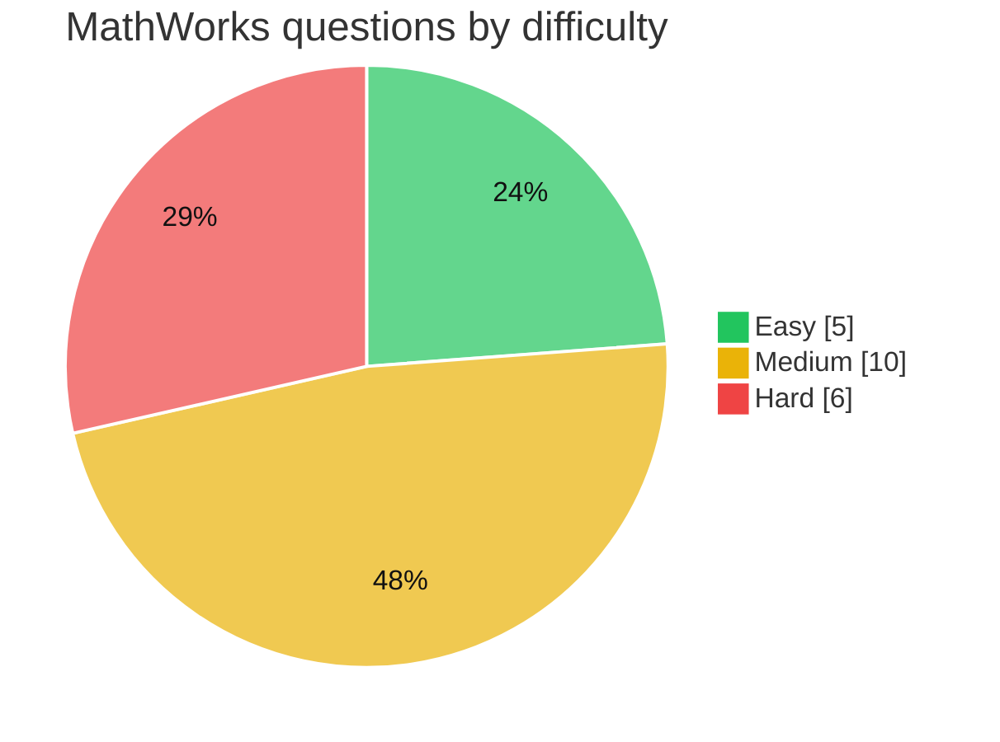

[← All companies](../README.md) · [Most asked across companies](../most-asked.md)

# MathWorks Coding Questions

   

**21 MathWorks coding questions** — 5 easy, 10 medium and 6 hard. Each one links to a free page where you can solve it in 13 languages, with hints and an editorial.

21 problems the CodeKairo catalogue tags as commonly asked in MathWorks's coding rounds — 5 easy, 10 medium and 6 hard — each judged by hidden tests in 13 languages. The most common topics among them are Arrays (13), Dynamic Programming (6) and Strings (5). The tag is the catalogue's own annotation of where a problem tends to come up — not a list published by MathWorks, which CodeKairo is not affiliated with.

**Practise on CodeKairo:** [All 21 MathWorks questions](https://codekairo.com/challenges/company/mathworks?utm_source=github)

## Contents

- [Start with these 10](#start-with-these-10)
- [Topics MathWorks asks most](#topics-mathworks-asks-most)
- 🟢 [Easy (5)](#easy-5)
- 🟡 [Medium (10)](#medium-10)
- 🔴 [Hard (6)](#hard-6)

## Start with these 10

The MathWorks questions most other companies ask too — the patterns worth knowing first.

1. 🟢 [Valid Parentheses](https://codekairo.com/problems/valid-parentheses?utm_source=github) — also asked at 14 other companies
2. 🟡 [Number of Islands](https://codekairo.com/problems/number-of-islands?utm_source=github) — also asked at 9 other companies
3. 🟢 [Counting Bits](https://codekairo.com/problems/counting-bits?utm_source=github) — also asked at 4 other companies
4. 🟡 [Unique Paths II](https://codekairo.com/problems/unique-paths-ii?utm_source=github) — also asked at 4 other companies
5. 🟡 [Remove Colored Pieces if Both Neighbors are the Same Color](https://codekairo.com/problems/remove-colored-pieces-if-both-neighbors-are-the-same-color?utm_source=github) — also asked at 4 other companies
6. 🔴 [Count Subarrays With Fixed Bounds](https://codekairo.com/problems/count-subarrays-with-fixed-bounds?utm_source=github) — also asked at 4 other companies
7. 🔴 [Last Substring in Lexicographical Order](https://codekairo.com/problems/last-substring-in-lexicographical-order?utm_source=github) — also asked at 4 other companies
8. 🟢 [Reshape the Matrix](https://codekairo.com/problems/reshape-the-matrix?utm_source=github) — also asked at 3 other companies
9. 🟡 [Bulb Switcher](https://codekairo.com/problems/bulb-switcher?utm_source=github) — also asked at 3 other companies
10. 🟡 [Minimum Cost Tree From Leaf Values](https://codekairo.com/problems/minimum-cost-tree-from-leaf-values?utm_source=github) — also asked at 3 other companies

## Topics MathWorks asks most

[Arrays](https://codekairo.com/challenges/arrays?utm_source=github) (13) · [Dynamic Programming](https://codekairo.com/challenges/dynamic-programming?utm_source=github) (6) · [Matrix](https://codekairo.com/challenges/matrix?utm_source=github) (5) · [Strings](https://codekairo.com/challenges/strings?utm_source=github) (5) · [Greedy](https://codekairo.com/challenges/greedy?utm_source=github) (4) · [Hash Table](https://codekairo.com/challenges/hash-table?utm_source=github) (3) · [Math](https://codekairo.com/challenges/math?utm_source=github) (3) · [Two Pointers](https://codekairo.com/challenges/two-pointers?utm_source=github) (3) · [Binary Search](https://codekairo.com/challenges/binary-search?utm_source=github) (2) · [Bit Manipulation](https://codekairo.com/challenges/bit-manipulation?utm_source=github) (2)

## Easy (5)

| # | Question | Topics | Acceptance |
|---:|---|---|---:|
| 4 | 🟢 [Valid Parentheses](https://codekairo.com/problems/valid-parentheses?utm_source=github) | Strings, Stack | — |
| 200 | 🟢 [Degree of an Array](https://codekairo.com/problems/degree-of-an-array?utm_source=github) | Arrays, Hash Table | — |
| 278 | 🟢 [Reshape the Matrix](https://codekairo.com/problems/reshape-the-matrix?utm_source=github) | Arrays, Matrix, Simulation | — |
| 410 | 🟢 [Counting Bits](https://codekairo.com/problems/counting-bits?utm_source=github) | Dynamic Programming, Bit Manipulation | — |
| 593 | 🟢 [Keyboard Row](https://codekairo.com/problems/keyboard-row?utm_source=github) | Arrays, Strings, Hash Table | — |

## Medium (10)

| # | Question | Topics | Acceptance |
|---:|---|---|---:|
| 85 | 🟡 [Task Scheduler](https://codekairo.com/problems/task-scheduler?utm_source=github) | Arrays, Greedy, Heap | — |
| 118 | 🟡 [Number of Islands](https://codekairo.com/problems/number-of-islands?utm_source=github) | Arrays, Matrix, Depth-First Search | — |
| 289 | 🟡 [Unique Paths II](https://codekairo.com/problems/unique-paths-ii?utm_source=github) | Arrays, Dynamic Programming, Matrix | — |
| 436 | 🟡 [Bulb Switcher](https://codekairo.com/problems/bulb-switcher?utm_source=github) | Math, Brainteaser | — |
| 880 | 🟡 [Minimum Cost Tree From Leaf Values](https://codekairo.com/problems/minimum-cost-tree-from-leaf-values?utm_source=github) | Arrays, Dynamic Programming, Stack | — |
| 969 | 🟡 [Total Cost to Hire K Workers](https://codekairo.com/problems/total-cost-to-hire-k-workers?utm_source=github) | Arrays, Two Pointers, Simulation | — |
| 1229 | 🟡 [Remove Colored Pieces if Both Neighbors are the Same Color](https://codekairo.com/problems/remove-colored-pieces-if-both-neighbors-are-the-same-color?utm_source=github) | Math, Strings, Greedy | — |
| 1344 | 🟡 [Beautiful Arrangement](https://codekairo.com/problems/beautiful-arrangement?utm_source=github) | Dynamic Programming, Backtracking, Bit Manipulation | — |
| 1387 | 🟡 [Maximum Number of Alloys](https://codekairo.com/problems/maximum-number-of-alloys?utm_source=github) | Arrays, Binary Search | — |
| 1391 | 🟡 [Earliest Second to Mark Indices I](https://codekairo.com/problems/earliest-second-to-mark-indices-i?utm_source=github) | Arrays, Binary Search, Greedy | — |

## Hard (6)

| # | Question | Topics | Acceptance |
|---:|---|---|---:|
| 339 | 🔴 [Count Vowels Permutation](https://codekairo.com/problems/count-vowels-permutation?utm_source=github) | Dynamic Programming | — |
| 804 | 🔴 [Count Subarrays With Fixed Bounds](https://codekairo.com/problems/count-subarrays-with-fixed-bounds?utm_source=github) | Arrays, Sliding Window, Two Pointers | — |
| 888 | 🔴 [Cherry Pickup](https://codekairo.com/problems/cherry-pickup?utm_source=github) | Arrays, Matrix, Dynamic Programming | — |
| 925 | 🔴 [Shortest Distance from All Buildings](https://codekairo.com/problems/shortest-distance-from-all-buildings?utm_source=github) | Arrays, Matrix, Breadth-First Search | — |
| 1036 | 🔴 [Count Anagrams](https://codekairo.com/problems/count-anagrams?utm_source=github) | Hash Table, Math, Strings | — |
| 1254 | 🔴 [Last Substring in Lexicographical Order](https://codekairo.com/problems/last-substring-in-lexicographical-order?utm_source=github) | Strings, Two Pointers | — |

---

[← All companies](../README.md) · Rebuilt every night from [codekairo.com](https://codekairo.com/challenges/company/mathworks?utm_source=github). Last refreshed: November 2026. ⭐ [Star the repo](https://github.com/ayaanp14/company-wise-coding-questions) if it helps.
