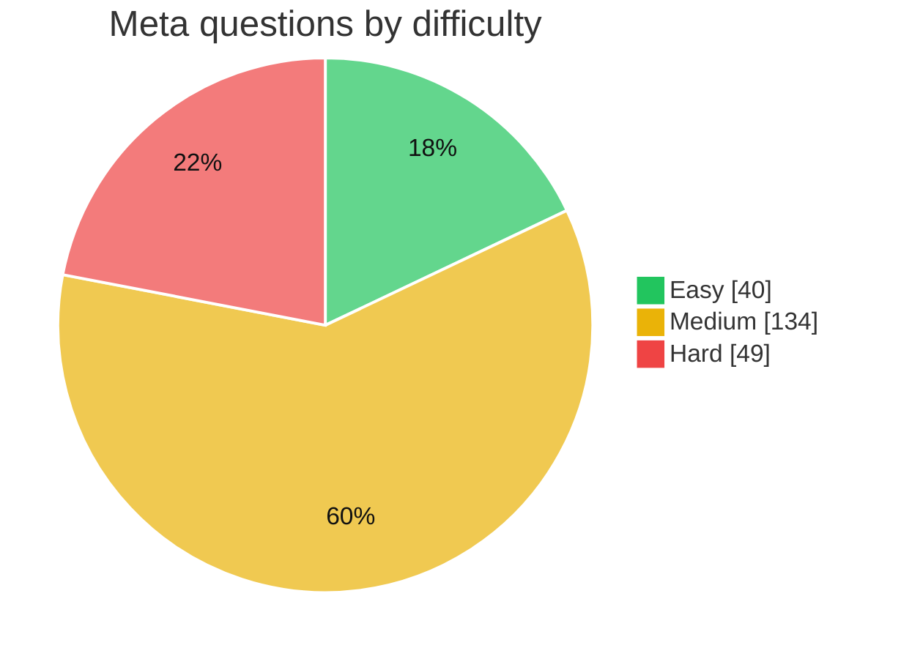

[← All companies](../README.md) · [Most asked across companies](../most-asked.md)

# Meta Coding Questions

   

**223 Meta coding questions** — 40 easy, 134 medium and 49 hard. Each one links to a free page where you can solve it in 13 languages, with hints and an editorial.

223 problems the CodeKairo catalogue tags as commonly asked in Meta's coding rounds — 40 easy, 134 medium and 49 hard — each judged by hidden tests in 13 languages. The most common topics among them are Arrays (108), Strings (61) and Depth-First Search (50). CodeKairo's Meta — Coding Screen mock covers the Meta coding screen pattern, which has the tightest clock in this catalogue: four problems in seventy minutes. The tag is the catalogue's own annotation of where a problem tends to come up — not a list published by Meta, which CodeKairo is not affiliated with.

**Practise on CodeKairo:** [All 223 Meta questions](https://codekairo.com/challenges/company/meta?utm_source=github) · [Meta — Coding Screen mock test](https://codekairo.com/tests/meta-coding-screen?utm_source=github) · [Meta hiring process, round by round](https://codekairo.com/simulations/meta?utm_source=github)

## Contents

- [Start with these 10](#start-with-these-10)
- [Topics Meta asks most](#topics-meta-asks-most)
- 🟢 [Easy (40)](#easy-40)
- 🟡 [Medium (134)](#medium-134)
- 🔴 [Hard (49)](#hard-49)

## Start with these 10

The Meta questions most other companies ask too — the patterns worth knowing first.

1. 🔴 [Word Ladder](https://codekairo.com/problems/word-ladder?utm_source=github) — also asked at 9 other companies
2. 🟡 [Word Search](https://codekairo.com/problems/word-search?utm_source=github) — also asked at 8 other companies
3. 🟢 [Find Pivot Index](https://codekairo.com/problems/find-pivot-index?utm_source=github) — also asked at 7 other companies
4. 🟡 [Reverse Words in a String](https://codekairo.com/problems/reverse-words-in-a-string?utm_source=github) — also asked at 7 other companies
5. 🟡 [Game of Life](https://codekairo.com/problems/game-of-life?utm_source=github) — also asked at 7 other companies
6. 🟡 [Valid Sudoku](https://codekairo.com/problems/valid-sudoku?utm_source=github) — also asked at 7 other companies
7. 🟢 [Roman to Integer](https://codekairo.com/problems/roman-to-integer?utm_source=github) — also asked at 6 other companies
8. 🟢 [Plus One](https://codekairo.com/problems/plus-one?utm_source=github) — also asked at 6 other companies
9. 🟡 [Basic Calculator II](https://codekairo.com/problems/basic-calculator-ii?utm_source=github) — also asked at 6 other companies
10. 🔴 [Best Time to Buy and Sell Stock III](https://codekairo.com/problems/best-time-to-buy-and-sell-stock-iii?utm_source=github) — also asked at 6 other companies

## Topics Meta asks most

[Arrays](https://codekairo.com/challenges/arrays?utm_source=github) (108) · [Strings](https://codekairo.com/challenges/strings?utm_source=github) (61) · [Depth-First Search](https://codekairo.com/challenges/depth-first-search?utm_source=github) (50) · [Dynamic Programming](https://codekairo.com/challenges/dynamic-programming?utm_source=github) (41) · [Trees](https://codekairo.com/challenges/trees?utm_source=github) (39) · [Hash Table](https://codekairo.com/challenges/hash-table?utm_source=github) (37) · [Breadth-First Search](https://codekairo.com/challenges/breadth-first-search?utm_source=github) (35) · [Math](https://codekairo.com/challenges/math?utm_source=github) (30) · [Sorting](https://codekairo.com/challenges/sorting?utm_source=github) (24) · [Matrix](https://codekairo.com/challenges/matrix?utm_source=github) (23)

## Easy (40)

| # | Question | Topics | Acceptance |
|---:|---|---|---:|
| 157 | 🟢 [Excel Sheet Column Number](https://codekairo.com/problems/excel-sheet-column-number?utm_source=github) | Math, Strings | — |
| 158 | 🟢 [Excel Sheet Column Title](https://codekairo.com/problems/excel-sheet-column-title?utm_source=github) | Math, Strings | — |
| 159 | 🟢 [Roman to Integer](https://codekairo.com/problems/roman-to-integer?utm_source=github) | Hash Table, Math, Strings | — |
| 161 | 🟢 [Add Binary](https://codekairo.com/problems/add-binary?utm_source=github) | Math, Strings, Bit Manipulation | — |
| 162 | 🟢 [Plus One](https://codekairo.com/problems/plus-one?utm_source=github) | Arrays, Math | — |
| 163 | 🟢 [Add Strings](https://codekairo.com/problems/add-strings?utm_source=github) | Math, Strings, Simulation | — |
| 181 | 🟢 [Intersection of Two Arrays](https://codekairo.com/problems/intersection-of-two-arrays?utm_source=github) | Arrays, Hash Table, Two Pointers | — |
| 182 | 🟢 [Intersection of Two Arrays II](https://codekairo.com/problems/intersection-of-two-arrays-ii?utm_source=github) | Arrays, Hash Table, Two Pointers | — |
| 186 | 🟢 [Find Pivot Index](https://codekairo.com/problems/find-pivot-index?utm_source=github) | Arrays, Prefix Sum | — |
| 202 | 🟢 [Distribute Candies](https://codekairo.com/problems/distribute-candies?utm_source=github) | Arrays, Hash Table, Greedy | — |
| 204 | 🟢 [Sort Array By Parity](https://codekairo.com/problems/sort-array-by-parity?utm_source=github) | Arrays, Two Pointers, Sorting | — |
| 211 | 🟢 [Reverse Words in a String III](https://codekairo.com/problems/reverse-words-in-a-string-iii?utm_source=github) | Two Pointers, Strings | — |
| 223 | 🟢 [Jewels and Stones](https://codekairo.com/problems/jewels-and-stones?utm_source=github) | Hash Table, Strings | — |
| 256 | 🟢 [Shortest Distance to a Character](https://codekairo.com/problems/shortest-distance-to-a-character?utm_source=github) | Arrays, Two Pointers, Strings | — |
| 277 | 🟢 [Toeplitz Matrix](https://codekairo.com/problems/toeplitz-matrix?utm_source=github) | Arrays, Matrix | — |
| 353 | 🟢 [Sort Array By Parity II](https://codekairo.com/problems/sort-array-by-parity-ii?utm_source=github) | Arrays, Two Pointers, Sorting | — |
| 370 | 🟢 [Maximum Product of Three Numbers](https://codekairo.com/problems/maximum-product-of-three-numbers?utm_source=github) | Arrays, Math, Sorting | — |
| 410 | 🟢 [Counting Bits](https://codekairo.com/problems/counting-bits?utm_source=github) | Dynamic Programming, Bit Manipulation | — |
| 411 | 🟢 [Hamming Distance](https://codekairo.com/problems/hamming-distance?utm_source=github) | Bit Manipulation | — |
| 481 | 🟢 [Monotonic Array](https://codekairo.com/problems/monotonic-array?utm_source=github) | Arrays | — |
| 495 | 🟢 [Check If All 1's Are at Least Length K Places Away](https://codekairo.com/problems/check-if-all-1s-are-at-least-length-k-places-away?utm_source=github) | Arrays | — |
| 513 | 🟢 [Verifying an Alien Dictionary](https://codekairo.com/problems/verifying-an-alien-dictionary?utm_source=github) | Arrays, Strings, Hash Table | — |
| 555 | 🟢 [Check If It Is a Straight Line](https://codekairo.com/problems/check-if-it-is-a-straight-line?utm_source=github) | Arrays, Math, Geometry | — |
| 632 | 🟢 [Valid Word Abbreviation](https://codekairo.com/problems/valid-word-abbreviation?utm_source=github) | Strings, Two Pointers | — |
| 765 | 🟢 [Shortest Word Distance](https://codekairo.com/problems/shortest-word-distance?utm_source=github) | Arrays, Strings, Two Pointers | — |
| 1102 | 🟢 [Element Appearing More Than 25% In Sorted Array](https://codekairo.com/problems/element-appearing-more-than-25-in-sorted-array?utm_source=github) | Arrays, Binary Search | — |
| 1103 | 🟢 [Make Two Arrays Equal by Reversing Subarrays](https://codekairo.com/problems/make-two-arrays-equal-by-reversing-subarrays?utm_source=github) | Arrays, Hash Table, Sorting | — |
| 1187 | 🟢 [Check if One String Swap Can Make Strings Equal](https://codekairo.com/problems/check-if-one-string-swap-can-make-strings-equal?utm_source=github) | Hash Table, Strings, Counting | — |
| 1865 | 🟢 [Minimum Depth of Binary Tree](https://codekairo.com/problems/minimum-depth-of-binary-tree?utm_source=github) | Trees, Depth-First Search, Breadth-First Search | — |
| 1867 | 🟢 [Path Sum](https://codekairo.com/problems/path-sum?utm_source=github) | Trees, Depth-First Search, Breadth-First Search | — |
| 1869 | 🟢 [Binary Tree Paths](https://codekairo.com/problems/binary-tree-paths?utm_source=github) | Trees, Depth-First Search, Backtracking | — |
| 1873 | 🟢 [Diameter of Binary Tree](https://codekairo.com/problems/diameter-of-binary-tree?utm_source=github) | Trees, Depth-First Search | — |
| 1874 | 🟢 [Binary Tree Tilt](https://codekairo.com/problems/binary-tree-tilt?utm_source=github) | Trees, Depth-First Search | — |
| 1875 | 🟢 [Subtree of Another Tree](https://codekairo.com/problems/subtree-of-another-tree?utm_source=github) | Trees, Depth-First Search, String Matching | — |
| 1877 | 🟢 [Two Sum IV - Input is a BST](https://codekairo.com/problems/two-sum-iv-input-is-a-bst?utm_source=github) | Trees, Depth-First Search, Hash Table | — |
| 1882 | 🟢 [Range Sum of BST](https://codekairo.com/problems/range-sum-of-bst?utm_source=github) | Trees, Depth-First Search, Binary Search | — |
| 1884 | 🟢 [Cousins in Binary Tree](https://codekairo.com/problems/cousins-in-binary-tree?utm_source=github) | Trees, Depth-First Search, Breadth-First Search | — |
| 1888 | 🟢 [Convert Sorted Array to Binary Search Tree](https://codekairo.com/problems/convert-sorted-array-to-binary-search-tree?utm_source=github) | Arrays, Divide and Conquer, Trees | — |
| 1990 | 🟢 [Palindrome Linked List](https://codekairo.com/problems/palindrome-linked-list?utm_source=github) | Linked List, Two Pointers, Stack | — |
| 2038 | 🟢 [Range Sum Query - Immutable](https://codekairo.com/problems/range-sum-query-immutable?utm_source=github) | Arrays, Prefix Sum, Design | — |

## Medium (134)

| # | Question | Topics | Acceptance |
|---:|---|---|---:|
| 185 | 🟡 [Next Permutation](https://codekairo.com/problems/next-permutation?utm_source=github) | Arrays, Two Pointers | — |
| 207 | 🟡 [H-Index](https://codekairo.com/problems/h-index?utm_source=github) | Arrays, Sorting, Counting Sort | — |
| 208 | 🟡 [Increasing Triplet Subsequence](https://codekairo.com/problems/increasing-triplet-subsequence?utm_source=github) | Arrays, Greedy | — |
| 210 | 🟡 [Reverse Words in a String](https://codekairo.com/problems/reverse-words-in-a-string?utm_source=github) | Two Pointers, Strings | — |
| 218 | 🟡 [Count and Say](https://codekairo.com/problems/count-and-say?utm_source=github) | Strings, Simulation | — |
| 221 | 🟡 [Valid Parenthesis String](https://codekairo.com/problems/valid-parenthesis-string?utm_source=github) | Strings, Dynamic Programming, Stack | — |
| 232 | 🟡 [Custom Sort String](https://codekairo.com/problems/custom-sort-string?utm_source=github) | Hash Table, Strings, Sorting | — |
| 244 | 🟡 [Subarray Product Less Than K](https://codekairo.com/problems/subarray-product-less-than-k?utm_source=github) | Arrays, Sliding Window, Binary Search | — |
| 245 | 🟡 [Contiguous Array](https://codekairo.com/problems/contiguous-array?utm_source=github) | Arrays, Hash Table, Prefix Sum | — |
| 246 | 🟡 [Continuous Subarray Sum](https://codekairo.com/problems/continuous-subarray-sum?utm_source=github) | Arrays, Hash Table, Math | — |
| 252 | 🟡 [Remove Duplicates from Sorted Array II](https://codekairo.com/problems/remove-duplicates-from-sorted-array-ii?utm_source=github) | Arrays, Two Pointers | — |
| 276 | 🟡 [Diagonal Traverse](https://codekairo.com/problems/diagonal-traverse?utm_source=github) | Arrays, Matrix, Simulation | — |
| 290 | 🟡 [Maximal Square](https://codekairo.com/problems/maximal-square?utm_source=github) | Arrays, Dynamic Programming, Matrix | — |
| 293 | 🟡 [Game of Life](https://codekairo.com/problems/game-of-life?utm_source=github) | Arrays, Matrix, Simulation | — |
| 303 | 🟡 [Valid Sudoku](https://codekairo.com/problems/valid-sudoku?utm_source=github) | Arrays, Hash Table, Matrix | — |
| 312 | 🟡 [Maximum Length of Repeated Subarray](https://codekairo.com/problems/maximum-length-of-repeated-subarray?utm_source=github) | Arrays, Binary Search, Dynamic Programming | — |
| 314 | 🟡 [Number of Longest Increasing Subsequence](https://codekairo.com/problems/number-of-longest-increasing-subsequence?utm_source=github) | Arrays, Dynamic Programming, Binary Indexed Tree | — |
| 316 | 🟡 [Arithmetic Slices](https://codekairo.com/problems/arithmetic-slices?utm_source=github) | Arrays, Dynamic Programming | — |
| 319 | 🟡 [Interleaving String](https://codekairo.com/problems/interleaving-string?utm_source=github) | Strings, Dynamic Programming | — |
| 322 | 🟡 [Perfect Squares](https://codekairo.com/problems/perfect-squares?utm_source=github) | Math, Dynamic Programming, Breadth-First Search | — |
| 330 | 🟡 [Combination Sum IV](https://codekairo.com/problems/combination-sum-iv?utm_source=github) | Arrays, Dynamic Programming | — |
| 333 | 🟡 [Maximum Sum Circular Subarray](https://codekairo.com/problems/maximum-sum-circular-subarray?utm_source=github) | Arrays, Divide and Conquer, Dynamic Programming | — |
| 351 | 🟡 [Largest Number](https://codekairo.com/problems/largest-number?utm_source=github) | Arrays, Strings, Greedy | — |
| 356 | 🟡 [Valid Triangle Number](https://codekairo.com/problems/valid-triangle-number?utm_source=github) | Arrays, Two Pointers, Binary Search | — |
| 357 | 🟡 [Maximum Swap](https://codekairo.com/problems/maximum-swap?utm_source=github) | Math, Greedy | — |
| 364 | 🟡 [K Closest Points to Origin](https://codekairo.com/problems/k-closest-points-to-origin?utm_source=github) | Arrays, Math, Divide and Conquer | — |
| 367 | 🟡 [Kth Smallest Element in a Sorted Matrix](https://codekairo.com/problems/kth-smallest-element-in-a-sorted-matrix?utm_source=github) | Arrays, Binary Search, Sorting | — |
| 368 | 🟡 [Find K Closest Elements](https://codekairo.com/problems/find-k-closest-elements?utm_source=github) | Arrays, Two Pointers, Binary Search | — |
| 376 | 🟡 [Minimum Add to Make Parentheses Valid](https://codekairo.com/problems/minimum-add-to-make-parentheses-valid?utm_source=github) | Strings, Stack, Greedy | — |
| 377 | 🟡 [Minimum Remove to Make Valid Parentheses](https://codekairo.com/problems/minimum-remove-to-make-valid-parentheses?utm_source=github) | Strings, Stack | — |
| 378 | 🟡 [Score of Parentheses](https://codekairo.com/problems/score-of-parentheses?utm_source=github) | Strings, Stack | — |
| 389 | 🟡 [Basic Calculator II](https://codekairo.com/problems/basic-calculator-ii?utm_source=github) | Math, Strings, Stack | — |
| 406 | 🟡 [Buildings With an Ocean View](https://codekairo.com/problems/buildings-with-an-ocean-view?utm_source=github) | Arrays, Stack, Monotonic Stack | — |
| 408 | 🟡 [Single Number III](https://codekairo.com/problems/single-number-iii?utm_source=github) | Arrays, Bit Manipulation | — |
| 412 | 🟡 [Total Hamming Distance](https://codekairo.com/problems/total-hamming-distance?utm_source=github) | Arrays, Math, Bit Manipulation | — |
| 428 | 🟡 [Maximum Product of Word Lengths](https://codekairo.com/problems/maximum-product-of-word-lengths?utm_source=github) | Arrays, Strings, Bit Manipulation | — |
| 431 | 🟡 [Divide Two Integers](https://codekairo.com/problems/divide-two-integers?utm_source=github) | Math, Bit Manipulation | — |
| 442 | 🟡 [Number of Connected Components in an Undirected Graph](https://codekairo.com/problems/number-of-connected-components-in-an-undirected-graph?utm_source=github) | Depth-First Search, Breadth-First Search, Union Find | — |
| 443 | 🟡 [Graph Valid Tree](https://codekairo.com/problems/graph-valid-tree?utm_source=github) | Depth-First Search, Breadth-First Search, Union Find | — |
| 444 | 🟡 [Is Graph Bipartite?](https://codekairo.com/problems/is-graph-bipartite?utm_source=github) | Depth-First Search, Breadth-First Search, Union Find | — |
| 446 | 🟡 [All Paths From Source to Target](https://codekairo.com/problems/all-paths-from-source-to-target?utm_source=github) | Backtracking, Depth-First Search, Breadth-First Search | — |
| 450 | 🟡 [Shortest Path in Binary Matrix](https://codekairo.com/problems/shortest-path-in-binary-matrix?utm_source=github) | Arrays, Breadth-First Search, Matrix | — |
| 454 | 🟡 [The Earliest Moment When Everyone Become Friends](https://codekairo.com/problems/the-earliest-moment-when-everyone-become-friends?utm_source=github) | Arrays, Union Find, Sorting | — |
| 455 | 🟡 [Shortest Bridge](https://codekairo.com/problems/shortest-bridge?utm_source=github) | Arrays, Depth-First Search, Breadth-First Search | — |
| 456 | 🟡 [Number of Distinct Islands](https://codekairo.com/problems/number-of-distinct-islands?utm_source=github) | Arrays, Hash Table, Depth-First Search | — |
| 458 | 🟡 [Minimum Height Trees](https://codekairo.com/problems/minimum-height-trees?utm_source=github) | Depth-First Search, Breadth-First Search, Graph | — |
| 459 | 🟡 [Possible Bipartition](https://codekairo.com/problems/possible-bipartition?utm_source=github) | Depth-First Search, Breadth-First Search, Union Find | — |
| 468 | 🟡 [Jump Game III](https://codekairo.com/problems/jump-game-iii?utm_source=github) | Arrays, Depth-First Search, Breadth-First Search | — |
| 472 | 🟡 [Pacific Atlantic Water Flow](https://codekairo.com/problems/pacific-atlantic-water-flow?utm_source=github) | Arrays, Depth-First Search, Breadth-First Search | — |
| 473 | 🟡 [Word Search](https://codekairo.com/problems/word-search?utm_source=github) | Arrays, Strings, Backtracking | — |
| 480 | 🟡 [Non-decreasing Array](https://codekairo.com/problems/non-decreasing-array?utm_source=github) | Arrays, Greedy | — |
| 575 | 🟡 [Paint House](https://codekairo.com/problems/paint-house?utm_source=github) | Arrays, Dynamic Programming | — |
| 639 | 🟡 [Number of Matching Subsequences](https://codekairo.com/problems/number-of-matching-subsequences?utm_source=github) | Strings, Two Pointers, Binary Search | — |
| 648 | 🟡 [Longest Substring With At Least K Repeating Characters](https://codekairo.com/problems/longest-substring-with-at-least-k-repeating-characters?utm_source=github) | Strings, Sliding Window, Divide and Conquer | — |
| 656 | 🟡 [Short Encoding of Words](https://codekairo.com/problems/short-encoding-of-words?utm_source=github) | Strings, Trie, Hash Table | — |
| 672 | 🟡 [Maximum Size Subarray Sum Equals k](https://codekairo.com/problems/maximum-size-subarray-sum-equals-k?utm_source=github) | Arrays, Hash Table, Prefix Sum | — |
| 676 | 🟡 [Brick Wall](https://codekairo.com/problems/brick-wall?utm_source=github) | Hash Table, Arrays, Counting | — |
| 682 | 🟡 [Number of Boomerangs](https://codekairo.com/problems/number-of-boomerangs?utm_source=github) | Hash Table, Math, Arrays | — |
| 683 | 🟡 [Minimum Area Rectangle](https://codekairo.com/problems/minimum-area-rectangle?utm_source=github) | Hash Table, Arrays, Geometry | — |
| 707 | 🟡 [Integer Replacement](https://codekairo.com/problems/integer-replacement?utm_source=github) | Bit Manipulation, Greedy, Dynamic Programming | — |
| 726 | 🟡 [Maximum XOR After Operations](https://codekairo.com/problems/maximum-xor-after-operations?utm_source=github) | Bit Manipulation, Arrays, Brainteaser | — |
| 731 | 🟡 [Flip String to Monotone Increasing](https://codekairo.com/problems/flip-string-to-monotone-increasing?utm_source=github) | Strings, Dynamic Programming, Bit Manipulation | — |
| 737 | 🟡 [UTF-8 Validation](https://codekairo.com/problems/utf-8-validation?utm_source=github) | Bit Manipulation, Arrays | — |
| 739 | 🟡 [Find the Longest Substring Containing Vowels in Even Counts](https://codekairo.com/problems/find-the-longest-substring-containing-vowels-in-even-counts?utm_source=github) | Bit Manipulation, Hash Table, Strings | — |
| 740 | 🟡 [Bitwise ORs of Subarrays](https://codekairo.com/problems/bitwise-ors-of-subarrays?utm_source=github) | Bit Manipulation, Arrays, Dynamic Programming | — |
| 741 | 🟡 [Number of Wonderful Substrings](https://codekairo.com/problems/number-of-wonderful-substrings?utm_source=github) | Bit Manipulation, Hash Table, Strings | — |
| 773 | 🟡 [Sentence Similarity III](https://codekairo.com/problems/sentence-similarity-iii?utm_source=github) | Strings, Two Pointers, Arrays | — |
| 802 | 🟡 [Max Consecutive Ones II](https://codekairo.com/problems/max-consecutive-ones-ii?utm_source=github) | Arrays, Sliding Window, Dynamic Programming | — |
| 814 | 🟡 [Find First and Last Position of Element in Sorted Array](https://codekairo.com/problems/find-first-and-last-position-of-element-in-sorted-array?utm_source=github) | Arrays, Binary Search | — |
| 823 | 🟡 [Peak Index in a Mountain Array](https://codekairo.com/problems/peak-index-in-a-mountain-array?utm_source=github) | Arrays, Binary Search | — |
| 916 | 🟡 [Number of Corner Rectangles](https://codekairo.com/problems/number-of-corner-rectangles?utm_source=github) | Arrays, Matrix, Math | — |
| 942 | 🟡 [The Maze II](https://codekairo.com/problems/the-maze-ii?utm_source=github) | Arrays, Matrix, Graph | — |
| 1085 | 🟡 [Minimum Number of Increments on Subarrays to Form a Target Array](https://codekairo.com/problems/minimum-number-of-increments-on-subarrays-to-form-a-target-array?utm_source=github) | Arrays, Greedy, Dynamic Programming | — |
| 1126 | 🟡 [Friends Of Appropriate Ages](https://codekairo.com/problems/friends-of-appropriate-ages?utm_source=github) | Arrays, Counting, Sorting | — |
| 1130 | 🟡 [Previous Permutation With One Swap](https://codekairo.com/problems/previous-permutation-with-one-swap?utm_source=github) | Arrays, Greedy | — |
| 1177 | 🟡 [Groups of Special-Equivalent Strings](https://codekairo.com/problems/groups-of-special-equivalent-strings?utm_source=github) | Arrays, Hash Table, Strings | — |
| 1215 | 🟡 [Break a Palindrome](https://codekairo.com/problems/break-a-palindrome?utm_source=github) | Strings, Greedy | — |
| 1230 | 🟡 [Plates Between Candles](https://codekairo.com/problems/plates-between-candles?utm_source=github) | Arrays, Strings, Binary Search | — |
| 1271 | 🟡 [Fraction to Recurring Decimal](https://codekairo.com/problems/fraction-to-recurring-decimal?utm_source=github) | Hash Table, Math, Strings | — |
| 1281 | 🟡 [Mirror Reflection](https://codekairo.com/problems/mirror-reflection?utm_source=github) | Math, Geometry, Number Theory | — |
| 1356 | 🟡 [Shortest Subarray to be Removed to Make Array Sorted](https://codekairo.com/problems/shortest-subarray-to-be-removed-to-make-array-sorted?utm_source=github) | Arrays, Two Pointers, Binary Search | — |
| 1400 | 🟡 [Exclusive Time of Functions](https://codekairo.com/problems/exclusive-time-of-functions?utm_source=github) | Arrays, Stack | — |
| 1413 | 🟡 [Check if a Parentheses String Can Be Valid](https://codekairo.com/problems/check-if-a-parentheses-string-can-be-valid?utm_source=github) | Strings, Stack, Greedy | — |
| 1530 | 🟡 [Nearest Exit from Entrance in Maze](https://codekairo.com/problems/nearest-exit-from-entrance-in-maze?utm_source=github) | Arrays, Matrix, Breadth-First Search | — |
| 1549 | 🟡 [Diagonal Traverse II](https://codekairo.com/problems/diagonal-traverse-ii?utm_source=github) | Arrays, Sorting, Matrix | — |
| 1560 | 🟡 [Battleships in a Board](https://codekairo.com/problems/battleships-in-a-board?utm_source=github) | Arrays, Depth-First Search, Matrix | — |
| 1561 | 🟡 [Minesweeper](https://codekairo.com/problems/minesweeper?utm_source=github) | Arrays, Breadth-First Search, Depth-First Search | — |
| 1564 | 🟡 [Valid Tic-Tac-Toe State](https://codekairo.com/problems/valid-tic-tac-toe-state?utm_source=github) | Arrays, Matrix, Simulation | — |
| 1574 | 🟡 [Subsets II](https://codekairo.com/problems/subsets-ii?utm_source=github) | Arrays, Backtracking, Bit Manipulation | — |
| 1575 | 🟡 [Permutations II](https://codekairo.com/problems/permutations-ii?utm_source=github) | Arrays, Backtracking, Sorting | — |
| 1576 | 🟡 [Combination Sum II](https://codekairo.com/problems/combination-sum-ii?utm_source=github) | Arrays, Backtracking | — |
| 1580 | 🟡 [Matchsticks to Square](https://codekairo.com/problems/matchsticks-to-square?utm_source=github) | Arrays, Backtracking, Bitmask | — |
| 1581 | 🟡 [Letter Case Permutation](https://codekairo.com/problems/letter-case-permutation?utm_source=github) | Strings, Backtracking, Bit Manipulation | — |
| 1696 | 🟡 [Validate Binary Tree Nodes](https://codekairo.com/problems/validate-binary-tree-nodes?utm_source=github) | Trees, Depth-First Search, Breadth-First Search | — |
| 1751 | 🟡 [Remove Sub-Folders from the Filesystem](https://codekairo.com/problems/remove-sub-folders-from-the-filesystem?utm_source=github) | Arrays, Strings, Depth-First Search | — |
| 1902 | 🟡 [Construct String from Binary Tree](https://codekairo.com/problems/construct-string-from-binary-tree?utm_source=github) | Trees, Depth-First Search, Strings | — |
| 1903 | 🟡 [Validate Binary Search Tree](https://codekairo.com/problems/validate-binary-search-tree?utm_source=github) | Trees, Depth-First Search | — |
| 1905 | 🟡 [Binary Tree Level Order Traversal](https://codekairo.com/problems/binary-tree-level-order-traversal?utm_source=github) | Trees, Breadth-First Search | — |
| 1906 | 🟡 [Binary Tree Zigzag Level Order Traversal](https://codekairo.com/problems/binary-tree-zigzag-level-order-traversal?utm_source=github) | Trees, Breadth-First Search | — |
| 1910 | 🟡 [Path Sum II](https://codekairo.com/problems/path-sum-ii?utm_source=github) | Trees, Depth-First Search, Backtracking | — |
| 1911 | 🟡 [Flatten Binary Tree to Linked List](https://codekairo.com/problems/flatten-binary-tree-to-linked-list?utm_source=github) | Trees, Depth-First Search, Stack | — |
| 1912 | 🟡 [Sum Root to Leaf Numbers](https://codekairo.com/problems/sum-root-to-leaf-numbers?utm_source=github) | Trees, Depth-First Search | — |
| 1913 | 🟡 [Binary Tree Right Side View](https://codekairo.com/problems/binary-tree-right-side-view?utm_source=github) | Trees, Breadth-First Search, Depth-First Search | — |
| 1914 | 🟡 [Kth Smallest Element in a BST](https://codekairo.com/problems/kth-smallest-element-in-a-bst?utm_source=github) | Trees, Depth-First Search | — |
| 1915 | 🟡 [Lowest Common Ancestor of a Binary Search Tree](https://codekairo.com/problems/lowest-common-ancestor-of-a-binary-search-tree?utm_source=github) | Trees, Binary Search, Depth-First Search | — |
| 1916 | 🟡 [Lowest Common Ancestor of a Binary Tree](https://codekairo.com/problems/lowest-common-ancestor-of-a-binary-tree?utm_source=github) | Trees, Depth-First Search | — |
| 1918 | 🟡 [Path Sum III](https://codekairo.com/problems/path-sum-iii?utm_source=github) | Trees, Depth-First Search, Prefix Sum | — |
| 1922 | 🟡 [Find Largest Value in Each Tree Row](https://codekairo.com/problems/find-largest-value-in-each-tree-row?utm_source=github) | Trees, Depth-First Search, Breadth-First Search | — |
| 1923 | 🟡 [Convert BST to Greater Tree](https://codekairo.com/problems/convert-bst-to-greater-tree?utm_source=github) | Trees, Depth-First Search, Binary Search | — |
| 1926 | 🟡 [Maximum Width of Binary Tree](https://codekairo.com/problems/maximum-width-of-binary-tree?utm_source=github) | Trees, Depth-First Search, Breadth-First Search | — |
| 1931 | 🟡 [All Nodes Distance K in Binary Tree](https://codekairo.com/problems/all-nodes-distance-k-in-binary-tree?utm_source=github) | Hash Table, Trees, Depth-First Search | — |
| 1932 | 🟡 [Smallest Subtree with all the Deepest Nodes](https://codekairo.com/problems/smallest-subtree-with-all-the-deepest-nodes?utm_source=github) | Hash Table, Trees, Depth-First Search | — |
| 1934 | 🟡 [Check Completeness of a Binary Tree](https://codekairo.com/problems/check-completeness-of-a-binary-tree?utm_source=github) | Trees, Breadth-First Search | — |
| 1938 | 🟡 [Construct Binary Search Tree from Preorder Traversal](https://codekairo.com/problems/construct-binary-search-tree-from-preorder-traversal?utm_source=github) | Arrays, Stack, Trees | — |
| 1939 | 🟡 [Maximum Difference Between Node and Ancestor](https://codekairo.com/problems/maximum-difference-between-node-and-ancestor?utm_source=github) | Trees, Depth-First Search | — |
| 1944 | 🟡 [All Elements in Two Binary Search Trees](https://codekairo.com/problems/all-elements-in-two-binary-search-trees?utm_source=github) | Trees, Depth-First Search, Sorting | — |
| 1949 | 🟡 [Longest ZigZag Path in a Binary Tree](https://codekairo.com/problems/longest-zigzag-path-in-a-binary-tree?utm_source=github) | Trees, Depth-First Search, Dynamic Programming | — |
| 1950 | 🟡 [Count Good Nodes in Binary Tree](https://codekairo.com/problems/count-good-nodes-in-binary-tree?utm_source=github) | Trees, Depth-First Search, Breadth-First Search | — |
| 1954 | 🟡 [Step-By-Step Directions From a Binary Tree Node to Another](https://codekairo.com/problems/step-by-step-directions-from-a-binary-tree-node-to-another?utm_source=github) | Trees, Depth-First Search, Strings | — |
| 1956 | 🟡 [Count Nodes Equal to Average of Subtree](https://codekairo.com/problems/count-nodes-equal-to-average-of-subtree?utm_source=github) | Trees, Depth-First Search | — |
| 2002 | 🟡 [Remove Nth Node From End of List](https://codekairo.com/problems/remove-nth-node-from-end-of-list?utm_source=github) | Linked List, Two Pointers | — |
| 2003 | 🟡 [Swap Nodes in Pairs](https://codekairo.com/problems/swap-nodes-in-pairs?utm_source=github) | Linked List, Recursion | — |
| 2005 | 🟡 [Remove Duplicates from Sorted List II](https://codekairo.com/problems/remove-duplicates-from-sorted-list-ii?utm_source=github) | Linked List, Two Pointers | — |
| 2007 | 🟡 [Reverse Linked List II](https://codekairo.com/problems/reverse-linked-list-ii?utm_source=github) | Linked List, Two Pointers | — |
| 2008 | 🟡 [Convert Sorted List to Binary Search Tree](https://codekairo.com/problems/convert-sorted-list-to-binary-search-tree?utm_source=github) | Linked List, Trees, Divide and Conquer | — |
| 2009 | 🟡 [Reorder List](https://codekairo.com/problems/reorder-list?utm_source=github) | Linked List, Two Pointers, Stack | — |
| 2011 | 🟡 [Sort List](https://codekairo.com/problems/sort-list?utm_source=github) | Linked List, Sorting, Merge Sort | — |
| 2045 | 🟡 [LRU Cache](https://codekairo.com/problems/lru-cache?utm_source=github) | Hash Table, Design | — |
| 2048 | 🟡 [Design Add and Search Words Data Structure](https://codekairo.com/problems/design-add-and-search-words-data-structure?utm_source=github) | Strings, Depth-First Search, Trie | — |
| 2049 | 🟡 [Range Sum Query 2D - Immutable](https://codekairo.com/problems/range-sum-query-2d-immutable?utm_source=github) | Arrays, Matrix, Prefix Sum | — |
| 2050 | 🟡 [Range Sum Query - Mutable](https://codekairo.com/problems/range-sum-query-mutable?utm_source=github) | Arrays, Binary Indexed Tree, Segment Tree | — |
| 2053 | 🟡 [Design Twitter](https://codekairo.com/problems/design-twitter?utm_source=github) | Hash Table, Heap, Design | — |
| 2054 | 🟡 [Design Circular Queue](https://codekairo.com/problems/design-circular-queue?utm_source=github) | Arrays, Queue, Design | — |
| 2061 | 🟡 [Time Based Key-Value Store](https://codekairo.com/problems/time-based-key-value-store?utm_source=github) | Hash Table, Strings, Binary Search | — |

## Hard (49)

| # | Question | Topics | Acceptance |
|---:|---|---|---:|
| 311 | 🔴 [Best Time to Buy and Sell Stock III](https://codekairo.com/problems/best-time-to-buy-and-sell-stock-iii?utm_source=github) | Arrays, Dynamic Programming | — |
| 388 | 🔴 [Longest Valid Parentheses](https://codekairo.com/problems/longest-valid-parentheses?utm_source=github) | Strings, Dynamic Programming, Stack | — |
| 470 | 🔴 [Word Ladder](https://codekairo.com/problems/word-ladder?utm_source=github) | Hash Table, Strings, Breadth-First Search | — |
| 474 | 🔴 [Swim in Rising Water](https://codekairo.com/problems/swim-in-rising-water?utm_source=github) | Arrays, Binary Search, Depth-First Search | — |
| 584 | 🔴 [Wildcard Matching](https://codekairo.com/problems/wildcard-matching?utm_source=github) | Strings, Dynamic Programming, Greedy | — |
| 622 | 🔴 [Max Value of Equation](https://codekairo.com/problems/max-value-of-equation?utm_source=github) | Arrays, Monotonic Queue, Sliding Window | — |
| 657 | 🔴 [Count Unique Characters of All Substrings of a Given String](https://codekairo.com/problems/count-unique-characters-of-all-substrings?utm_source=github) | Strings, Hash Table, Counting | — |
| 687 | 🔴 [Substring with Concatenation of All Words](https://codekairo.com/problems/substring-with-concatenation-of-all-words?utm_source=github) | Hash Table, Strings, Sliding Window | — |
| 688 | 🔴 [Count of Range Sum](https://codekairo.com/problems/count-of-range-sum?utm_source=github) | Binary Indexed Tree, Divide and Conquer, Prefix Sum | — |
| 714 | 🔴 [Largest Multiple of Three](https://codekairo.com/problems/largest-multiple-of-three?utm_source=github) | Arrays, Greedy, Dynamic Programming | — |
| 716 | 🔴 [Preimage Size of Factorial Zeroes Function](https://codekairo.com/problems/preimage-size-of-factorial-zeroes-function?utm_source=github) | Math, Binary Search, Number Theory | — |
| 745 | 🔴 [Find Subarray With Bitwise OR Closest to K](https://codekairo.com/problems/find-subarray-with-bitwise-or-closest-to-k?utm_source=github) | Bit Manipulation, Arrays, Binary Search | — |
| 746 | 🔴 [Maximum AND Sum of Array](https://codekairo.com/problems/maximum-and-sum-of-array?utm_source=github) | Bit Manipulation, Dynamic Programming, Bitmask | — |
| 748 | 🔴 [Shortest Path Visiting All Nodes](https://codekairo.com/problems/shortest-path-visiting-all-nodes?utm_source=github) | Bit Manipulation, Breadth-First Search, Graph | — |
| 921 | 🔴 [Number of Submatrices That Sum to Target](https://codekairo.com/problems/number-of-submatrices-that-sum-to-target?utm_source=github) | Arrays, Matrix, Hash Table | — |
| 925 | 🔴 [Shortest Distance from All Buildings](https://codekairo.com/problems/shortest-distance-from-all-buildings?utm_source=github) | Arrays, Matrix, Breadth-First Search | — |
| 1040 | 🔴 [Special Binary String](https://codekairo.com/problems/special-binary-string?utm_source=github) | Strings, Recursion, Divide and Conquer | — |
| 1057 | 🔴 [Strange Printer](https://codekairo.com/problems/strange-printer?utm_source=github) | Strings, Dynamic Programming | — |
| 1062 | 🔴 [Constrained Subsequence Sum](https://codekairo.com/problems/constrained-subsequence-sum?utm_source=github) | Arrays, Dynamic Programming, Queue | — |
| 1064 | 🔴 [Stone Game VIII](https://codekairo.com/problems/stone-game-viii?utm_source=github) | Arrays, Math, Dynamic Programming | — |
| 1070 | 🔴 [Number of Ways to Separate Numbers](https://codekairo.com/problems/number-of-ways-to-separate-numbers?utm_source=github) | Strings, Dynamic Programming, Suffix Array | — |
| 1087 | 🔴 [Reverse Pairs](https://codekairo.com/problems/reverse-pairs?utm_source=github) | Arrays, Binary Search, Divide and Conquer | — |
| 1090 | 🔴 [Minimum Replacements to Sort the Array](https://codekairo.com/problems/minimum-replacements-to-sort-the-array?utm_source=github) | Arrays, Math, Greedy | — |
| 1092 | 🔴 [Odd Even Jump](https://codekairo.com/problems/odd-even-jump?utm_source=github) | Arrays, Dynamic Programming, Stack | — |
| 1093 | 🔴 [Make Array Strictly Increasing](https://codekairo.com/problems/make-array-strictly-increasing?utm_source=github) | Arrays, Binary Search, Dynamic Programming | — |
| 1094 | 🔴 [Number of Ways to Reorder Array to Get Same BST](https://codekairo.com/problems/number-of-ways-to-reorder-array-to-get-same-bst?utm_source=github) | Arrays, Math, Divide and Conquer | — |
| 1095 | 🔴 [The Number of Good Subsets](https://codekairo.com/problems/the-number-of-good-subsets?utm_source=github) | Arrays, Math, Dynamic Programming | — |
| 1096 | 🔴 [Number of Ways to Rearrange Sticks With K Sticks Visible](https://codekairo.com/problems/number-of-ways-to-rearrange-sticks-with-k-sticks-visible?utm_source=github) | Math, Dynamic Programming, Combinatorics | — |
| 1097 | 🔴 [Count the Number of Ideal Arrays](https://codekairo.com/problems/count-the-number-of-ideal-arrays?utm_source=github) | Math, Dynamic Programming, Combinatorics | — |
| 1250 | 🔴 [Valid Number](https://codekairo.com/problems/valid-number?utm_source=github) | Strings, Simulation | — |
| 1251 | 🔴 [Integer to English Words](https://codekairo.com/problems/integer-to-english-words?utm_source=github) | Strings, Math, Recursion | — |
| 1252 | 🔴 [Remove Invalid Parentheses](https://codekairo.com/problems/remove-invalid-parentheses?utm_source=github) | Strings, Backtracking, Breadth-First Search | — |
| 1268 | 🔴 [Concatenated Words](https://codekairo.com/problems/concatenated-words?utm_source=github) | Strings, Dynamic Programming, Depth-First Search | — |
| 1270 | 🔴 [Word Break II](https://codekairo.com/problems/word-break-ii?utm_source=github) | Hash Table, Strings, Dynamic Programming | — |
| 1381 | 🔴 [Number of Flowers in Full Bloom](https://codekairo.com/problems/number-of-flowers-in-full-bloom?utm_source=github) | Arrays, Binary Search, Sorting | — |
| 1412 | 🔴 [Robot Collisions](https://codekairo.com/problems/robot-collisions?utm_source=github) | Arrays, Stack, Sorting | — |
| 1421 | 🔴 [Basic Calculator](https://codekairo.com/problems/basic-calculator?utm_source=github) | Math, Strings, Stack | — |
| 1498 | 🔴 [Minimum Swaps To Make Sequences Increasing](https://codekairo.com/problems/minimum-swaps-to-make-sequences-increasing?utm_source=github) | Arrays, Dynamic Programming | — |
| 1499 | 🔴 [Decode Ways II](https://codekairo.com/problems/decode-ways-ii?utm_source=github) | Strings, Dynamic Programming | — |
| 1501 | 🔴 [Maximum Sum of 3 Non-Overlapping Subarrays](https://codekairo.com/problems/maximum-sum-of-3-non-overlapping-subarrays?utm_source=github) | Arrays, Dynamic Programming, Prefix Sum | — |
| 1569 | 🔴 [Shortest Path in a Grid with Obstacles Elimination](https://codekairo.com/problems/shortest-path-in-a-grid-with-obstacles-elimination?utm_source=github) | Arrays, Breadth-First Search, Matrix | — |
| 1579 | 🔴 [Expression Add Operators](https://codekairo.com/problems/expression-add-operators?utm_source=github) | Math, Strings, Backtracking | — |
| 1589 | 🔴 [Stickers to Spell Word](https://codekairo.com/problems/stickers-to-spell-word?utm_source=github) | Strings, Dynamic Programming, Backtracking | — |
| 1979 | 🔴 [Binary Tree Maximum Path Sum](https://codekairo.com/problems/binary-tree-maximum-path-sum?utm_source=github) | Trees, Depth-First Search, Dynamic Programming | — |
| 1981 | 🔴 [Vertical Order Traversal of a Binary Tree](https://codekairo.com/problems/vertical-order-traversal-of-a-binary-tree?utm_source=github) | Trees, Depth-First Search, Breadth-First Search | — |
| 2033 | 🔴 [Merge k Sorted Lists](https://codekairo.com/problems/merge-k-sorted-lists?utm_source=github) | Linked List, Divide and Conquer, Heap | — |
| 2034 | 🔴 [Reverse Nodes in k-Group](https://codekairo.com/problems/reverse-nodes-in-k-group?utm_source=github) | Linked List, Recursion | — |
| 2091 | 🔴 [LFU Cache](https://codekairo.com/problems/lfu-cache?utm_source=github) | Hash Table, Linked List, Design | — |
| 2093 | 🔴 [Prefix and Suffix Search](https://codekairo.com/problems/prefix-and-suffix-search?utm_source=github) | Arrays, Hash Table, Strings | — |

---

[← All companies](../README.md) · Rebuilt every night from [codekairo.com](https://codekairo.com/challenges/company/meta?utm_source=github). Last refreshed: November 2026. ⭐ [Star the repo](https://github.com/ayaanp14/company-wise-coding-questions) if it helps.
