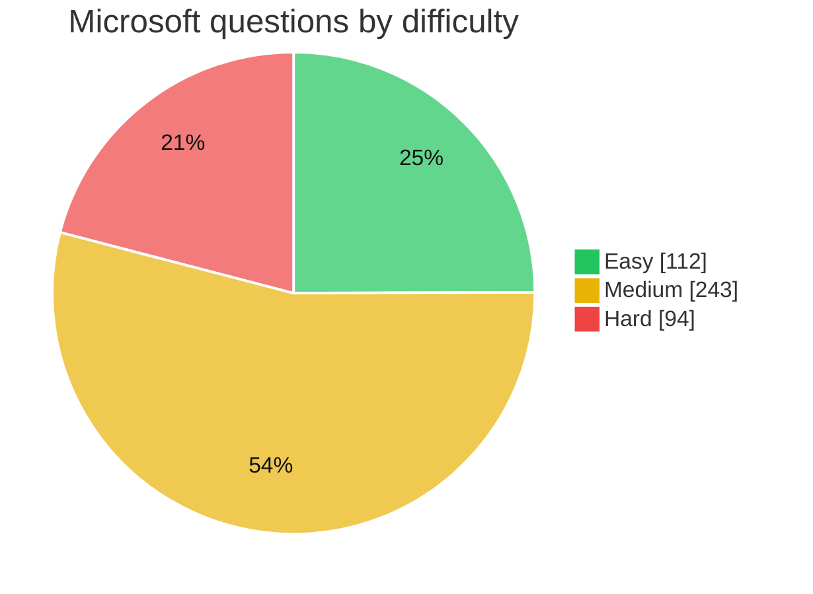

[← All companies](../README.md) · [Most asked across companies](../most-asked.md)

# Microsoft Coding Questions

   

**449 Microsoft coding questions** — 112 easy, 243 medium and 94 hard. Each one links to a free page where you can solve it in 13 languages, with hints and an editorial.

449 problems the CodeKairo catalogue tags as commonly asked in Microsoft's coding rounds — 112 easy, 243 medium and 94 hard — each judged by hidden tests in 13 languages. The most common topics among them are Arrays (206), Strings (92) and Dynamic Programming (82). Tagged for Microsoft and no other company: Convert Date to Binary. CodeKairo's Microsoft — Online Assessment mock covers the Microsoft online assessment pattern: two coding problems on a platform such as Codility or HackerRank, and nothing that is not code. The tag is the catalogue's own annotation of where a problem tends to come up — not a list published by Microsoft, which CodeKairo is not affiliated with.

**Practise on CodeKairo:** [All 449 Microsoft questions](https://codekairo.com/challenges/company/microsoft?utm_source=github) · [Microsoft — Online Assessment mock test](https://codekairo.com/tests/microsoft-online-assessment?utm_source=github) · [Microsoft hiring process, round by round](https://codekairo.com/simulations/microsoft?utm_source=github)

## Contents

- [Start with these 10](#start-with-these-10)
- [Topics Microsoft asks most](#topics-microsoft-asks-most)
- 🟢 [Easy (112)](#easy-112)
- 🟡 [Medium (243)](#medium-243)
- 🔴 [Hard (94)](#hard-94)

## Start with these 10

The Microsoft questions most other companies ask too — the patterns worth knowing first.

1. 🔴 [Word Ladder](https://codekairo.com/problems/word-ladder?utm_source=github) — also asked at 9 other companies
2. 🔴 [Text Justification](https://codekairo.com/problems/text-justification?utm_source=github) — also asked at 9 other companies
3. 🟡 [Word Search](https://codekairo.com/problems/word-search?utm_source=github) — also asked at 8 other companies
4. 🟢 [Reverse String](https://codekairo.com/problems/reverse-string?utm_source=github) — also asked at 7 other companies
5. 🟢 [First Unique Character in a String](https://codekairo.com/problems/first-unique-character-in-a-string?utm_source=github) — also asked at 7 other companies
6. 🟡 [Count Primes](https://codekairo.com/problems/count-primes?utm_source=github) — also asked at 7 other companies
7. 🟡 [Reverse Words in a String](https://codekairo.com/problems/reverse-words-in-a-string?utm_source=github) — also asked at 7 other companies
8. 🟡 [String Compression](https://codekairo.com/problems/string-compression?utm_source=github) — also asked at 7 other companies
9. 🟡 [Game of Life](https://codekairo.com/problems/game-of-life?utm_source=github) — also asked at 7 other companies
10. 🔴 [The Skyline Problem](https://codekairo.com/problems/the-skyline-problem?utm_source=github) — also asked at 7 other companies

## Topics Microsoft asks most

[Arrays](https://codekairo.com/challenges/arrays?utm_source=github) (206) · [Strings](https://codekairo.com/challenges/strings?utm_source=github) (92) · [Dynamic Programming](https://codekairo.com/challenges/dynamic-programming?utm_source=github) (82) · [Depth-First Search](https://codekairo.com/challenges/depth-first-search?utm_source=github) (72) · [Trees](https://codekairo.com/challenges/trees?utm_source=github) (72) · [Math](https://codekairo.com/challenges/math?utm_source=github) (60) · [Hash Table](https://codekairo.com/challenges/hash-table?utm_source=github) (53) · [Matrix](https://codekairo.com/challenges/matrix?utm_source=github) (47) · [Breadth-First Search](https://codekairo.com/challenges/breadth-first-search?utm_source=github) (46) · [Greedy](https://codekairo.com/challenges/greedy?utm_source=github) (43)

## Easy (112)

| # | Question | Topics | Acceptance |
|---:|---|---|---:|
| 2 | 🟢 [Reverse String](https://codekairo.com/problems/reverse-string?utm_source=github) | Two Pointers, Strings | — |
| 157 | 🟢 [Excel Sheet Column Number](https://codekairo.com/problems/excel-sheet-column-number?utm_source=github) | Math, Strings | — |
| 158 | 🟢 [Excel Sheet Column Title](https://codekairo.com/problems/excel-sheet-column-title?utm_source=github) | Math, Strings | — |
| 159 | 🟢 [Roman to Integer](https://codekairo.com/problems/roman-to-integer?utm_source=github) | Hash Table, Math, Strings | — |
| 187 | 🟢 [Running Sum of 1d Array](https://codekairo.com/problems/running-sum-of-1d-array?utm_source=github) | Arrays, Prefix Sum | 80% |
| 191 | 🟢 [Build Array from Permutation](https://codekairo.com/problems/build-array-from-permutation?utm_source=github) | Arrays, Simulation | — |
| 197 | 🟢 [Max Consecutive Ones](https://codekairo.com/problems/max-consecutive-ones?utm_source=github) | Arrays | — |
| 199 | 🟢 [Can Place Flowers](https://codekairo.com/problems/can-place-flowers?utm_source=github) | Arrays, Greedy | — |
| 205 | 🟢 [Height Checker](https://codekairo.com/problems/height-checker?utm_source=github) | Arrays, Sorting, Counting Sort | — |
| 206 | 🟢 [Relative Sort Array](https://codekairo.com/problems/relative-sort-array?utm_source=github) | Arrays, Hash Table, Sorting | — |
| 213 | 🟢 [First Unique Character in a String](https://codekairo.com/problems/first-unique-character-in-a-string?utm_source=github) | Hash Table, Strings, Queue | — |
| 215 | 🟢 [Length of Last Word](https://codekairo.com/problems/length-of-last-word?utm_source=github) | Strings | — |
| 217 | 🟢 [Repeated Substring Pattern](https://codekairo.com/problems/repeated-substring-pattern?utm_source=github) | Strings, String Matching | — |
| 225 | 🟢 [Shuffle String](https://codekairo.com/problems/shuffle-string?utm_source=github) | Arrays, Strings | — |
| 234 | 🟢 [Rotate String](https://codekairo.com/problems/rotate-string?utm_source=github) | Strings, String Matching | — |
| 235 | 🟢 [Unique Email Addresses](https://codekairo.com/problems/unique-email-addresses?utm_source=github) | Arrays, Hash Table, Strings | — |
| 240 | 🟢 [Check If Two String Arrays Are Equivalent](https://codekairo.com/problems/check-if-two-string-arrays-are-equivalent?utm_source=github) | Arrays, Strings | — |
| 253 | 🟢 [Remove Element](https://codekairo.com/problems/remove-element?utm_source=github) | Arrays, Two Pointers | — |
| 271 | 🟢 [Left and Right Sum Differences](https://codekairo.com/problems/left-and-right-sum-differences?utm_source=github) | Arrays, Prefix Sum | — |
| 274 | 🟢 [Maximum Count of Positive Integer and Negative Integer](https://codekairo.com/problems/maximum-count-of-positive-integer-and-negative-integer?utm_source=github) | Arrays, Binary Search, Counting | — |
| 278 | 🟢 [Reshape the Matrix](https://codekairo.com/problems/reshape-the-matrix?utm_source=github) | Arrays, Matrix, Simulation | — |
| 281 | 🟢 [Count Negative Numbers in a Sorted Matrix](https://codekairo.com/problems/count-negative-numbers-in-a-sorted-matrix?utm_source=github) | Arrays, Binary Search, Matrix | — |
| 283 | 🟢 [Shift 2D Grid](https://codekairo.com/problems/shift-2d-grid?utm_source=github) | Arrays, Matrix, Simulation | — |
| 284 | 🟢 [The K Weakest Rows in a Matrix](https://codekairo.com/problems/the-k-weakest-rows-in-a-matrix?utm_source=github) | Arrays, Binary Search, Sorting | — |
| 298 | 🟢 [Row With Maximum Ones](https://codekairo.com/problems/row-with-maximum-ones?utm_source=github) | Arrays, Matrix | — |
| 302 | 🟢 [Convert 1D Array Into 2D Array](https://codekairo.com/problems/convert-1d-array-into-2d-array?utm_source=github) | Arrays, Matrix, Simulation | — |
| 304 | 🟢 [Find Winner on a Tic Tac Toe Game](https://codekairo.com/problems/find-winner-on-a-tic-tac-toe-game?utm_source=github) | Arrays, Hash Table, Matrix | — |
| 307 | 🟢 [Special Positions in a Binary Matrix](https://codekairo.com/problems/special-positions-in-a-binary-matrix?utm_source=github) | Arrays, Matrix | — |
| 372 | 🟢 [Sort Even and Odd Indices Independently](https://codekairo.com/problems/sort-even-and-odd-indices-independently?utm_source=github) | Arrays, Sorting | — |
| 409 | 🟢 [Number of 1 Bits](https://codekairo.com/problems/number-of-1-bits?utm_source=github) | Divide and Conquer, Bit Manipulation | — |
| 413 | 🟢 [Power of Four](https://codekairo.com/problems/power-of-four?utm_source=github) | Math, Bit Manipulation, Recursion | — |
| 420 | 🟢 [Convert a Number to Hexadecimal](https://codekairo.com/problems/convert-a-number-to-hexadecimal?utm_source=github) | Math, Bit Manipulation | — |
| 490 | 🟢 [Minimum Value to Get Positive Step by Step Sum](https://codekairo.com/problems/minimum-value-to-get-positive-step-by-step-sum?utm_source=github) | Arrays, Prefix Sum | — |
| 498 | 🟢 [Minimum Operations to Make the Array Increasing](https://codekairo.com/problems/minimum-operations-to-make-the-array-increasing?utm_source=github) | Arrays, Greedy | — |
| 514 | 🟢 [Greatest Common Divisor of Strings](https://codekairo.com/problems/greatest-common-divisor-of-strings?utm_source=github) | Strings, Math | — |
| 527 | 🟢 [Longest Nice Substring](https://codekairo.com/problems/longest-nice-substring?utm_source=github) | Strings, Divide and Conquer | — |
| 541 | 🟢 [Add to Array-Form of Integer](https://codekairo.com/problems/add-to-array-form-of-integer?utm_source=github) | Arrays, Math | — |
| 779 | 🟢 [Maximum Sum Subarray of Size K](https://codekairo.com/problems/maximum-sum-subarray-of-size-k?utm_source=github) | Arrays, Sliding Window | — |
| 782 | 🟢 [Defuse the Bomb](https://codekairo.com/problems/defuse-the-bomb?utm_source=github) | Arrays, Sliding Window, Simulation | — |
| 784 | 🟢 [Count Subarrays of Length Three With a Condition](https://codekairo.com/problems/count-subarrays-of-length-three-with-a-condition?utm_source=github) | Arrays, Sliding Window | — |
| 809 | 🟢 [Find Smallest Letter Greater Than Target](https://codekairo.com/problems/find-smallest-letter-greater-than-target?utm_source=github) | Arrays, Binary Search | — |
| 811 | 🟢 [Sqrt(x)](https://codekairo.com/problems/sqrtx?utm_source=github) | Math, Binary Search | — |
| 839 | 🟢 [Take Gifts From the Richest Pile](https://codekairo.com/problems/take-gifts-from-the-richest-pile?utm_source=github) | Arrays, Heap, Simulation | — |
| 847 | 🟢 [Minimum Moves to Convert String](https://codekairo.com/problems/minimum-moves-to-convert-string?utm_source=github) | Strings, Greedy | — |
| 850 | 🟢 [Determine the Winner of a Bowling Game](https://codekairo.com/problems/determine-the-winner-of-a-bowling-game?utm_source=github) | Arrays, Simulation | — |
| 1108 | 🟢 [Check if Array Is Sorted and Rotated](https://codekairo.com/problems/check-if-array-is-sorted-and-rotated?utm_source=github) | Arrays, Sorting | — |
| 1180 | 🟢 [String Matching in an Array](https://codekairo.com/problems/string-matching-in-an-array?utm_source=github) | Arrays, Strings, String Matching | — |
| 1181 | 🟢 [Consecutive Characters](https://codekairo.com/problems/consecutive-characters?utm_source=github) | Strings, Two Pointers | — |
| 1184 | 🟢 [Slowest Key](https://codekairo.com/problems/slowest-key?utm_source=github) | Arrays, Strings | — |
| 1189 | 🟢 [Longer Contiguous Segments of Ones than Zeros](https://codekairo.com/problems/longer-contiguous-segments-of-ones-than-zeros?utm_source=github) | Strings, Counting | — |
| 1191 | 🟢 [Check if Numbers Are Ascending in a Sentence](https://codekairo.com/problems/check-if-numbers-are-ascending-in-a-sentence?utm_source=github) | Strings, Simulation | — |
| 1192 | 🟢 [Number of Valid Words in a Sentence](https://codekairo.com/problems/number-of-valid-words-in-a-sentence?utm_source=github) | Strings, Simulation | — |
| 1196 | 🟢 [Remove Digit From Number to Maximize Result](https://codekairo.com/problems/remove-digit-from-number-to-maximize-result?utm_source=github) | Strings, Greedy, Enumeration | — |
| 1198 | 🟢 [Greatest English Letter in Upper and Lower Case](https://codekairo.com/problems/greatest-english-letter-in-upper-and-lower-case?utm_source=github) | Hash Table, Strings, Enumeration | — |
| 1288 | 🟢 [Number of Days Between Two Dates](https://codekairo.com/problems/number-of-days-between-two-dates?utm_source=github) | Math, Strings | — |
| 1289 | 🟢 [Day of the Week](https://codekairo.com/problems/day-of-the-week?utm_source=github) | Math | — |
| 1301 | 🟢 [Rectangle Overlap](https://codekairo.com/problems/rectangle-overlap?utm_source=github) | Math, Geometry | — |
| 1416 | 🟢 [Nearest Smaller Element](https://codekairo.com/problems/nearest-smaller-element?utm_source=github) | Arrays, Stack, Monotonic Stack | — |
| 1614 | 🟢 [Count Ways to Tile a 2 x N Floor](https://codekairo.com/problems/count-ways-to-tile-a-floor?utm_source=github) | Math, Dynamic Programming | — |
| 1744 | 🟢 [Robot Return to Origin](https://codekairo.com/problems/robot-return-to-origin?utm_source=github) | Strings, Simulation | — |
| 1755 | 🟢 [Cells in a Range on an Excel Sheet](https://codekairo.com/problems/cells-in-a-range-on-an-excel-sheet?utm_source=github) | Strings | — |
| 1768 | 🟢 [Latest Time You Can Obtain After Replacing Characters](https://codekairo.com/problems/latest-time-you-can-obtain-after-replacing-characters?utm_source=github) | Strings, Enumeration | — |
| 1772 | 🟢 [Convert Date to Binary](https://codekairo.com/problems/convert-date-to-binary?utm_source=github) | Math, Strings | — |
| 1827 | 🟢 [Maximum Difference Between Even and Odd Frequency I](https://codekairo.com/problems/maximum-difference-between-even-and-odd-frequency-i?utm_source=github) | Hash Table, Strings, Counting | — |
| 1835 | 🟢 [Longest Continuous Increasing Subsequence](https://codekairo.com/problems/longest-continuous-increasing-subsequence?utm_source=github) | Arrays | — |
| 1840 | 🟢 [Semi-Ordered Permutation](https://codekairo.com/problems/semi-ordered-permutation?utm_source=github) | Arrays, Simulation | — |
| 1859 | 🟢 [Binary Tree Inorder Traversal](https://codekairo.com/problems/binary-tree-inorder-traversal?utm_source=github) | Trees, Depth-First Search, Stack | — |
| 1860 | 🟢 [Binary Tree Preorder Traversal](https://codekairo.com/problems/binary-tree-preorder-traversal?utm_source=github) | Trees, Depth-First Search, Stack | — |
| 1861 | 🟢 [Binary Tree Postorder Traversal](https://codekairo.com/problems/binary-tree-postorder-traversal?utm_source=github) | Trees, Depth-First Search, Stack | — |
| 1862 | 🟢 [Same Tree](https://codekairo.com/problems/same-tree?utm_source=github) | Trees, Depth-First Search, Breadth-First Search | — |
| 1863 | 🟢 [Symmetric Tree](https://codekairo.com/problems/symmetric-tree?utm_source=github) | Trees, Depth-First Search, Breadth-First Search | — |
| 1864 | 🟢 [Maximum Depth of Binary Tree](https://codekairo.com/problems/maximum-depth-of-binary-tree?utm_source=github) | Trees, Depth-First Search, Breadth-First Search | — |
| 1865 | 🟢 [Minimum Depth of Binary Tree](https://codekairo.com/problems/minimum-depth-of-binary-tree?utm_source=github) | Trees, Depth-First Search, Breadth-First Search | — |
| 1866 | 🟢 [Balanced Binary Tree](https://codekairo.com/problems/balanced-binary-tree?utm_source=github) | Trees, Depth-First Search | — |
| 1867 | 🟢 [Path Sum](https://codekairo.com/problems/path-sum?utm_source=github) | Trees, Depth-First Search, Breadth-First Search | — |
| 1868 | 🟢 [Invert Binary Tree](https://codekairo.com/problems/invert-binary-tree?utm_source=github) | Trees, Depth-First Search, Breadth-First Search | — |
| 1871 | 🟢 [Find Mode in Binary Search Tree](https://codekairo.com/problems/find-mode-in-binary-search-tree?utm_source=github) | Trees, Depth-First Search | — |
| 1872 | 🟢 [Minimum Absolute Difference in BST](https://codekairo.com/problems/minimum-absolute-difference-in-bst?utm_source=github) | Trees, Depth-First Search, Breadth-First Search | — |
| 1873 | 🟢 [Diameter of Binary Tree](https://codekairo.com/problems/diameter-of-binary-tree?utm_source=github) | Trees, Depth-First Search | — |
| 1875 | 🟢 [Subtree of Another Tree](https://codekairo.com/problems/subtree-of-another-tree?utm_source=github) | Trees, Depth-First Search, String Matching | — |
| 1876 | 🟢 [Merge Two Binary Trees](https://codekairo.com/problems/merge-two-binary-trees?utm_source=github) | Trees, Depth-First Search, Breadth-First Search | — |
| 1877 | 🟢 [Two Sum IV - Input is a BST](https://codekairo.com/problems/two-sum-iv-input-is-a-bst?utm_source=github) | Trees, Depth-First Search, Hash Table | — |
| 1878 | 🟢 [Second Minimum Node In a Binary Tree](https://codekairo.com/problems/second-minimum-node-in-a-binary-tree?utm_source=github) | Trees, Depth-First Search | — |
| 1879 | 🟢 [Search in a Binary Search Tree](https://codekairo.com/problems/search-in-a-binary-search-tree?utm_source=github) | Trees, Binary Search | — |
| 1885 | 🟢 [Sum of Root To Leaf Binary Numbers](https://codekairo.com/problems/sum-of-root-to-leaf-binary-numbers?utm_source=github) | Trees, Depth-First Search, Bit Manipulation | — |
| 1888 | 🟢 [Convert Sorted Array to Binary Search Tree](https://codekairo.com/problems/convert-sorted-array-to-binary-search-tree?utm_source=github) | Arrays, Divide and Conquer, Trees | — |
| 1889 | 🟢 [Count Complete Tree Nodes](https://codekairo.com/problems/count-complete-tree-nodes?utm_source=github) | Binary Search, Bit Manipulation, Trees | — |
| 1891 | 🟢 [Transform to Sum Tree](https://codekairo.com/problems/transform-to-sum-tree?utm_source=github) | Trees, Depth-First Search, Recursion | — |
| 1892 | 🟢 [Children Sum in a Binary Tree](https://codekairo.com/problems/children-sum-property?utm_source=github) | Trees, Depth-First Search | — |
| 1894 | 🟢 [Check if Two Trees are Isomorphic](https://codekairo.com/problems/isomorphic-trees?utm_source=github) | Trees, Depth-First Search, Recursion | — |
| 1895 | 🟢 [Nodes at Distance K from Root](https://codekairo.com/problems/k-distance-from-root?utm_source=github) | Trees, Depth-First Search, Breadth-First Search | — |
| 1896 | 🟢 [Ceil in BST](https://codekairo.com/problems/ceil-in-bst?utm_source=github) | Trees, Binary Search | — |
| 1897 | 🟢 [Kth Largest Element in BST](https://codekairo.com/problems/kth-largest-element-in-bst?utm_source=github) | Trees, Depth-First Search, Stack | — |
| 1899 | 🟢 [Count BST Nodes That Lie in a Given Range](https://codekairo.com/problems/count-bst-nodes-in-a-range?utm_source=github) | Trees, Binary Search, Depth-First Search | — |
| 1900 | 🟢 [Sum of Leaf Nodes at Minimum Level](https://codekairo.com/problems/sum-of-leaf-nodes-at-minimum-level?utm_source=github) | Trees, Breadth-First Search | — |
| 1986 | 🟢 [Merge Two Sorted Lists](https://codekairo.com/problems/merge-two-sorted-lists?utm_source=github) | Linked List, Recursion, Two Pointers | — |
| 1987 | 🟢 [Remove Duplicates from Sorted List](https://codekairo.com/problems/remove-duplicates-from-sorted-list?utm_source=github) | Linked List, Two Pointers | — |
| 1988 | 🟢 [Remove Linked List Elements](https://codekairo.com/problems/remove-linked-list-elements?utm_source=github) | Linked List, Recursion | — |
| 1989 | 🟢 [Reverse Linked List](https://codekairo.com/problems/reverse-linked-list?utm_source=github) | Linked List, Recursion | — |
| 1990 | 🟢 [Palindrome Linked List](https://codekairo.com/problems/palindrome-linked-list?utm_source=github) | Linked List, Two Pointers, Stack | — |
| 1991 | 🟢 [Middle of the Linked List](https://codekairo.com/problems/middle-of-the-linked-list?utm_source=github) | Linked List, Two Pointers | — |
| 1993 | 🟢 [Intersection of Two Sorted Linked Lists](https://codekairo.com/problems/intersection-of-two-sorted-linked-lists?utm_source=github) | Linked List, Two Pointers | — |
| 1994 | 🟢 [Remove Duplicates from an Unsorted Linked List](https://codekairo.com/problems/remove-duplicates-from-an-unsorted-linked-list?utm_source=github) | Linked List, Hash Table | — |
| 1995 | 🟢 [Sort a Linked List of 0s, 1s and 2s](https://codekairo.com/problems/sort-a-linked-list-of-0s-1s-and-2s?utm_source=github) | Linked List, Sorting, Counting | — |
| 1997 | 🟢 [Nth Node From End of Linked List](https://codekairo.com/problems/nth-node-from-end-of-linked-list?utm_source=github) | Linked List, Two Pointers | — |
| 1998 | 🟢 [Insert in a Sorted Linked List](https://codekairo.com/problems/insert-in-a-sorted-linked-list?utm_source=github) | Linked List | — |
| 2000 | 🟢 [Delete N Nodes After M Nodes of a Linked List](https://codekairo.com/problems/delete-n-nodes-after-m-nodes?utm_source=github) | Linked List, Simulation | — |
| 2036 | 🟢 [Implement Stack using Queues](https://codekairo.com/problems/implement-stack-using-queues?utm_source=github) | Stack, Queue, Design | — |
| 2037 | 🟢 [Implement Queue using Stacks](https://codekairo.com/problems/implement-queue-using-stacks?utm_source=github) | Stack, Queue, Design | — |
| 2039 | 🟢 [Design HashSet](https://codekairo.com/problems/design-hashset?utm_source=github) | Arrays, Hash Table, Design | — |
| 2040 | 🟢 [Design HashMap](https://codekairo.com/problems/design-hashmap?utm_source=github) | Arrays, Hash Table, Design | — |
| 2042 | 🟢 [Design Parking System](https://codekairo.com/problems/design-parking-system?utm_source=github) | Design, Simulation, Counting | — |

## Medium (243)

| # | Question | Topics | Acceptance |
|---:|---|---|---:|
| 149 | 🟡 [Reverse Integer](https://codekairo.com/problems/reverse-integer?utm_source=github) | Math | — |
| 150 | 🟡 [Count Primes](https://codekairo.com/problems/count-primes?utm_source=github) | Math, Sieve of Eratosthenes | — |
| 160 | 🟡 [Integer to Roman](https://codekairo.com/problems/integer-to-roman?utm_source=github) | Hash Table, Math, Strings | — |
| 183 | 🟡 [Find All Duplicates in an Array](https://codekairo.com/problems/find-all-duplicates-in-an-array?utm_source=github) | Arrays, Hash Table | — |
| 185 | 🟡 [Next Permutation](https://codekairo.com/problems/next-permutation?utm_source=github) | Arrays, Two Pointers | — |
| 208 | 🟡 [Increasing Triplet Subsequence](https://codekairo.com/problems/increasing-triplet-subsequence?utm_source=github) | Arrays, Greedy | — |
| 210 | 🟡 [Reverse Words in a String](https://codekairo.com/problems/reverse-words-in-a-string?utm_source=github) | Two Pointers, Strings | — |
| 218 | 🟡 [Count and Say](https://codekairo.com/problems/count-and-say?utm_source=github) | Strings, Simulation | — |
| 219 | 🟡 [String Compression](https://codekairo.com/problems/string-compression?utm_source=github) | Two Pointers, Strings | — |
| 247 | 🟡 [Longest Subarray of 1's After Deleting One Element](https://codekairo.com/problems/longest-subarray-of-1s-after-deleting-one-element?utm_source=github) | Arrays, Dynamic Programming, Sliding Window | — |
| 252 | 🟡 [Remove Duplicates from Sorted Array II](https://codekairo.com/problems/remove-duplicates-from-sorted-array-ii?utm_source=github) | Arrays, Two Pointers | — |
| 275 | 🟡 [Spiral Matrix II](https://codekairo.com/problems/spiral-matrix-ii?utm_source=github) | Arrays, Matrix, Simulation | — |
| 287 | 🟡 [Sort the Matrix Diagonally](https://codekairo.com/problems/sort-the-matrix-diagonally?utm_source=github) | Arrays, Sorting, Matrix | — |
| 288 | 🟡 [Minimum Path Sum](https://codekairo.com/problems/minimum-path-sum?utm_source=github) | Arrays, Dynamic Programming, Matrix | — |
| 289 | 🟡 [Unique Paths II](https://codekairo.com/problems/unique-paths-ii?utm_source=github) | Arrays, Dynamic Programming, Matrix | — |
| 293 | 🟡 [Game of Life](https://codekairo.com/problems/game-of-life?utm_source=github) | Arrays, Matrix, Simulation | — |
| 294 | 🟡 [Surrounded Regions](https://codekairo.com/problems/surrounded-regions?utm_source=github) | Arrays, Depth-First Search, Breadth-First Search | — |
| 300 | 🟡 [Count Servers that Communicate](https://codekairo.com/problems/count-servers-that-communicate?utm_source=github) | Arrays, Depth-First Search, Breadth-First Search | — |
| 318 | 🟡 [Delete Operation for Two Strings](https://codekairo.com/problems/delete-operation-for-two-strings?utm_source=github) | Strings, Dynamic Programming | — |
| 319 | 🟡 [Interleaving String](https://codekairo.com/problems/interleaving-string?utm_source=github) | Strings, Dynamic Programming | — |
| 324 | 🟡 [Ugly Number II](https://codekairo.com/problems/ugly-number-ii?utm_source=github) | Hash Table, Math, Dynamic Programming | — |
| 328 | 🟡 [Last Stone Weight II](https://codekairo.com/problems/last-stone-weight-ii?utm_source=github) | Arrays, Dynamic Programming | — |
| 340 | 🟡 [Knight Dialer](https://codekairo.com/problems/knight-dialer?utm_source=github) | Dynamic Programming | — |
| 343 | 🟡 [Queue Reconstruction by Height](https://codekairo.com/problems/queue-reconstruction-by-height?utm_source=github) | Arrays, Greedy, Sorting | — |
| 344 | 🟡 [Reduce Array Size to The Half](https://codekairo.com/problems/reduce-array-size-to-the-half?utm_source=github) | Arrays, Hash Table, Greedy | — |
| 346 | 🟡 [Minimum Deletions to Make Character Frequencies Unique](https://codekairo.com/problems/minimum-deletions-to-make-character-frequencies-unique?utm_source=github) | Strings, Hash Table, Greedy | — |
| 347 | 🟡 [Minimum Number of Steps to Make Two Strings Anagram](https://codekairo.com/problems/minimum-number-of-steps-to-make-two-strings-anagram?utm_source=github) | Hash Table, Strings, Counting | — |
| 348 | 🟡 [Remove Covered Intervals](https://codekairo.com/problems/remove-covered-intervals?utm_source=github) | Arrays, Greedy, Sorting | — |
| 351 | 🟡 [Largest Number](https://codekairo.com/problems/largest-number?utm_source=github) | Arrays, Strings, Greedy | — |
| 357 | 🟡 [Maximum Swap](https://codekairo.com/problems/maximum-swap?utm_source=github) | Math, Greedy | — |
| 363 | 🟡 [Partition Array into Disjoint Intervals](https://codekairo.com/problems/partition-array-into-disjoint-intervals?utm_source=github) | Arrays, Greedy | — |
| 364 | 🟡 [K Closest Points to Origin](https://codekairo.com/problems/k-closest-points-to-origin?utm_source=github) | Arrays, Math, Divide and Conquer | — |
| 386 | 🟡 [Next Greater Element III](https://codekairo.com/problems/next-greater-element-iii?utm_source=github) | Math, Two Pointers, Strings | — |
| 387 | 🟡 [Validate Stack Sequences](https://codekairo.com/problems/validate-stack-sequences?utm_source=github) | Arrays, Stack, Simulation | — |
| 389 | 🟡 [Basic Calculator II](https://codekairo.com/problems/basic-calculator-ii?utm_source=github) | Math, Strings, Stack | — |
| 390 | 🟡 [Reverse Substrings Between Each Pair of Parentheses](https://codekairo.com/problems/reverse-substrings-between-each-pair-of-parentheses?utm_source=github) | Strings, Stack | — |
| 393 | 🟡 [Dota2 Senate](https://codekairo.com/problems/dota2-senate?utm_source=github) | Strings, Greedy, Queue | — |
| 407 | 🟡 [Single Number II](https://codekairo.com/problems/single-number-ii?utm_source=github) | Arrays, Bit Manipulation | — |
| 414 | 🟡 [Bitwise AND of Numbers Range](https://codekairo.com/problems/bitwise-and-of-numbers-range?utm_source=github) | Bit Manipulation | — |
| 415 | 🟡 [Sum of Two Integers](https://codekairo.com/problems/sum-of-two-integers?utm_source=github) | Math, Bit Manipulation | — |
| 416 | 🟡 [Maximum XOR of Two Numbers in an Array](https://codekairo.com/problems/maximum-xor-of-two-numbers-in-an-array?utm_source=github) | Arrays, Hash Table, Bit Manipulation | — |
| 423 | 🟡 [Gray Code](https://codekairo.com/problems/gray-code?utm_source=github) | Math, Backtracking, Bit Manipulation | — |
| 431 | 🟡 [Divide Two Integers](https://codekairo.com/problems/divide-two-integers?utm_source=github) | Math, Bit Manipulation | — |
| 436 | 🟡 [Bulb Switcher](https://codekairo.com/problems/bulb-switcher?utm_source=github) | Math, Brainteaser | — |
| 445 | 🟡 [Keys and Rooms](https://codekairo.com/problems/keys-and-rooms?utm_source=github) | Depth-First Search, Breadth-First Search, Graph | — |
| 447 | 🟡 [Find Eventual Safe States](https://codekairo.com/problems/find-eventual-safe-states?utm_source=github) | Depth-First Search, Breadth-First Search, Graph | — |
| 453 | 🟡 [Number of Operations to Make Network Connected](https://codekairo.com/problems/number-of-operations-to-make-network-connected?utm_source=github) | Depth-First Search, Breadth-First Search, Union Find | — |
| 460 | 🟡 [Reorder Routes to Make All Paths Lead to the City Zero](https://codekairo.com/problems/reorder-routes-to-make-all-paths-lead-to-the-city-zero?utm_source=github) | Depth-First Search, Breadth-First Search, Graph | — |
| 461 | 🟡 [Time Needed to Inform All Employees](https://codekairo.com/problems/time-needed-to-inform-all-employees?utm_source=github) | Trees, Depth-First Search, Breadth-First Search | — |
| 462 | 🟡 [Path With Minimum Effort](https://codekairo.com/problems/path-with-minimum-effort?utm_source=github) | Arrays, Binary Search, Depth-First Search | — |
| 463 | 🟡 [Maximal Network Rank](https://codekairo.com/problems/maximal-network-rank?utm_source=github) | Graph | — |
| 469 | 🟡 [Minimum Genetic Mutation](https://codekairo.com/problems/minimum-genetic-mutation?utm_source=github) | Hash Table, Strings, Breadth-First Search | — |
| 471 | 🟡 [Snakes and Ladders](https://codekairo.com/problems/snakes-and-ladders?utm_source=github) | Arrays, Breadth-First Search, Matrix | — |
| 473 | 🟡 [Word Search](https://codekairo.com/problems/word-search?utm_source=github) | Arrays, Strings, Backtracking | — |
| 482 | 🟡 [K-diff Pairs in an Array](https://codekairo.com/problems/k-diff-pairs-in-an-array?utm_source=github) | Arrays, Hash Table | — |
| 609 | 🟡 [Count Inversions](https://codekairo.com/problems/count-inversions?utm_source=github) | Arrays, Divide and Conquer, Binary Indexed Tree | — |
| 618 | 🟡 [Maximum Index](https://codekairo.com/problems/maximum-index?utm_source=github) | Arrays, Two Pointers | — |
| 619 | 🟡 [Kth Smallest Element](https://codekairo.com/problems/kth-smallest-element?utm_source=github) | Arrays, Sorting, Quickselect | — |
| 647 | 🟡 [Maximum Number of Occurrences of a Substring](https://codekairo.com/problems/maximum-number-of-occurrences-of-a-substring?utm_source=github) | Strings, Sliding Window, Hash Table | — |
| 672 | 🟡 [Maximum Size Subarray Sum Equals k](https://codekairo.com/problems/maximum-size-subarray-sum-equals-k?utm_source=github) | Arrays, Hash Table, Prefix Sum | — |
| 685 | 🟡 [4Sum II](https://codekairo.com/problems/4sum-ii?utm_source=github) | Hash Table, Arrays, Counting | — |
| 704 | 🟡 [Minimum Operations to Reduce an Integer to 0](https://codekairo.com/problems/minimum-operations-to-reduce-an-integer-to-0?utm_source=github) | Bit Manipulation, Greedy, Dynamic Programming | — |
| 710 | 🟡 [Super Ugly Number](https://codekairo.com/problems/super-ugly-number?utm_source=github) | Dynamic Programming, Math, Heap | — |
| 770 | 🟡 [The k Strongest Values in an Array](https://codekairo.com/problems/the-k-strongest-values-in-an-array?utm_source=github) | Arrays, Two Pointers, Sorting | — |
| 790 | 🟡 [K Radius Subarray Averages](https://codekairo.com/problems/k-radius-subarray-averages?utm_source=github) | Arrays, Sliding Window, Prefix Sum | — |
| 798 | 🟡 [Count Complete Subarrays in an Array](https://codekairo.com/problems/count-complete-subarrays-in-an-array?utm_source=github) | Arrays, Hash Table, Sliding Window | — |
| 803 | 🟡 [Minimum Consecutive Cards to Pick Up](https://codekairo.com/problems/minimum-consecutive-cards-to-pick-up?utm_source=github) | Arrays, Hash Table, Sliding Window | — |
| 814 | 🟡 [Find First and Last Position of Element in Sorted Array](https://codekairo.com/problems/find-first-and-last-position-of-element-in-sorted-array?utm_source=github) | Arrays, Binary Search | — |
| 828 | 🟡 [Search a 2D Matrix II](https://codekairo.com/problems/search-a-2d-matrix-ii?utm_source=github) | Arrays, Matrix, Binary Search | — |
| 844 | 🟡 [Removing Minimum and Maximum From Array](https://codekairo.com/problems/removing-minimum-and-maximum-from-array?utm_source=github) | Arrays, Greedy | — |
| 853 | 🟡 [Maximum Consecutive Floors Without Special Floors](https://codekairo.com/problems/maximum-consecutive-floors-without-special-floors?utm_source=github) | Arrays, Sorting, Greedy | — |
| 872 | 🟡 [Count Alternating Subarrays](https://codekairo.com/problems/count-alternating-subarrays?utm_source=github) | Arrays, Math, Dynamic Programming | — |
| 901 | 🟡 [Difference Between Ones and Zeros in Row and Column](https://codekairo.com/problems/difference-between-ones-and-zeros-in-row-and-column?utm_source=github) | Arrays, Matrix, Simulation | — |
| 907 | 🟡 [Rotating the Box](https://codekairo.com/problems/rotating-the-box?utm_source=github) | Arrays, Matrix, Two Pointers | — |
| 910 | 🟡 [Convert an Array Into a 2D Array With Conditions](https://codekairo.com/problems/convert-an-array-into-a-2d-array-with-conditions?utm_source=github) | Arrays, Matrix, Hash Table | — |
| 911 | 🟡 [Map of Highest Peak](https://codekairo.com/problems/map-of-highest-peak?utm_source=github) | Arrays, Matrix, Breadth-First Search | — |
| 914 | 🟡 [Maximum Number of Fish in a Grid](https://codekairo.com/problems/maximum-number-of-fish-in-a-grid?utm_source=github) | Arrays, Matrix, Depth-First Search | — |
| 937 | 🟡 [Shortest Path with Alternating Colors](https://codekairo.com/problems/shortest-path-with-alternating-colors?utm_source=github) | Graph, Breadth-First Search | — |
| 951 | 🟡 [Number of Ways to Arrive at Destination](https://codekairo.com/problems/number-of-ways-to-arrive-at-destination?utm_source=github) | Graph, Dynamic Programming, Shortest Path | — |
| 979 | 🟡 [Process Tasks Using Servers](https://codekairo.com/problems/process-tasks-using-servers?utm_source=github) | Arrays, Simulation, Heap | — |
| 989 | 🟡 [Maximum Value of an Ordered Triplet II](https://codekairo.com/problems/maximum-value-of-an-ordered-triplet-ii?utm_source=github) | Arrays, Prefix Sum | — |
| 1005 | 🟡 [Alternating Groups II](https://codekairo.com/problems/alternating-groups-ii?utm_source=github) | Arrays, Sliding Window | — |
| 1026 | 🟡 [Minimum Number of Changes to Make Binary String Beautiful](https://codekairo.com/problems/minimum-number-of-changes-to-make-binary-string-beautiful?utm_source=github) | Strings, Greedy | — |
| 1032 | 🟡 [Construct String With Repeat Limit](https://codekairo.com/problems/construct-string-with-repeat-limit?utm_source=github) | Hash Table, Strings, Greedy | — |
| 1046 | 🟡 [Number of Ways to Divide a Long Corridor](https://codekairo.com/problems/number-of-ways-to-divide-a-long-corridor?utm_source=github) | Math, Strings, Dynamic Programming | — |
| 1047 | 🟡 [Count Fertile Pyramids in a Land](https://codekairo.com/problems/count-fertile-pyramids-in-a-land?utm_source=github) | Arrays, Dynamic Programming, Matrix | — |
| 1048 | 🟡 [Minimum Number of Work Sessions to Finish the Tasks](https://codekairo.com/problems/minimum-number-of-work-sessions-to-finish-the-tasks?utm_source=github) | Arrays, Dynamic Programming, Bit Manipulation | — |
| 1049 | 🟡 [Stone Game VII](https://codekairo.com/problems/stone-game-vii?utm_source=github) | Arrays, Math, Dynamic Programming | — |
| 1081 | 🟡 [Find the Winner of the Circular Game](https://codekairo.com/problems/find-the-winner-of-the-circular-game?utm_source=github) | Arrays, Math, Recursion | — |
| 1084 | 🟡 [Find the Winner of an Array Game](https://codekairo.com/problems/find-the-winner-of-an-array-game?utm_source=github) | Arrays, Simulation | — |
| 1129 | 🟡 [Pairs of Songs With Total Durations Divisible by 60](https://codekairo.com/problems/pairs-of-songs-with-total-durations-divisible-by-60?utm_source=github) | Arrays, Hash Table, Counting | — |
| 1131 | 🟡 [Minimum Domino Rotations For Equal Row](https://codekairo.com/problems/minimum-domino-rotations-for-equal-row?utm_source=github) | Arrays, Greedy | — |
| 1135 | 🟡 [Maximum Subarray Sum with One Deletion](https://codekairo.com/problems/maximum-subarray-sum-with-one-deletion?utm_source=github) | Arrays, Dynamic Programming | — |
| 1144 | 🟡 [Minimum Elements to Add to Form a Given Sum](https://codekairo.com/problems/minimum-elements-to-add-to-form-a-given-sum?utm_source=github) | Arrays, Greedy | — |
| 1150 | 🟡 [Partition Array According to Given Pivot](https://codekairo.com/problems/partition-array-according-to-given-pivot?utm_source=github) | Arrays, Two Pointers, Simulation | — |
| 1152 | 🟡 [Minimum Average Difference](https://codekairo.com/problems/minimum-average-difference?utm_source=github) | Arrays, Prefix Sum | — |
| 1153 | 🟡 [Number of Ways to Split Array](https://codekairo.com/problems/number-of-ways-to-split-array?utm_source=github) | Arrays, Prefix Sum | — |
| 1165 | 🟡 [Maximum Sum of Distinct Subarrays With Length K](https://codekairo.com/problems/maximum-sum-of-distinct-subarrays-with-length-k?utm_source=github) | Arrays, Hash Table, Sliding Window | — |
| 1199 | 🟡 [Zigzag Conversion](https://codekairo.com/problems/zigzag-conversion?utm_source=github) | Strings, Simulation | — |
| 1200 | 🟡 [Restore IP Addresses](https://codekairo.com/problems/restore-ip-addresses?utm_source=github) | Strings, Backtracking | — |
| 1202 | 🟡 [Bulls and Cows](https://codekairo.com/problems/bulls-and-cows?utm_source=github) | Hash Table, Strings, Counting | — |
| 1203 | 🟡 [Additive Number](https://codekairo.com/problems/additive-number?utm_source=github) | Strings, Backtracking, Enumeration | — |
| 1206 | 🟡 [Minimum Time Difference](https://codekairo.com/problems/minimum-time-difference?utm_source=github) | Arrays, Math, Strings | — |
| 1209 | 🟡 [Masking Personal Information](https://codekairo.com/problems/masking-personal-information?utm_source=github) | Strings | — |
| 1210 | 🟡 [Find And Replace in String](https://codekairo.com/problems/find-and-replace-in-string?utm_source=github) | Arrays, Hash Table, Strings | — |
| 1211 | 🟡 [Reorder Data in Log Files](https://codekairo.com/problems/reorder-data-in-log-files?utm_source=github) | Arrays, Strings, Sorting | — |
| 1214 | 🟡 [Print Words Vertically](https://codekairo.com/problems/print-words-vertically?utm_source=github) | Arrays, Strings, Simulation | — |
| 1215 | 🟡 [Break a Palindrome](https://codekairo.com/problems/break-a-palindrome?utm_source=github) | Strings, Greedy | — |
| 1216 | 🟡 [Rearrange Words in a Sentence](https://codekairo.com/problems/rearrange-words-in-a-sentence?utm_source=github) | Strings, Sorting | — |
| 1222 | 🟡 [Smallest String With A Given Numeric Value](https://codekairo.com/problems/smallest-string-with-a-given-numeric-value?utm_source=github) | Strings, Greedy | — |
| 1226 | 🟡 [Minimum Number of Swaps to Make the Binary String Alternating](https://codekairo.com/problems/minimum-number-of-swaps-to-make-the-binary-string-alternating?utm_source=github) | Strings, Greedy, Counting | — |
| 1229 | 🟡 [Remove Colored Pieces if Both Neighbors are the Same Color](https://codekairo.com/problems/remove-colored-pieces-if-both-neighbors-are-the-same-color?utm_source=github) | Math, Strings, Greedy | — |
| 1233 | 🟡 [Longest Palindrome by Concatenating Two Letter Words](https://codekairo.com/problems/longest-palindrome-by-concatenating-two-letter-words?utm_source=github) | Arrays, Hash Table, Strings | — |
| 1237 | 🟡 [Shifting Letters II](https://codekairo.com/problems/shifting-letters-ii?utm_source=github) | Arrays, Strings, Prefix Sum | — |
| 1242 | 🟡 [Minimum Penalty for a Shop](https://codekairo.com/problems/minimum-penalty-for-a-shop?utm_source=github) | Strings, Prefix Sum | — |
| 1274 | 🟡 [Bulb Switcher II](https://codekairo.com/problems/bulb-switcher-ii?utm_source=github) | Math, Bit Manipulation, Breadth-First Search | — |
| 1275 | 🟡 [Water and Jug Problem](https://codekairo.com/problems/water-and-jug-problem?utm_source=github) | Math, Depth-First Search, Breadth-First Search | — |
| 1282 | 🟡 [Prime Palindrome](https://codekairo.com/problems/prime-palindrome?utm_source=github) | Math, Number Theory | — |
| 1286 | 🟡 [Robot Bounded In Circle](https://codekairo.com/problems/robot-bounded-in-circle?utm_source=github) | Math, Strings, Simulation | — |
| 1293 | 🟡 [Find the Minimum Number of Fibonacci Numbers Whose Sum Is K](https://codekairo.com/problems/find-the-minimum-number-of-fibonacci-numbers-whose-sum-is-k?utm_source=github) | Math, Greedy | — |
| 1294 | 🟡 [The k-th Lexicographical String of All Happy Strings of Length n](https://codekairo.com/problems/the-k-th-lexicographical-string-of-all-happy-strings-of-length-n?utm_source=github) | Strings, Backtracking, Combinatorics | — |
| 1299 | 🟡 [Rectangle Area](https://codekairo.com/problems/rectangle-area?utm_source=github) | Math, Geometry | — |
| 1305 | 🟡 [Queries on Number of Points Inside a Circle](https://codekairo.com/problems/queries-on-number-of-points-inside-a-circle?utm_source=github) | Arrays, Math, Geometry | — |
| 1313 | 🟡 [Count Good Numbers](https://codekairo.com/problems/count-good-numbers?utm_source=github) | Math, Recursion | — |
| 1317 | 🟡 [Closest Prime Numbers in Range](https://codekairo.com/problems/closest-prime-numbers-in-range?utm_source=github) | Math, Number Theory | — |
| 1321 | 🟡 [Punishment Number of an Integer](https://codekairo.com/problems/punishment-number-of-an-integer?utm_source=github) | Math, Backtracking | — |
| 1322 | 🟡 [Minimum Operations to Make the Integer Zero](https://codekairo.com/problems/minimum-operations-to-make-the-integer-zero?utm_source=github) | Bit Manipulation, Brainteaser, Enumeration | — |
| 1325 | 🟡 [Largest Combination With Bitwise AND Greater Than Zero](https://codekairo.com/problems/largest-combination-with-bitwise-and-greater-than-zero?utm_source=github) | Arrays, Hash Table, Bit Manipulation | — |
| 1350 | 🟡 [Maximum Length of Subarray With Positive Product](https://codekairo.com/problems/maximum-length-of-subarray-with-positive-product?utm_source=github) | Arrays, Dynamic Programming, Greedy | — |
| 1355 | 🟡 [Maximum Sum Obtained of Any Permutation](https://codekairo.com/problems/maximum-sum-obtained-of-any-permutation?utm_source=github) | Arrays, Greedy, Sorting | — |
| 1358 | 🟡 [Count Subarrays Where Max Element Appears at Least K Times](https://codekairo.com/problems/count-subarrays-where-max-element-appears-at-least-k-times?utm_source=github) | Arrays, Sliding Window | — |
| 1361 | 🟡 [Count the Number of Fair Pairs](https://codekairo.com/problems/count-the-number-of-fair-pairs?utm_source=github) | Arrays, Two Pointers, Binary Search | — |
| 1374 | 🟡 [Heaters](https://codekairo.com/problems/heaters?utm_source=github) | Arrays, Binary Search, Sorting | — |
| 1397 | 🟡 [K-th Element of Two Sorted Arrays](https://codekairo.com/problems/k-th-element-of-two-sorted-arrays?utm_source=github) | Arrays, Binary Search, Divide and Conquer | — |
| 1399 | 🟡 [Stock Span Problem](https://codekairo.com/problems/stock-span-problem?utm_source=github) | Arrays, Stack, Monotonic Stack | — |
| 1401 | 🟡 [Steps to Make Array Non-decreasing](https://codekairo.com/problems/steps-to-make-array-non-decreasing?utm_source=github) | Arrays, Stack, Monotonic Stack | — |
| 1414 | 🟡 [Jump Game VI](https://codekairo.com/problems/jump-game-vi?utm_source=github) | Arrays, Dynamic Programming, Queue | — |
| 1418 | 🟡 [The Celebrity Problem](https://codekairo.com/problems/the-celebrity-problem?utm_source=github) | Arrays, Stack, Two Pointers | — |
| 1420 | 🟡 [Infix to Postfix](https://codekairo.com/problems/infix-to-postfix?utm_source=github) | Strings, Stack | — |
| 1451 | 🟡 [Minimum Number of Coins for Fruits](https://codekairo.com/problems/minimum-number-of-coins-for-fruits?utm_source=github) | Arrays, Dynamic Programming, Monotonic Queue | — |
| 1454 | 🟡 [Broken Calculator](https://codekairo.com/problems/broken-calculator?utm_source=github) | Math, Greedy | — |
| 1474 | 🟡 [Out of Boundary Paths](https://codekairo.com/problems/out-of-boundary-paths?utm_source=github) | Dynamic Programming, Matrix | — |
| 1475 | 🟡 [Partition to K Equal Sum Subsets](https://codekairo.com/problems/partition-to-k-equal-sum-subsets?utm_source=github) | Dynamic Programming, Backtracking, Bitmask | — |
| 1479 | 🟡 [Filling Bookcase Shelves](https://codekairo.com/problems/filling-bookcase-shelves?utm_source=github) | Arrays, Dynamic Programming | — |
| 1480 | 🟡 [Guess Number Higher or Lower II](https://codekairo.com/problems/guess-number-higher-or-lower-ii?utm_source=github) | Math, Dynamic Programming, Game Theory | — |
| 1488 | 🟡 [Solving Questions With Brainpower](https://codekairo.com/problems/solving-questions-with-brainpower?utm_source=github) | Arrays, Dynamic Programming | — |
| 1525 | 🟡 [Most Stones Removed with Same Row or Column](https://codekairo.com/problems/most-stones-removed-with-same-row-or-column?utm_source=github) | Graph, Union Find, Depth-First Search | — |
| 1551 | 🟡 [Difference of Number of Distinct Values on Diagonals](https://codekairo.com/problems/difference-of-number-of-distinct-values-on-diagonals?utm_source=github) | Arrays, Hash Table, Matrix | — |
| 1557 | 🟡 [Image Overlap](https://codekairo.com/problems/image-overlap?utm_source=github) | Arrays, Matrix, Enumeration | — |
| 1559 | 🟡 [Minimum Swaps to Arrange a Binary Grid](https://codekairo.com/problems/minimum-swaps-to-arrange-a-binary-grid?utm_source=github) | Arrays, Greedy, Matrix | — |
| 1560 | 🟡 [Battleships in a Board](https://codekairo.com/problems/battleships-in-a-board?utm_source=github) | Arrays, Depth-First Search, Matrix | — |
| 1563 | 🟡 [Queens That Can Attack the King](https://codekairo.com/problems/queens-that-can-attack-the-king?utm_source=github) | Arrays, Matrix, Simulation | — |
| 1564 | 🟡 [Valid Tic-Tac-Toe State](https://codekairo.com/problems/valid-tic-tac-toe-state?utm_source=github) | Arrays, Matrix, Simulation | — |
| 1575 | 🟡 [Permutations II](https://codekairo.com/problems/permutations-ii?utm_source=github) | Arrays, Backtracking, Sorting | — |
| 1577 | 🟡 [Combination Sum III](https://codekairo.com/problems/combination-sum-iii?utm_source=github) | Arrays, Backtracking | — |
| 1580 | 🟡 [Matchsticks to Square](https://codekairo.com/problems/matchsticks-to-square?utm_source=github) | Arrays, Backtracking, Bitmask | — |
| 1581 | 🟡 [Letter Case Permutation](https://codekairo.com/problems/letter-case-permutation?utm_source=github) | Strings, Backtracking, Bit Manipulation | — |
| 1600 | 🟡 [0/1 Knapsack](https://codekairo.com/problems/zero-one-knapsack?utm_source=github) | Arrays, Dynamic Programming | — |
| 1601 | 🟡 [Rod Cutting](https://codekairo.com/problems/rod-cutting?utm_source=github) | Arrays, Dynamic Programming | — |
| 1603 | 🟡 [Longest Common Substring](https://codekairo.com/problems/longest-common-substring?utm_source=github) | Strings, Dynamic Programming | — |
| 1604 | 🟡 [Subset Sum Problem](https://codekairo.com/problems/subset-sum-problem?utm_source=github) | Arrays, Dynamic Programming | — |
| 1605 | 🟡 [Perfect Sum Problem](https://codekairo.com/problems/perfect-sum-problem?utm_source=github) | Arrays, Dynamic Programming | — |
| 1607 | 🟡 [Optimal Strategy For A Game](https://codekairo.com/problems/optimal-strategy-for-a-game?utm_source=github) | Arrays, Dynamic Programming, Game Theory | — |
| 1609 | 🟡 [Longest Repeating Subsequence](https://codekairo.com/problems/longest-repeating-subsequence?utm_source=github) | Strings, Dynamic Programming | — |
| 1610 | 🟡 [Shortest Common Supersequence Length](https://codekairo.com/problems/shortest-common-supersequence-length?utm_source=github) | Strings, Dynamic Programming | — |
| 1611 | 🟡 [Longest Bitonic Subsequence](https://codekairo.com/problems/longest-bitonic-subsequence?utm_source=github) | Arrays, Dynamic Programming | — |
| 1612 | 🟡 [Maximum Sum Increasing Subsequence](https://codekairo.com/problems/maximum-sum-increasing-subsequence?utm_source=github) | Arrays, Dynamic Programming | — |
| 1683 | 🟡 [Knight Walk](https://codekairo.com/problems/knight-walk?utm_source=github) | Breadth-First Search, Matrix | — |
| 1684 | 🟡 [Water Connection Problem](https://codekairo.com/problems/water-connection-problem?utm_source=github) | Graph, Depth-First Search | — |
| 1770 | 🟡 [String Compression III](https://codekairo.com/problems/string-compression-iii?utm_source=github) | Strings | — |
| 1786 | 🟡 [Making File Names Unique](https://codekairo.com/problems/making-file-names-unique?utm_source=github) | Arrays, Hash Table, Strings | — |
| 1804 | 🟡 [Minimum Seconds to Equalize a Circular Array](https://codekairo.com/problems/minimum-seconds-to-equalize-a-circular-array?utm_source=github) | Arrays, Hash Table, Greedy | — |
| 1837 | 🟡 [Maximize Distance to Closest Person](https://codekairo.com/problems/maximize-distance-to-closest-person?utm_source=github) | Arrays, Two Pointers | — |
| 1902 | 🟡 [Construct String from Binary Tree](https://codekairo.com/problems/construct-string-from-binary-tree?utm_source=github) | Trees, Depth-First Search, Strings | — |
| 1903 | 🟡 [Validate Binary Search Tree](https://codekairo.com/problems/validate-binary-search-tree?utm_source=github) | Trees, Depth-First Search | — |
| 1904 | 🟡 [Recover Binary Search Tree](https://codekairo.com/problems/recover-binary-search-tree?utm_source=github) | Trees, Depth-First Search | — |
| 1905 | 🟡 [Binary Tree Level Order Traversal](https://codekairo.com/problems/binary-tree-level-order-traversal?utm_source=github) | Trees, Breadth-First Search | — |
| 1906 | 🟡 [Binary Tree Zigzag Level Order Traversal](https://codekairo.com/problems/binary-tree-zigzag-level-order-traversal?utm_source=github) | Trees, Breadth-First Search | — |
| 1907 | 🟡 [Construct Binary Tree from Preorder and Inorder Traversal](https://codekairo.com/problems/construct-binary-tree-from-preorder-and-inorder-traversal?utm_source=github) | Trees, Arrays, Hash Table | — |
| 1908 | 🟡 [Construct Binary Tree from Inorder and Postorder Traversal](https://codekairo.com/problems/construct-binary-tree-from-inorder-and-postorder-traversal?utm_source=github) | Trees, Arrays, Hash Table | — |
| 1909 | 🟡 [Binary Tree Level Order Traversal II](https://codekairo.com/problems/binary-tree-level-order-traversal-ii?utm_source=github) | Trees, Breadth-First Search | — |
| 1911 | 🟡 [Flatten Binary Tree to Linked List](https://codekairo.com/problems/flatten-binary-tree-to-linked-list?utm_source=github) | Trees, Depth-First Search, Stack | — |
| 1915 | 🟡 [Lowest Common Ancestor of a Binary Search Tree](https://codekairo.com/problems/lowest-common-ancestor-of-a-binary-search-tree?utm_source=github) | Trees, Binary Search, Depth-First Search | — |
| 1916 | 🟡 [Lowest Common Ancestor of a Binary Tree](https://codekairo.com/problems/lowest-common-ancestor-of-a-binary-tree?utm_source=github) | Trees, Depth-First Search | — |
| 1919 | 🟡 [Delete Node in a BST](https://codekairo.com/problems/delete-node-in-a-bst?utm_source=github) | Trees, Binary Search, Recursion | — |
| 1921 | 🟡 [Find Bottom Left Tree Value](https://codekairo.com/problems/find-bottom-left-tree-value?utm_source=github) | Trees, Depth-First Search, Breadth-First Search | — |
| 1925 | 🟡 [Maximum Binary Tree](https://codekairo.com/problems/maximum-binary-tree?utm_source=github) | Arrays, Divide and Conquer, Stack | — |
| 1926 | 🟡 [Maximum Width of Binary Tree](https://codekairo.com/problems/maximum-width-of-binary-tree?utm_source=github) | Trees, Depth-First Search, Breadth-First Search | — |
| 1927 | 🟡 [Trim a Binary Search Tree](https://codekairo.com/problems/trim-a-binary-search-tree?utm_source=github) | Trees, Depth-First Search, Recursion | — |
| 1929 | 🟡 [Insert into a Binary Search Tree](https://codekairo.com/problems/insert-into-a-binary-search-tree?utm_source=github) | Trees, Binary Search | — |
| 1930 | 🟡 [Binary Tree Pruning](https://codekairo.com/problems/binary-tree-pruning?utm_source=github) | Trees, Depth-First Search | — |
| 1931 | 🟡 [All Nodes Distance K in Binary Tree](https://codekairo.com/problems/all-nodes-distance-k-in-binary-tree?utm_source=github) | Hash Table, Trees, Depth-First Search | — |
| 1934 | 🟡 [Check Completeness of a Binary Tree](https://codekairo.com/problems/check-completeness-of-a-binary-tree?utm_source=github) | Trees, Breadth-First Search | — |
| 1935 | 🟡 [Distribute Coins in Binary Tree](https://codekairo.com/problems/distribute-coins-in-binary-tree?utm_source=github) | Trees, Depth-First Search | — |
| 1938 | 🟡 [Construct Binary Search Tree from Preorder Traversal](https://codekairo.com/problems/construct-binary-search-tree-from-preorder-traversal?utm_source=github) | Arrays, Stack, Trees | — |
| 1942 | 🟡 [Maximum Level Sum of a Binary Tree](https://codekairo.com/problems/maximum-level-sum-of-a-binary-tree?utm_source=github) | Trees, Breadth-First Search | — |
| 1943 | 🟡 [Deepest Leaves Sum](https://codekairo.com/problems/deepest-leaves-sum?utm_source=github) | Trees, Breadth-First Search, Depth-First Search | — |
| 1944 | 🟡 [All Elements in Two Binary Search Trees](https://codekairo.com/problems/all-elements-in-two-binary-search-trees?utm_source=github) | Trees, Depth-First Search, Sorting | — |
| 1947 | 🟡 [Maximum Product of Splitted Binary Tree](https://codekairo.com/problems/maximum-product-of-splitted-binary-tree?utm_source=github) | Trees, Depth-First Search | — |
| 1948 | 🟡 [Linked List in Binary Tree](https://codekairo.com/problems/linked-list-in-binary-tree?utm_source=github) | Trees, Depth-First Search | — |
| 1950 | 🟡 [Count Good Nodes in Binary Tree](https://codekairo.com/problems/count-good-nodes-in-binary-tree?utm_source=github) | Trees, Depth-First Search, Breadth-First Search | — |
| 1955 | 🟡 [Create Binary Tree From Descriptions](https://codekairo.com/problems/create-binary-tree-from-descriptions?utm_source=github) | Trees, Hash Table, Arrays | — |
| 1957 | 🟡 [Amount of Time for Binary Tree to Be Infected](https://codekairo.com/problems/amount-of-time-for-binary-tree-to-be-infected?utm_source=github) | Trees, Breadth-First Search, Depth-First Search | — |
| 1958 | 🟡 [Reverse Odd Levels of Binary Tree](https://codekairo.com/problems/reverse-odd-levels-of-binary-tree?utm_source=github) | Trees, Depth-First Search, Breadth-First Search | — |
| 1965 | 🟡 [Boundary Traversal of Binary Tree](https://codekairo.com/problems/boundary-traversal-of-binary-tree?utm_source=github) | Trees, Depth-First Search | — |
| 1969 | 🟡 [Minimum Distance Between Two Given Nodes of a Binary Tree](https://codekairo.com/problems/minimum-distance-between-two-nodes?utm_source=github) | Trees, Depth-First Search | — |
| 1971 | 🟡 [Inorder Successor in BST](https://codekairo.com/problems/inorder-successor-in-bst?utm_source=github) | Trees, Binary Search, Depth-First Search | — |
| 1972 | 🟡 [Predecessor and Successor in BST](https://codekairo.com/problems/predecessor-and-successor?utm_source=github) | Trees, Binary Search | — |
| 1974 | 🟡 [Largest BST in a Binary Tree](https://codekairo.com/problems/largest-bst?utm_source=github) | Trees, Depth-First Search, Dynamic Programming | — |
| 1978 | 🟡 [Foldable Binary Tree](https://codekairo.com/problems/foldable-binary-tree?utm_source=github) | Trees, Depth-First Search, Recursion | — |
| 2001 | 🟡 [Add Two Numbers](https://codekairo.com/problems/add-two-numbers?utm_source=github) | Linked List, Math, Recursion | — |
| 2002 | 🟡 [Remove Nth Node From End of List](https://codekairo.com/problems/remove-nth-node-from-end-of-list?utm_source=github) | Linked List, Two Pointers | — |
| 2003 | 🟡 [Swap Nodes in Pairs](https://codekairo.com/problems/swap-nodes-in-pairs?utm_source=github) | Linked List, Recursion | — |
| 2004 | 🟡 [Rotate List](https://codekairo.com/problems/rotate-list?utm_source=github) | Linked List, Two Pointers | — |
| 2005 | 🟡 [Remove Duplicates from Sorted List II](https://codekairo.com/problems/remove-duplicates-from-sorted-list-ii?utm_source=github) | Linked List, Two Pointers | — |
| 2006 | 🟡 [Partition List](https://codekairo.com/problems/partition-list?utm_source=github) | Linked List, Two Pointers | — |
| 2007 | 🟡 [Reverse Linked List II](https://codekairo.com/problems/reverse-linked-list-ii?utm_source=github) | Linked List, Two Pointers | — |
| 2008 | 🟡 [Convert Sorted List to Binary Search Tree](https://codekairo.com/problems/convert-sorted-list-to-binary-search-tree?utm_source=github) | Linked List, Trees, Divide and Conquer | — |
| 2009 | 🟡 [Reorder List](https://codekairo.com/problems/reorder-list?utm_source=github) | Linked List, Two Pointers, Stack | — |
| 2010 | 🟡 [Insertion Sort List](https://codekairo.com/problems/insertion-sort-list?utm_source=github) | Linked List, Sorting | — |
| 2011 | 🟡 [Sort List](https://codekairo.com/problems/sort-list?utm_source=github) | Linked List, Sorting, Merge Sort | — |
| 2012 | 🟡 [Odd Even Linked List](https://codekairo.com/problems/odd-even-linked-list?utm_source=github) | Linked List, Two Pointers | — |
| 2013 | 🟡 [Add Two Numbers II](https://codekairo.com/problems/add-two-numbers-ii?utm_source=github) | Linked List, Math, Stack | — |
| 2015 | 🟡 [Next Greater Node In Linked List](https://codekairo.com/problems/next-greater-node-in-linked-list?utm_source=github) | Linked List, Stack, Monotonic Stack | — |
| 2017 | 🟡 [Swapping Nodes in a Linked List](https://codekairo.com/problems/swapping-nodes-in-a-linked-list?utm_source=github) | Linked List, Two Pointers | — |
| 2020 | 🟡 [Delete the Middle Node of a Linked List](https://codekairo.com/problems/delete-the-middle-node-of-a-linked-list?utm_source=github) | Linked List, Two Pointers | — |
| 2021 | 🟡 [Maximum Twin Sum of a Linked List](https://codekairo.com/problems/maximum-twin-sum-of-a-linked-list?utm_source=github) | Linked List, Two Pointers, Stack | — |
| 2024 | 🟡 [Remove Nodes From Linked List](https://codekairo.com/problems/remove-nodes-from-linked-list?utm_source=github) | Linked List, Stack, Monotonic Stack | — |
| 2028 | 🟡 [Add 1 to a Number Represented as Linked List](https://codekairo.com/problems/add-one-to-a-number-represented-as-linked-list?utm_source=github) | Linked List, Math, Recursion | — |
| 2029 | 🟡 [Segregate Even and Odd Nodes in a Linked List](https://codekairo.com/problems/segregate-even-and-odd-nodes-in-a-linked-list?utm_source=github) | Linked List, Two Pointers | — |
| 2030 | 🟡 [Union of Two Linked Lists](https://codekairo.com/problems/union-of-two-linked-lists?utm_source=github) | Linked List, Hash Table, Sorting | — |
| 2031 | 🟡 [Rotate a Linked List](https://codekairo.com/problems/rotate-a-linked-list?utm_source=github) | Linked List, Two Pointers | — |
| 2032 | 🟡 [Merge Two Sorted Linked Lists in Reverse Order](https://codekairo.com/problems/merge-two-sorted-linked-lists-in-reverse-order?utm_source=github) | Linked List, Two Pointers, Sorting | — |
| 2045 | 🟡 [LRU Cache](https://codekairo.com/problems/lru-cache?utm_source=github) | Hash Table, Design | — |
| 2046 | 🟡 [Min Stack](https://codekairo.com/problems/min-stack?utm_source=github) | Stack, Design | — |
| 2047 | 🟡 [Implement Trie (Prefix Tree)](https://codekairo.com/problems/implement-trie-prefix-tree?utm_source=github) | Hash Table, Strings, Trie | — |
| 2053 | 🟡 [Design Twitter](https://codekairo.com/problems/design-twitter?utm_source=github) | Hash Table, Heap, Design | — |
| 2054 | 🟡 [Design Circular Queue](https://codekairo.com/problems/design-circular-queue?utm_source=github) | Arrays, Queue, Design | — |
| 2055 | 🟡 [Design Circular Deque](https://codekairo.com/problems/design-circular-deque?utm_source=github) | Arrays, Queue, Design | — |
| 2056 | 🟡 [Design Linked List](https://codekairo.com/problems/design-linked-list?utm_source=github) | Linked List, Simulation, Design | — |
| 2067 | 🟡 [Design Browser History](https://codekairo.com/problems/design-browser-history?utm_source=github) | Arrays, Linked List, Stack | — |
| 2080 | 🟡 [Design an ATM Machine](https://codekairo.com/problems/design-an-atm-machine?utm_source=github) | Arrays, Greedy, Design | — |
| 2082 | 🟡 [Design a Number Container System](https://codekairo.com/problems/design-a-number-container-system?utm_source=github) | Hash Table, Heap, Ordered Set | — |

## Hard (94)

| # | Question | Topics | Acceptance |
|---:|---|---|---:|
| 311 | 🔴 [Best Time to Buy and Sell Stock III](https://codekairo.com/problems/best-time-to-buy-and-sell-stock-iii?utm_source=github) | Arrays, Dynamic Programming | — |
| 339 | 🔴 [Count Vowels Permutation](https://codekairo.com/problems/count-vowels-permutation?utm_source=github) | Dynamic Programming | — |
| 388 | 🔴 [Longest Valid Parentheses](https://codekairo.com/problems/longest-valid-parentheses?utm_source=github) | Strings, Dynamic Programming, Stack | — |
| 470 | 🔴 [Word Ladder](https://codekairo.com/problems/word-ladder?utm_source=github) | Hash Table, Strings, Breadth-First Search | — |
| 652 | 🔴 [Shortest Palindrome](https://codekairo.com/problems/shortest-palindrome?utm_source=github) | Strings, KMP Algorithm, Rolling Hash | — |
| 658 | 🔴 [Longest Happy Prefix](https://codekairo.com/problems/longest-happy-prefix?utm_source=github) | Strings, KMP Algorithm, Rolling Hash | — |
| 717 | 🔴 [Number of Digit One](https://codekairo.com/problems/number-of-digit-one?utm_source=github) | Math, Digit DP, Recursion | — |
| 774 | 🔴 [Subarrays with K Different Integers](https://codekairo.com/problems/subarrays-with-k-different-integers?utm_source=github) | Arrays, Hash Table, Sliding Window | — |
| 805 | 🔴 [Shortest Subarray with Sum at Least K](https://codekairo.com/problems/shortest-subarray-with-sum-at-least-k?utm_source=github) | Arrays, Prefix Sum, Sliding Window | — |
| 832 | 🔴 [Split Array Largest Sum](https://codekairo.com/problems/split-array-largest-sum?utm_source=github) | Arrays, Binary Search, Greedy | — |
| 836 | 🔴 [Russian Doll Envelopes](https://codekairo.com/problems/russian-doll-envelopes?utm_source=github) | Arrays, Binary Search, Dynamic Programming | — |
| 881 | 🔴 [Dungeon Game](https://codekairo.com/problems/dungeon-game?utm_source=github) | Arrays, Matrix, Dynamic Programming | — |
| 883 | 🔴 [Frog Jump](https://codekairo.com/problems/frog-jump?utm_source=github) | Arrays, Hash Table, Dynamic Programming | — |
| 890 | 🔴 [Distinct Subsequences II](https://codekairo.com/problems/distinct-subsequences-ii?utm_source=github) | Strings, Dynamic Programming | — |
| 893 | 🔴 [Scramble String](https://codekairo.com/problems/scramble-string?utm_source=github) | Strings, Dynamic Programming | — |
| 897 | 🔴 [Minimum Cost to Cut a Stick](https://codekairo.com/problems/minimum-cost-to-cut-a-stick?utm_source=github) | Arrays, Dynamic Programming, Sorting | — |
| 919 | 🔴 [Maximal Rectangle](https://codekairo.com/problems/maximal-rectangle?utm_source=github) | Arrays, Matrix, Stack | — |
| 922 | 🔴 [Unique Paths III](https://codekairo.com/problems/unique-paths-iii?utm_source=github) | Arrays, Matrix, Backtracking | — |
| 923 | 🔴 [Making A Large Island](https://codekairo.com/problems/making-a-large-island?utm_source=github) | Arrays, Matrix, Depth-First Search | — |
| 927 | 🔴 [Escape the Spreading Fire](https://codekairo.com/problems/escape-the-spreading-fire?utm_source=github) | Arrays, Matrix, Binary Search | — |
| 940 | 🔴 [Jump Game IV](https://codekairo.com/problems/jump-game-iv?utm_source=github) | Arrays, Hash Table, Breadth-First Search | — |
| 946 | 🔴 [Number of Restricted Paths From First to Last Node](https://codekairo.com/problems/number-of-restricted-paths-from-first-to-last-node?utm_source=github) | Graph, Dynamic Programming, Shortest Path | — |
| 948 | 🔴 [Critical Connections in a Network](https://codekairo.com/problems/critical-connections-in-a-network?utm_source=github) | Graph, Depth-First Search, Biconnected Component | — |
| 949 | 🔴 [Largest Component Size by Common Factor](https://codekairo.com/problems/largest-component-size-by-common-factor?utm_source=github) | Arrays, Math, Union Find | — |
| 952 | 🔴 [Minimum Obstacle Removal to Reach Corner](https://codekairo.com/problems/minimum-obstacle-removal-to-reach-corner?utm_source=github) | Arrays, Matrix, Graph | — |
| 954 | 🔴 [Checking Existence of Edge Length Limited Paths](https://codekairo.com/problems/checking-existence-of-edge-length-limited-paths?utm_source=github) | Arrays, Union Find, Graph | — |
| 956 | 🔴 [Minimum Number of Days to Disconnect Island](https://codekairo.com/problems/minimum-number-of-days-to-disconnect-island?utm_source=github) | Arrays, Matrix, Depth-First Search | — |
| 957 | 🔴 [Minimum Time to Visit a Cell In a Grid](https://codekairo.com/problems/minimum-time-to-visit-a-cell-in-a-grid?utm_source=github) | Arrays, Matrix, Graph | — |
| 967 | 🔴 [Put Marbles in Bags](https://codekairo.com/problems/put-marbles-in-bags?utm_source=github) | Arrays, Greedy, Sorting | — |
| 971 | 🔴 [Minimum Number of Operations to Make Array Continuous](https://codekairo.com/problems/minimum-number-of-operations-to-make-array-continuous?utm_source=github) | Arrays, Hash Table, Binary Search | — |
| 974 | 🔴 [Construct Target Array With Multiple Sums](https://codekairo.com/problems/construct-target-array-with-multiple-sums?utm_source=github) | Arrays, Heap, Math | — |
| 975 | 🔴 [Maximum Performance of a Team](https://codekairo.com/problems/maximum-performance-of-a-team?utm_source=github) | Arrays, Greedy, Sorting | — |
| 980 | 🔴 [Meeting Rooms III](https://codekairo.com/problems/meeting-rooms-iii?utm_source=github) | Arrays, Sorting, Simulation | — |
| 1010 | 🔴 [Apply Operations to Maximize Score](https://codekairo.com/problems/apply-operations-to-maximize-score?utm_source=github) | Arrays, Math, Stack | — |
| 1035 | 🔴 [String Compression II](https://codekairo.com/problems/string-compression-ii?utm_source=github) | Strings, Dynamic Programming | — |
| 1037 | 🔴 [Valid Palindrome III](https://codekairo.com/problems/valid-palindrome-iii?utm_source=github) | Strings, Dynamic Programming | — |
| 1038 | 🔴 [Smallest K-Length Subsequence With Occurrences of a Letter](https://codekairo.com/problems/smallest-k-length-subsequence-with-occurrences-of-a-letter?utm_source=github) | Strings, Stack, Greedy | — |
| 1050 | 🔴 [Paths in Matrix Whose Sum Is Divisible by K](https://codekairo.com/problems/paths-in-matrix-whose-sum-is-divisible-by-k?utm_source=github) | Arrays, Dynamic Programming, Matrix | — |
| 1052 | 🔴 [Number of Great Partitions](https://codekairo.com/problems/number-of-great-partitions?utm_source=github) | Arrays, Dynamic Programming | — |
| 1054 | 🔴 [Count Special Integers](https://codekairo.com/problems/count-special-integers?utm_source=github) | Math, Dynamic Programming, Combinatorics | — |
| 1055 | 🔴 [Maximum Value of K Coins From Piles](https://codekairo.com/problems/maximum-value-of-k-coins-from-piles?utm_source=github) | Arrays, Dynamic Programming, Prefix Sum | — |
| 1056 | 🔴 [Number of Ways to Stay in the Same Place After Some Steps](https://codekairo.com/problems/number-of-ways-to-stay-in-the-same-place-after-some-steps?utm_source=github) | Dynamic Programming | — |
| 1058 | 🔴 [Cherry Pickup II](https://codekairo.com/problems/cherry-pickup-ii?utm_source=github) | Arrays, Dynamic Programming, Matrix | — |
| 1059 | 🔴 [Maximum Height by Stacking Cuboids](https://codekairo.com/problems/maximum-height-by-stacking-cuboids?utm_source=github) | Arrays, Dynamic Programming, Sorting | — |
| 1061 | 🔴 [Restore the Array](https://codekairo.com/problems/restore-the-array?utm_source=github) | Strings, Dynamic Programming | — |
| 1063 | 🔴 [Allocate Mailboxes](https://codekairo.com/problems/allocate-mailboxes?utm_source=github) | Arrays, Math, Dynamic Programming | — |
| 1065 | 🔴 [Build Array Where You Can Find The Maximum Exactly K Comparisons](https://codekairo.com/problems/build-array-where-you-can-find-the-maximum-exactly-k-comparisons?utm_source=github) | Dynamic Programming, Prefix Sum | — |
| 1066 | 🔴 [Form Largest Integer With Digits That Add up to Target](https://codekairo.com/problems/form-largest-integer-with-digits-that-add-up-to-target?utm_source=github) | Arrays, Strings, Dynamic Programming | — |
| 1067 | 🔴 [Number of Distinct Roll Sequences](https://codekairo.com/problems/number-of-distinct-roll-sequences?utm_source=github) | Dynamic Programming, Memoization | — |
| 1068 | 🔴 [Minimum Incompatibility](https://codekairo.com/problems/minimum-incompatibility?utm_source=github) | Arrays, Dynamic Programming, Bit Manipulation | — |
| 1069 | 🔴 [Painting a Grid With Three Different Colors](https://codekairo.com/problems/painting-a-grid-with-three-different-colors?utm_source=github) | Dynamic Programming, Bitmask | — |
| 1088 | 🔴 [Painting the Walls](https://codekairo.com/problems/painting-the-walls?utm_source=github) | Arrays, Dynamic Programming | — |
| 1089 | 🔴 [Create Sorted Array Through Instructions](https://codekairo.com/problems/create-sorted-array-through-instructions?utm_source=github) | Arrays, Binary Search, Divide and Conquer | — |
| 1091 | 🔴 [Maximum Number of Events That Can Be Attended II](https://codekairo.com/problems/maximum-number-of-events-that-can-be-attended-ii?utm_source=github) | Arrays, Binary Search, Dynamic Programming | — |
| 1098 | 🔴 [Count Ways to Make Array With Product](https://codekairo.com/problems/count-ways-to-make-array-with-product?utm_source=github) | Arrays, Math, Dynamic Programming | — |
| 1249 | 🔴 [Text Justification](https://codekairo.com/problems/text-justification?utm_source=github) | Arrays, Strings, Simulation | — |
| 1251 | 🔴 [Integer to English Words](https://codekairo.com/problems/integer-to-english-words?utm_source=github) | Strings, Math, Recursion | — |
| 1253 | 🔴 [Student Attendance Record II](https://codekairo.com/problems/student-attendance-record-ii?utm_source=github) | Dynamic Programming, Combinatorics | — |
| 1255 | 🔴 [Parsing A Boolean Expression](https://codekairo.com/problems/parsing-a-boolean-expression?utm_source=github) | Strings, Stack, Recursion | — |
| 1280 | 🔴 [Consecutive Numbers Sum](https://codekairo.com/problems/consecutive-numbers-sum?utm_source=github) | Math, Enumeration | — |
| 1380 | 🔴 [Kth Smallest Product of Two Sorted Arrays](https://codekairo.com/problems/kth-smallest-product-of-two-sorted-arrays?utm_source=github) | Arrays, Binary Search, Two Pointers | — |
| 1385 | 🔴 [Minimum Cost to Make Array Equal](https://codekairo.com/problems/minimum-cost-to-make-array-equal?utm_source=github) | Arrays, Binary Search, Greedy | — |
| 1403 | 🔴 [Maximum Score of a Good Subarray](https://codekairo.com/problems/maximum-score-of-a-good-subarray?utm_source=github) | Arrays, Two Pointers, Stack | — |
| 1417 | 🔴 [Maximum of Minimum for Every Window Size](https://codekairo.com/problems/maximum-of-minimum-for-every-window-size?utm_source=github) | Arrays, Stack, Monotonic Stack | — |
| 1421 | 🔴 [Basic Calculator](https://codekairo.com/problems/basic-calculator?utm_source=github) | Math, Strings, Stack | — |
| 1425 | 🔴 [The Skyline Problem](https://codekairo.com/problems/the-skyline-problem?utm_source=github) | Arrays, Divide and Conquer, Heap | — |
| 1427 | 🔴 [Course Schedule III](https://codekairo.com/problems/course-schedule-iii?utm_source=github) | Arrays, Greedy, Sorting | — |
| 1482 | 🔴 [Maximum Score from Performing Multiplication Operations](https://codekairo.com/problems/maximum-score-from-performing-multiplication-operations?utm_source=github) | Arrays, Dynamic Programming | — |
| 1500 | 🔴 [Arithmetic Slices II - Subsequence](https://codekairo.com/problems/arithmetic-slices-ii-subsequence?utm_source=github) | Arrays, Dynamic Programming, Hash Table | — |
| 1503 | 🔴 [Minimum Cost to Merge Stones](https://codekairo.com/problems/minimum-cost-to-merge-stones?utm_source=github) | Arrays, Dynamic Programming, Prefix Sum | — |
| 1506 | 🔴 [Maximum Profit in Job Scheduling](https://codekairo.com/problems/maximum-profit-in-job-scheduling?utm_source=github) | Arrays, Binary Search, Dynamic Programming | — |
| 1511 | 🔴 [Paint House III](https://codekairo.com/problems/paint-house-iii?utm_source=github) | Arrays, Dynamic Programming | — |
| 1553 | 🔴 [Max Sum of Rectangle No Larger Than K](https://codekairo.com/problems/max-sum-of-rectangle-no-larger-than-k?utm_source=github) | Arrays, Binary Search, Matrix | — |
| 1572 | 🔴 [Sudoku Solver](https://codekairo.com/problems/sudoku-solver?utm_source=github) | Arrays, Hash Table, Backtracking | — |
| 1573 | 🔴 [Word Search II](https://codekairo.com/problems/word-search-ii?utm_source=github) | Strings, Backtracking, Trie | — |
| 1578 | 🔴 [N-Queens II](https://codekairo.com/problems/n-queens-ii?utm_source=github) | Backtracking, Bit Manipulation | — |
| 1591 | 🔴 [Permutation Sequence](https://codekairo.com/problems/permutation-sequence?utm_source=github) | Math, Recursion | — |
| 1602 | 🔴 [Matrix Chain Multiplication](https://codekairo.com/problems/matrix-chain-multiplication?utm_source=github) | Arrays, Dynamic Programming | — |
| 1606 | 🔴 [Boolean Parenthesization](https://codekairo.com/problems/boolean-parenthesization?utm_source=github) | Strings, Dynamic Programming | — |
| 1608 | 🔴 [Word Wrap](https://codekairo.com/problems/word-wrap?utm_source=github) | Arrays, Dynamic Programming | — |
| 1621 | 🔴 [Minimum Number of Removals to Make Mountain Array](https://codekairo.com/problems/minimum-number-of-removals-to-make-mountain-array?utm_source=github) | Arrays, Binary Search, Dynamic Programming | — |
| 1629 | 🔴 [Substring With Largest Variance](https://codekairo.com/problems/substring-with-largest-variance?utm_source=github) | Arrays, Dynamic Programming | — |
| 1681 | 🔴 [Strongly Connected Components (Kosaraju's Algorithm)](https://codekairo.com/problems/strongly-connected-components?utm_source=github) | Graph, Depth-First Search | — |
| 1682 | 🔴 [Articulation Points in a Graph](https://codekairo.com/problems/articulation-points?utm_source=github) | Graph, Depth-First Search | — |
| 1686 | 🔴 [Contain Virus](https://codekairo.com/problems/contain-virus?utm_source=github) | Arrays, Depth-First Search, Breadth-First Search | — |
| 1704 | 🔴 [Create Components With Same Value](https://codekairo.com/problems/create-components-with-same-value?utm_source=github) | Arrays, Math, Trees | — |
| 1979 | 🔴 [Binary Tree Maximum Path Sum](https://codekairo.com/problems/binary-tree-maximum-path-sum?utm_source=github) | Trees, Depth-First Search, Dynamic Programming | — |
| 1980 | 🔴 [Binary Tree Cameras](https://codekairo.com/problems/binary-tree-cameras?utm_source=github) | Trees, Depth-First Search, Dynamic Programming | — |
| 1985 | 🔴 [Maximum Path Sum Between Two Leaves](https://codekairo.com/problems/maximum-path-sum-between-two-leaves?utm_source=github) | Trees, Depth-First Search, Recursion | — |
| 2033 | 🔴 [Merge k Sorted Lists](https://codekairo.com/problems/merge-k-sorted-lists?utm_source=github) | Linked List, Divide and Conquer, Heap | — |
| 2034 | 🔴 [Reverse Nodes in k-Group](https://codekairo.com/problems/reverse-nodes-in-k-group?utm_source=github) | Linked List, Recursion | — |
| 2035 | 🔴 [Subtraction in Linked List](https://codekairo.com/problems/subtraction-in-linked-list?utm_source=github) | Linked List, Math | — |
| 2091 | 🔴 [LFU Cache](https://codekairo.com/problems/lfu-cache?utm_source=github) | Hash Table, Linked List, Design | — |
| 2095 | 🔴 [Design Skiplist](https://codekairo.com/problems/design-skiplist?utm_source=github) | Linked List, Design | — |

---

[← All companies](../README.md) · Rebuilt every night from [codekairo.com](https://codekairo.com/challenges/company/microsoft?utm_source=github). Last refreshed: November 2026. ⭐ [Star the repo](https://github.com/ayaanp14/company-wise-coding-questions) if it helps.
