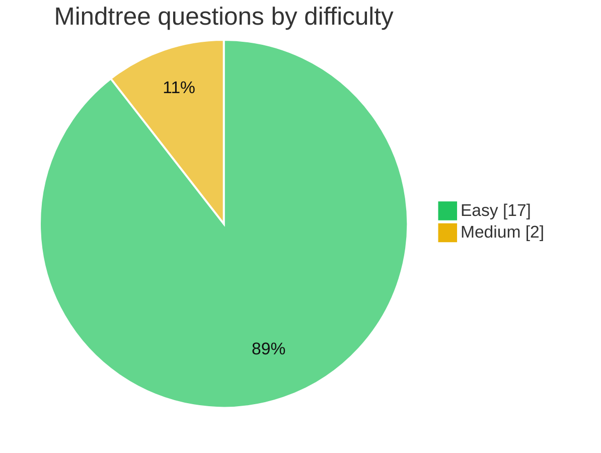

[← All companies](../README.md) · [Most asked across companies](../most-asked.md)

# Mindtree Coding Questions

   

**19 Mindtree coding questions** — 17 easy and 2 medium. Each one links to a free page where you can solve it in 13 languages, with hints and an editorial.

19 problems the CodeKairo catalogue tags as commonly asked in Mindtree's coding rounds — 17 easy and 2 medium, no hard ones — each judged by hidden tests in 13 languages. The most common topics among them are Arrays (9), Math (7) and Strings (5). The tag is the catalogue's own annotation of where a problem tends to come up — not a list published by Mindtree, which CodeKairo is not affiliated with.

**Practise on CodeKairo:** [All 19 Mindtree questions](https://codekairo.com/challenges/company/mindtree?utm_source=github) · [LTIMindtree — Online Assessment mock test](https://codekairo.com/tests/ltimindtree-online-assessment?utm_source=github) · [Mindtree hiring process, round by round](https://codekairo.com/simulations/ltimindtree?utm_source=github)

## Contents

- [Start with these 10](#start-with-these-10)
- [Topics Mindtree asks most](#topics-mindtree-asks-most)
- 🟢 [Easy (17)](#easy-17)
- 🟡 [Medium (2)](#medium-2)

## Start with these 10

The Mindtree questions most other companies ask too — the patterns worth knowing first.

1. 🟢 [Two Sum](https://codekairo.com/problems/two-sum?utm_source=github) — also asked at 18 other companies
2. 🟢 [Valid Parentheses](https://codekairo.com/problems/valid-parentheses?utm_source=github) — also asked at 14 other companies
3. 🟢 [Valid Anagram](https://codekairo.com/problems/valid-anagram?utm_source=github) — also asked at 7 other companies
4. 🟢 [First Unique Character in a String](https://codekairo.com/problems/first-unique-character-in-a-string?utm_source=github) — also asked at 7 other companies
5. 🟢 [Armstrong Number](https://codekairo.com/problems/armstrong-number?utm_source=github) — also asked at 6 other companies
6. 🟢 [Palindrome Number](https://codekairo.com/problems/palindrome-number?utm_source=github) — also asked at 5 other companies
7. 🟢 [Second Largest Element](https://codekairo.com/problems/second-largest-element?utm_source=github) — also asked at 4 other companies
8. 🟢 [Longest Common Prefix](https://codekairo.com/problems/longest-common-prefix?utm_source=github) — also asked at 3 other companies
9. 🟢 [Remove Vowels from a String](https://codekairo.com/problems/remove-vowels-from-a-string?utm_source=github) — also asked at 3 other companies
10. 🟡 [Subarray Sum Equals K](https://codekairo.com/problems/subarray-sum-equals-k?utm_source=github) — also asked at 3 other companies

## Topics Mindtree asks most

[Arrays](https://codekairo.com/challenges/arrays?utm_source=github) (9) · [Math](https://codekairo.com/challenges/math?utm_source=github) (7) · [Hash Table](https://codekairo.com/challenges/hash-table?utm_source=github) (5) · [Strings](https://codekairo.com/challenges/strings?utm_source=github) (5) · [Simulation](https://codekairo.com/challenges/simulation?utm_source=github) (3) · [Sorting](https://codekairo.com/challenges/sorting?utm_source=github) (3) · [Bit Manipulation](https://codekairo.com/challenges/bit-manipulation?utm_source=github) (2) · [Counting](https://codekairo.com/challenges/counting?utm_source=github) (2) · [Prefix Sum](https://codekairo.com/challenges/prefix-sum?utm_source=github) (2) · [Two Pointers](https://codekairo.com/challenges/two-pointers?utm_source=github) (2)

## Easy (17)

| # | Question | Topics | Acceptance |
|---:|---|---|---:|
| 1 | 🟢 [Two Sum](https://codekairo.com/problems/two-sum?utm_source=github) | Arrays, Hash Table | — |
| 3 | 🟢 [Palindrome Number](https://codekairo.com/problems/palindrome-number?utm_source=github) | Math | — |
| 4 | 🟢 [Valid Parentheses](https://codekairo.com/problems/valid-parentheses?utm_source=github) | Strings, Stack | — |
| 6 | 🟢 [Valid Anagram](https://codekairo.com/problems/valid-anagram?utm_source=github) | Hash Table, Strings, Sorting | — |
| 17 | 🟢 [Missing Number](https://codekairo.com/problems/missing-number?utm_source=github) | Arrays, Math, Bit Manipulation | — |
| 28 | 🟢 [Longest Common Prefix](https://codekairo.com/problems/longest-common-prefix?utm_source=github) | Strings | — |
| 166 | 🟢 [Armstrong Number](https://codekairo.com/problems/armstrong-number?utm_source=github) | Math | — |
| 171 | 🟢 [Harshad Number](https://codekairo.com/problems/harshad-number?utm_source=github) | Math | — |
| 213 | 🟢 [First Unique Character in a String](https://codekairo.com/problems/first-unique-character-in-a-string?utm_source=github) | Hash Table, Strings, Queue | — |
| 475 | 🟢 [Second Largest Element](https://codekairo.com/problems/second-largest-element?utm_source=github) | Arrays | — |
| 515 | 🟢 [Remove Vowels from a String](https://codekairo.com/problems/remove-vowels-from-a-string?utm_source=github) | Strings | — |
| 550 | 🟢 [Count Integers With Even Digit Sum](https://codekairo.com/problems/count-integers-with-even-digit-sum?utm_source=github) | Math, Simulation | — |
| 606 | 🟢 [Find the Array Concatenation Value](https://codekairo.com/problems/find-the-array-concatenation-value?utm_source=github) | Arrays, Two Pointers, Simulation | — |
| 628 | 🟢 [Minimum Number Game](https://codekairo.com/problems/minimum-number-game?utm_source=github) | Arrays, Sorting, Simulation | — |
| 691 | 🟢 [Split With Minimum Sum](https://codekairo.com/problems/split-with-minimum-sum?utm_source=github) | Math, Greedy, Sorting | — |
| 988 | 🟢 [Minimum Sum of Mountain Triplets I](https://codekairo.com/problems/minimum-sum-of-mountain-triplets-i?utm_source=github) | Arrays, Prefix Sum | — |
| 998 | 🟢 [Find the XOR of Numbers Which Appear Twice](https://codekairo.com/problems/find-the-xor-of-numbers-which-appear-twice?utm_source=github) | Arrays, Hash Table, Bit Manipulation | — |

## Medium (2)

| # | Question | Topics | Acceptance |
|---:|---|---|---:|
| 15 | 🟡 [Rotate Array](https://codekairo.com/problems/rotate-array?utm_source=github) | Arrays, Math, Two Pointers | — |
| 21 | 🟡 [Subarray Sum Equals K](https://codekairo.com/problems/subarray-sum-equals-k?utm_source=github) | Arrays, Hash Table, Prefix Sum | — |

---

[← All companies](../README.md) · Rebuilt every night from [codekairo.com](https://codekairo.com/challenges/company/mindtree?utm_source=github). Last refreshed: November 2026. ⭐ [Star the repo](https://github.com/ayaanp14/company-wise-coding-questions) if it helps.
