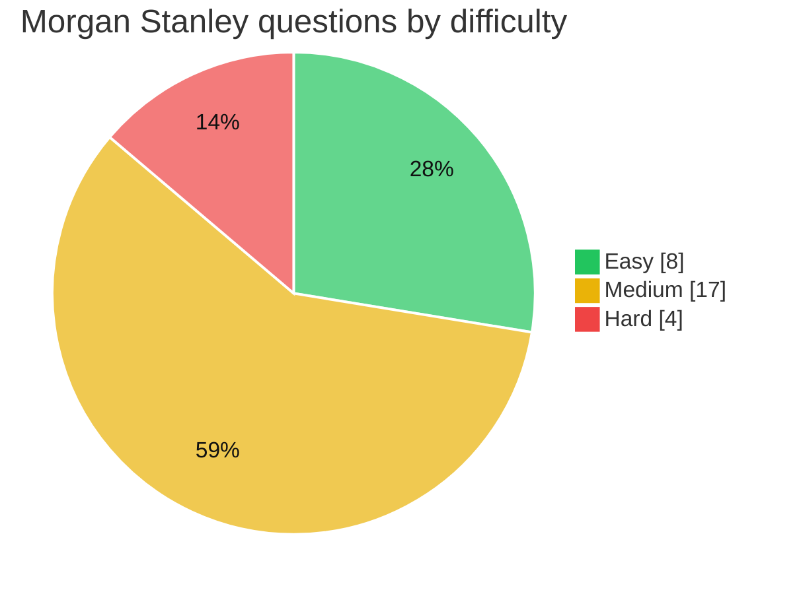

[← All companies](../README.md) · [Most asked across companies](../most-asked.md)

# Morgan Stanley Coding Questions

   

**29 Morgan Stanley coding questions** — 8 easy, 17 medium and 4 hard. Each one links to a free page where you can solve it in 13 languages, with hints and an editorial.

29 problems the CodeKairo catalogue tags as commonly asked in Morgan Stanley's coding rounds — 8 easy, 17 medium and 4 hard — each judged by hidden tests in 13 languages. The most common topics among them are Arrays (24), Dynamic Programming (10) and Hash Table (6). Tagged for Morgan Stanley and no other company: Find Subarrays With Equal Sum, Jump Game and Maximum Product Subarray. CodeKairo's Morgan Stanley — Aptitude & Technical mock covers the Morgan Stanley aptitude and technical assessment pattern, where computer science carries most of the weight: thirty of its fifty-three questions are fundamentals. The tag is the catalogue's own annotation of where a problem tends to come up — not a list published by Morgan Stanley, which CodeKairo is not affiliated with.

**Practise on CodeKairo:** [All 29 Morgan Stanley questions](https://codekairo.com/challenges/company/morgan-stanley?utm_source=github) · [Morgan Stanley — Aptitude & Technical mock test](https://codekairo.com/tests/morgan-stanley-assessment?utm_source=github) · [Morgan Stanley hiring process, round by round](https://codekairo.com/simulations/morgan-stanley?utm_source=github)

## Contents

- [Start with these 10](#start-with-these-10)
- [Topics Morgan Stanley asks most](#topics-morgan-stanley-asks-most)
- 🟢 [Easy (8)](#easy-8)
- 🟡 [Medium (17)](#medium-17)
- 🔴 [Hard (4)](#hard-4)

## Start with these 10

The Morgan Stanley questions most other companies ask too — the patterns worth knowing first.

1. 🟢 [Two Sum](https://codekairo.com/problems/two-sum?utm_source=github) — also asked at 18 other companies
2. 🟡 [Longest Substring Without Repeating Characters](https://codekairo.com/problems/longest-substring-without-repeating-characters?utm_source=github) — also asked at 13 other companies
3. 🟡 [Merge Intervals](https://codekairo.com/problems/merge-intervals?utm_source=github) — also asked at 12 other companies
4. 🟢 [First Unique Character in a String](https://codekairo.com/problems/first-unique-character-in-a-string?utm_source=github) — also asked at 7 other companies
5. 🟡 [Spiral Matrix](https://codekairo.com/problems/spiral-matrix?utm_source=github) — also asked at 7 other companies
6. 🟢 [Best Time to Buy and Sell Stock](https://codekairo.com/problems/best-time-to-buy-and-sell-stock?utm_source=github) — also asked at 6 other companies
7. 🟡 [Maximum Subarray](https://codekairo.com/problems/maximum-subarray?utm_source=github) — also asked at 6 other companies
8. 🟢 [Palindrome Number](https://codekairo.com/problems/palindrome-number?utm_source=github) — also asked at 5 other companies
9. 🔴 [Longest Valid Parentheses](https://codekairo.com/problems/longest-valid-parentheses?utm_source=github) — also asked at 4 other companies
10. 🔴 [Count Subarrays With Fixed Bounds](https://codekairo.com/problems/count-subarrays-with-fixed-bounds?utm_source=github) — also asked at 4 other companies

## Topics Morgan Stanley asks most

[Arrays](https://codekairo.com/challenges/arrays?utm_source=github) (24) · [Dynamic Programming](https://codekairo.com/challenges/dynamic-programming?utm_source=github) (10) · [Hash Table](https://codekairo.com/challenges/hash-table?utm_source=github) (6) · [Sorting](https://codekairo.com/challenges/sorting?utm_source=github) (4) · [Strings](https://codekairo.com/challenges/strings?utm_source=github) (4) · [Two Pointers](https://codekairo.com/challenges/two-pointers?utm_source=github) (4) · [Greedy](https://codekairo.com/challenges/greedy?utm_source=github) (3) · [Sliding Window](https://codekairo.com/challenges/sliding-window?utm_source=github) (3) · [Counting](https://codekairo.com/challenges/counting?utm_source=github) (2) · [Heap](https://codekairo.com/challenges/heap?utm_source=github) (2)

## Easy (8)

| # | Question | Topics | Acceptance |
|---:|---|---|---:|
| 1 | 🟢 [Two Sum](https://codekairo.com/problems/two-sum?utm_source=github) | Arrays, Hash Table | — |
| 3 | 🟢 [Palindrome Number](https://codekairo.com/problems/palindrome-number?utm_source=github) | Math | — |
| 11 | 🟢 [Best Time to Buy and Sell Stock](https://codekairo.com/problems/best-time-to-buy-and-sell-stock?utm_source=github) | Arrays, Dynamic Programming | — |
| 14 | 🟢 [Remove Duplicates from Sorted Array](https://codekairo.com/problems/remove-duplicates-from-sorted-array?utm_source=github) | Arrays, Two Pointers | — |
| 213 | 🟢 [First Unique Character in a String](https://codekairo.com/problems/first-unique-character-in-a-string?utm_source=github) | Hash Table, Strings, Queue | — |
| 350 | 🟢 [Minimum Cost to Move Chips to The Same Position](https://codekairo.com/problems/minimum-cost-to-move-chips-to-the-same-position?utm_source=github) | Arrays, Math, Greedy | — |
| 1073 | 🟢 [The Employee That Worked on the Longest Task](https://codekairo.com/problems/the-employee-that-worked-on-the-longest-task?utm_source=github) | Arrays | — |
| 1797 | 🟢 [Find Subarrays With Equal Sum](https://codekairo.com/problems/find-subarrays-with-equal-sum?utm_source=github) | Arrays, Hash Table | — |

## Medium (17)

| # | Question | Topics | Acceptance |
|---:|---|---|---:|
| 8 | 🟡 [Maximum Subarray](https://codekairo.com/problems/maximum-subarray?utm_source=github) | Arrays, Dynamic Programming, Divide and Conquer | — |
| 20 | 🟡 [Maximum Product Subarray](https://codekairo.com/problems/maximum-product-subarray?utm_source=github) | Arrays, Dynamic Programming | — |
| 29 | 🟡 [Longest Substring Without Repeating Characters](https://codekairo.com/problems/longest-substring-without-repeating-characters?utm_source=github) | Strings, Sliding Window, Hash Table | — |
| 50 | 🟡 [Sort Colors](https://codekairo.com/problems/sort-colors?utm_source=github) | Arrays, Two Pointers, Sorting | — |
| 67 | 🟡 [Daily Temperatures](https://codekairo.com/problems/daily-temperatures?utm_source=github) | Arrays, Stack, Monotonic Stack | — |
| 77 | 🟡 [Jump Game](https://codekairo.com/problems/jump-game?utm_source=github) | Arrays, Greedy, Dynamic Programming | — |
| 100 | 🟡 [Kth Largest Element in an Array](https://codekairo.com/problems/kth-largest-element-in-an-array?utm_source=github) | Arrays, Heap, Quickselect | — |
| 110 | 🟡 [Spiral Matrix](https://codekairo.com/problems/spiral-matrix?utm_source=github) | Arrays, Matrix, Simulation | — |
| 122 | 🟡 [Merge Intervals](https://codekairo.com/problems/merge-intervals?utm_source=github) | Arrays, Sorting, Intervals | — |
| 308 | 🟡 [Delete and Earn](https://codekairo.com/problems/delete-and-earn?utm_source=github) | Arrays, Hash Table, Dynamic Programming | — |
| 610 | 🟡 [Minimum Swaps to Sort](https://codekairo.com/problems/minimum-swaps-to-sort?utm_source=github) | Arrays, Sorting, Graph | — |
| 723 | 🟡 [Find The Original Array of Prefix Xor](https://codekairo.com/problems/find-the-original-array-of-prefix-xor?utm_source=github) | Bit Manipulation, Arrays, Prefix Sum | — |
| 965 | 🟡 [Number of Orders in the Backlog](https://codekairo.com/problems/number-of-orders-in-the-backlog?utm_source=github) | Arrays, Simulation, Heap | — |
| 1600 | 🟡 [0/1 Knapsack](https://codekairo.com/problems/zero-one-knapsack?utm_source=github) | Arrays, Dynamic Programming | — |
| 1603 | 🟡 [Longest Common Substring](https://codekairo.com/problems/longest-common-substring?utm_source=github) | Strings, Dynamic Programming | — |
| 1607 | 🟡 [Optimal Strategy For A Game](https://codekairo.com/problems/optimal-strategy-for-a-game?utm_source=github) | Arrays, Dynamic Programming, Game Theory | — |
| 1612 | 🟡 [Maximum Sum Increasing Subsequence](https://codekairo.com/problems/maximum-sum-increasing-subsequence?utm_source=github) | Arrays, Dynamic Programming | — |

## Hard (4)

| # | Question | Topics | Acceptance |
|---:|---|---|---:|
| 83 | 🔴 [Candy](https://codekairo.com/problems/candy?utm_source=github) | Arrays, Greedy | — |
| 388 | 🔴 [Longest Valid Parentheses](https://codekairo.com/problems/longest-valid-parentheses?utm_source=github) | Strings, Dynamic Programming, Stack | — |
| 774 | 🔴 [Subarrays with K Different Integers](https://codekairo.com/problems/subarrays-with-k-different-integers?utm_source=github) | Arrays, Hash Table, Sliding Window | — |
| 804 | 🔴 [Count Subarrays With Fixed Bounds](https://codekairo.com/problems/count-subarrays-with-fixed-bounds?utm_source=github) | Arrays, Sliding Window, Two Pointers | — |

---

[← All companies](../README.md) · Rebuilt every night from [codekairo.com](https://codekairo.com/challenges/company/morgan-stanley?utm_source=github). Last refreshed: November 2026. ⭐ [Star the repo](https://github.com/ayaanp14/company-wise-coding-questions) if it helps.
