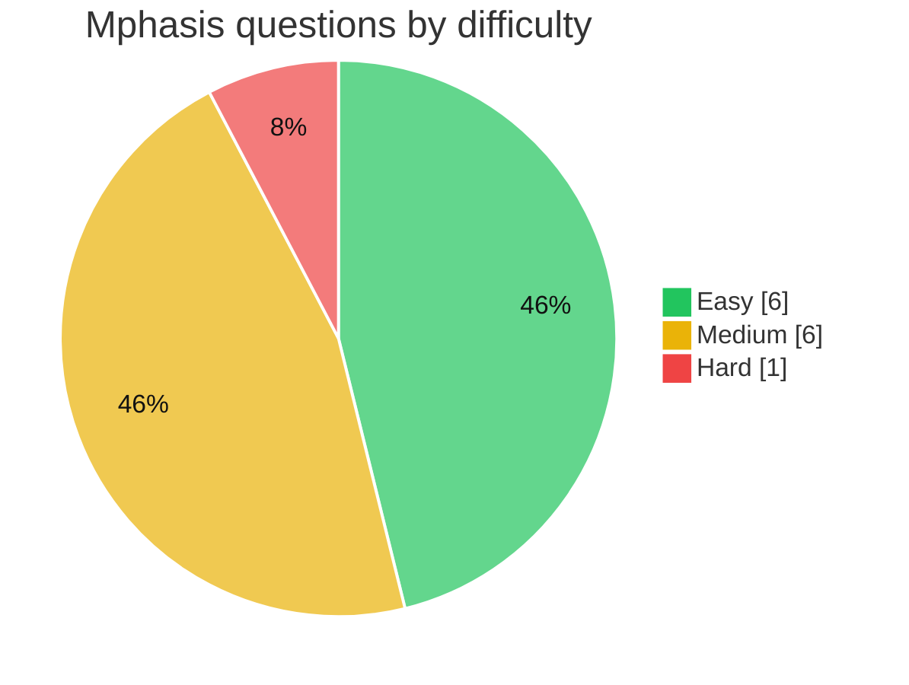

[← All companies](../README.md) · [Most asked across companies](../most-asked.md)

# Mphasis Coding Questions

   

**13 Mphasis coding questions** — 6 easy, 6 medium and 1 hard. Each one links to a free page where you can solve it in 13 languages, with hints and an editorial.

13 problems the CodeKairo catalogue tags as commonly asked in Mphasis's coding rounds — 6 easy, 6 medium and 1 hard — each judged by hidden tests in 13 languages. The most common topics among them are Math (5), Arrays (3) and Strings (3). Tagged for Mphasis and no other company: Network Delay Time. The tag is the catalogue's own annotation of where a problem tends to come up — not a list published by Mphasis, which CodeKairo is not affiliated with.

**Practise on CodeKairo:** [All 13 Mphasis questions](https://codekairo.com/challenges/company/mphasis?utm_source=github) · [Mphasis — AMCAT Assessment mock test](https://codekairo.com/tests/mphasis-amcat?utm_source=github) · [Mphasis hiring process, round by round](https://codekairo.com/simulations/mphasis?utm_source=github)

## Contents

- [Start with these 10](#start-with-these-10)
- [Topics Mphasis asks most](#topics-mphasis-asks-most)
- 🟢 [Easy (6)](#easy-6)
- 🟡 [Medium (6)](#medium-6)
- 🔴 [Hard (1)](#hard-1)

## Start with these 10

The Mphasis questions most other companies ask too — the patterns worth knowing first.

1. 🟢 [Reverse String](https://codekairo.com/problems/reverse-string?utm_source=github) — also asked at 7 other companies
2. 🟡 [Count Primes](https://codekairo.com/problems/count-primes?utm_source=github) — also asked at 7 other companies
3. 🟢 [Armstrong Number](https://codekairo.com/problems/armstrong-number?utm_source=github) — also asked at 6 other companies
4. 🟡 [Maximum Subarray](https://codekairo.com/problems/maximum-subarray?utm_source=github) — also asked at 6 other companies
5. 🟡 [Longest Palindromic Substring](https://codekairo.com/problems/longest-palindromic-substring?utm_source=github) — also asked at 6 other companies
6. 🟢 [Palindrome Number](https://codekairo.com/problems/palindrome-number?utm_source=github) — also asked at 5 other companies
7. 🟢 [Valid Palindrome](https://codekairo.com/problems/valid-palindrome?utm_source=github) — also asked at 4 other companies
8. 🟢 [Add Digits](https://codekairo.com/problems/add-digits?utm_source=github) — also asked at 4 other companies
9. 🔴 [N-Queens II](https://codekairo.com/problems/n-queens-ii?utm_source=github) — also asked at 3 other companies
10. 🟢 [Neon Number](https://codekairo.com/problems/neon-number?utm_source=github) — also asked at 2 other companies

## Topics Mphasis asks most

[Math](https://codekairo.com/challenges/math?utm_source=github) (5) · [Arrays](https://codekairo.com/challenges/arrays?utm_source=github) (3) · [Dynamic Programming](https://codekairo.com/challenges/dynamic-programming?utm_source=github) (3) · [Strings](https://codekairo.com/challenges/strings?utm_source=github) (3) · [Two Pointers](https://codekairo.com/challenges/two-pointers?utm_source=github) (3) · [Backtracking](https://codekairo.com/challenges/backtracking?utm_source=github) (1) · [Bit Manipulation](https://codekairo.com/challenges/bit-manipulation?utm_source=github) (1) · [Breadth-First Search](https://codekairo.com/challenges/breadth-first-search?utm_source=github) (1) · [Divide and Conquer](https://codekairo.com/challenges/divide-and-conquer?utm_source=github) (1) · [Graph](https://codekairo.com/challenges/graph?utm_source=github) (1)

## Easy (6)

| # | Question | Topics | Acceptance |
|---:|---|---|---:|
| 2 | 🟢 [Reverse String](https://codekairo.com/problems/reverse-string?utm_source=github) | Two Pointers, Strings | — |
| 3 | 🟢 [Palindrome Number](https://codekairo.com/problems/palindrome-number?utm_source=github) | Math | — |
| 27 | 🟢 [Valid Palindrome](https://codekairo.com/problems/valid-palindrome?utm_source=github) | Strings, Two Pointers | — |
| 153 | 🟢 [Add Digits](https://codekairo.com/problems/add-digits?utm_source=github) | Math, Simulation, Number Theory | — |
| 166 | 🟢 [Armstrong Number](https://codekairo.com/problems/armstrong-number?utm_source=github) | Math | — |
| 169 | 🟢 [Neon Number](https://codekairo.com/problems/neon-number?utm_source=github) | Math | — |

## Medium (6)

| # | Question | Topics | Acceptance |
|---:|---|---|---:|
| 8 | 🟡 [Maximum Subarray](https://codekairo.com/problems/maximum-subarray?utm_source=github) | Arrays, Dynamic Programming, Divide and Conquer | — |
| 30 | 🟡 [Longest Palindromic Substring](https://codekairo.com/problems/longest-palindromic-substring?utm_source=github) | Strings, Dynamic Programming | — |
| 50 | 🟡 [Sort Colors](https://codekairo.com/problems/sort-colors?utm_source=github) | Arrays, Two Pointers, Sorting | — |
| 90 | 🟡 [Coin Change](https://codekairo.com/problems/coin-change?utm_source=github) | Arrays, Dynamic Programming, Breadth-First Search | — |
| 140 | 🟡 [Network Delay Time](https://codekairo.com/problems/network-delay-time?utm_source=github) | Graph, Shortest Path, Heap | — |
| 150 | 🟡 [Count Primes](https://codekairo.com/problems/count-primes?utm_source=github) | Math, Sieve of Eratosthenes | — |

## Hard (1)

| # | Question | Topics | Acceptance |
|---:|---|---|---:|
| 1578 | 🔴 [N-Queens II](https://codekairo.com/problems/n-queens-ii?utm_source=github) | Backtracking, Bit Manipulation | — |

---

[← All companies](../README.md) · Rebuilt every night from [codekairo.com](https://codekairo.com/challenges/company/mphasis?utm_source=github). Last refreshed: November 2026. ⭐ [Star the repo](https://github.com/ayaanp14/company-wise-coding-questions) if it helps.
