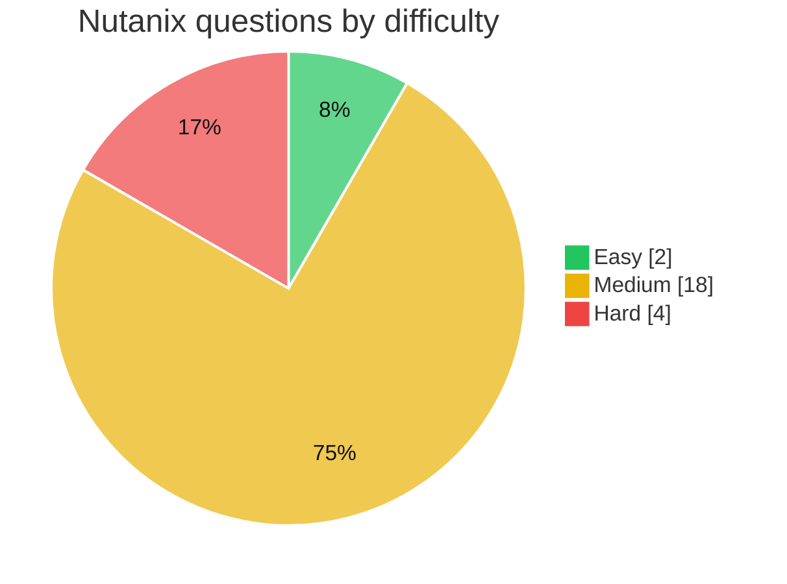

[← All companies](../README.md) · [Most asked across companies](../most-asked.md)

# Nutanix Coding Questions

   

**24 Nutanix coding questions** — 2 easy, 18 medium and 4 hard. Each one links to a free page where you can solve it in 13 languages, with hints and an editorial.

24 problems the CodeKairo catalogue tags as commonly asked in Nutanix's coding rounds — 2 easy, 18 medium and 4 hard — each judged by hidden tests in 13 languages. The most common topics among them are Arrays (15), Strings (6) and Matrix (6). Tagged for Nutanix and no other company: Car Fleet. The tag is the catalogue's own annotation of where a problem tends to come up — not a list published by Nutanix, which CodeKairo is not affiliated with.

**Practise on CodeKairo:** [All 24 Nutanix questions](https://codekairo.com/challenges/company/nutanix?utm_source=github)

## Contents

- [Start with these 10](#start-with-these-10)
- [Topics Nutanix asks most](#topics-nutanix-asks-most)
- 🟢 [Easy (2)](#easy-2)
- 🟡 [Medium (18)](#medium-18)
- 🔴 [Hard (4)](#hard-4)

## Start with these 10

The Nutanix questions most other companies ask too — the patterns worth knowing first.

1. 🟡 [Longest Substring Without Repeating Characters](https://codekairo.com/problems/longest-substring-without-repeating-characters?utm_source=github) — also asked at 13 other companies
2. 🟡 [Merge Intervals](https://codekairo.com/problems/merge-intervals?utm_source=github) — also asked at 12 other companies
3. 🟡 [Spiral Matrix](https://codekairo.com/problems/spiral-matrix?utm_source=github) — also asked at 7 other companies
4. 🟢 [Happy Number](https://codekairo.com/problems/happy-number?utm_source=github) — also asked at 5 other companies
5. 🟢 [Can Place Flowers](https://codekairo.com/problems/can-place-flowers?utm_source=github) — also asked at 5 other companies
6. 🟡 [Decode String](https://codekairo.com/problems/decode-string?utm_source=github) — also asked at 5 other companies
7. 🟡 [Increasing Triplet Subsequence](https://codekairo.com/problems/increasing-triplet-subsequence?utm_source=github) — also asked at 4 other companies
8. 🟡 [Broken Calculator](https://codekairo.com/problems/broken-calculator?utm_source=github) — also asked at 4 other companies
9. 🔴 [Longest Increasing Path in a Matrix](https://codekairo.com/problems/longest-increasing-path-in-a-matrix?utm_source=github) — also asked at 4 other companies
10. 🟡 [Course Schedule II](https://codekairo.com/problems/course-schedule-ii?utm_source=github) — also asked at 3 other companies

## Topics Nutanix asks most

[Arrays](https://codekairo.com/challenges/arrays?utm_source=github) (15) · [Matrix](https://codekairo.com/challenges/matrix?utm_source=github) (6) · [Strings](https://codekairo.com/challenges/strings?utm_source=github) (6) · [Greedy](https://codekairo.com/challenges/greedy?utm_source=github) (5) · [Sliding Window](https://codekairo.com/challenges/sliding-window?utm_source=github) (5) · [Binary Search](https://codekairo.com/challenges/binary-search?utm_source=github) (3) · [Dynamic Programming](https://codekairo.com/challenges/dynamic-programming?utm_source=github) (3) · [Hash Table](https://codekairo.com/challenges/hash-table?utm_source=github) (3) · [Heap](https://codekairo.com/challenges/heap?utm_source=github) (3) · [Math](https://codekairo.com/challenges/math?utm_source=github) (3)

## Easy (2)

| # | Question | Topics | Acceptance |
|---:|---|---|---:|
| 151 | 🟢 [Happy Number](https://codekairo.com/problems/happy-number?utm_source=github) | Hash Table, Math, Two Pointers | — |
| 199 | 🟢 [Can Place Flowers](https://codekairo.com/problems/can-place-flowers?utm_source=github) | Arrays, Greedy | — |

## Medium (18)

| # | Question | Topics | Acceptance |
|---:|---|---|---:|
| 29 | 🟡 [Longest Substring Without Repeating Characters](https://codekairo.com/problems/longest-substring-without-repeating-characters?utm_source=github) | Strings, Sliding Window, Hash Table | — |
| 74 | 🟡 [Decode String](https://codekairo.com/problems/decode-string?utm_source=github) | Strings, Stack, Recursion | — |
| 76 | 🟡 [Car Fleet](https://codekairo.com/problems/car-fleet?utm_source=github) | Arrays, Stack, Sorting | — |
| 85 | 🟡 [Task Scheduler](https://codekairo.com/problems/task-scheduler?utm_source=github) | Arrays, Greedy, Heap | — |
| 109 | 🟡 [Rotate Image](https://codekairo.com/problems/rotate-image?utm_source=github) | Arrays, Matrix, Math | — |
| 110 | 🟡 [Spiral Matrix](https://codekairo.com/problems/spiral-matrix?utm_source=github) | Arrays, Matrix, Simulation | — |
| 112 | 🟡 [Search a 2D Matrix](https://codekairo.com/problems/search-a-2d-matrix?utm_source=github) | Arrays, Matrix, Binary Search | — |
| 122 | 🟡 [Merge Intervals](https://codekairo.com/problems/merge-intervals?utm_source=github) | Arrays, Sorting, Intervals | — |
| 138 | 🟡 [Course Schedule II](https://codekairo.com/problems/course-schedule-ii?utm_source=github) | Graph, Topological Sort, Heap | — |
| 208 | 🟡 [Increasing Triplet Subsequence](https://codekairo.com/problems/increasing-triplet-subsequence?utm_source=github) | Arrays, Greedy | — |
| 334 | 🟡 [Best Sightseeing Pair](https://codekairo.com/problems/best-sightseeing-pair?utm_source=github) | Arrays, Dynamic Programming | — |
| 379 | 🟡 [Check If Word Is Valid After Substitutions](https://codekairo.com/problems/check-if-word-is-valid-after-substitutions?utm_source=github) | Strings, Stack | — |
| 457 | 🟡 [Detect Cycles in 2D Grid](https://codekairo.com/problems/detect-cycles-in-2d-grid?utm_source=github) | Arrays, Depth-First Search, Breadth-First Search | — |
| 788 | 🟡 [Grumpy Bookstore Owner](https://codekairo.com/problems/grumpy-bookstore-owner?utm_source=github) | Arrays, Sliding Window | — |
| 795 | 🟡 [Swap For Longest Repeated Character Substring](https://codekairo.com/problems/swap-for-longest-repeated-character-substring?utm_source=github) | Strings, Sliding Window, Hash Table | — |
| 827 | 🟡 [Find Right Interval](https://codekairo.com/problems/find-right-interval?utm_source=github) | Arrays, Binary Search, Sorting | — |
| 1454 | 🟡 [Broken Calculator](https://codekairo.com/problems/broken-calculator?utm_source=github) | Math, Greedy | — |
| 1550 | 🟡 [Maximum Sum of an Hourglass](https://codekairo.com/problems/maximum-sum-of-an-hourglass?utm_source=github) | Arrays, Matrix, Prefix Sum | — |

## Hard (4)

| # | Question | Topics | Acceptance |
|---:|---|---|---:|
| 54 | 🔴 [Sliding Window Maximum](https://codekairo.com/problems/sliding-window-maximum?utm_source=github) | Arrays, Sliding Window, Monotonic Queue | — |
| 808 | 🔴 [Minimum Number of Flips to Make the Binary String Alternating](https://codekairo.com/problems/minimum-number-of-flips-to-make-binary-string-alternating?utm_source=github) | Strings, Sliding Window, Dynamic Programming | — |
| 920 | 🔴 [Longest Increasing Path in a Matrix](https://codekairo.com/problems/longest-increasing-path-in-a-matrix?utm_source=github) | Arrays, Matrix, Dynamic Programming | — |
| 1250 | 🔴 [Valid Number](https://codekairo.com/problems/valid-number?utm_source=github) | Strings, Simulation | — |

---

[← All companies](../README.md) · Rebuilt every night from [codekairo.com](https://codekairo.com/challenges/company/nutanix?utm_source=github). Last refreshed: November 2026. ⭐ [Star the repo](https://github.com/ayaanp14/company-wise-coding-questions) if it helps.
