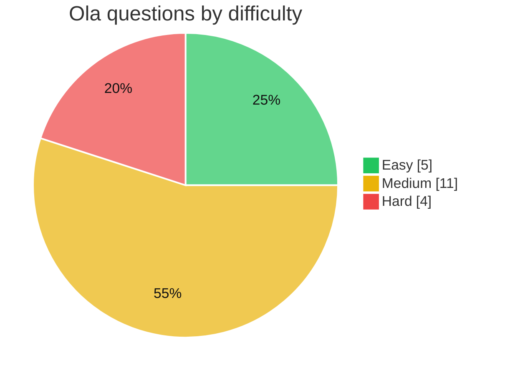

[← All companies](../README.md) · [Most asked across companies](../most-asked.md)

# Ola Coding Questions

   

**20 Ola coding questions** — 5 easy, 11 medium and 4 hard. Each one links to a free page where you can solve it in 13 languages, with hints and an editorial.

20 problems the CodeKairo catalogue tags as commonly asked in Ola's coding rounds — 5 easy, 11 medium and 4 hard — each judged by hidden tests in 13 languages. The most common topics among them are Arrays (12), Strings (6) and Dynamic Programming (6). Tagged for Ola and no other company: Find Minimum in Rotated Sorted Array. The tag is the catalogue's own annotation of where a problem tends to come up — not a list published by Ola, which CodeKairo is not affiliated with.

**Practise on CodeKairo:** [All 20 Ola questions](https://codekairo.com/challenges/company/ola?utm_source=github)

## Contents

- [Start with these 10](#start-with-these-10)
- [Topics Ola asks most](#topics-ola-asks-most)
- 🟢 [Easy (5)](#easy-5)
- 🟡 [Medium (11)](#medium-11)
- 🔴 [Hard (4)](#hard-4)

## Start with these 10

The Ola questions most other companies ask too — the patterns worth knowing first.

1. 🟢 [Two Sum](https://codekairo.com/problems/two-sum?utm_source=github) — also asked at 18 other companies
2. 🟡 [Longest Substring Without Repeating Characters](https://codekairo.com/problems/longest-substring-without-repeating-characters?utm_source=github) — also asked at 13 other companies
3. 🟡 [Number of Islands](https://codekairo.com/problems/number-of-islands?utm_source=github) — also asked at 9 other companies
4. 🔴 [Word Ladder](https://codekairo.com/problems/word-ladder?utm_source=github) — also asked at 9 other companies
5. 🟢 [Find Pivot Index](https://codekairo.com/problems/find-pivot-index?utm_source=github) — also asked at 7 other companies
6. 🔴 [Trapping Rain Water](https://codekairo.com/problems/trapping-rain-water?utm_source=github) — also asked at 7 other companies
7. 🟢 [Best Time to Buy and Sell Stock](https://codekairo.com/problems/best-time-to-buy-and-sell-stock?utm_source=github) — also asked at 6 other companies
8. 🟡 [Longest Palindromic Substring](https://codekairo.com/problems/longest-palindromic-substring?utm_source=github) — also asked at 6 other companies
9. 🟡 [Container With Most Water](https://codekairo.com/problems/container-with-most-water?utm_source=github) — also asked at 6 other companies
10. 🟢 [Excel Sheet Column Title](https://codekairo.com/problems/excel-sheet-column-title?utm_source=github) — also asked at 5 other companies

## Topics Ola asks most

[Arrays](https://codekairo.com/challenges/arrays?utm_source=github) (12) · [Dynamic Programming](https://codekairo.com/challenges/dynamic-programming?utm_source=github) (6) · [Strings](https://codekairo.com/challenges/strings?utm_source=github) (6) · [Hash Table](https://codekairo.com/challenges/hash-table?utm_source=github) (4) · [Greedy](https://codekairo.com/challenges/greedy?utm_source=github) (3) · [Math](https://codekairo.com/challenges/math?utm_source=github) (3) · [Stack](https://codekairo.com/challenges/stack?utm_source=github) (3) · [Two Pointers](https://codekairo.com/challenges/two-pointers?utm_source=github) (3) · [Binary Search](https://codekairo.com/challenges/binary-search?utm_source=github) (2) · [Breadth-First Search](https://codekairo.com/challenges/breadth-first-search?utm_source=github) (2)

## Easy (5)

| # | Question | Topics | Acceptance |
|---:|---|---|---:|
| 1 | 🟢 [Two Sum](https://codekairo.com/problems/two-sum?utm_source=github) | Arrays, Hash Table | — |
| 7 | 🟢 [Climbing Stairs](https://codekairo.com/problems/climbing-stairs?utm_source=github) | Math, Dynamic Programming, Memoization | — |
| 11 | 🟢 [Best Time to Buy and Sell Stock](https://codekairo.com/problems/best-time-to-buy-and-sell-stock?utm_source=github) | Arrays, Dynamic Programming | — |
| 158 | 🟢 [Excel Sheet Column Title](https://codekairo.com/problems/excel-sheet-column-title?utm_source=github) | Math, Strings | — |
| 186 | 🟢 [Find Pivot Index](https://codekairo.com/problems/find-pivot-index?utm_source=github) | Arrays, Prefix Sum | — |

## Medium (11)

| # | Question | Topics | Acceptance |
|---:|---|---|---:|
| 29 | 🟡 [Longest Substring Without Repeating Characters](https://codekairo.com/problems/longest-substring-without-repeating-characters?utm_source=github) | Strings, Sliding Window, Hash Table | — |
| 30 | 🟡 [Longest Palindromic Substring](https://codekairo.com/problems/longest-palindromic-substring?utm_source=github) | Strings, Dynamic Programming | — |
| 44 | 🟡 [Container With Most Water](https://codekairo.com/problems/container-with-most-water?utm_source=github) | Arrays, Two Pointers, Greedy | — |
| 59 | 🟡 [Find Minimum in Rotated Sorted Array](https://codekairo.com/problems/find-minimum-in-rotated-sorted-array?utm_source=github) | Arrays, Binary Search | — |
| 74 | 🟡 [Decode String](https://codekairo.com/problems/decode-string?utm_source=github) | Strings, Stack, Recursion | — |
| 88 | 🟡 [House Robber](https://codekairo.com/problems/house-robber?utm_source=github) | Arrays, Dynamic Programming | — |
| 95 | 🟡 [Unique Paths](https://codekairo.com/problems/unique-paths?utm_source=github) | Math, Dynamic Programming, Combinatorics | — |
| 118 | 🟡 [Number of Islands](https://codekairo.com/problems/number-of-islands?utm_source=github) | Arrays, Matrix, Depth-First Search | — |
| 131 | 🟡 [3Sum](https://codekairo.com/problems/3sum?utm_source=github) | Arrays, Two Pointers, Sorting | — |
| 852 | 🟡 [Count Collisions on a Road](https://codekairo.com/problems/count-collisions-on-a-road?utm_source=github) | Strings, Stack, Simulation | — |
| 934 | 🟡 [Maximum Star Sum of a Graph](https://codekairo.com/problems/maximum-star-sum-of-a-graph?utm_source=github) | Arrays, Graph, Greedy | — |

## Hard (4)

| # | Question | Topics | Acceptance |
|---:|---|---|---:|
| 25 | 🔴 [First Missing Positive](https://codekairo.com/problems/first-missing-positive?utm_source=github) | Arrays, Hash Table | — |
| 26 | 🔴 [Trapping Rain Water](https://codekairo.com/problems/trapping-rain-water?utm_source=github) | Arrays, Two Pointers, Dynamic Programming | — |
| 470 | 🔴 [Word Ladder](https://codekairo.com/problems/word-ladder?utm_source=github) | Hash Table, Strings, Breadth-First Search | — |
| 834 | 🔴 [Minimum Time to Complete Trips](https://codekairo.com/problems/minimum-time-to-complete-trips?utm_source=github) | Arrays, Binary Search | — |

---

[← All companies](../README.md) · Rebuilt every night from [codekairo.com](https://codekairo.com/challenges/company/ola?utm_source=github). Last refreshed: November 2026. ⭐ [Star the repo](https://github.com/ayaanp14/company-wise-coding-questions) if it helps.
