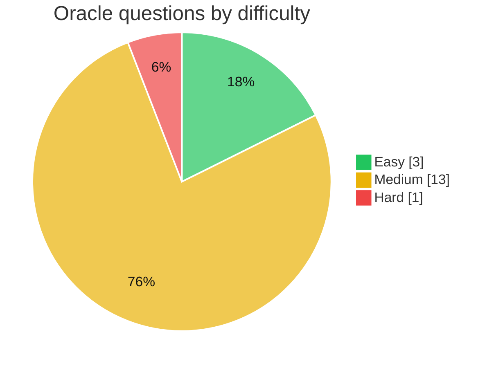

[← All companies](../README.md) · [Most asked across companies](../most-asked.md)

# Oracle Coding Questions

   

**17 Oracle coding questions** — 3 easy, 13 medium and 1 hard. Each one links to a free page where you can solve it in 13 languages, with hints and an editorial.

17 problems the CodeKairo catalogue tags as commonly asked in Oracle's coding rounds — 3 easy, 13 medium and 1 hard — each judged by hidden tests in 13 languages. The most common topics among them are Math (8), Arrays (6) and Strings (6). CodeKairo's Oracle — Aptitude & Verbal mock covers the Oracle aptitude and verbal pattern: a short multiple-choice block of twenty questions on one clock, with a reported cut-off of sixty per cent. The tag is the catalogue's own annotation of where a problem tends to come up — not a list published by Oracle, which CodeKairo is not affiliated with.

**Practise on CodeKairo:** [All 17 Oracle questions](https://codekairo.com/challenges/company/oracle?utm_source=github) · [Oracle — Aptitude & Verbal mock test](https://codekairo.com/tests/oracle-aptitude-verbal?utm_source=github) · [Oracle hiring process, round by round](https://codekairo.com/simulations/oracle?utm_source=github)

## Contents

- [Start with these 10](#start-with-these-10)
- [Topics Oracle asks most](#topics-oracle-asks-most)
- 🟢 [Easy (3)](#easy-3)
- 🟡 [Medium (13)](#medium-13)
- 🔴 [Hard (1)](#hard-1)

## Start with these 10

The Oracle questions most other companies ask too — the patterns worth knowing first.

1. 🔴 [Integer to English Words](https://codekairo.com/problems/integer-to-english-words?utm_source=github) — also asked at 6 other companies
2. 🟡 [Restore IP Addresses](https://codekairo.com/problems/restore-ip-addresses?utm_source=github) — also asked at 3 other companies
3. 🟢 [Common Elements in Three Sorted Arrays](https://codekairo.com/problems/common-elements-in-three-sorted-arrays?utm_source=github) — also asked at 2 other companies
4. 🟢 [Find Missing and Repeated Values](https://codekairo.com/problems/find-missing-and-repeated-values?utm_source=github) — also asked at 2 other companies
5. 🟢 [Binary Watch](https://codekairo.com/problems/binary-watch?utm_source=github) — also asked at 2 other companies
6. 🟡 [Closest Divisors](https://codekairo.com/problems/closest-divisors?utm_source=github) — also asked at 2 other companies
7. 🟡 [Clumsy Factorial](https://codekairo.com/problems/clumsy-factorial?utm_source=github) — also asked at 2 other companies
8. 🟡 [Number of Substrings Containing All Three Characters](https://codekairo.com/problems/number-of-substrings-containing-all-three-characters?utm_source=github) — also asked at 2 other companies
9. 🟡 [Find the Smallest Divisor Given a Threshold](https://codekairo.com/problems/find-the-smallest-divisor-given-a-threshold?utm_source=github) — also asked at 2 other companies
10. 🟡 [Check Knight Tour Configuration](https://codekairo.com/problems/check-knight-tour-configuration?utm_source=github) — also asked at 2 other companies

## Topics Oracle asks most

[Math](https://codekairo.com/challenges/math?utm_source=github) (8) · [Arrays](https://codekairo.com/challenges/arrays?utm_source=github) (6) · [Strings](https://codekairo.com/challenges/strings?utm_source=github) (6) · [Hash Table](https://codekairo.com/challenges/hash-table?utm_source=github) (3) · [Simulation](https://codekairo.com/challenges/simulation?utm_source=github) (3) · [Backtracking](https://codekairo.com/challenges/backtracking?utm_source=github) (2) · [Binary Search](https://codekairo.com/challenges/binary-search?utm_source=github) (2) · [Depth-First Search](https://codekairo.com/challenges/depth-first-search?utm_source=github) (2) · [Matrix](https://codekairo.com/challenges/matrix?utm_source=github) (2) · [Binary Indexed Tree](https://codekairo.com/challenges/binary-indexed-tree?utm_source=github) (1)

## Easy (3)

| # | Question | Topics | Acceptance |
|---:|---|---|---:|
| 617 | 🟢 [Common Elements in Three Sorted Arrays](https://codekairo.com/problems/common-elements-in-three-sorted-arrays?utm_source=github) | Arrays, Two Pointers | — |
| 623 | 🟢 [Find Missing and Repeated Values](https://codekairo.com/problems/find-missing-and-repeated-values?utm_source=github) | Matrix, Hash Table, Math | — |
| 730 | 🟢 [Binary Watch](https://codekairo.com/problems/binary-watch?utm_source=github) | Bit Manipulation, Backtracking, Enumeration | — |

## Medium (13)

| # | Question | Topics | Acceptance |
|---:|---|---|---:|
| 703 | 🟡 [Closest Divisors](https://codekairo.com/problems/closest-divisors?utm_source=github) | Math, Number Theory | — |
| 706 | 🟡 [Clumsy Factorial](https://codekairo.com/problems/clumsy-factorial?utm_source=github) | Math, Stack, Simulation | — |
| 787 | 🟡 [Number of Substrings Containing All Three Characters](https://codekairo.com/problems/number-of-substrings-containing-all-three-characters?utm_source=github) | Strings, Hash Table, Sliding Window | — |
| 821 | 🟡 [Find the Smallest Divisor Given a Threshold](https://codekairo.com/problems/find-the-smallest-divisor-given-a-threshold?utm_source=github) | Arrays, Binary Search | — |
| 909 | 🟡 [Check Knight Tour Configuration](https://codekairo.com/problems/check-knight-tour-configuration?utm_source=github) | Arrays, Matrix, Depth-First Search | — |
| 932 | 🟡 [Minimum Score of a Path Between Two Cities](https://codekairo.com/problems/minimum-score-of-a-path-between-two-cities?utm_source=github) | Graph, Union Find, Depth-First Search | — |
| 997 | 🟡 [Determine the Minimum Sum of a k-avoiding Array](https://codekairo.com/problems/determine-the-minimum-sum-of-a-k-avoiding-array?utm_source=github) | Arrays, Math, Greedy | — |
| 1024 | 🟡 [Count Substrings Starting and Ending with Given Character](https://codekairo.com/problems/count-substrings-starting-and-ending-with-given-character?utm_source=github) | Math, Strings, Counting | — |
| 1033 | 🟡 [Count Number of Homogenous Substrings](https://codekairo.com/problems/count-number-of-homogenous-substrings?utm_source=github) | Math, Strings | — |
| 1043 | 🟡 [Count Number of Ways to Place Houses](https://codekairo.com/problems/count-number-of-ways-to-place-houses?utm_source=github) | Math, Dynamic Programming | — |
| 1083 | 🟡 [Queries on a Permutation With Key](https://codekairo.com/problems/queries-on-a-permutation-with-key?utm_source=github) | Arrays, Binary Indexed Tree, Simulation | — |
| 1200 | 🟡 [Restore IP Addresses](https://codekairo.com/problems/restore-ip-addresses?utm_source=github) | Strings, Backtracking | — |
| 1213 | 🟡 [Compare Strings by Frequency of the Smallest Character](https://codekairo.com/problems/compare-strings-by-frequency-of-the-smallest-character?utm_source=github) | Arrays, Hash Table, Strings | — |

## Hard (1)

| # | Question | Topics | Acceptance |
|---:|---|---|---:|
| 1251 | 🔴 [Integer to English Words](https://codekairo.com/problems/integer-to-english-words?utm_source=github) | Strings, Math, Recursion | — |

---

[← All companies](../README.md) · Rebuilt every night from [codekairo.com](https://codekairo.com/challenges/company/oracle?utm_source=github). Last refreshed: November 2026. ⭐ [Star the repo](https://github.com/ayaanp14/company-wise-coding-questions) if it helps.
