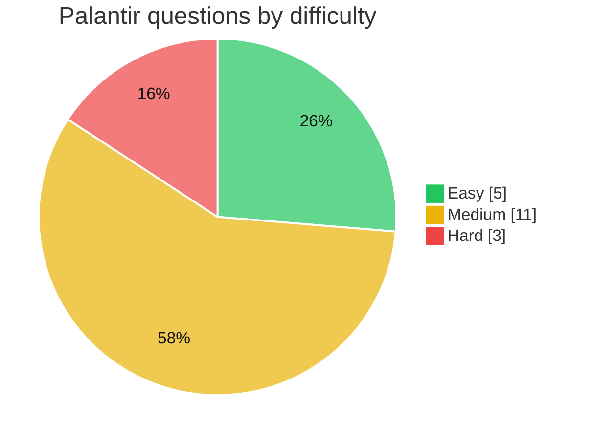

[← All companies](../README.md) · [Most asked across companies](../most-asked.md)

# Palantir Coding Questions

   

**19 Palantir coding questions** — 5 easy, 11 medium and 3 hard. Each one links to a free page where you can solve it in 13 languages, with hints and an editorial.

19 problems the CodeKairo catalogue tags as commonly asked in Palantir's coding rounds — 5 easy, 11 medium and 3 hard — each judged by hidden tests in 13 languages. The most common topics among them are Arrays (14), Strings (5) and Hash Table (5). Tagged for Palantir and no other company: Flood Fill. The tag is the catalogue's own annotation of where a problem tends to come up — not a list published by Palantir, which CodeKairo is not affiliated with.

**Practise on CodeKairo:** [All 19 Palantir questions](https://codekairo.com/challenges/company/palantir?utm_source=github)

## Contents

- [Start with these 10](#start-with-these-10)
- [Topics Palantir asks most](#topics-palantir-asks-most)
- 🟢 [Easy (5)](#easy-5)
- 🟡 [Medium (11)](#medium-11)
- 🔴 [Hard (3)](#hard-3)

## Start with these 10

The Palantir questions most other companies ask too — the patterns worth knowing first.

1. 🟡 [Merge Intervals](https://codekairo.com/problems/merge-intervals?utm_source=github) — also asked at 12 other companies
2. 🟡 [Number of Islands](https://codekairo.com/problems/number-of-islands?utm_source=github) — also asked at 9 other companies
3. 🟡 [String Compression](https://codekairo.com/problems/string-compression?utm_source=github) — also asked at 7 other companies
4. 🔴 [Trapping Rain Water](https://codekairo.com/problems/trapping-rain-water?utm_source=github) — also asked at 7 other companies
5. 🟡 [Longest Palindromic Substring](https://codekairo.com/problems/longest-palindromic-substring?utm_source=github) — also asked at 6 other companies
6. 🔴 [Integer to English Words](https://codekairo.com/problems/integer-to-english-words?utm_source=github) — also asked at 6 other companies
7. 🟡 [Smallest String With Swaps](https://codekairo.com/problems/smallest-string-with-swaps?utm_source=github) — also asked at 5 other companies
8. 🟡 [Maximum Length of Repeated Subarray](https://codekairo.com/problems/maximum-length-of-repeated-subarray?utm_source=github) — also asked at 4 other companies
9. 🟡 [Find Players With Zero or One Losses](https://codekairo.com/problems/find-players-with-zero-or-one-losses?utm_source=github) — also asked at 4 other companies
10. 🟡 [Minimum Time Difference](https://codekairo.com/problems/minimum-time-difference?utm_source=github) — also asked at 4 other companies

## Topics Palantir asks most

[Arrays](https://codekairo.com/challenges/arrays?utm_source=github) (14) · [Hash Table](https://codekairo.com/challenges/hash-table?utm_source=github) (5) · [Sorting](https://codekairo.com/challenges/sorting?utm_source=github) (5) · [Strings](https://codekairo.com/challenges/strings?utm_source=github) (5) · [Dynamic Programming](https://codekairo.com/challenges/dynamic-programming?utm_source=github) (4) · [Math](https://codekairo.com/challenges/math?utm_source=github) (3) · [Bit Manipulation](https://codekairo.com/challenges/bit-manipulation?utm_source=github) (2) · [Breadth-First Search](https://codekairo.com/challenges/breadth-first-search?utm_source=github) (2) · [Depth-First Search](https://codekairo.com/challenges/depth-first-search?utm_source=github) (2) · [Matrix](https://codekairo.com/challenges/matrix?utm_source=github) (2)

## Easy (5)

| # | Question | Topics | Acceptance |
|---:|---|---|---:|
| 10 | 🟢 [Contains Duplicate](https://codekairo.com/problems/contains-duplicate?utm_source=github) | Arrays, Hash Table, Sorting | — |
| 19 | 🟢 [Single Number](https://codekairo.com/problems/single-number?utm_source=github) | Arrays, Bit Manipulation | — |
| 116 | 🟢 [Flood Fill](https://codekairo.com/problems/flood-fill?utm_source=github) | Arrays, Matrix, Depth-First Search | — |
| 180 | 🟢 [Contains Duplicate II](https://codekairo.com/problems/contains-duplicate-ii?utm_source=github) | Arrays, Hash Table, Sliding Window | — |
| 555 | 🟢 [Check If It Is a Straight Line](https://codekairo.com/problems/check-if-it-is-a-straight-line?utm_source=github) | Arrays, Math, Geometry | — |

## Medium (11)

| # | Question | Topics | Acceptance |
|---:|---|---|---:|
| 30 | 🟡 [Longest Palindromic Substring](https://codekairo.com/problems/longest-palindromic-substring?utm_source=github) | Strings, Dynamic Programming | — |
| 118 | 🟡 [Number of Islands](https://codekairo.com/problems/number-of-islands?utm_source=github) | Arrays, Matrix, Depth-First Search | — |
| 122 | 🟡 [Merge Intervals](https://codekairo.com/problems/merge-intervals?utm_source=github) | Arrays, Sorting, Intervals | — |
| 138 | 🟡 [Course Schedule II](https://codekairo.com/problems/course-schedule-ii?utm_source=github) | Graph, Topological Sort, Heap | — |
| 219 | 🟡 [String Compression](https://codekairo.com/problems/string-compression?utm_source=github) | Two Pointers, Strings | — |
| 312 | 🟡 [Maximum Length of Repeated Subarray](https://codekairo.com/problems/maximum-length-of-repeated-subarray?utm_source=github) | Arrays, Binary Search, Dynamic Programming | — |
| 672 | 🟡 [Maximum Size Subarray Sum Equals k](https://codekairo.com/problems/maximum-size-subarray-sum-equals-k?utm_source=github) | Arrays, Hash Table, Prefix Sum | — |
| 675 | 🟡 [Smallest String With Swaps](https://codekairo.com/problems/smallest-string-with-swaps?utm_source=github) | Union Find, Hash Table, Strings | — |
| 684 | 🟡 [Find Players With Zero or One Losses](https://codekairo.com/problems/find-players-with-zero-or-one-losses?utm_source=github) | Hash Table, Arrays, Sorting | — |
| 737 | 🟡 [UTF-8 Validation](https://codekairo.com/problems/utf-8-validation?utm_source=github) | Bit Manipulation, Arrays | — |
| 1206 | 🟡 [Minimum Time Difference](https://codekairo.com/problems/minimum-time-difference?utm_source=github) | Arrays, Math, Strings | — |

## Hard (3)

| # | Question | Topics | Acceptance |
|---:|---|---|---:|
| 26 | 🔴 [Trapping Rain Water](https://codekairo.com/problems/trapping-rain-water?utm_source=github) | Arrays, Two Pointers, Dynamic Programming | — |
| 1251 | 🔴 [Integer to English Words](https://codekairo.com/problems/integer-to-english-words?utm_source=github) | Strings, Math, Recursion | — |
| 1521 | 🔴 [Selling Pieces of Wood](https://codekairo.com/problems/selling-pieces-of-wood?utm_source=github) | Arrays, Dynamic Programming, Memoization | — |

---

[← All companies](../README.md) · Rebuilt every night from [codekairo.com](https://codekairo.com/challenges/company/palantir?utm_source=github). Last refreshed: November 2026. ⭐ [Star the repo](https://github.com/ayaanp14/company-wise-coding-questions) if it helps.
