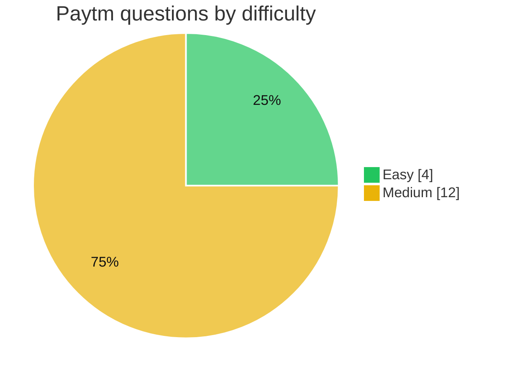

[← All companies](../README.md) · [Most asked across companies](../most-asked.md)

# Paytm Coding Questions

   

**16 Paytm coding questions** — 4 easy and 12 medium. Each one links to a free page where you can solve it in 13 languages, with hints and an editorial.

16 problems the CodeKairo catalogue tags as commonly asked in Paytm's coding rounds — 4 easy and 12 medium, no hard ones — each judged by hidden tests in 13 languages. The most common topics among them are Arrays (11), Hash Table (4) and Breadth-First Search (3). The tag is the catalogue's own annotation of where a problem tends to come up — not a list published by Paytm, which CodeKairo is not affiliated with.

**Practise on CodeKairo:** [All 16 Paytm questions](https://codekairo.com/challenges/company/paytm?utm_source=github)

## Contents

- [Start with these 10](#start-with-these-10)
- [Topics Paytm asks most](#topics-paytm-asks-most)
- 🟢 [Easy (4)](#easy-4)
- 🟡 [Medium (12)](#medium-12)

## Start with these 10

The Paytm questions most other companies ask too — the patterns worth knowing first.

1. 🟡 [Find Players With Zero or One Losses](https://codekairo.com/problems/find-players-with-zero-or-one-losses?utm_source=github) — also asked at 4 other companies
2. 🟢 [Left View of Binary Tree](https://codekairo.com/problems/left-view-of-binary-tree?utm_source=github) — also asked at 3 other companies
3. 🟢 [Alternating Groups I](https://codekairo.com/problems/alternating-groups-i?utm_source=github) — also asked at 2 other companies
4. 🟢 [Count Ways to Tile a 2 x N Floor](https://codekairo.com/problems/count-ways-to-tile-a-floor?utm_source=github) — also asked at 2 other companies
5. 🟡 [Longest Subarray With Sum Zero](https://codekairo.com/problems/longest-subarray-with-sum-zero?utm_source=github) — also asked at 2 other companies
6. 🟡 [Rearrange Array in Max/Min Form](https://codekairo.com/problems/rearrange-array-in-max-min-form?utm_source=github) — also asked at 2 other companies
7. 🟡 [Number of Zero-Filled Subarrays](https://codekairo.com/problems/number-of-zero-filled-subarrays?utm_source=github) — also asked at 2 other companies
8. 🟡 [Watering Plants II](https://codekairo.com/problems/watering-plants-ii?utm_source=github) — also asked at 2 other companies
9. 🟡 [Longest Substring with At Most K Distinct Characters](https://codekairo.com/problems/longest-substring-with-at-most-k-distinct-characters?utm_source=github) — also asked at 2 other companies
10. 🟡 [Find the Student That Will Replace the Chalk](https://codekairo.com/problems/find-the-student-that-will-replace-the-chalk?utm_source=github) — also asked at 2 other companies

## Topics Paytm asks most

[Arrays](https://codekairo.com/challenges/arrays?utm_source=github) (11) · [Hash Table](https://codekairo.com/challenges/hash-table?utm_source=github) (4) · [Breadth-First Search](https://codekairo.com/challenges/breadth-first-search?utm_source=github) (3) · [Depth-First Search](https://codekairo.com/challenges/depth-first-search?utm_source=github) (3) · [Counting](https://codekairo.com/challenges/counting?utm_source=github) (2) · [Dynamic Programming](https://codekairo.com/challenges/dynamic-programming?utm_source=github) (2) · [Greedy](https://codekairo.com/challenges/greedy?utm_source=github) (2) · [Math](https://codekairo.com/challenges/math?utm_source=github) (2) · [Prefix Sum](https://codekairo.com/challenges/prefix-sum?utm_source=github) (2) · [Simulation](https://codekairo.com/challenges/simulation?utm_source=github) (2)

## Easy (4)

| # | Question | Topics | Acceptance |
|---:|---|---|---:|
| 991 | 🟢 [Alternating Groups I](https://codekairo.com/problems/alternating-groups-i?utm_source=github) | Arrays, Sliding Window | — |
| 1614 | 🟢 [Count Ways to Tile a 2 x N Floor](https://codekairo.com/problems/count-ways-to-tile-a-floor?utm_source=github) | Math, Dynamic Programming | — |
| 1890 | 🟢 [Left View of Binary Tree](https://codekairo.com/problems/left-view-of-binary-tree?utm_source=github) | Trees, Breadth-First Search, Depth-First Search | — |
| 1893 | 🟢 [Check if All Leaves are at Same Level](https://codekairo.com/problems/check-if-leaves-are-at-same-level?utm_source=github) | Trees, Depth-First Search, Breadth-First Search | — |

## Medium (12)

| # | Question | Topics | Acceptance |
|---:|---|---|---:|
| 611 | 🟡 [Longest Subarray With Sum Zero](https://codekairo.com/problems/longest-subarray-with-sum-zero?utm_source=github) | Arrays, Hash Table, Prefix Sum | — |
| 613 | 🟡 [Rearrange Array in Max/Min Form](https://codekairo.com/problems/rearrange-array-in-max-min-form?utm_source=github) | Arrays, Two Pointers | — |
| 684 | 🟡 [Find Players With Zero or One Losses](https://codekairo.com/problems/find-players-with-zero-or-one-losses?utm_source=github) | Hash Table, Arrays, Sorting | — |
| 698 | 🟡 [Number of Zero-Filled Subarrays](https://codekairo.com/problems/number-of-zero-filled-subarrays?utm_source=github) | Arrays, Math, Counting | — |
| 772 | 🟡 [Watering Plants II](https://codekairo.com/problems/watering-plants-ii?utm_source=github) | Arrays, Two Pointers, Simulation | — |
| 786 | 🟡 [Longest Substring with At Most K Distinct Characters](https://codekairo.com/problems/longest-substring-with-at-most-k-distinct-characters?utm_source=github) | Strings, Hash Table, Sliding Window | — |
| 819 | 🟡 [Find the Student That Will Replace the Chalk](https://codekairo.com/problems/find-the-student-that-will-replace-the-chalk?utm_source=github) | Arrays, Binary Search, Prefix Sum | — |
| 845 | 🟡 [Eliminate Maximum Number of Monsters](https://codekairo.com/problems/eliminate-maximum-number-of-monsters?utm_source=github) | Arrays, Greedy, Sorting | — |
| 914 | 🟡 [Maximum Number of Fish in a Grid](https://codekairo.com/problems/maximum-number-of-fish-in-a-grid?utm_source=github) | Arrays, Matrix, Depth-First Search | — |
| 962 | 🟡 [Maximal Score After Applying K Operations](https://codekairo.com/problems/maximal-score-after-applying-k-operations?utm_source=github) | Arrays, Greedy, Heap | — |
| 1419 | 🟡 [Next Greater Frequency Element](https://codekairo.com/problems/next-greater-frequency-element?utm_source=github) | Arrays, Hash Table, Stack | — |
| 1609 | 🟡 [Longest Repeating Subsequence](https://codekairo.com/problems/longest-repeating-subsequence?utm_source=github) | Strings, Dynamic Programming | — |

---

[← All companies](../README.md) · Rebuilt every night from [codekairo.com](https://codekairo.com/challenges/company/paytm?utm_source=github). Last refreshed: November 2026. ⭐ [Star the repo](https://github.com/ayaanp14/company-wise-coding-questions) if it helps.
