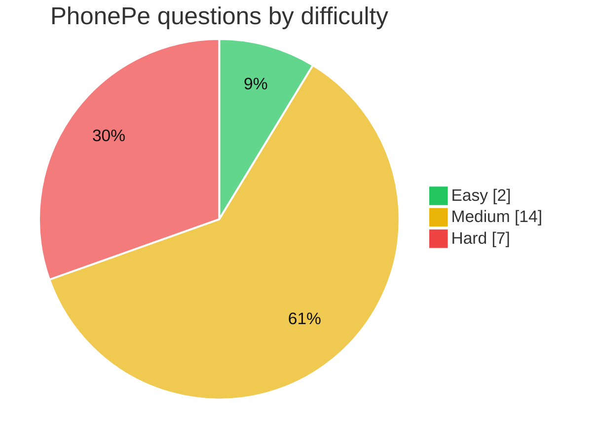

[← All companies](../README.md) · [Most asked across companies](../most-asked.md)

# PhonePe Coding Questions

   

**23 PhonePe coding questions** — 2 easy, 14 medium and 7 hard. Each one links to a free page where you can solve it in 13 languages, with hints and an editorial.

23 problems the CodeKairo catalogue tags as commonly asked in PhonePe's coding rounds — 2 easy, 14 medium and 7 hard — each judged by hidden tests in 13 languages. The most common topics among them are Arrays (16), Dynamic Programming (7) and Sorting (6). The tag is the catalogue's own annotation of where a problem tends to come up — not a list published by PhonePe, which CodeKairo is not affiliated with.

**Practise on CodeKairo:** [All 23 PhonePe questions](https://codekairo.com/challenges/company/phonepe?utm_source=github)

## Contents

- [Start with these 10](#start-with-these-10)
- [Topics PhonePe asks most](#topics-phonepe-asks-most)
- 🟢 [Easy (2)](#easy-2)
- 🟡 [Medium (14)](#medium-14)
- 🔴 [Hard (7)](#hard-7)

## Start with these 10

The PhonePe questions most other companies ask too — the patterns worth knowing first.

1. 🟢 [Two Sum](https://codekairo.com/problems/two-sum?utm_source=github) — also asked at 18 other companies
2. 🟢 [Valid Parentheses](https://codekairo.com/problems/valid-parentheses?utm_source=github) — also asked at 14 other companies
3. 🔴 [Trapping Rain Water](https://codekairo.com/problems/trapping-rain-water?utm_source=github) — also asked at 7 other companies
4. 🟡 [Longest Palindromic Substring](https://codekairo.com/problems/longest-palindromic-substring?utm_source=github) — also asked at 6 other companies
5. 🟡 [Kth Smallest Element in a Sorted Matrix](https://codekairo.com/problems/kth-smallest-element-in-a-sorted-matrix?utm_source=github) — also asked at 5 other companies
6. 🟡 [Smallest String With Swaps](https://codekairo.com/problems/smallest-string-with-swaps?utm_source=github) — also asked at 5 other companies
7. 🔴 [Maximum Profit in Job Scheduling](https://codekairo.com/problems/maximum-profit-in-job-scheduling?utm_source=github) — also asked at 5 other companies
8. 🟡 [Asteroid Collision](https://codekairo.com/problems/asteroid-collision?utm_source=github) — also asked at 4 other companies
9. 🟡 [House Robber](https://codekairo.com/problems/house-robber?utm_source=github) — also asked at 4 other companies
10. 🟡 [Rotting Oranges](https://codekairo.com/problems/rotting-oranges?utm_source=github) — also asked at 4 other companies

## Topics PhonePe asks most

[Arrays](https://codekairo.com/challenges/arrays?utm_source=github) (16) · [Dynamic Programming](https://codekairo.com/challenges/dynamic-programming?utm_source=github) (7) · [Sorting](https://codekairo.com/challenges/sorting?utm_source=github) (6) · [Binary Search](https://codekairo.com/challenges/binary-search?utm_source=github) (5) · [Hash Table](https://codekairo.com/challenges/hash-table?utm_source=github) (5) · [Greedy](https://codekairo.com/challenges/greedy?utm_source=github) (4) · [Stack](https://codekairo.com/challenges/stack?utm_source=github) (4) · [Strings](https://codekairo.com/challenges/strings?utm_source=github) (4) · [Sliding Window](https://codekairo.com/challenges/sliding-window?utm_source=github) (3) · [Breadth-First Search](https://codekairo.com/challenges/breadth-first-search?utm_source=github) (2)

## Easy (2)

| # | Question | Topics | Acceptance |
|---:|---|---|---:|
| 1 | 🟢 [Two Sum](https://codekairo.com/problems/two-sum?utm_source=github) | Arrays, Hash Table | — |
| 4 | 🟢 [Valid Parentheses](https://codekairo.com/problems/valid-parentheses?utm_source=github) | Strings, Stack | — |

## Medium (14)

| # | Question | Topics | Acceptance |
|---:|---|---|---:|
| 30 | 🟡 [Longest Palindromic Substring](https://codekairo.com/problems/longest-palindromic-substring?utm_source=github) | Strings, Dynamic Programming | — |
| 71 | 🟡 [Remove K Digits](https://codekairo.com/problems/remove-k-digits?utm_source=github) | Strings, Stack, Greedy | — |
| 75 | 🟡 [Asteroid Collision](https://codekairo.com/problems/asteroid-collision?utm_source=github) | Arrays, Stack, Simulation | — |
| 78 | 🟡 [Jump Game II](https://codekairo.com/problems/jump-game-ii?utm_source=github) | Arrays, Greedy, Dynamic Programming | — |
| 88 | 🟡 [House Robber](https://codekairo.com/problems/house-robber?utm_source=github) | Arrays, Dynamic Programming | — |
| 120 | 🟡 [Rotting Oranges](https://codekairo.com/problems/rotting-oranges?utm_source=github) | Arrays, Matrix, Breadth-First Search | — |
| 367 | 🟡 [Kth Smallest Element in a Sorted Matrix](https://codekairo.com/problems/kth-smallest-element-in-a-sorted-matrix?utm_source=github) | Arrays, Binary Search, Sorting | — |
| 675 | 🟡 [Smallest String With Swaps](https://codekairo.com/problems/smallest-string-with-swaps?utm_source=github) | Union Find, Hash Table, Strings | — |
| 796 | 🟡 [Count the Number of Good Subarrays](https://codekairo.com/problems/count-the-number-of-good-subarrays?utm_source=github) | Arrays, Hash Table, Sliding Window | — |
| 816 | 🟡 [Minimum Number of Days to Make m Bouquets](https://codekairo.com/problems/minimum-number-of-days-to-make-m-bouquets?utm_source=github) | Arrays, Binary Search | — |
| 1349 | 🟡 [Longest Continuous Subarray With Absolute Diff Less Than or Equal to Limit](https://codekairo.com/problems/longest-continuous-subarray-with-absolute-diff-less-than-or-equal-to-limit?utm_source=github) | Arrays, Sliding Window, Monotonic Queue | — |
| 1379 | 🟡 [Maximum Tastiness of Candy Basket](https://codekairo.com/problems/maximum-tastiness-of-candy-basket?utm_source=github) | Arrays, Binary Search, Greedy | — |
| 1525 | 🟡 [Most Stones Removed with Same Row or Column](https://codekairo.com/problems/most-stones-removed-with-same-row-or-column?utm_source=github) | Graph, Union Find, Depth-First Search | — |
| 1580 | 🟡 [Matchsticks to Square](https://codekairo.com/problems/matchsticks-to-square?utm_source=github) | Arrays, Backtracking, Bitmask | — |

## Hard (7)

| # | Question | Topics | Acceptance |
|---:|---|---|---:|
| 26 | 🔴 [Trapping Rain Water](https://codekairo.com/problems/trapping-rain-water?utm_source=github) | Arrays, Two Pointers, Dynamic Programming | — |
| 947 | 🔴 [Bus Routes](https://codekairo.com/problems/bus-routes?utm_source=github) | Arrays, Hash Table, Breadth-First Search | — |
| 977 | 🔴 [Smallest Range Covering Elements from K Lists](https://codekairo.com/problems/smallest-range-covering-elements-from-k-lists?utm_source=github) | Arrays, Hash Table, Greedy | — |
| 1320 | 🔴 [Check if Point Is Reachable](https://codekairo.com/problems/check-if-point-is-reachable?utm_source=github) | Math, Number Theory | — |
| 1381 | 🔴 [Number of Flowers in Full Bloom](https://codekairo.com/problems/number-of-flowers-in-full-bloom?utm_source=github) | Arrays, Binary Search, Sorting | — |
| 1506 | 🔴 [Maximum Profit in Job Scheduling](https://codekairo.com/problems/maximum-profit-in-job-scheduling?utm_source=github) | Arrays, Binary Search, Dynamic Programming | — |
| 1540 | 🔴 [Sum of Distances in Tree](https://codekairo.com/problems/sum-of-distances-in-tree?utm_source=github) | Trees, Depth-First Search, Graph | — |

---

[← All companies](../README.md) · Rebuilt every night from [codekairo.com](https://codekairo.com/challenges/company/phonepe?utm_source=github). Last refreshed: November 2026. ⭐ [Star the repo](https://github.com/ayaanp14/company-wise-coding-questions) if it helps.
