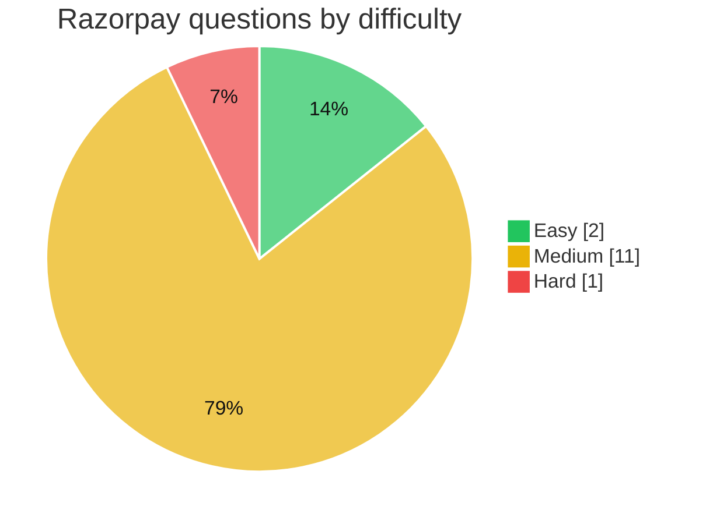

[← All companies](../README.md) · [Most asked across companies](../most-asked.md)

# Razorpay Coding Questions

   

**14 Razorpay coding questions** — 2 easy, 11 medium and 1 hard. Each one links to a free page where you can solve it in 13 languages, with hints and an editorial.

14 problems the CodeKairo catalogue tags as commonly asked in Razorpay's coding rounds — 2 easy, 11 medium and 1 hard — each judged by hidden tests in 13 languages. The most common topics among them are Arrays (8), Two Pointers (5) and Binary Search (5). The tag is the catalogue's own annotation of where a problem tends to come up — not a list published by Razorpay, which CodeKairo is not affiliated with.

**Practise on CodeKairo:** [All 14 Razorpay questions](https://codekairo.com/challenges/company/razorpay?utm_source=github)

## Contents

- [Start with these 10](#start-with-these-10)
- [Topics Razorpay asks most](#topics-razorpay-asks-most)
- 🟢 [Easy (2)](#easy-2)
- 🟡 [Medium (11)](#medium-11)
- 🔴 [Hard (1)](#hard-1)

## Start with these 10

The Razorpay questions most other companies ask too — the patterns worth knowing first.

1. 🟡 [Merge Intervals](https://codekairo.com/problems/merge-intervals?utm_source=github) — also asked at 12 other companies
2. 🟢 [First Unique Character in a String](https://codekairo.com/problems/first-unique-character-in-a-string?utm_source=github) — also asked at 7 other companies
3. 🟡 [Container With Most Water](https://codekairo.com/problems/container-with-most-water?utm_source=github) — also asked at 6 other companies
4. 🟡 [Decode String](https://codekairo.com/problems/decode-string?utm_source=github) — also asked at 5 other companies
5. 🟢 [Excel Sheet Column Number](https://codekairo.com/problems/excel-sheet-column-number?utm_source=github) — also asked at 4 other companies
6. 🟡 [Maximum Points You Can Obtain from Cards](https://codekairo.com/problems/maximum-points-you-can-obtain-from-cards?utm_source=github) — also asked at 3 other companies
7. 🟡 [Most Beautiful Item for Each Query](https://codekairo.com/problems/most-beautiful-item-for-each-query?utm_source=github) — also asked at 3 other companies
8. 🟡 [Shortest Subarray to be Removed to Make Array Sorted](https://codekairo.com/problems/shortest-subarray-to-be-removed-to-make-array-sorted?utm_source=github) — also asked at 3 other companies
9. 🔴 [Smallest Good Base](https://codekairo.com/problems/smallest-good-base?utm_source=github) — also asked at 3 other companies
10. 🟡 [Rotate Array](https://codekairo.com/problems/rotate-array?utm_source=github) — also asked at 2 other companies

## Topics Razorpay asks most

[Arrays](https://codekairo.com/challenges/arrays?utm_source=github) (8) · [Binary Search](https://codekairo.com/challenges/binary-search?utm_source=github) (5) · [Two Pointers](https://codekairo.com/challenges/two-pointers?utm_source=github) (5) · [Math](https://codekairo.com/challenges/math?utm_source=github) (4) · [Sorting](https://codekairo.com/challenges/sorting?utm_source=github) (4) · [Strings](https://codekairo.com/challenges/strings?utm_source=github) (4) · [Dynamic Programming](https://codekairo.com/challenges/dynamic-programming?utm_source=github) (2) · [Greedy](https://codekairo.com/challenges/greedy?utm_source=github) (2) · [Combinatorics](https://codekairo.com/challenges/combinatorics?utm_source=github) (1) · [Counting](https://codekairo.com/challenges/counting?utm_source=github) (1)

## Easy (2)

| # | Question | Topics | Acceptance |
|---:|---|---|---:|
| 157 | 🟢 [Excel Sheet Column Number](https://codekairo.com/problems/excel-sheet-column-number?utm_source=github) | Math, Strings | — |
| 213 | 🟢 [First Unique Character in a String](https://codekairo.com/problems/first-unique-character-in-a-string?utm_source=github) | Hash Table, Strings, Queue | — |

## Medium (11)

| # | Question | Topics | Acceptance |
|---:|---|---|---:|
| 15 | 🟡 [Rotate Array](https://codekairo.com/problems/rotate-array?utm_source=github) | Arrays, Math, Two Pointers | — |
| 44 | 🟡 [Container With Most Water](https://codekairo.com/problems/container-with-most-water?utm_source=github) | Arrays, Two Pointers, Greedy | — |
| 74 | 🟡 [Decode String](https://codekairo.com/problems/decode-string?utm_source=github) | Strings, Stack, Recursion | — |
| 95 | 🟡 [Unique Paths](https://codekairo.com/problems/unique-paths?utm_source=github) | Math, Dynamic Programming, Combinatorics | — |
| 122 | 🟡 [Merge Intervals](https://codekairo.com/problems/merge-intervals?utm_source=github) | Arrays, Sorting, Intervals | — |
| 789 | 🟡 [Maximum Points You Can Obtain from Cards](https://codekairo.com/problems/maximum-points-you-can-obtain-from-cards?utm_source=github) | Arrays, Sliding Window, Prefix Sum | — |
| 829 | 🟡 [Successful Pairs of Spells and Potions](https://codekairo.com/problems/successful-pairs-of-spells-and-potions?utm_source=github) | Arrays, Binary Search, Sorting | — |
| 857 | 🟡 [Separate Black and White Balls](https://codekairo.com/problems/separate-black-and-white-balls?utm_source=github) | Strings, Greedy, Two Pointers | — |
| 966 | 🟡 [Most Beautiful Item for Each Query](https://codekairo.com/problems/most-beautiful-item-for-each-query?utm_source=github) | Arrays, Binary Search, Sorting | — |
| 1356 | 🟡 [Shortest Subarray to be Removed to Make Array Sorted](https://codekairo.com/problems/shortest-subarray-to-be-removed-to-make-array-sorted?utm_source=github) | Arrays, Two Pointers, Binary Search | — |
| 1443 | 🟡 [Two Best Non-Overlapping Events](https://codekairo.com/problems/two-best-non-overlapping-events?utm_source=github) | Arrays, Binary Search, Dynamic Programming | — |

## Hard (1)

| # | Question | Topics | Acceptance |
|---:|---|---|---:|
| 718 | 🔴 [Smallest Good Base](https://codekairo.com/problems/smallest-good-base?utm_source=github) | Math, Binary Search, Number Theory | — |

---

[← All companies](../README.md) · Rebuilt every night from [codekairo.com](https://codekairo.com/challenges/company/razorpay?utm_source=github). Last refreshed: November 2026. ⭐ [Star the repo](https://github.com/ayaanp14/company-wise-coding-questions) if it helps.
