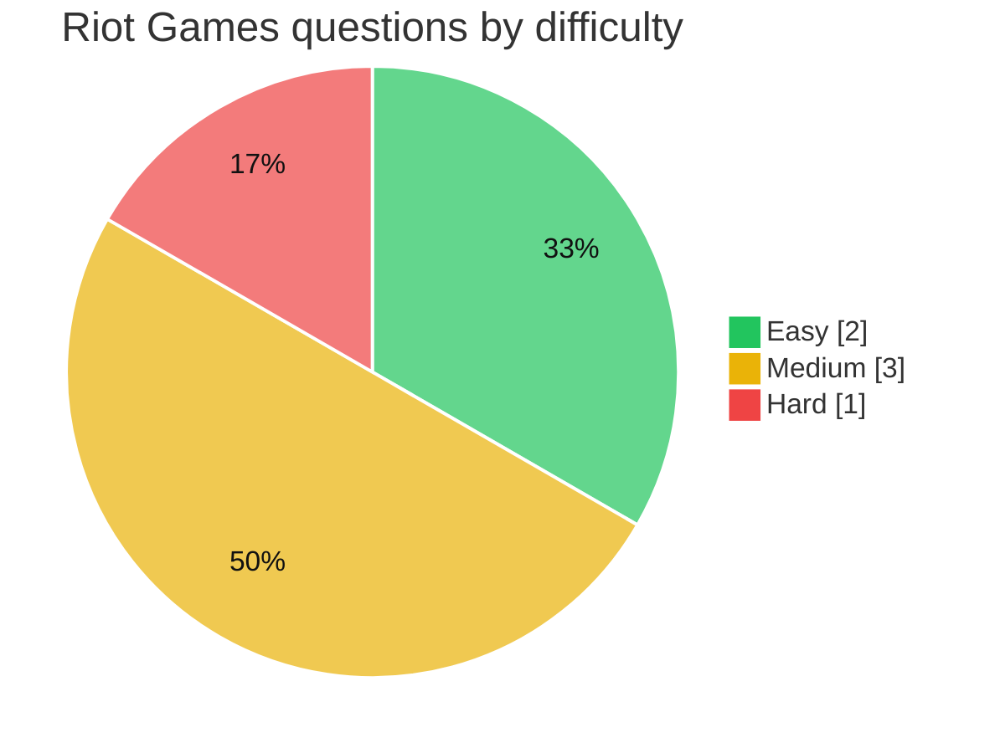

[← All companies](../README.md) · [Most asked across companies](../most-asked.md)

# Riot Games Coding Questions

   

**6 Riot Games coding questions** — 2 easy, 3 medium and 1 hard. Each one links to a free page where you can solve it in 13 languages, with hints and an editorial.

6 problems the CodeKairo catalogue tags as commonly asked in Riot Games's coding rounds — 2 easy, 3 medium and 1 hard — each judged by hidden tests in 13 languages. The most common topics among them are Arrays (4), Matrix (3) and Hash Table (2). The tag is the catalogue's own annotation of where a problem tends to come up — not a list published by Riot Games, which CodeKairo is not affiliated with.

**Practise on CodeKairo:** [All 6 Riot Games questions](https://codekairo.com/challenges/company/riot-games?utm_source=github)

## Contents

- [Start with these 6](#start-with-these-6)
- [Topics Riot Games asks most](#topics-riot-games-asks-most)
- 🟢 [Easy (2)](#easy-2)
- 🟡 [Medium (3)](#medium-3)
- 🔴 [Hard (1)](#hard-1)

## Start with these 6

The Riot Games questions most other companies ask too — the patterns worth knowing first.

1. 🟢 [Valid Parentheses](https://codekairo.com/problems/valid-parentheses?utm_source=github) — also asked at 14 other companies
2. 🟡 [Game of Life](https://codekairo.com/problems/game-of-life?utm_source=github) — also asked at 7 other companies
3. 🟡 [Valid Sudoku](https://codekairo.com/problems/valid-sudoku?utm_source=github) — also asked at 7 other companies
4. 🔴 [Sudoku Solver](https://codekairo.com/problems/sudoku-solver?utm_source=github) — also asked at 6 other companies
5. 🟡 [Divide Two Integers](https://codekairo.com/problems/divide-two-integers?utm_source=github) — also asked at 4 other companies
6. 🟢 [Teemo Attacking](https://codekairo.com/problems/teemo-attacking?utm_source=github) — also asked at 1 other company

## Topics Riot Games asks most

[Arrays](https://codekairo.com/challenges/arrays?utm_source=github) (4) · [Matrix](https://codekairo.com/challenges/matrix?utm_source=github) (3) · [Hash Table](https://codekairo.com/challenges/hash-table?utm_source=github) (2) · [Simulation](https://codekairo.com/challenges/simulation?utm_source=github) (2) · [Backtracking](https://codekairo.com/challenges/backtracking?utm_source=github) (1) · [Bit Manipulation](https://codekairo.com/challenges/bit-manipulation?utm_source=github) (1) · [Math](https://codekairo.com/challenges/math?utm_source=github) (1) · [Stack](https://codekairo.com/challenges/stack?utm_source=github) (1) · [Strings](https://codekairo.com/challenges/strings?utm_source=github) (1)

## Easy (2)

| # | Question | Topics | Acceptance |
|---:|---|---|---:|
| 4 | 🟢 [Valid Parentheses](https://codekairo.com/problems/valid-parentheses?utm_source=github) | Strings, Stack | — |
| 494 | 🟢 [Teemo Attacking](https://codekairo.com/problems/teemo-attacking?utm_source=github) | Arrays, Simulation | — |

## Medium (3)

| # | Question | Topics | Acceptance |
|---:|---|---|---:|
| 293 | 🟡 [Game of Life](https://codekairo.com/problems/game-of-life?utm_source=github) | Arrays, Matrix, Simulation | — |
| 303 | 🟡 [Valid Sudoku](https://codekairo.com/problems/valid-sudoku?utm_source=github) | Arrays, Hash Table, Matrix | — |
| 431 | 🟡 [Divide Two Integers](https://codekairo.com/problems/divide-two-integers?utm_source=github) | Math, Bit Manipulation | — |

## Hard (1)

| # | Question | Topics | Acceptance |
|---:|---|---|---:|
| 1572 | 🔴 [Sudoku Solver](https://codekairo.com/problems/sudoku-solver?utm_source=github) | Arrays, Hash Table, Backtracking | — |

---

[← All companies](../README.md) · Rebuilt every night from [codekairo.com](https://codekairo.com/challenges/company/riot-games?utm_source=github). Last refreshed: November 2026. ⭐ [Star the repo](https://github.com/ayaanp14/company-wise-coding-questions) if it helps.
