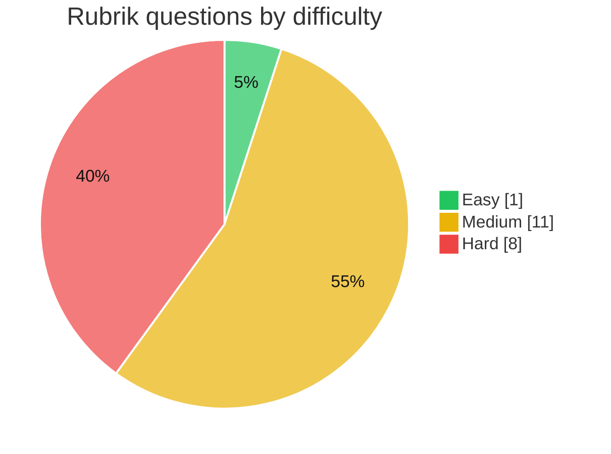

[← All companies](../README.md) · [Most asked across companies](../most-asked.md)

# Rubrik Coding Questions

   

**20 Rubrik coding questions** — 1 easy, 11 medium and 8 hard. Each one links to a free page where you can solve it in 13 languages, with hints and an editorial.

20 problems the CodeKairo catalogue tags as commonly asked in Rubrik's coding rounds — 1 easy, 11 medium and 8 hard — each judged by hidden tests in 13 languages. The most common topics among them are Arrays (10), Strings (8) and Hash Table (6). The tag is the catalogue's own annotation of where a problem tends to come up — not a list published by Rubrik, which CodeKairo is not affiliated with.

**Practise on CodeKairo:** [All 20 Rubrik questions](https://codekairo.com/challenges/company/rubrik?utm_source=github)

## Contents

- [Start with these 10](#start-with-these-10)
- [Topics Rubrik asks most](#topics-rubrik-asks-most)
- 🟢 [Easy (1)](#easy-1)
- 🟡 [Medium (11)](#medium-11)
- 🔴 [Hard (8)](#hard-8)

## Start with these 10

The Rubrik questions most other companies ask too — the patterns worth knowing first.

1. 🔴 [Best Time to Buy and Sell Stock III](https://codekairo.com/problems/best-time-to-buy-and-sell-stock-iii?utm_source=github) — also asked at 6 other companies
2. 🟡 [Next Permutation](https://codekairo.com/problems/next-permutation?utm_source=github) — also asked at 5 other companies
3. 🟡 [Minimum Path Sum](https://codekairo.com/problems/minimum-path-sum?utm_source=github) — also asked at 5 other companies
4. 🟡 [Smallest String With Swaps](https://codekairo.com/problems/smallest-string-with-swaps?utm_source=github) — also asked at 5 other companies
5. 🟢 [Existence of a Substring in a String and Its Reverse](https://codekairo.com/problems/existence-of-a-substring-in-a-string-and-its-reverse?utm_source=github) — also asked at 3 other companies
6. 🟡 [3Sum](https://codekairo.com/problems/3sum?utm_source=github) — also asked at 3 other companies
7. 🟡 [4Sum](https://codekairo.com/problems/4sum?utm_source=github) — also asked at 3 other companies
8. 🟡 [Fraction to Recurring Decimal](https://codekairo.com/problems/fraction-to-recurring-decimal?utm_source=github) — also asked at 3 other companies
9. 🔴 [Minimum Number of Moves to Make Palindrome](https://codekairo.com/problems/minimum-number-of-moves-to-make-palindrome?utm_source=github) — also asked at 3 other companies
10. 🔴 [Scramble String](https://codekairo.com/problems/scramble-string?utm_source=github) — also asked at 3 other companies

## Topics Rubrik asks most

[Arrays](https://codekairo.com/challenges/arrays?utm_source=github) (10) · [Strings](https://codekairo.com/challenges/strings?utm_source=github) (8) · [Greedy](https://codekairo.com/challenges/greedy?utm_source=github) (6) · [Hash Table](https://codekairo.com/challenges/hash-table?utm_source=github) (6) · [Sorting](https://codekairo.com/challenges/sorting?utm_source=github) (5) · [Dynamic Programming](https://codekairo.com/challenges/dynamic-programming?utm_source=github) (4) · [Two Pointers](https://codekairo.com/challenges/two-pointers?utm_source=github) (4) · [Math](https://codekairo.com/challenges/math?utm_source=github) (3) · [Binary Search](https://codekairo.com/challenges/binary-search?utm_source=github) (2) · [Backtracking](https://codekairo.com/challenges/backtracking?utm_source=github) (1)

## Easy (1)

| # | Question | Topics | Acceptance |
|---:|---|---|---:|
| 1013 | 🟢 [Existence of a Substring in a String and Its Reverse](https://codekairo.com/problems/existence-of-a-substring-in-a-string-and-its-reverse?utm_source=github) | Strings, Hash Table | — |

## Medium (11)

| # | Question | Topics | Acceptance |
|---:|---|---|---:|
| 85 | 🟡 [Task Scheduler](https://codekairo.com/problems/task-scheduler?utm_source=github) | Arrays, Greedy, Heap | — |
| 131 | 🟡 [3Sum](https://codekairo.com/problems/3sum?utm_source=github) | Arrays, Two Pointers, Sorting | — |
| 185 | 🟡 [Next Permutation](https://codekairo.com/problems/next-permutation?utm_source=github) | Arrays, Two Pointers | — |
| 288 | 🟡 [Minimum Path Sum](https://codekairo.com/problems/minimum-path-sum?utm_source=github) | Arrays, Dynamic Programming, Matrix | — |
| 574 | 🟡 [Paint Fence](https://codekairo.com/problems/paint-fence?utm_source=github) | Dynamic Programming | — |
| 675 | 🟡 [Smallest String With Swaps](https://codekairo.com/problems/smallest-string-with-swaps?utm_source=github) | Union Find, Hash Table, Strings | — |
| 760 | 🟡 [4Sum](https://codekairo.com/problems/4sum?utm_source=github) | Arrays, Two Pointers, Sorting | — |
| 820 | 🟡 [Maximum Value at a Given Index in a Bounded Array](https://codekairo.com/problems/maximum-value-at-a-given-index-in-a-bounded-array?utm_source=github) | Binary Search, Greedy, Math | — |
| 1158 | 🟡 [Task Scheduler II](https://codekairo.com/problems/task-scheduler-ii?utm_source=github) | Arrays, Hash Table, Simulation | — |
| 1271 | 🟡 [Fraction to Recurring Decimal](https://codekairo.com/problems/fraction-to-recurring-decimal?utm_source=github) | Hash Table, Math, Strings | — |
| 1306 | 🟡 [Count Lattice Points Inside a Circle](https://codekairo.com/problems/count-lattice-points-inside-a-circle?utm_source=github) | Arrays, Hash Table, Math | — |

## Hard (8)

| # | Question | Topics | Acceptance |
|---:|---|---|---:|
| 311 | 🔴 [Best Time to Buy and Sell Stock III](https://codekairo.com/problems/best-time-to-buy-and-sell-stock-iii?utm_source=github) | Arrays, Dynamic Programming | — |
| 776 | 🔴 [Minimum Number of Moves to Make Palindrome](https://codekairo.com/problems/minimum-number-of-moves-to-make-palindrome?utm_source=github) | Strings, Two Pointers, Greedy | — |
| 807 | 🔴 [Take K of Each Character From Left and Right](https://codekairo.com/problems/take-k-of-each-character-from-left-and-right?utm_source=github) | Strings, Hash Table, Sliding Window | — |
| 868 | 🔴 [Minimum Time to Complete All Tasks](https://codekairo.com/problems/minimum-time-to-complete-all-tasks?utm_source=github) | Arrays, Greedy, Sorting | — |
| 893 | 🔴 [Scramble String](https://codekairo.com/problems/scramble-string?utm_source=github) | Strings, Dynamic Programming | — |
| 895 | 🔴 [Maximum Number of Groups With Increasing Length](https://codekairo.com/problems/maximum-number-of-groups-with-increasing-length?utm_source=github) | Arrays, Greedy, Sorting | — |
| 1040 | 🔴 [Special Binary String](https://codekairo.com/problems/special-binary-string?utm_source=github) | Strings, Recursion, Divide and Conquer | — |
| 1252 | 🔴 [Remove Invalid Parentheses](https://codekairo.com/problems/remove-invalid-parentheses?utm_source=github) | Strings, Backtracking, Breadth-First Search | — |

---

[← All companies](../README.md) · Rebuilt every night from [codekairo.com](https://codekairo.com/challenges/company/rubrik?utm_source=github). Last refreshed: November 2026. ⭐ [Star the repo](https://github.com/ayaanp14/company-wise-coding-questions) if it helps.
