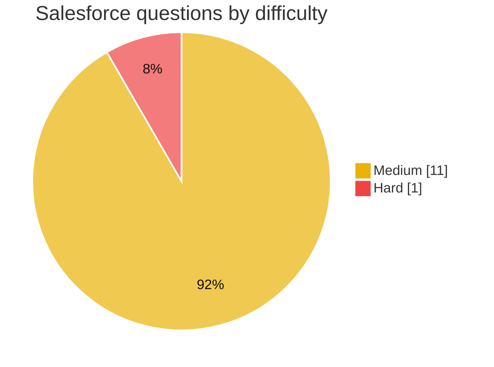

[← All companies](../README.md) · [Most asked across companies](../most-asked.md)

# Salesforce Coding Questions

   

**12 Salesforce coding questions** — 11 medium and 1 hard. Each one links to a free page where you can solve it in 13 languages, with hints and an editorial.

12 problems the CodeKairo catalogue tags as commonly asked in Salesforce's coding rounds — 11 medium and 1 hard — each judged by hidden tests in 13 languages. The most common topics among them are Arrays (5), Strings (4) and Sorting (3). CodeKairo's Salesforce — SWE Assessment mock covers the Salesforce software engineering assessment pattern: two narrative coding problems in seventy-five minutes, with no aptitude section. The tag is the catalogue's own annotation of where a problem tends to come up — not a list published by Salesforce, which CodeKairo is not affiliated with.

**Practise on CodeKairo:** [All 12 Salesforce questions](https://codekairo.com/challenges/company/salesforce?utm_source=github) · [Salesforce — SWE Assessment mock test](https://codekairo.com/tests/salesforce-swe-assessment?utm_source=github) · [Salesforce hiring process, round by round](https://codekairo.com/simulations/salesforce?utm_source=github)

## Contents

- [Start with these 10](#start-with-these-10)
- [Topics Salesforce asks most](#topics-salesforce-asks-most)
- 🟡 [Medium (11)](#medium-11)
- 🔴 [Hard (1)](#hard-1)

## Start with these 10

The Salesforce questions most other companies ask too — the patterns worth knowing first.

1. 🔴 [Last Substring in Lexicographical Order](https://codekairo.com/problems/last-substring-in-lexicographical-order?utm_source=github) — also asked at 4 other companies
2. 🟡 [Frequency of the Most Frequent Element](https://codekairo.com/problems/frequency-of-the-most-frequent-element?utm_source=github) — also asked at 2 other companies
3. 🟡 [Maximum Number of Removable Characters](https://codekairo.com/problems/maximum-number-of-removable-characters?utm_source=github) — also asked at 2 other companies
4. 🟡 [Count Ways To Build Good Strings](https://codekairo.com/problems/count-ways-to-build-good-strings?utm_source=github) — also asked at 2 other companies
5. 🟡 [Remove All Ones With Row and Column Flips](https://codekairo.com/problems/remove-all-ones-with-row-and-column-flips?utm_source=github) — also asked at 2 other companies
6. 🟡 [Count the Number of Complete Components](https://codekairo.com/problems/count-the-number-of-complete-components?utm_source=github) — also asked at 2 other companies
7. 🟡 [Number of Nodes in the Sub-Tree With the Same Label](https://codekairo.com/problems/number-of-nodes-in-the-sub-tree-with-the-same-label?utm_source=github) — also asked at 2 other companies
8. 🟡 [Count Days Without Meetings](https://codekairo.com/problems/count-days-without-meetings?utm_source=github) — also asked at 2 other companies
9. 🟡 [Minimum Length of String After Operations](https://codekairo.com/problems/minimum-length-of-string-after-operations?utm_source=github) — also asked at 2 other companies
10. 🟡 [Count Ways to Group Overlapping Ranges](https://codekairo.com/problems/count-ways-to-group-overlapping-ranges?utm_source=github) — also asked at 2 other companies

## Topics Salesforce asks most

[Arrays](https://codekairo.com/challenges/arrays?utm_source=github) (5) · [Strings](https://codekairo.com/challenges/strings?utm_source=github) (4) · [Breadth-First Search](https://codekairo.com/challenges/breadth-first-search?utm_source=github) (3) · [Depth-First Search](https://codekairo.com/challenges/depth-first-search?utm_source=github) (3) · [Sorting](https://codekairo.com/challenges/sorting?utm_source=github) (3) · [Binary Search](https://codekairo.com/challenges/binary-search?utm_source=github) (2) · [Counting](https://codekairo.com/challenges/counting?utm_source=github) (2) · [Graph](https://codekairo.com/challenges/graph?utm_source=github) (2) · [Hash Table](https://codekairo.com/challenges/hash-table?utm_source=github) (2) · [Trees](https://codekairo.com/challenges/trees?utm_source=github) (2)

## Medium (11)

| # | Question | Topics | Acceptance |
|---:|---|---|---:|
| 791 | 🟡 [Frequency of the Most Frequent Element](https://codekairo.com/problems/frequency-of-the-most-frequent-element?utm_source=github) | Arrays, Sliding Window, Greedy | — |
| 831 | 🟡 [Maximum Number of Removable Characters](https://codekairo.com/problems/maximum-number-of-removable-characters?utm_source=github) | Arrays, Strings, Binary Search | — |
| 871 | 🟡 [Count Ways To Build Good Strings](https://codekairo.com/problems/count-ways-to-build-good-strings?utm_source=github) | Dynamic Programming | — |
| 917 | 🟡 [Remove All Ones With Row and Column Flips](https://codekairo.com/problems/remove-all-ones-with-row-and-column-flips?utm_source=github) | Arrays, Matrix, Bit Manipulation | — |
| 933 | 🟡 [Count the Number of Complete Components](https://codekairo.com/problems/count-the-number-of-complete-components?utm_source=github) | Graph, Union Find, Depth-First Search | — |
| 936 | 🟡 [Number of Nodes in the Sub-Tree With the Same Label](https://codekairo.com/problems/number-of-nodes-in-the-sub-tree-with-the-same-label?utm_source=github) | Hash Table, Trees, Graph | — |
| 1002 | 🟡 [Count Days Without Meetings](https://codekairo.com/problems/count-days-without-meetings?utm_source=github) | Arrays, Sorting | — |
| 1027 | 🟡 [Minimum Length of String After Operations](https://codekairo.com/problems/minimum-length-of-string-after-operations?utm_source=github) | Hash Table, Strings, Counting | — |
| 1044 | 🟡 [Count Ways to Group Overlapping Ranges](https://codekairo.com/problems/count-ways-to-group-overlapping-ranges?utm_source=github) | Arrays, Sorting, Math | — |
| 1086 | 🟡 [Make Three Strings Equal](https://codekairo.com/problems/make-three-strings-equal?utm_source=github) | Strings | — |
| 1945 | 🟡 [Sum of Nodes with Even-Valued Grandparent](https://codekairo.com/problems/sum-of-nodes-with-even-valued-grandparent?utm_source=github) | Trees, Depth-First Search, Breadth-First Search | — |

## Hard (1)

| # | Question | Topics | Acceptance |
|---:|---|---|---:|
| 1254 | 🔴 [Last Substring in Lexicographical Order](https://codekairo.com/problems/last-substring-in-lexicographical-order?utm_source=github) | Strings, Two Pointers | — |

---

[← All companies](../README.md) · Rebuilt every night from [codekairo.com](https://codekairo.com/challenges/company/salesforce?utm_source=github). Last refreshed: November 2026. ⭐ [Star the repo](https://github.com/ayaanp14/company-wise-coding-questions) if it helps.
