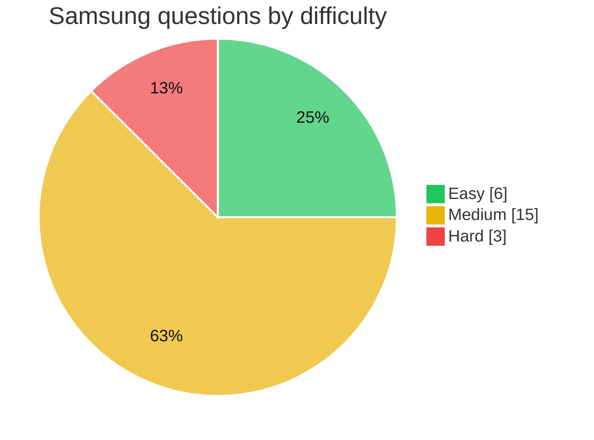

[← All companies](../README.md) · [Most asked across companies](../most-asked.md)

# Samsung Coding Questions

   

**24 Samsung coding questions** — 6 easy, 15 medium and 3 hard. Each one links to a free page where you can solve it in 13 languages, with hints and an editorial.

24 problems the CodeKairo catalogue tags as commonly asked in Samsung's coding rounds — 6 easy, 15 medium and 3 hard — each judged by hidden tests in 13 languages. The most common topics among them are Trees (8), Depth-First Search (7) and Breadth-First Search (5). The tag is the catalogue's own annotation of where a problem tends to come up — not a list published by Samsung, which CodeKairo is not affiliated with.

**Practise on CodeKairo:** [All 24 Samsung questions](https://codekairo.com/challenges/company/samsung?utm_source=github)

## Contents

- [Start with these 10](#start-with-these-10)
- [Topics Samsung asks most](#topics-samsung-asks-most)
- 🟢 [Easy (6)](#easy-6)
- 🟡 [Medium (15)](#medium-15)
- 🔴 [Hard (3)](#hard-3)

## Start with these 10

The Samsung questions most other companies ask too — the patterns worth knowing first.

1. 🟢 [Left View of Binary Tree](https://codekairo.com/problems/left-view-of-binary-tree?utm_source=github) — also asked at 3 other companies
2. 🟡 [Infix to Postfix](https://codekairo.com/problems/infix-to-postfix?utm_source=github) — also asked at 3 other companies
3. 🟡 [Add 1 to a Number Represented as Linked List](https://codekairo.com/problems/add-one-to-a-number-represented-as-linked-list?utm_source=github) — also asked at 3 other companies
4. 🔴 [Boolean Parenthesization](https://codekairo.com/problems/boolean-parenthesization?utm_source=github) — also asked at 3 other companies
5. 🟢 [Children Sum in a Binary Tree](https://codekairo.com/problems/children-sum-property?utm_source=github) — also asked at 2 other companies
6. 🟢 [Nodes at Distance K from Root](https://codekairo.com/problems/k-distance-from-root?utm_source=github) — also asked at 2 other companies
7. 🟢 [Kth Largest Element in BST](https://codekairo.com/problems/kth-largest-element-in-bst?utm_source=github) — also asked at 2 other companies
8. 🟢 [Nth Node From End of Linked List](https://codekairo.com/problems/nth-node-from-end-of-linked-list?utm_source=github) — also asked at 2 other companies
9. 🟡 [Longest Subarray With Sum Zero](https://codekairo.com/problems/longest-subarray-with-sum-zero?utm_source=github) — also asked at 2 other companies
10. 🟡 [Count Triplets With Sum Smaller Than X](https://codekairo.com/problems/count-triplets-with-sum-smaller-than-x?utm_source=github) — also asked at 2 other companies

## Topics Samsung asks most

[Trees](https://codekairo.com/challenges/trees?utm_source=github) (8) · [Depth-First Search](https://codekairo.com/challenges/depth-first-search?utm_source=github) (7) · [Breadth-First Search](https://codekairo.com/challenges/breadth-first-search?utm_source=github) (5) · [Dynamic Programming](https://codekairo.com/challenges/dynamic-programming?utm_source=github) (5) · [Arrays](https://codekairo.com/challenges/arrays?utm_source=github) (4) · [Graph](https://codekairo.com/challenges/graph?utm_source=github) (3) · [Greedy](https://codekairo.com/challenges/greedy?utm_source=github) (3) · [Matrix](https://codekairo.com/challenges/matrix?utm_source=github) (3) · [Strings](https://codekairo.com/challenges/strings?utm_source=github) (3) · [Bit Manipulation](https://codekairo.com/challenges/bit-manipulation?utm_source=github) (2)

## Easy (6)

| # | Question | Topics | Acceptance |
|---:|---|---|---:|
| 1890 | 🟢 [Left View of Binary Tree](https://codekairo.com/problems/left-view-of-binary-tree?utm_source=github) | Trees, Breadth-First Search, Depth-First Search | — |
| 1892 | 🟢 [Children Sum in a Binary Tree](https://codekairo.com/problems/children-sum-property?utm_source=github) | Trees, Depth-First Search | — |
| 1895 | 🟢 [Nodes at Distance K from Root](https://codekairo.com/problems/k-distance-from-root?utm_source=github) | Trees, Depth-First Search, Breadth-First Search | — |
| 1897 | 🟢 [Kth Largest Element in BST](https://codekairo.com/problems/kth-largest-element-in-bst?utm_source=github) | Trees, Depth-First Search, Stack | — |
| 1901 | 🟢 [Level of a Node in Binary Tree](https://codekairo.com/problems/level-of-a-node-in-binary-tree?utm_source=github) | Trees, Breadth-First Search, Depth-First Search | — |
| 1997 | 🟢 [Nth Node From End of Linked List](https://codekairo.com/problems/nth-node-from-end-of-linked-list?utm_source=github) | Linked List, Two Pointers | — |

## Medium (15)

| # | Question | Topics | Acceptance |
|---:|---|---|---:|
| 611 | 🟡 [Longest Subarray With Sum Zero](https://codekairo.com/problems/longest-subarray-with-sum-zero?utm_source=github) | Arrays, Hash Table, Prefix Sum | — |
| 620 | 🟡 [Count Triplets With Sum Smaller Than X](https://codekairo.com/problems/count-triplets-with-sum-smaller-than-x?utm_source=github) | Arrays, Two Pointers, Sorting | — |
| 645 | 🟡 [Minimum Number of Frogs Croaking](https://codekairo.com/problems/minimum-number-of-frogs-croaking?utm_source=github) | Strings, Greedy, Counting | — |
| 699 | 🟡 [Smallest Value After Replacing With Sum of Prime Factors](https://codekairo.com/problems/smallest-value-after-replacing-with-sum-of-prime-factors?utm_source=github) | Math, Number Theory, Simulation | — |
| 732 | 🟡 [Minimize XOR](https://codekairo.com/problems/minimize-xor?utm_source=github) | Bit Manipulation, Greedy | — |
| 735 | 🟡 [Count Number of Maximum Bitwise-OR Subsets](https://codekairo.com/problems/count-number-of-maximum-bitwise-or-subsets?utm_source=github) | Bit Manipulation, Backtracking, Enumeration | — |
| 1420 | 🟡 [Infix to Postfix](https://codekairo.com/problems/infix-to-postfix?utm_source=github) | Strings, Stack | — |
| 1558 | 🟡 [Largest 1-Bordered Square](https://codekairo.com/problems/largest-1-bordered-square?utm_source=github) | Arrays, Dynamic Programming, Matrix | — |
| 1679 | 🟡 [Floyd Warshall](https://codekairo.com/problems/floyd-warshall?utm_source=github) | Graph, Dynamic Programming, Shortest Path | — |
| 1680 | 🟡 [Minimum Spanning Tree](https://codekairo.com/problems/minimum-spanning-tree?utm_source=github) | Graph, Union Find, Minimum Spanning Tree | — |
| 1683 | 🟡 [Knight Walk](https://codekairo.com/problems/knight-walk?utm_source=github) | Breadth-First Search, Matrix | — |
| 1963 | 🟡 [Top View of Binary Tree](https://codekairo.com/problems/top-view-of-binary-tree?utm_source=github) | Trees, Breadth-First Search, Hash Table | — |
| 1970 | 🟡 [Floor in BST](https://codekairo.com/problems/floor-in-bst?utm_source=github) | Trees, Binary Search | — |
| 1974 | 🟡 [Largest BST in a Binary Tree](https://codekairo.com/problems/largest-bst?utm_source=github) | Trees, Depth-First Search, Dynamic Programming | — |
| 2028 | 🟡 [Add 1 to a Number Represented as Linked List](https://codekairo.com/problems/add-one-to-a-number-represented-as-linked-list?utm_source=github) | Linked List, Math, Recursion | — |

## Hard (3)

| # | Question | Topics | Acceptance |
|---:|---|---|---:|
| 1555 | 🔴 [Number of Paths with Max Score](https://codekairo.com/problems/number-of-paths-with-max-score?utm_source=github) | Arrays, Dynamic Programming, Matrix | — |
| 1606 | 🔴 [Boolean Parenthesization](https://codekairo.com/problems/boolean-parenthesization?utm_source=github) | Strings, Dynamic Programming | — |
| 1682 | 🔴 [Articulation Points in a Graph](https://codekairo.com/problems/articulation-points?utm_source=github) | Graph, Depth-First Search | — |

---

[← All companies](../README.md) · Rebuilt every night from [codekairo.com](https://codekairo.com/challenges/company/samsung?utm_source=github). Last refreshed: November 2026. ⭐ [Star the repo](https://github.com/ayaanp14/company-wise-coding-questions) if it helps.
