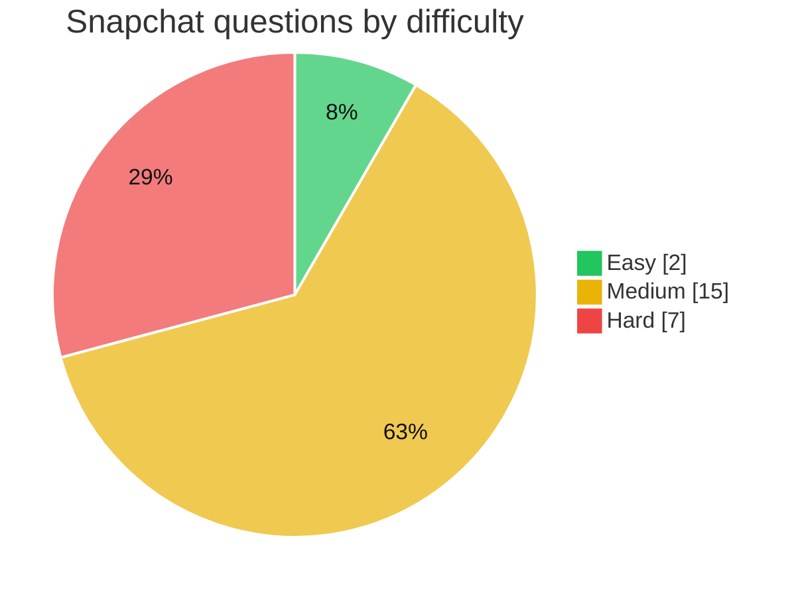

[← All companies](../README.md) · [Most asked across companies](../most-asked.md)

# Snapchat Coding Questions

   

**24 Snapchat coding questions** — 2 easy, 15 medium and 7 hard. Each one links to a free page where you can solve it in 13 languages, with hints and an editorial.

24 problems the CodeKairo catalogue tags as commonly asked in Snapchat's coding rounds — 2 easy, 15 medium and 7 hard — each judged by hidden tests in 13 languages. The most common topics among them are Arrays (13), Strings (10) and Hash Table (9). The tag is the catalogue's own annotation of where a problem tends to come up — not a list published by Snapchat, which CodeKairo is not affiliated with.

**Practise on CodeKairo:** [All 24 Snapchat questions](https://codekairo.com/challenges/company/snapchat?utm_source=github)

## Contents

- [Start with these 10](#start-with-these-10)
- [Topics Snapchat asks most](#topics-snapchat-asks-most)
- 🟢 [Easy (2)](#easy-2)
- 🟡 [Medium (15)](#medium-15)
- 🔴 [Hard (7)](#hard-7)

## Start with these 10

The Snapchat questions most other companies ask too — the patterns worth knowing first.

1. 🟡 [Merge Intervals](https://codekairo.com/problems/merge-intervals?utm_source=github) — also asked at 12 other companies
2. 🟡 [Number of Islands](https://codekairo.com/problems/number-of-islands?utm_source=github) — also asked at 9 other companies
3. 🔴 [Word Ladder](https://codekairo.com/problems/word-ladder?utm_source=github) — also asked at 9 other companies
4. 🟡 [Word Search](https://codekairo.com/problems/word-search?utm_source=github) — also asked at 8 other companies
5. 🟡 [Reverse Words in a String](https://codekairo.com/problems/reverse-words-in-a-string?utm_source=github) — also asked at 7 other companies
6. 🟡 [String Compression](https://codekairo.com/problems/string-compression?utm_source=github) — also asked at 7 other companies
7. 🟡 [Game of Life](https://codekairo.com/problems/game-of-life?utm_source=github) — also asked at 7 other companies
8. 🟡 [Valid Sudoku](https://codekairo.com/problems/valid-sudoku?utm_source=github) — also asked at 7 other companies
9. 🟡 [Basic Calculator II](https://codekairo.com/problems/basic-calculator-ii?utm_source=github) — also asked at 6 other companies
10. 🔴 [Sudoku Solver](https://codekairo.com/problems/sudoku-solver?utm_source=github) — also asked at 6 other companies

## Topics Snapchat asks most

[Arrays](https://codekairo.com/challenges/arrays?utm_source=github) (13) · [Strings](https://codekairo.com/challenges/strings?utm_source=github) (10) · [Hash Table](https://codekairo.com/challenges/hash-table?utm_source=github) (9) · [Matrix](https://codekairo.com/challenges/matrix?utm_source=github) (7) · [Breadth-First Search](https://codekairo.com/challenges/breadth-first-search?utm_source=github) (5) · [Backtracking](https://codekairo.com/challenges/backtracking?utm_source=github) (4) · [Depth-First Search](https://codekairo.com/challenges/depth-first-search?utm_source=github) (4) · [Heap](https://codekairo.com/challenges/heap?utm_source=github) (3) · [Math](https://codekairo.com/challenges/math?utm_source=github) (3) · [Two Pointers](https://codekairo.com/challenges/two-pointers?utm_source=github) (3)

## Easy (2)

| # | Question | Topics | Acceptance |
|---:|---|---|---:|
| 154 | 🟢 [Power of Two](https://codekairo.com/problems/power-of-two?utm_source=github) | Math, Bit Manipulation | — |
| 161 | 🟢 [Add Binary](https://codekairo.com/problems/add-binary?utm_source=github) | Math, Strings, Bit Manipulation | — |

## Medium (15)

| # | Question | Topics | Acceptance |
|---:|---|---|---:|
| 71 | 🟡 [Remove K Digits](https://codekairo.com/problems/remove-k-digits?utm_source=github) | Strings, Stack, Greedy | — |
| 102 | 🟡 [Top K Frequent Elements](https://codekairo.com/problems/top-k-frequent-elements?utm_source=github) | Arrays, Heap, Hash Table | — |
| 118 | 🟡 [Number of Islands](https://codekairo.com/problems/number-of-islands?utm_source=github) | Arrays, Matrix, Depth-First Search | — |
| 122 | 🟡 [Merge Intervals](https://codekairo.com/problems/merge-intervals?utm_source=github) | Arrays, Sorting, Intervals | — |
| 126 | 🟡 [Meeting Rooms II](https://codekairo.com/problems/meeting-rooms-ii?utm_source=github) | Arrays, Sorting, Heap | — |
| 138 | 🟡 [Course Schedule II](https://codekairo.com/problems/course-schedule-ii?utm_source=github) | Graph, Topological Sort, Heap | — |
| 148 | 🟡 [Combination Sum](https://codekairo.com/problems/combination-sum?utm_source=github) | Arrays, Backtracking | — |
| 210 | 🟡 [Reverse Words in a String](https://codekairo.com/problems/reverse-words-in-a-string?utm_source=github) | Two Pointers, Strings | — |
| 219 | 🟡 [String Compression](https://codekairo.com/problems/string-compression?utm_source=github) | Two Pointers, Strings | — |
| 293 | 🟡 [Game of Life](https://codekairo.com/problems/game-of-life?utm_source=github) | Arrays, Matrix, Simulation | — |
| 303 | 🟡 [Valid Sudoku](https://codekairo.com/problems/valid-sudoku?utm_source=github) | Arrays, Hash Table, Matrix | — |
| 389 | 🟡 [Basic Calculator II](https://codekairo.com/problems/basic-calculator-ii?utm_source=github) | Math, Strings, Stack | — |
| 456 | 🟡 [Number of Distinct Islands](https://codekairo.com/problems/number-of-distinct-islands?utm_source=github) | Arrays, Hash Table, Depth-First Search | — |
| 473 | 🟡 [Word Search](https://codekairo.com/problems/word-search?utm_source=github) | Arrays, Strings, Backtracking | — |
| 1225 | 🟡 [Largest Merge Of Two Strings](https://codekairo.com/problems/largest-merge-of-two-strings?utm_source=github) | Two Pointers, Strings, Greedy | — |

## Hard (7)

| # | Question | Topics | Acceptance |
|---:|---|---|---:|
| 40 | 🔴 [Minimum Window Substring](https://codekairo.com/problems/minimum-window-substring?utm_source=github) | Strings, Sliding Window, Hash Table | — |
| 470 | 🔴 [Word Ladder](https://codekairo.com/problems/word-ladder?utm_source=github) | Hash Table, Strings, Breadth-First Search | — |
| 883 | 🔴 [Frog Jump](https://codekairo.com/problems/frog-jump?utm_source=github) | Arrays, Hash Table, Dynamic Programming | — |
| 923 | 🔴 [Making A Large Island](https://codekairo.com/problems/making-a-large-island?utm_source=github) | Arrays, Matrix, Depth-First Search | — |
| 947 | 🔴 [Bus Routes](https://codekairo.com/problems/bus-routes?utm_source=github) | Arrays, Hash Table, Breadth-First Search | — |
| 1270 | 🔴 [Word Break II](https://codekairo.com/problems/word-break-ii?utm_source=github) | Hash Table, Strings, Dynamic Programming | — |
| 1572 | 🔴 [Sudoku Solver](https://codekairo.com/problems/sudoku-solver?utm_source=github) | Arrays, Hash Table, Backtracking | — |

---

[← All companies](../README.md) · Rebuilt every night from [codekairo.com](https://codekairo.com/challenges/company/snapchat?utm_source=github). Last refreshed: November 2026. ⭐ [Star the repo](https://github.com/ayaanp14/company-wise-coding-questions) if it helps.
