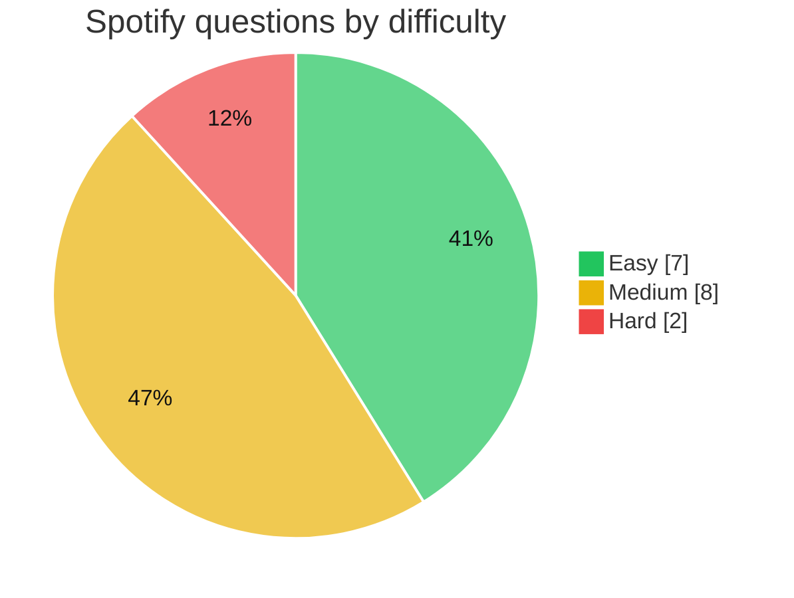

[← All companies](../README.md) · [Most asked across companies](../most-asked.md)

# Spotify Coding Questions

   

**17 Spotify coding questions** — 7 easy, 8 medium and 2 hard. Each one links to a free page where you can solve it in 13 languages, with hints and an editorial.

17 problems the CodeKairo catalogue tags as commonly asked in Spotify's coding rounds — 7 easy, 8 medium and 2 hard — each judged by hidden tests in 13 languages. The most common topics among them are Strings (9), Arrays (6) and Hash Table (6). The tag is the catalogue's own annotation of where a problem tends to come up — not a list published by Spotify, which CodeKairo is not affiliated with.

**Practise on CodeKairo:** [All 17 Spotify questions](https://codekairo.com/challenges/company/spotify?utm_source=github)

## Contents

- [Start with these 10](#start-with-these-10)
- [Topics Spotify asks most](#topics-spotify-asks-most)
- 🟢 [Easy (7)](#easy-7)
- 🟡 [Medium (8)](#medium-8)
- 🔴 [Hard (2)](#hard-2)

## Start with these 10

The Spotify questions most other companies ask too — the patterns worth knowing first.

1. 🟢 [Two Sum](https://codekairo.com/problems/two-sum?utm_source=github) — also asked at 18 other companies
2. 🟢 [Valid Parentheses](https://codekairo.com/problems/valid-parentheses?utm_source=github) — also asked at 14 other companies
3. 🟡 [Longest Substring Without Repeating Characters](https://codekairo.com/problems/longest-substring-without-repeating-characters?utm_source=github) — also asked at 13 other companies
4. 🟡 [Number of Islands](https://codekairo.com/problems/number-of-islands?utm_source=github) — also asked at 9 other companies
5. 🔴 [Word Ladder](https://codekairo.com/problems/word-ladder?utm_source=github) — also asked at 9 other companies
6. 🟢 [Fibonacci Number](https://codekairo.com/problems/fibonacci-number?utm_source=github) — also asked at 7 other companies
7. 🟡 [String Compression](https://codekairo.com/problems/string-compression?utm_source=github) — also asked at 7 other companies
8. 🟢 [Plus One](https://codekairo.com/problems/plus-one?utm_source=github) — also asked at 6 other companies
9. 🟡 [Top K Frequent Elements](https://codekairo.com/problems/top-k-frequent-elements?utm_source=github) — also asked at 5 other companies
10. 🟢 [Valid Palindrome](https://codekairo.com/problems/valid-palindrome?utm_source=github) — also asked at 4 other companies

## Topics Spotify asks most

[Strings](https://codekairo.com/challenges/strings?utm_source=github) (9) · [Arrays](https://codekairo.com/challenges/arrays?utm_source=github) (6) · [Hash Table](https://codekairo.com/challenges/hash-table?utm_source=github) (6) · [Math](https://codekairo.com/challenges/math?utm_source=github) (4) · [Dynamic Programming](https://codekairo.com/challenges/dynamic-programming?utm_source=github) (3) · [Backtracking](https://codekairo.com/challenges/backtracking?utm_source=github) (2) · [Breadth-First Search](https://codekairo.com/challenges/breadth-first-search?utm_source=github) (2) · [Heap](https://codekairo.com/challenges/heap?utm_source=github) (2) · [Two Pointers](https://codekairo.com/challenges/two-pointers?utm_source=github) (2) · [Union Find](https://codekairo.com/challenges/union-find?utm_source=github) (2)

## Easy (7)

| # | Question | Topics | Acceptance |
|---:|---|---|---:|
| 1 | 🟢 [Two Sum](https://codekairo.com/problems/two-sum?utm_source=github) | Arrays, Hash Table | — |
| 4 | 🟢 [Valid Parentheses](https://codekairo.com/problems/valid-parentheses?utm_source=github) | Strings, Stack | — |
| 5 | 🟢 [Fizz Buzz](https://codekairo.com/problems/fizz-buzz?utm_source=github) | Math, Strings, Simulation | — |
| 27 | 🟢 [Valid Palindrome](https://codekairo.com/problems/valid-palindrome?utm_source=github) | Strings, Two Pointers | — |
| 162 | 🟢 [Plus One](https://codekairo.com/problems/plus-one?utm_source=github) | Arrays, Math | — |
| 164 | 🟢 [Fibonacci Number](https://codekairo.com/problems/fibonacci-number?utm_source=github) | Math, Dynamic Programming, Recursion | — |
| 214 | 🟢 [Ransom Note](https://codekairo.com/problems/ransom-note?utm_source=github) | Hash Table, Strings, Counting | — |

## Medium (8)

| # | Question | Topics | Acceptance |
|---:|---|---|---:|
| 22 | 🟡 [Longest Consecutive Sequence](https://codekairo.com/problems/longest-consecutive-sequence?utm_source=github) | Arrays, Hash Table, Union Find | — |
| 29 | 🟡 [Longest Substring Without Repeating Characters](https://codekairo.com/problems/longest-substring-without-repeating-characters?utm_source=github) | Strings, Sliding Window, Hash Table | — |
| 100 | 🟡 [Kth Largest Element in an Array](https://codekairo.com/problems/kth-largest-element-in-an-array?utm_source=github) | Arrays, Heap, Quickselect | — |
| 102 | 🟡 [Top K Frequent Elements](https://codekairo.com/problems/top-k-frequent-elements?utm_source=github) | Arrays, Heap, Hash Table | — |
| 118 | 🟡 [Number of Islands](https://codekairo.com/problems/number-of-islands?utm_source=github) | Arrays, Matrix, Depth-First Search | — |
| 144 | 🟡 [Generate Parentheses](https://codekairo.com/problems/generate-parentheses?utm_source=github) | Strings, Backtracking, Dynamic Programming | — |
| 219 | 🟡 [String Compression](https://codekairo.com/problems/string-compression?utm_source=github) | Two Pointers, Strings | — |
| 1581 | 🟡 [Letter Case Permutation](https://codekairo.com/problems/letter-case-permutation?utm_source=github) | Strings, Backtracking, Bit Manipulation | — |

## Hard (2)

| # | Question | Topics | Acceptance |
|---:|---|---|---:|
| 470 | 🔴 [Word Ladder](https://codekairo.com/problems/word-ladder?utm_source=github) | Hash Table, Strings, Breadth-First Search | — |
| 892 | 🔴 [Number of Music Playlists](https://codekairo.com/problems/number-of-music-playlists?utm_source=github) | Math, Dynamic Programming, Combinatorics | — |

---

[← All companies](../README.md) · Rebuilt every night from [codekairo.com](https://codekairo.com/challenges/company/spotify?utm_source=github). Last refreshed: November 2026. ⭐ [Star the repo](https://github.com/ayaanp14/company-wise-coding-questions) if it helps.
