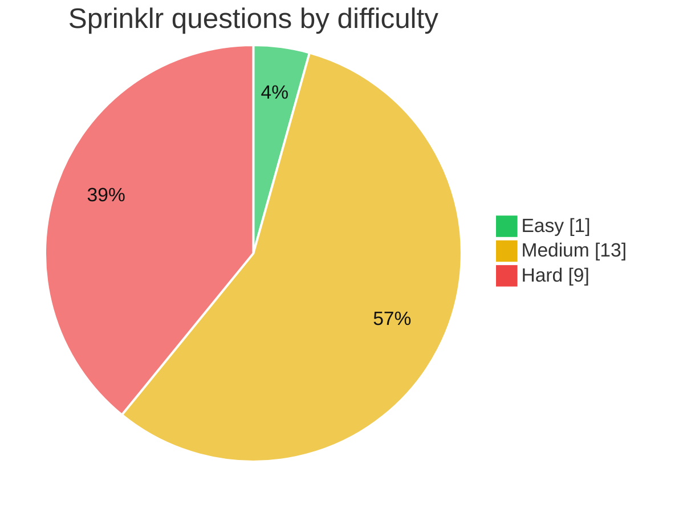

[← All companies](../README.md) · [Most asked across companies](../most-asked.md)

# Sprinklr Coding Questions

   

**23 Sprinklr coding questions** — 1 easy, 13 medium and 9 hard. Each one links to a free page where you can solve it in 13 languages, with hints and an editorial.

23 problems the CodeKairo catalogue tags as commonly asked in Sprinklr's coding rounds — 1 easy, 13 medium and 9 hard — each judged by hidden tests in 13 languages. The most common topics among them are Arrays (17), Dynamic Programming (10) and Stack (6). Tagged for Sprinklr and no other company: Edit Distance. The tag is the catalogue's own annotation of where a problem tends to come up — not a list published by Sprinklr, which CodeKairo is not affiliated with.

**Practise on CodeKairo:** [All 23 Sprinklr questions](https://codekairo.com/challenges/company/sprinklr?utm_source=github)

## Contents

- [Start with these 10](#start-with-these-10)
- [Topics Sprinklr asks most](#topics-sprinklr-asks-most)
- 🟢 [Easy (1)](#easy-1)
- 🟡 [Medium (13)](#medium-13)
- 🔴 [Hard (9)](#hard-9)

## Start with these 10

The Sprinklr questions most other companies ask too — the patterns worth knowing first.

1. 🔴 [Trapping Rain Water](https://codekairo.com/problems/trapping-rain-water?utm_source=github) — also asked at 7 other companies
2. 🟡 [Asteroid Collision](https://codekairo.com/problems/asteroid-collision?utm_source=github) — also asked at 4 other companies
3. 🟡 [Maximum Sum Circular Subarray](https://codekairo.com/problems/maximum-sum-circular-subarray?utm_source=github) — also asked at 4 other companies
4. 🟡 [Sum of Subarray Minimums](https://codekairo.com/problems/sum-of-subarray-minimums?utm_source=github) — also asked at 4 other companies
5. 🔴 [Max Points on a Line](https://codekairo.com/problems/max-points-on-a-line?utm_source=github) — also asked at 4 other companies
6. 🟡 [Subarray Sum Equals K](https://codekairo.com/problems/subarray-sum-equals-k?utm_source=github) — also asked at 3 other companies
7. 🟡 [132 Pattern](https://codekairo.com/problems/132-pattern?utm_source=github) — also asked at 3 other companies
8. 🟡 [Validate Stack Sequences](https://codekairo.com/problems/validate-stack-sequences?utm_source=github) — also asked at 3 other companies
9. 🟡 [Maximum Points You Can Obtain from Cards](https://codekairo.com/problems/maximum-points-you-can-obtain-from-cards?utm_source=github) — also asked at 3 other companies
10. 🟡 [House Robber IV](https://codekairo.com/problems/house-robber-iv?utm_source=github) — also asked at 3 other companies

## Topics Sprinklr asks most

[Arrays](https://codekairo.com/challenges/arrays?utm_source=github) (17) · [Dynamic Programming](https://codekairo.com/challenges/dynamic-programming?utm_source=github) (10) · [Stack](https://codekairo.com/challenges/stack?utm_source=github) (6) · [Hash Table](https://codekairo.com/challenges/hash-table?utm_source=github) (5) · [Prefix Sum](https://codekairo.com/challenges/prefix-sum?utm_source=github) (4) · [Greedy](https://codekairo.com/challenges/greedy?utm_source=github) (3) · [Monotonic Stack](https://codekairo.com/challenges/monotonic-stack?utm_source=github) (3) · [Simulation](https://codekairo.com/challenges/simulation?utm_source=github) (3) · [Binary Search](https://codekairo.com/challenges/binary-search?utm_source=github) (2) · [Bitmask](https://codekairo.com/challenges/bitmask?utm_source=github) (2)

## Easy (1)

| # | Question | Topics | Acceptance |
|---:|---|---|---:|
| 34 | 🟢 [Isomorphic Strings](https://codekairo.com/problems/isomorphic-strings?utm_source=github) | Strings, Hash Table | — |

## Medium (13)

| # | Question | Topics | Acceptance |
|---:|---|---|---:|
| 21 | 🟡 [Subarray Sum Equals K](https://codekairo.com/problems/subarray-sum-equals-k?utm_source=github) | Arrays, Hash Table, Prefix Sum | — |
| 75 | 🟡 [Asteroid Collision](https://codekairo.com/problems/asteroid-collision?utm_source=github) | Arrays, Stack, Simulation | — |
| 79 | 🟡 [Gas Station](https://codekairo.com/problems/gas-station?utm_source=github) | Arrays, Greedy | — |
| 98 | 🟡 [Edit Distance](https://codekairo.com/problems/edit-distance?utm_source=github) | Strings, Dynamic Programming | — |
| 333 | 🟡 [Maximum Sum Circular Subarray](https://codekairo.com/problems/maximum-sum-circular-subarray?utm_source=github) | Arrays, Divide and Conquer, Dynamic Programming | — |
| 383 | 🟡 [Sum of Subarray Minimums](https://codekairo.com/problems/sum-of-subarray-minimums?utm_source=github) | Arrays, Dynamic Programming, Stack | — |
| 384 | 🟡 [132 Pattern](https://codekairo.com/problems/132-pattern?utm_source=github) | Arrays, Binary Search, Stack | — |
| 387 | 🟡 [Validate Stack Sequences](https://codekairo.com/problems/validate-stack-sequences?utm_source=github) | Arrays, Stack, Simulation | — |
| 789 | 🟡 [Maximum Points You Can Obtain from Cards](https://codekairo.com/problems/maximum-points-you-can-obtain-from-cards?utm_source=github) | Arrays, Sliding Window, Prefix Sum | — |
| 826 | 🟡 [House Robber IV](https://codekairo.com/problems/house-robber-iv?utm_source=github) | Arrays, Binary Search, Greedy | — |
| 876 | 🟡 [Number of People Aware of a Secret](https://codekairo.com/problems/number-of-people-aware-of-a-secret?utm_source=github) | Queue, Dynamic Programming, Simulation | — |
| 937 | 🟡 [Shortest Path with Alternating Colors](https://codekairo.com/problems/shortest-path-with-alternating-colors?utm_source=github) | Graph, Breadth-First Search | — |
| 1132 | 🟡 [Maximum Sum of Two Non-Overlapping Subarrays](https://codekairo.com/problems/maximum-sum-of-two-non-overlapping-subarrays?utm_source=github) | Arrays, Dynamic Programming, Sliding Window | — |

## Hard (9)

| # | Question | Topics | Acceptance |
|---:|---|---|---:|
| 26 | 🔴 [Trapping Rain Water](https://codekairo.com/problems/trapping-rain-water?utm_source=github) | Arrays, Two Pointers, Dynamic Programming | — |
| 686 | 🔴 [Max Points on a Line](https://codekairo.com/problems/max-points-on-a-line?utm_source=github) | Hash Table, Math, Geometry | — |
| 1052 | 🔴 [Number of Great Partitions](https://codekairo.com/problems/number-of-great-partitions?utm_source=github) | Arrays, Dynamic Programming | — |
| 1058 | 🔴 [Cherry Pickup II](https://codekairo.com/problems/cherry-pickup-ii?utm_source=github) | Arrays, Dynamic Programming, Matrix | — |
| 1092 | 🔴 [Odd Even Jump](https://codekairo.com/problems/odd-even-jump?utm_source=github) | Arrays, Dynamic Programming, Stack | — |
| 1335 | 🔴 [Apply Operations on Array to Maximize Sum of Squares](https://codekairo.com/problems/apply-operations-on-array-to-maximize-sum-of-squares?utm_source=github) | Arrays, Hash Table, Greedy | — |
| 1347 | 🔴 [Maximize Score After N Operations](https://codekairo.com/problems/maximize-score-after-n-operations?utm_source=github) | Math, Dynamic Programming, Number Theory | — |
| 1353 | 🔴 [Count Subarrays With Median K](https://codekairo.com/problems/count-subarrays-with-median-k?utm_source=github) | Arrays, Hash Table, Prefix Sum | — |
| 1595 | 🔴 [Closest Subsequence Sum](https://codekairo.com/problems/closest-subsequence-sum?utm_source=github) | Arrays, Two Pointers, Bitmask | — |

---

[← All companies](../README.md) · Rebuilt every night from [codekairo.com](https://codekairo.com/challenges/company/sprinklr?utm_source=github). Last refreshed: November 2026. ⭐ [Star the repo](https://github.com/ayaanp14/company-wise-coding-questions) if it helps.
