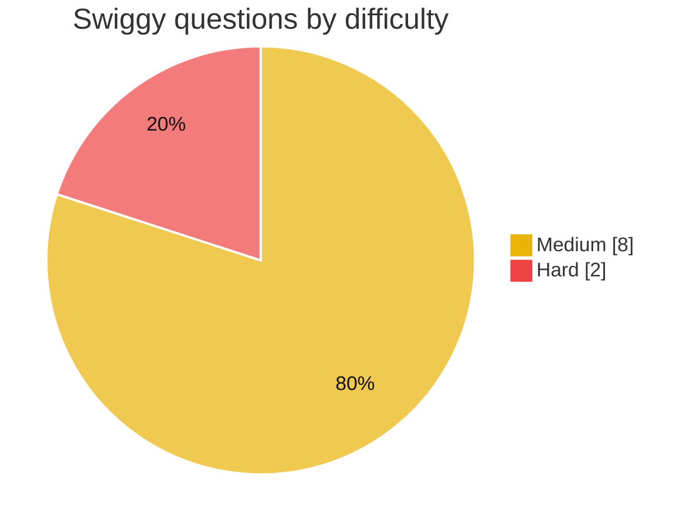

[← All companies](../README.md) · [Most asked across companies](../most-asked.md)

# Swiggy Coding Questions

   

**10 Swiggy coding questions** — 8 medium and 2 hard. Each one links to a free page where you can solve it in 13 languages, with hints and an editorial.

10 problems the CodeKairo catalogue tags as commonly asked in Swiggy's coding rounds — 8 medium and 2 hard — each judged by hidden tests in 13 languages. The most common topics among them are Arrays (8), Sorting (4) and Binary Search (3). The tag is the catalogue's own annotation of where a problem tends to come up — not a list published by Swiggy, which CodeKairo is not affiliated with.

**Practise on CodeKairo:** [All 10 Swiggy questions](https://codekairo.com/challenges/company/swiggy?utm_source=github)

## Contents

- [Start with these 10](#start-with-these-10)
- [Topics Swiggy asks most](#topics-swiggy-asks-most)
- 🟡 [Medium (8)](#medium-8)
- 🔴 [Hard (2)](#hard-2)

## Start with these 10

The Swiggy questions most other companies ask too — the patterns worth knowing first.

1. 🔴 [Maximum Profit in Job Scheduling](https://codekairo.com/problems/maximum-profit-in-job-scheduling?utm_source=github) — also asked at 5 other companies
2. 🟡 [Grumpy Bookstore Owner](https://codekairo.com/problems/grumpy-bookstore-owner?utm_source=github) — also asked at 3 other companies
3. 🟡 [Minimum Number of Days to Make m Bouquets](https://codekairo.com/problems/minimum-number-of-days-to-make-m-bouquets?utm_source=github) — also asked at 3 other companies
4. 🟡 [Count Number of Bad Pairs](https://codekairo.com/problems/count-number-of-bad-pairs?utm_source=github) — also asked at 2 other companies
5. 🟡 [Minimum Number of Operations to Make Array Empty](https://codekairo.com/problems/minimum-number-of-operations-to-make-array-empty?utm_source=github) — also asked at 2 other companies
6. 🟡 [Number of Subsequences That Satisfy the Given Sum Condition](https://codekairo.com/problems/number-of-subsequences-that-satisfy-the-given-sum-condition?utm_source=github) — also asked at 2 other companies
7. 🟡 [Find the Maximum Number of Marked Indices](https://codekairo.com/problems/find-the-maximum-number-of-marked-indices?utm_source=github) — also asked at 2 other companies
8. 🟡 [Maximum Number of Moves in a Grid](https://codekairo.com/problems/maximum-number-of-moves-in-a-grid?utm_source=github) — also asked at 2 other companies
9. 🟡 [Maximum Number of Eaten Apples](https://codekairo.com/problems/maximum-number-of-eaten-apples?utm_source=github) — also asked at 2 other companies
10. 🔴 [Find All People With Secret](https://codekairo.com/problems/find-all-people-with-secret?utm_source=github) — also asked at 2 other companies

## Topics Swiggy asks most

[Arrays](https://codekairo.com/challenges/arrays?utm_source=github) (8) · [Sorting](https://codekairo.com/challenges/sorting?utm_source=github) (4) · [Binary Search](https://codekairo.com/challenges/binary-search?utm_source=github) (3) · [Greedy](https://codekairo.com/challenges/greedy?utm_source=github) (3) · [Breadth-First Search](https://codekairo.com/challenges/breadth-first-search?utm_source=github) (2) · [Counting](https://codekairo.com/challenges/counting?utm_source=github) (2) · [Dynamic Programming](https://codekairo.com/challenges/dynamic-programming?utm_source=github) (2) · [Hash Table](https://codekairo.com/challenges/hash-table?utm_source=github) (2) · [Two Pointers](https://codekairo.com/challenges/two-pointers?utm_source=github) (2) · [Depth-First Search](https://codekairo.com/challenges/depth-first-search?utm_source=github) (1)

## Medium (8)

| # | Question | Topics | Acceptance |
|---:|---|---|---:|
| 679 | 🟡 [Count Number of Bad Pairs](https://codekairo.com/problems/count-number-of-bad-pairs?utm_source=github) | Hash Table, Arrays, Counting | — |
| 700 | 🟡 [Minimum Number of Operations to Make Array Empty](https://codekairo.com/problems/minimum-number-of-operations-to-make-array-empty?utm_source=github) | Hash Table, Greedy, Counting | — |
| 771 | 🟡 [Number of Subsequences That Satisfy the Given Sum Condition](https://codekairo.com/problems/number-of-subsequences-that-satisfy-the-given-sum-condition?utm_source=github) | Arrays, Two Pointers, Sorting | — |
| 788 | 🟡 [Grumpy Bookstore Owner](https://codekairo.com/problems/grumpy-bookstore-owner?utm_source=github) | Arrays, Sliding Window | — |
| 816 | 🟡 [Minimum Number of Days to Make m Bouquets](https://codekairo.com/problems/minimum-number-of-days-to-make-m-bouquets?utm_source=github) | Arrays, Binary Search | — |
| 856 | 🟡 [Find the Maximum Number of Marked Indices](https://codekairo.com/problems/find-the-maximum-number-of-marked-indices?utm_source=github) | Arrays, Two Pointers, Greedy | — |
| 912 | 🟡 [Maximum Number of Moves in a Grid](https://codekairo.com/problems/maximum-number-of-moves-in-a-grid?utm_source=github) | Arrays, Matrix, Dynamic Programming | — |
| 978 | 🟡 [Maximum Number of Eaten Apples](https://codekairo.com/problems/maximum-number-of-eaten-apples?utm_source=github) | Arrays, Greedy, Heap | — |

## Hard (2)

| # | Question | Topics | Acceptance |
|---:|---|---|---:|
| 953 | 🔴 [Find All People With Secret](https://codekairo.com/problems/find-all-people-with-secret?utm_source=github) | Graph, Union Find, Depth-First Search | — |
| 1506 | 🔴 [Maximum Profit in Job Scheduling](https://codekairo.com/problems/maximum-profit-in-job-scheduling?utm_source=github) | Arrays, Binary Search, Dynamic Programming | — |

---

[← All companies](../README.md) · Rebuilt every night from [codekairo.com](https://codekairo.com/challenges/company/swiggy?utm_source=github). Last refreshed: November 2026. ⭐ [Star the repo](https://github.com/ayaanp14/company-wise-coding-questions) if it helps.
