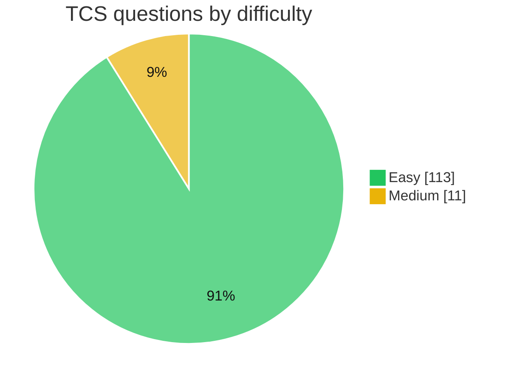

[← All companies](../README.md) · [Most asked across companies](../most-asked.md)

# TCS Coding Questions

   

**124 TCS coding questions** — 113 easy and 11 medium. Each one links to a free page where you can solve it in 13 languages, with hints and an editorial.

124 problems the CodeKairo catalogue tags as commonly asked in TCS's coding rounds — 113 easy and 11 medium, no hard ones — each judged by hidden tests in 13 languages. The most common topics among them are Arrays (66), Math (41) and Strings (36). CodeKairo's TCS NQT — Foundation mock covers the Foundation section of the TCS National Qualifier Test (NQT), the aptitude gate that every candidate has to clear before any track opens. The tag is the catalogue's own annotation of where a problem tends to come up — not a list published by TCS, which CodeKairo is not affiliated with.

**Practise on CodeKairo:** [All 124 TCS questions](https://codekairo.com/challenges/company/tcs?utm_source=github) · [TCS NQT — Foundation mock test](https://codekairo.com/tests/tcs-nqt-foundation?utm_source=github) · [TCS NQT — Foundation + Advanced mock test](https://codekairo.com/tests/tcs-nqt-full?utm_source=github) · [TCS NQT — Advanced Coding mock test](https://codekairo.com/tests/tcs-nqt-advanced-coding?utm_source=github) · [TCS hiring process, round by round](https://codekairo.com/simulations/tcs?utm_source=github)

## Contents

- [Start with these 10](#start-with-these-10)
- [Topics TCS asks most](#topics-tcs-asks-most)
- 🟢 [Easy (113)](#easy-113)
- 🟡 [Medium (11)](#medium-11)

## Start with these 10

The TCS questions most other companies ask too — the patterns worth knowing first.

1. 🟢 [Reverse String](https://codekairo.com/problems/reverse-string?utm_source=github) — also asked at 7 other companies
2. 🟢 [Fibonacci Number](https://codekairo.com/problems/fibonacci-number?utm_source=github) — also asked at 7 other companies
3. 🟢 [Find Pivot Index](https://codekairo.com/problems/find-pivot-index?utm_source=github) — also asked at 7 other companies
4. 🟢 [Plus One](https://codekairo.com/problems/plus-one?utm_source=github) — also asked at 6 other companies
5. 🟢 [Armstrong Number](https://codekairo.com/problems/armstrong-number?utm_source=github) — also asked at 6 other companies
6. 🟢 [Length of Last Word](https://codekairo.com/problems/length-of-last-word?utm_source=github) — also asked at 4 other companies
7. 🟢 [Second Largest Element](https://codekairo.com/problems/second-largest-element?utm_source=github) — also asked at 4 other companies
8. 🟡 [Reverse Integer](https://codekairo.com/problems/reverse-integer?utm_source=github) — also asked at 4 other companies
9. 🟡 [Minimum Number of Platforms](https://codekairo.com/problems/minimum-number-of-platforms?utm_source=github) — also asked at 4 other companies
10. 🟢 [Strong Number](https://codekairo.com/problems/strong-number?utm_source=github) — also asked at 3 other companies

## Topics TCS asks most

[Arrays](https://codekairo.com/challenges/arrays?utm_source=github) (66) · [Math](https://codekairo.com/challenges/math?utm_source=github) (41) · [Strings](https://codekairo.com/challenges/strings?utm_source=github) (36) · [Hash Table](https://codekairo.com/challenges/hash-table?utm_source=github) (25) · [Two Pointers](https://codekairo.com/challenges/two-pointers?utm_source=github) (15) · [Simulation](https://codekairo.com/challenges/simulation?utm_source=github) (13) · [Counting](https://codekairo.com/challenges/counting?utm_source=github) (11) · [Number Theory](https://codekairo.com/challenges/number-theory?utm_source=github) (11) · [Sorting](https://codekairo.com/challenges/sorting?utm_source=github) (11) · [Bit Manipulation](https://codekairo.com/challenges/bit-manipulation?utm_source=github) (6)

## Easy (113)

| # | Question | Topics | Acceptance |
|---:|---|---|---:|
| 2 | 🟢 [Reverse String](https://codekairo.com/problems/reverse-string?utm_source=github) | Two Pointers, Strings | — |
| 162 | 🟢 [Plus One](https://codekairo.com/problems/plus-one?utm_source=github) | Arrays, Math | — |
| 164 | 🟢 [Fibonacci Number](https://codekairo.com/problems/fibonacci-number?utm_source=github) | Math, Dynamic Programming, Recursion | — |
| 166 | 🟢 [Armstrong Number](https://codekairo.com/problems/armstrong-number?utm_source=github) | Math | — |
| 167 | 🟢 [Strong Number](https://codekairo.com/problems/strong-number?utm_source=github) | Math | — |
| 168 | 🟢 [Automorphic Number](https://codekairo.com/problems/automorphic-number?utm_source=github) | Math, Strings | — |
| 169 | 🟢 [Neon Number](https://codekairo.com/problems/neon-number?utm_source=github) | Math | — |
| 171 | 🟢 [Harshad Number](https://codekairo.com/problems/harshad-number?utm_source=github) | Math | — |
| 172 | 🟢 [Perfect Number](https://codekairo.com/problems/perfect-number?utm_source=github) | Math | — |
| 173 | 🟢 [Prime Factorisation](https://codekairo.com/problems/prime-factors?utm_source=github) | Math, Number Theory | — |
| 174 | 🟢 [Find Greatest Common Divisor of Array](https://codekairo.com/problems/find-greatest-common-divisor-of-array?utm_source=github) | Arrays, Math, Number Theory | — |
| 178 | 🟢 [Find Numbers with Even Number of Digits](https://codekairo.com/problems/find-numbers-with-even-number-of-digits?utm_source=github) | Arrays, Math | — |
| 186 | 🟢 [Find Pivot Index](https://codekairo.com/problems/find-pivot-index?utm_source=github) | Arrays, Prefix Sum | — |
| 192 | 🟢 [Concatenation of Array](https://codekairo.com/problems/concatenation-of-array?utm_source=github) | Arrays, Simulation | — |
| 197 | 🟢 [Max Consecutive Ones](https://codekairo.com/problems/max-consecutive-ones?utm_source=github) | Arrays | — |
| 215 | 🟢 [Length of Last Word](https://codekairo.com/problems/length-of-last-word?utm_source=github) | Strings | — |
| 227 | 🟢 [Check if the Sentence Is Pangram](https://codekairo.com/problems/check-if-the-sentence-is-pangram?utm_source=github) | Hash Table, Strings | — |
| 253 | 🟢 [Remove Element](https://codekairo.com/problems/remove-element?utm_source=github) | Arrays, Two Pointers | — |
| 262 | 🟢 [Three Consecutive Odds](https://codekairo.com/problems/three-consecutive-odds?utm_source=github) | Arrays | — |
| 292 | 🟢 [Pascal's Triangle II](https://codekairo.com/problems/pascals-triangle-ii?utm_source=github) | Arrays, Dynamic Programming | — |
| 475 | 🟢 [Second Largest Element](https://codekairo.com/problems/second-largest-element?utm_source=github) | Arrays | — |
| 476 | 🟢 [Leaders in an Array](https://codekairo.com/problems/leaders-in-an-array?utm_source=github) | Arrays | — |
| 477 | 🟢 [Equilibrium Point](https://codekairo.com/problems/equilibrium-point?utm_source=github) | Arrays, Prefix Sum | — |
| 496 | 🟢 [Number of Students Doing Homework at a Given Time](https://codekairo.com/problems/number-of-students-doing-homework-at-a-given-time?utm_source=github) | Arrays | — |
| 497 | 🟢 [Sign of the Product of an Array](https://codekairo.com/problems/sign-of-the-product-of-an-array?utm_source=github) | Arrays, Math | — |
| 505 | 🟢 [Divide Array Into Equal Pairs](https://codekairo.com/problems/divide-array-into-equal-pairs?utm_source=github) | Arrays, Hash Table, Bit Manipulation | — |
| 506 | 🟢 [Chocolate Distribution Problem](https://codekairo.com/problems/chocolate-distribution-problem?utm_source=github) | Arrays, Sorting, Sliding Window | — |
| 507 | 🟢 [Union of Two Sorted Arrays](https://codekairo.com/problems/union-of-two-sorted-arrays?utm_source=github) | Arrays, Two Pointers | — |
| 508 | 🟢 [To Lower Case](https://codekairo.com/problems/to-lower-case?utm_source=github) | Strings | — |
| 515 | 🟢 [Remove Vowels from a String](https://codekairo.com/problems/remove-vowels-from-a-string?utm_source=github) | Strings | — |
| 518 | 🟢 [Thousand Separator](https://codekairo.com/problems/thousand-separator?utm_source=github) | Strings | — |
| 523 | 🟢 [Check If Word Equals Summation of Two Words](https://codekairo.com/problems/check-if-word-equals-summation-of-two-words?utm_source=github) | Strings, Math | — |
| 528 | 🟢 [Score of a String](https://codekairo.com/problems/score-of-a-string?utm_source=github) | Strings | — |
| 530 | 🟢 [Check if All A's Appears Before All B's](https://codekairo.com/problems/check-if-all-as-appears-before-all-bs?utm_source=github) | Strings | — |
| 532 | 🟢 [Find First Palindromic String in the Array](https://codekairo.com/problems/find-first-palindromic-string-in-the-array?utm_source=github) | Arrays, Strings, Two Pointers | — |
| 535 | 🟢 [Percentage of Letter in String](https://codekairo.com/problems/percentage-of-letter-in-string?utm_source=github) | Strings | — |
| 538 | 🟢 [Maximum Value of a String in an Array](https://codekairo.com/problems/maximum-value-of-a-string-in-an-array?utm_source=github) | Arrays, Strings | — |
| 542 | 🟢 [Count of Matches in Tournament](https://codekairo.com/problems/count-of-matches-in-tournament?utm_source=github) | Math, Simulation | — |
| 545 | 🟢 [Three Divisors](https://codekairo.com/problems/three-divisors?utm_source=github) | Math, Number Theory | — |
| 550 | 🟢 [Count Integers With Even Digit Sum](https://codekairo.com/problems/count-integers-with-even-digit-sum?utm_source=github) | Math, Simulation | — |
| 553 | 🟢 [Count Square Sum Triples](https://codekairo.com/problems/count-square-sum-triples?utm_source=github) | Math, Enumeration | — |
| 557 | 🟢 [Number of Employees Who Met the Target](https://codekairo.com/problems/number-of-employees-who-met-the-target?utm_source=github) | Arrays | — |
| 558 | 🟢 [Divisible and Non-Divisible Sums Difference](https://codekairo.com/problems/divisible-and-non-divisible-sums-difference?utm_source=github) | Math | — |
| 562 | 🟢 [Find the Maximum Achievable Number](https://codekairo.com/problems/find-the-maximum-achievable-number?utm_source=github) | Math | — |
| 563 | 🟢 [Ant on the Boundary](https://codekairo.com/problems/ant-on-the-boundary?utm_source=github) | Arrays, Prefix Sum, Simulation | — |
| 567 | 🟢 [Points That Intersect With Cars](https://codekairo.com/problems/points-that-intersect-with-cars?utm_source=github) | Arrays, Prefix Sum | — |
| 569 | 🟢 [Remove Trailing Zeros From a String](https://codekairo.com/problems/remove-trailing-zeros-from-a-string?utm_source=github) | Strings | — |
| 571 | 🟢 [Smallest Even Multiple](https://codekairo.com/problems/smallest-even-multiple?utm_source=github) | Math, Number Theory | — |
| 573 | 🟢 [Count the Digits That Divide a Number](https://codekairo.com/problems/count-the-digits-that-divide-a-number?utm_source=github) | Math | — |
| 589 | 🟢 [Unique Number of Occurrences](https://codekairo.com/problems/unique-number-of-occurrences?utm_source=github) | Arrays, Hash Table | — |
| 591 | 🟢 [Count Elements With Maximum Frequency](https://codekairo.com/problems/count-elements-with-maximum-frequency?utm_source=github) | Arrays, Hash Table, Counting | — |
| 597 | 🟢 [Maximum Number of Pairs in Array](https://codekairo.com/problems/maximum-number-of-pairs-in-array?utm_source=github) | Arrays, Hash Table, Counting | — |
| 600 | 🟢 [The Two Sneaky Numbers of Digitville](https://codekairo.com/problems/the-two-sneaky-numbers-of-digitville?utm_source=github) | Arrays, Hash Table | — |
| 601 | 🟢 [Find the Peaks](https://codekairo.com/problems/find-the-peaks?utm_source=github) | Arrays, Enumeration | — |
| 606 | 🟢 [Find the Array Concatenation Value](https://codekairo.com/problems/find-the-array-concatenation-value?utm_source=github) | Arrays, Two Pointers, Simulation | — |
| 607 | 🟢 [Maximum Sum With Exactly K Elements](https://codekairo.com/problems/maximum-sum-with-exactly-k-elements?utm_source=github) | Arrays, Greedy | — |
| 614 | 🟢 [Wave Array](https://codekairo.com/problems/wave-array?utm_source=github) | Arrays, Sorting | — |
| 616 | 🟢 [Find Transition Point](https://codekairo.com/problems/find-transition-point?utm_source=github) | Arrays, Binary Search | — |
| 623 | 🟢 [Find Missing and Repeated Values](https://codekairo.com/problems/find-missing-and-repeated-values?utm_source=github) | Matrix, Hash Table, Math | — |
| 624 | 🟢 [Left Rotate an Array by D Places](https://codekairo.com/problems/left-rotate-array-by-d?utm_source=github) | Arrays, Two Pointers | — |
| 625 | 🟢 [Sort the People](https://codekairo.com/problems/sort-the-people?utm_source=github) | Arrays, Sorting, Hash Table | — |
| 626 | 🟢 [Maximum Difference Between Adjacent Elements in a Circular Array](https://codekairo.com/problems/maximum-difference-between-adjacent-elements-in-a-circular-array?utm_source=github) | Arrays | — |
| 627 | 🟢 [Count Pairs With Given Sum](https://codekairo.com/problems/count-pairs-with-given-sum?utm_source=github) | Arrays, Hash Table | — |
| 628 | 🟢 [Minimum Number Game](https://codekairo.com/problems/minimum-number-game?utm_source=github) | Arrays, Sorting, Simulation | — |
| 629 | 🟢 [Largest Substring Between Two Equal Characters](https://codekairo.com/problems/largest-substring-between-two-equal-characters?utm_source=github) | Strings, Hash Table | — |
| 630 | 🟢 [Reverse String II](https://codekairo.com/problems/reverse-string-ii?utm_source=github) | Strings, Two Pointers | — |
| 631 | 🟢 [Student Attendance Record I](https://codekairo.com/problems/student-attendance-record-i?utm_source=github) | Strings | — |
| 633 | 🟢 [Check If String Is a Prefix of Array](https://codekairo.com/problems/check-if-string-is-a-prefix-of-array?utm_source=github) | Strings, Arrays | — |
| 635 | 🟢 [Minimum Changes to Make Alternating Binary String](https://codekairo.com/problems/minimum-changes-to-make-alternating-binary-string?utm_source=github) | Strings, Greedy | — |
| 636 | 🟢 [Check if Binary String Has at Most One Segment of Ones](https://codekairo.com/problems/check-if-binary-string-has-at-most-one-segment-of-ones?utm_source=github) | Strings | — |
| 637 | 🟢 [Count the Number of Vowel Strings in Range](https://codekairo.com/problems/count-the-number-of-vowel-strings-in-range?utm_source=github) | Strings, Arrays | — |
| 659 | 🟢 [Find Words That Can Be Formed by Characters](https://codekairo.com/problems/find-words-that-can-be-formed-by-characters?utm_source=github) | Hash Table, Strings, Counting | — |
| 660 | 🟢 [Maximum Number of Words Found in Sentences](https://codekairo.com/problems/maximum-number-of-words-found-in-sentences?utm_source=github) | Strings, Arrays | — |
| 661 | 🟢 [Check if All Characters Have Equal Number of Occurrences](https://codekairo.com/problems/check-if-all-characters-have-equal-number-of-occurrences?utm_source=github) | Hash Table, Strings, Counting | — |
| 662 | 🟢 [Rings and Rods](https://codekairo.com/problems/rings-and-rods?utm_source=github) | Hash Table, Strings, Bit Manipulation | — |
| 663 | 🟢 [Divide a String Into Groups of Size k](https://codekairo.com/problems/divide-a-string-into-groups-of-size-k?utm_source=github) | Strings, Simulation | — |
| 664 | 🟢 [Largest Unique Number](https://codekairo.com/problems/largest-unique-number?utm_source=github) | Hash Table, Arrays, Sorting | — |
| 665 | 🟢 [Counting Elements](https://codekairo.com/problems/counting-elements?utm_source=github) | Hash Table, Arrays, Counting | — |
| 666 | 🟢 [Number of Lines To Write String](https://codekairo.com/problems/number-of-lines-to-write-string?utm_source=github) | Arrays, Strings, Simulation | — |
| 667 | 🟢 [Check if The Number is Fascinating](https://codekairo.com/problems/check-if-the-number-is-fascinating?utm_source=github) | Math, Hash Table, Strings | — |
| 668 | 🟢 [Number of Distinct Averages](https://codekairo.com/problems/number-of-distinct-averages?utm_source=github) | Arrays, Hash Table, Two Pointers | — |
| 689 | 🟢 [Find the Pivot Integer](https://codekairo.com/problems/find-the-pivot-integer?utm_source=github) | Math, Prefix Sum | — |
| 690 | 🟢 [Number of Even and Odd Bits](https://codekairo.com/problems/number-of-even-and-odd-bits?utm_source=github) | Bit Manipulation, Math | — |
| 691 | 🟢 [Split With Minimum Sum](https://codekairo.com/problems/split-with-minimum-sum?utm_source=github) | Math, Greedy, Sorting | — |
| 692 | 🟢 [Sum Multiples](https://codekairo.com/problems/sum-multiples?utm_source=github) | Math, Number Theory | — |
| 693 | 🟢 [Count Distinct Numbers on Board](https://codekairo.com/problems/count-distinct-numbers-on-board?utm_source=github) | Math, Simulation, Number Theory | — |
| 694 | 🟢 [Sum of Squares of Special Elements](https://codekairo.com/problems/sum-of-squares-of-special-elements?utm_source=github) | Arrays, Math, Number Theory | — |
| 695 | 🟢 [Construct the Rectangle](https://codekairo.com/problems/construct-the-rectangle?utm_source=github) | Math, Number Theory | — |
| 696 | 🟢 [Check if Number Has Equal Digit Count and Digit Value](https://codekairo.com/problems/check-if-number-has-equal-digit-count-and-digit-value?utm_source=github) | Hash Table, Strings, Counting | — |
| 697 | 🟢 [Find the Maximum Divisibility Score](https://codekairo.com/problems/find-the-maximum-divisibility-score?utm_source=github) | Arrays, Math, Counting | — |
| 711 | 🟢 [Count Total Number of Colored Cells](https://codekairo.com/problems/count-total-number-of-colored-cells?utm_source=github) | Math, Simulation | — |
| 719 | 🟢 [Find the K-or of an Array](https://codekairo.com/problems/find-the-k-or-of-an-array?utm_source=github) | Bit Manipulation, Arrays | — |
| 720 | 🟢 [Complement of Base 10 Integer](https://codekairo.com/problems/complement-of-base-10-integer?utm_source=github) | Bit Manipulation, Math | — |
| 729 | 🟢 [Smallest Number With All Set Bits](https://codekairo.com/problems/smallest-number-with-all-set-bits?utm_source=github) | Bit Manipulation, Math | — |
| 749 | 🟢 [Merge Two 2D Arrays by Summing Values](https://codekairo.com/problems/merge-two-2d-arrays-by-summing-values?utm_source=github) | Arrays, Two Pointers | — |
| 750 | 🟢 [Find the Distance Value Between Two Arrays](https://codekairo.com/problems/find-the-distance-value-between-two-arrays?utm_source=github) | Arrays, Two Pointers, Binary Search | — |
| 753 | 🟢 [Intersection of Multiple Arrays](https://codekairo.com/problems/intersection-of-multiple-arrays?utm_source=github) | Arrays, Hash Table, Counting | — |
| 754 | 🟢 [Shortest Distance to Target String in a Circular Array](https://codekairo.com/problems/shortest-distance-to-target-string-in-a-circular-array?utm_source=github) | Arrays, Strings, Two Pointers | — |
| 755 | 🟢 [Count Number of Pairs With Absolute Difference K](https://codekairo.com/problems/count-number-of-pairs-with-absolute-difference-k?utm_source=github) | Arrays, Hash Table, Counting | — |
| 756 | 🟢 [Pair With Given Difference](https://codekairo.com/problems/pair-with-given-difference?utm_source=github) | Arrays, Two Pointers, Sorting | — |
| 757 | 🟢 [Find Indices With Index and Value Difference I](https://codekairo.com/problems/find-indices-with-index-and-value-difference-i?utm_source=github) | Arrays, Two Pointers | — |
| 779 | 🟢 [Maximum Sum Subarray of Size K](https://codekairo.com/problems/maximum-sum-subarray-of-size-k?utm_source=github) | Arrays, Sliding Window | — |
| 809 | 🟢 [Find Smallest Letter Greater Than Target](https://codekairo.com/problems/find-smallest-letter-greater-than-target?utm_source=github) | Arrays, Binary Search | — |
| 839 | 🟢 [Take Gifts From the Richest Pile](https://codekairo.com/problems/take-gifts-from-the-richest-pile?utm_source=github) | Arrays, Heap, Simulation | — |
| 981 | 🟢 [Split the Array](https://codekairo.com/problems/split-the-array?utm_source=github) | Arrays, Hash Table, Counting | — |
| 993 | 🟢 [Check if Array is Good](https://codekairo.com/problems/check-if-array-is-good?utm_source=github) | Arrays, Hash Table, Sorting | — |
| 1001 | 🟢 [Find the Power of K-Size Subarrays I](https://codekairo.com/problems/find-the-power-of-k-size-subarrays-i?utm_source=github) | Arrays, Sliding Window | — |
| 1011 | 🟢 [Find the Encrypted String](https://codekairo.com/problems/find-the-encrypted-string?utm_source=github) | Strings, Simulation | — |
| 1017 | 🟢 [Strong Password Checker II](https://codekairo.com/problems/strong-password-checker-ii?utm_source=github) | Strings | — |
| 1022 | 🟢 [Rearrange Characters to Make Target String](https://codekairo.com/problems/rearrange-characters-to-make-target-string?utm_source=github) | Hash Table, Strings, Counting | — |
| 1072 | 🟢 [Calculate Delayed Arrival Time](https://codekairo.com/problems/calculate-delayed-arrival-time?utm_source=github) | Math | — |
| 1287 | 🟢 [Day of the Year](https://codekairo.com/problems/day-of-the-year?utm_source=github) | Math, Strings | — |
| 1396 | 🟢 [Find Nth Root of M](https://codekairo.com/problems/find-nth-root-of-m?utm_source=github) | Math, Binary Search | — |

## Medium (11)

| # | Question | Topics | Acceptance |
|---:|---|---|---:|
| 149 | 🟡 [Reverse Integer](https://codekairo.com/problems/reverse-integer?utm_source=github) | Math | — |
| 373 | 🟡 [Minimum Number of Platforms](https://codekairo.com/problems/minimum-number-of-platforms?utm_source=github) | Arrays, Greedy, Sorting | — |
| 708 | 🟡 [The kth Factor of n](https://codekairo.com/problems/the-kth-factor-of-n?utm_source=github) | Math, Number Theory | — |
| 770 | 🟡 [The k Strongest Values in an Array](https://codekairo.com/problems/the-k-strongest-values-in-an-array?utm_source=github) | Arrays, Two Pointers, Sorting | — |
| 901 | 🟡 [Difference Between Ones and Zeros in Row and Column](https://codekairo.com/problems/difference-between-ones-and-zeros-in-row-and-column?utm_source=github) | Arrays, Matrix, Simulation | — |
| 910 | 🟡 [Convert an Array Into a 2D Array With Conditions](https://codekairo.com/problems/convert-an-array-into-a-2d-array-with-conditions?utm_source=github) | Arrays, Matrix, Hash Table | — |
| 1034 | 🟡 [Delete Characters to Make Fancy String](https://codekairo.com/problems/delete-characters-to-make-fancy-string?utm_source=github) | Strings, Greedy | — |
| 1316 | 🟡 [Distinct Prime Factors of Product of Array](https://codekairo.com/problems/distinct-prime-factors-of-product-of-array?utm_source=github) | Arrays, Hash Table, Math | — |
| 1323 | 🟡 [Prime Pairs With Target Sum](https://codekairo.com/problems/prime-pairs-with-target-sum?utm_source=github) | Arrays, Math, Enumeration | — |
| 1420 | 🟡 [Infix to Postfix](https://codekairo.com/problems/infix-to-postfix?utm_source=github) | Strings, Stack | — |
| 1550 | 🟡 [Maximum Sum of an Hourglass](https://codekairo.com/problems/maximum-sum-of-an-hourglass?utm_source=github) | Arrays, Matrix, Prefix Sum | — |

---

[← All companies](../README.md) · Rebuilt every night from [codekairo.com](https://codekairo.com/challenges/company/tcs?utm_source=github). Last refreshed: November 2026. ⭐ [Star the repo](https://github.com/ayaanp14/company-wise-coding-questions) if it helps.
