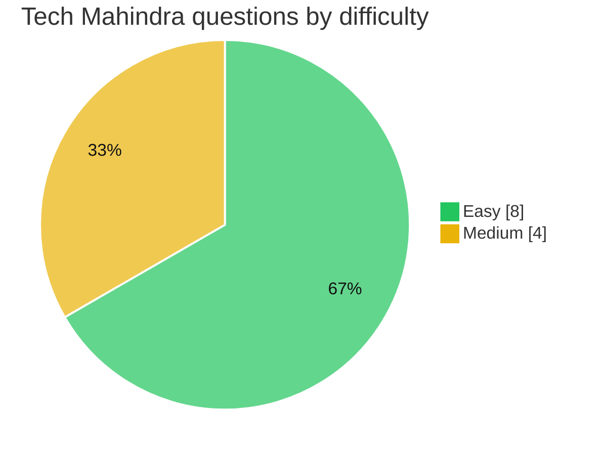

[← All companies](../README.md) · [Most asked across companies](../most-asked.md)

# Tech Mahindra Coding Questions

   

**12 Tech Mahindra coding questions** — 8 easy and 4 medium. Each one links to a free page where you can solve it in 13 languages, with hints and an editorial.

12 problems the CodeKairo catalogue tags as commonly asked in Tech Mahindra's coding rounds — 8 easy and 4 medium, no hard ones — each judged by hidden tests in 13 languages. The most common topics among them are Arrays (5), Math (4) and Dynamic Programming (4). CodeKairo's Tech Mahindra — Aptitude & Technical mock covers the Tech Mahindra aptitude and technical paper, the one services pattern in this catalogue where a wrong answer costs marks. The tag is the catalogue's own annotation of where a problem tends to come up — not a list published by Tech Mahindra, which CodeKairo is not affiliated with.

**Practise on CodeKairo:** [All 12 Tech Mahindra questions](https://codekairo.com/challenges/company/tech-mahindra?utm_source=github) · [Tech Mahindra — Aptitude & Technical mock test](https://codekairo.com/tests/tech-mahindra-written?utm_source=github) · [Tech Mahindra hiring process, round by round](https://codekairo.com/simulations/tech-mahindra?utm_source=github)

## Contents

- [Start with these 10](#start-with-these-10)
- [Topics Tech Mahindra asks most](#topics-tech-mahindra-asks-most)
- 🟢 [Easy (8)](#easy-8)
- 🟡 [Medium (4)](#medium-4)

## Start with these 10

The Tech Mahindra questions most other companies ask too — the patterns worth knowing first.

1. 🟢 [Two Sum](https://codekairo.com/problems/two-sum?utm_source=github) — also asked at 18 other companies
2. 🟢 [Valid Anagram](https://codekairo.com/problems/valid-anagram?utm_source=github) — also asked at 7 other companies
3. 🟢 [Fibonacci Number](https://codekairo.com/problems/fibonacci-number?utm_source=github) — also asked at 7 other companies
4. 🟡 [Count Primes](https://codekairo.com/problems/count-primes?utm_source=github) — also asked at 7 other companies
5. 🟢 [Best Time to Buy and Sell Stock](https://codekairo.com/problems/best-time-to-buy-and-sell-stock?utm_source=github) — also asked at 6 other companies
6. 🟡 [Maximum Subarray](https://codekairo.com/problems/maximum-subarray?utm_source=github) — also asked at 6 other companies
7. 🟡 [Longest Palindromic Substring](https://codekairo.com/problems/longest-palindromic-substring?utm_source=github) — also asked at 6 other companies
8. 🟢 [Valid Palindrome](https://codekairo.com/problems/valid-palindrome?utm_source=github) — also asked at 4 other companies
9. 🟡 [Reverse Integer](https://codekairo.com/problems/reverse-integer?utm_source=github) — also asked at 4 other companies
10. 🟢 [Remove Duplicates from Sorted Array](https://codekairo.com/problems/remove-duplicates-from-sorted-array?utm_source=github) — also asked at 3 other companies

## Topics Tech Mahindra asks most

[Arrays](https://codekairo.com/challenges/arrays?utm_source=github) (5) · [Dynamic Programming](https://codekairo.com/challenges/dynamic-programming?utm_source=github) (4) · [Math](https://codekairo.com/challenges/math?utm_source=github) (4) · [Strings](https://codekairo.com/challenges/strings?utm_source=github) (3) · [Two Pointers](https://codekairo.com/challenges/two-pointers?utm_source=github) (3) · [Hash Table](https://codekairo.com/challenges/hash-table?utm_source=github) (2) · [Sorting](https://codekairo.com/challenges/sorting?utm_source=github) (2) · [Counting](https://codekairo.com/challenges/counting?utm_source=github) (1) · [Divide and Conquer](https://codekairo.com/challenges/divide-and-conquer?utm_source=github) (1) · [Recursion](https://codekairo.com/challenges/recursion?utm_source=github) (1)

## Easy (8)

| # | Question | Topics | Acceptance |
|---:|---|---|---:|
| 1 | 🟢 [Two Sum](https://codekairo.com/problems/two-sum?utm_source=github) | Arrays, Hash Table | — |
| 6 | 🟢 [Valid Anagram](https://codekairo.com/problems/valid-anagram?utm_source=github) | Hash Table, Strings, Sorting | — |
| 11 | 🟢 [Best Time to Buy and Sell Stock](https://codekairo.com/problems/best-time-to-buy-and-sell-stock?utm_source=github) | Arrays, Dynamic Programming | — |
| 14 | 🟢 [Remove Duplicates from Sorted Array](https://codekairo.com/problems/remove-duplicates-from-sorted-array?utm_source=github) | Arrays, Two Pointers | — |
| 24 | 🟢 [Merge Sorted Array](https://codekairo.com/problems/merge-sorted-array?utm_source=github) | Arrays, Two Pointers, Sorting | — |
| 27 | 🟢 [Valid Palindrome](https://codekairo.com/problems/valid-palindrome?utm_source=github) | Strings, Two Pointers | — |
| 164 | 🟢 [Fibonacci Number](https://codekairo.com/problems/fibonacci-number?utm_source=github) | Math, Dynamic Programming, Recursion | — |
| 167 | 🟢 [Strong Number](https://codekairo.com/problems/strong-number?utm_source=github) | Math | — |

## Medium (4)

| # | Question | Topics | Acceptance |
|---:|---|---|---:|
| 8 | 🟡 [Maximum Subarray](https://codekairo.com/problems/maximum-subarray?utm_source=github) | Arrays, Dynamic Programming, Divide and Conquer | — |
| 30 | 🟡 [Longest Palindromic Substring](https://codekairo.com/problems/longest-palindromic-substring?utm_source=github) | Strings, Dynamic Programming | — |
| 149 | 🟡 [Reverse Integer](https://codekairo.com/problems/reverse-integer?utm_source=github) | Math | — |
| 150 | 🟡 [Count Primes](https://codekairo.com/problems/count-primes?utm_source=github) | Math, Sieve of Eratosthenes | — |

---

[← All companies](../README.md) · Rebuilt every night from [codekairo.com](https://codekairo.com/challenges/company/tech-mahindra?utm_source=github). Last refreshed: November 2026. ⭐ [Star the repo](https://github.com/ayaanp14/company-wise-coding-questions) if it helps.
