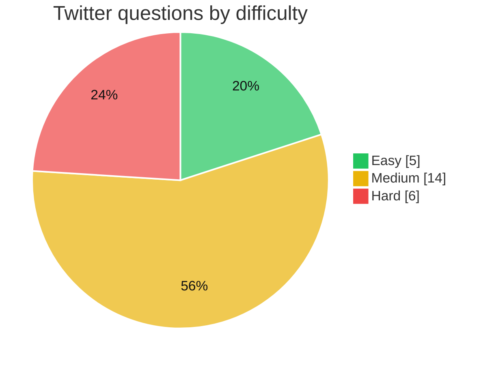

[← All companies](../README.md) · [Most asked across companies](../most-asked.md)

# Twitter Coding Questions

   

**25 Twitter coding questions** — 5 easy, 14 medium and 6 hard. Each one links to a free page where you can solve it in 13 languages, with hints and an editorial.

25 problems the CodeKairo catalogue tags as commonly asked in Twitter's coding rounds — 5 easy, 14 medium and 6 hard — each judged by hidden tests in 13 languages. The most common topics among them are Arrays (11), Strings (9) and Hash Table (8). Tagged for Twitter and no other company: Tweet Counts Per Frequency, Finding the Users Active Minutes and Pascal's Triangle. The tag is the catalogue's own annotation of where a problem tends to come up — not a list published by Twitter, which CodeKairo is not affiliated with.

**Practise on CodeKairo:** [All 25 Twitter questions](https://codekairo.com/challenges/company/twitter?utm_source=github)

## Contents

- [Start with these 10](#start-with-these-10)
- [Topics Twitter asks most](#topics-twitter-asks-most)
- 🟢 [Easy (5)](#easy-5)
- 🟡 [Medium (14)](#medium-14)
- 🔴 [Hard (6)](#hard-6)

## Start with these 10

The Twitter questions most other companies ask too — the patterns worth knowing first.

1. 🟢 [Valid Parentheses](https://codekairo.com/problems/valid-parentheses?utm_source=github) — also asked at 14 other companies
2. 🟡 [Merge Intervals](https://codekairo.com/problems/merge-intervals?utm_source=github) — also asked at 12 other companies
3. 🔴 [Trapping Rain Water](https://codekairo.com/problems/trapping-rain-water?utm_source=github) — also asked at 7 other companies
4. 🔴 [The Skyline Problem](https://codekairo.com/problems/the-skyline-problem?utm_source=github) — also asked at 7 other companies
5. 🟢 [Happy Number](https://codekairo.com/problems/happy-number?utm_source=github) — also asked at 5 other companies
6. 🟡 [Kth Smallest Element in a Sorted Matrix](https://codekairo.com/problems/kth-smallest-element-in-a-sorted-matrix?utm_source=github) — also asked at 5 other companies
7. 🔴 [Word Break II](https://codekairo.com/problems/word-break-ii?utm_source=github) — also asked at 5 other companies
8. 🔴 [Wildcard Matching](https://codekairo.com/problems/wildcard-matching?utm_source=github) — also asked at 4 other companies
9. 🔴 [Max Points on a Line](https://codekairo.com/problems/max-points-on-a-line?utm_source=github) — also asked at 4 other companies
10. 🟡 [Integer to Roman](https://codekairo.com/problems/integer-to-roman?utm_source=github) — also asked at 3 other companies

## Topics Twitter asks most

[Arrays](https://codekairo.com/challenges/arrays?utm_source=github) (11) · [Strings](https://codekairo.com/challenges/strings?utm_source=github) (9) · [Hash Table](https://codekairo.com/challenges/hash-table?utm_source=github) (8) · [Breadth-First Search](https://codekairo.com/challenges/breadth-first-search?utm_source=github) (4) · [Dynamic Programming](https://codekairo.com/challenges/dynamic-programming?utm_source=github) (4) · [Heap](https://codekairo.com/challenges/heap?utm_source=github) (4) · [Math](https://codekairo.com/challenges/math?utm_source=github) (4) · [Simulation](https://codekairo.com/challenges/simulation?utm_source=github) (4) · [Greedy](https://codekairo.com/challenges/greedy?utm_source=github) (3) · [Matrix](https://codekairo.com/challenges/matrix?utm_source=github) (3)

## Easy (5)

| # | Question | Topics | Acceptance |
|---:|---|---|---:|
| 4 | 🟢 [Valid Parentheses](https://codekairo.com/problems/valid-parentheses?utm_source=github) | Strings, Stack | — |
| 113 | 🟢 [Pascal's Triangle](https://codekairo.com/problems/pascals-triangle?utm_source=github) | Arrays, Dynamic Programming | — |
| 151 | 🟢 [Happy Number](https://codekairo.com/problems/happy-number?utm_source=github) | Hash Table, Math, Two Pointers | — |
| 391 | 🟢 [Time Needed to Buy Tickets](https://codekairo.com/problems/time-needed-to-buy-tickets?utm_source=github) | Arrays, Queue, Simulation | — |
| 418 | 🟢 [Binary Gap](https://codekairo.com/problems/binary-gap?utm_source=github) | Bit Manipulation | — |

## Medium (14)

| # | Question | Topics | Acceptance |
|---:|---|---|---:|
| 39 | 🟡 [Multiply Strings](https://codekairo.com/problems/multiply-strings?utm_source=github) | Strings, Math, Simulation | — |
| 122 | 🟡 [Merge Intervals](https://codekairo.com/problems/merge-intervals?utm_source=github) | Arrays, Sorting, Intervals | — |
| 160 | 🟡 [Integer to Roman](https://codekairo.com/problems/integer-to-roman?utm_source=github) | Hash Table, Math, Strings | — |
| 347 | 🟡 [Minimum Number of Steps to Make Two Strings Anagram](https://codekairo.com/problems/minimum-number-of-steps-to-make-two-strings-anagram?utm_source=github) | Hash Table, Strings, Counting | — |
| 367 | 🟡 [Kth Smallest Element in a Sorted Matrix](https://codekairo.com/problems/kth-smallest-element-in-a-sorted-matrix?utm_source=github) | Arrays, Binary Search, Sorting | — |
| 400 | 🟡 [Remove All Occurrences of a Substring](https://codekairo.com/problems/remove-all-occurrences-of-a-substring?utm_source=github) | Strings, Stack, Simulation | — |
| 442 | 🟡 [Number of Connected Components in an Undirected Graph](https://codekairo.com/problems/number-of-connected-components-in-an-undirected-graph?utm_source=github) | Depth-First Search, Breadth-First Search, Union Find | — |
| 452 | 🟡 [Count Sub Islands](https://codekairo.com/problems/count-sub-islands?utm_source=github) | Arrays, Depth-First Search, Breadth-First Search | — |
| 469 | 🟡 [Minimum Genetic Mutation](https://codekairo.com/problems/minimum-genetic-mutation?utm_source=github) | Hash Table, Strings, Breadth-First Search | — |
| 979 | 🟡 [Process Tasks Using Servers](https://codekairo.com/problems/process-tasks-using-servers?utm_source=github) | Arrays, Simulation, Heap | — |
| 1144 | 🟡 [Minimum Elements to Add to Form a Given Sum](https://codekairo.com/problems/minimum-elements-to-add-to-form-a-given-sum?utm_source=github) | Arrays, Greedy | — |
| 1209 | 🟡 [Masking Personal Information](https://codekairo.com/problems/masking-personal-information?utm_source=github) | Strings | — |
| 1789 | 🟡 [Finding the Users Active Minutes](https://codekairo.com/problems/finding-the-users-active-minutes?utm_source=github) | Arrays, Hash Table | — |
| 2064 | 🟡 [Tweet Counts Per Frequency](https://codekairo.com/problems/tweet-counts-per-frequency?utm_source=github) | Hash Table, Binary Search, Sorting | — |

## Hard (6)

| # | Question | Topics | Acceptance |
|---:|---|---|---:|
| 26 | 🔴 [Trapping Rain Water](https://codekairo.com/problems/trapping-rain-water?utm_source=github) | Arrays, Two Pointers, Dynamic Programming | — |
| 584 | 🔴 [Wildcard Matching](https://codekairo.com/problems/wildcard-matching?utm_source=github) | Strings, Dynamic Programming, Greedy | — |
| 686 | 🔴 [Max Points on a Line](https://codekairo.com/problems/max-points-on-a-line?utm_source=github) | Hash Table, Math, Geometry | — |
| 928 | 🔴 [Trapping Rain Water II](https://codekairo.com/problems/trapping-rain-water-ii?utm_source=github) | Arrays, Matrix, Heap | — |
| 1270 | 🔴 [Word Break II](https://codekairo.com/problems/word-break-ii?utm_source=github) | Hash Table, Strings, Dynamic Programming | — |
| 1425 | 🔴 [The Skyline Problem](https://codekairo.com/problems/the-skyline-problem?utm_source=github) | Arrays, Divide and Conquer, Heap | — |

---

[← All companies](../README.md) · Rebuilt every night from [codekairo.com](https://codekairo.com/challenges/company/twitter?utm_source=github). Last refreshed: November 2026. ⭐ [Star the repo](https://github.com/ayaanp14/company-wise-coding-questions) if it helps.
