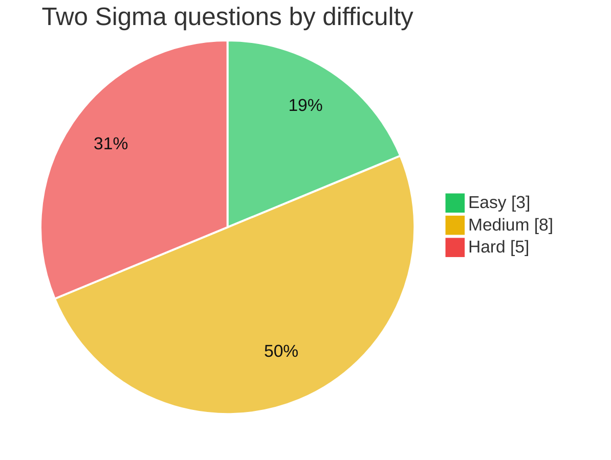

[← All companies](../README.md) · [Most asked across companies](../most-asked.md)

# Two Sigma Coding Questions

   

**16 Two Sigma coding questions** — 3 easy, 8 medium and 5 hard. Each one links to a free page where you can solve it in 13 languages, with hints and an editorial.

16 problems the CodeKairo catalogue tags as commonly asked in Two Sigma's coding rounds — 3 easy, 8 medium and 5 hard — each judged by hidden tests in 13 languages. The most common topics among them are Arrays (9), Strings (6) and Dynamic Programming (6). Tagged for Two Sigma and no other company: Number of Provinces. The tag is the catalogue's own annotation of where a problem tends to come up — not a list published by Two Sigma, which CodeKairo is not affiliated with.

**Practise on CodeKairo:** [All 16 Two Sigma questions](https://codekairo.com/challenges/company/two-sigma?utm_source=github)

## Contents

- [Start with these 10](#start-with-these-10)
- [Topics Two Sigma asks most](#topics-two-sigma-asks-most)
- 🟢 [Easy (3)](#easy-3)
- 🟡 [Medium (8)](#medium-8)
- 🔴 [Hard (5)](#hard-5)

## Start with these 10

The Two Sigma questions most other companies ask too — the patterns worth knowing first.

1. 🟢 [Valid Parentheses](https://codekairo.com/problems/valid-parentheses?utm_source=github) — also asked at 14 other companies
2. 🟡 [Number of Islands](https://codekairo.com/problems/number-of-islands?utm_source=github) — also asked at 9 other companies
3. 🟡 [Game of Life](https://codekairo.com/problems/game-of-life?utm_source=github) — also asked at 7 other companies
4. 🔴 [Word Search II](https://codekairo.com/problems/word-search-ii?utm_source=github) — also asked at 7 other companies
5. 🔴 [Best Time to Buy and Sell Stock III](https://codekairo.com/problems/best-time-to-buy-and-sell-stock-iii?utm_source=github) — also asked at 6 other companies
6. 🟡 [Meeting Rooms II](https://codekairo.com/problems/meeting-rooms-ii?utm_source=github) — also asked at 5 other companies
7. 🟡 [Maximum Sum Circular Subarray](https://codekairo.com/problems/maximum-sum-circular-subarray?utm_source=github) — also asked at 4 other companies
8. 🔴 [Wildcard Matching](https://codekairo.com/problems/wildcard-matching?utm_source=github) — also asked at 4 other companies
9. 🔴 [Last Substring in Lexicographical Order](https://codekairo.com/problems/last-substring-in-lexicographical-order?utm_source=github) — also asked at 4 other companies
10. 🟢 [Intersection of Two Arrays](https://codekairo.com/problems/intersection-of-two-arrays?utm_source=github) — also asked at 3 other companies

## Topics Two Sigma asks most

[Arrays](https://codekairo.com/challenges/arrays?utm_source=github) (9) · [Dynamic Programming](https://codekairo.com/challenges/dynamic-programming?utm_source=github) (6) · [Strings](https://codekairo.com/challenges/strings?utm_source=github) (6) · [Matrix](https://codekairo.com/challenges/matrix?utm_source=github) (3) · [Two Pointers](https://codekairo.com/challenges/two-pointers?utm_source=github) (3) · [Depth-First Search](https://codekairo.com/challenges/depth-first-search?utm_source=github) (2) · [Graph](https://codekairo.com/challenges/graph?utm_source=github) (2) · [Hash Table](https://codekairo.com/challenges/hash-table?utm_source=github) (2) · [Math](https://codekairo.com/challenges/math?utm_source=github) (2) · [Simulation](https://codekairo.com/challenges/simulation?utm_source=github) (2)

## Easy (3)

| # | Question | Topics | Acceptance |
|---:|---|---|---:|
| 4 | 🟢 [Valid Parentheses](https://codekairo.com/problems/valid-parentheses?utm_source=github) | Strings, Stack | — |
| 181 | 🟢 [Intersection of Two Arrays](https://codekairo.com/problems/intersection-of-two-arrays?utm_source=github) | Arrays, Hash Table, Two Pointers | — |
| 413 | 🟢 [Power of Four](https://codekairo.com/problems/power-of-four?utm_source=github) | Math, Bit Manipulation, Recursion | — |

## Medium (8)

| # | Question | Topics | Acceptance |
|---:|---|---|---:|
| 39 | 🟡 [Multiply Strings](https://codekairo.com/problems/multiply-strings?utm_source=github) | Strings, Math, Simulation | — |
| 118 | 🟡 [Number of Islands](https://codekairo.com/problems/number-of-islands?utm_source=github) | Arrays, Matrix, Depth-First Search | — |
| 126 | 🟡 [Meeting Rooms II](https://codekairo.com/problems/meeting-rooms-ii?utm_source=github) | Arrays, Sorting, Heap | — |
| 135 | 🟡 [Number of Provinces](https://codekairo.com/problems/number-of-provinces?utm_source=github) | Graph, Depth-First Search, Union Find | — |
| 293 | 🟡 [Game of Life](https://codekairo.com/problems/game-of-life?utm_source=github) | Arrays, Matrix, Simulation | — |
| 331 | 🟡 [Longest String Chain](https://codekairo.com/problems/longest-string-chain?utm_source=github) | Arrays, Hash Table, Two Pointers | — |
| 333 | 🟡 [Maximum Sum Circular Subarray](https://codekairo.com/problems/maximum-sum-circular-subarray?utm_source=github) | Arrays, Divide and Conquer, Dynamic Programming | — |
| 1135 | 🟡 [Maximum Subarray Sum with One Deletion](https://codekairo.com/problems/maximum-subarray-sum-with-one-deletion?utm_source=github) | Arrays, Dynamic Programming | — |

## Hard (5)

| # | Question | Topics | Acceptance |
|---:|---|---|---:|
| 311 | 🔴 [Best Time to Buy and Sell Stock III](https://codekairo.com/problems/best-time-to-buy-and-sell-stock-iii?utm_source=github) | Arrays, Dynamic Programming | — |
| 584 | 🔴 [Wildcard Matching](https://codekairo.com/problems/wildcard-matching?utm_source=github) | Strings, Dynamic Programming, Greedy | — |
| 1254 | 🔴 [Last Substring in Lexicographical Order](https://codekairo.com/problems/last-substring-in-lexicographical-order?utm_source=github) | Strings, Two Pointers | — |
| 1532 | 🔴 [Parallel Courses III](https://codekairo.com/problems/parallel-courses-iii?utm_source=github) | Arrays, Graph, Topological Sort | — |
| 1573 | 🔴 [Word Search II](https://codekairo.com/problems/word-search-ii?utm_source=github) | Strings, Backtracking, Trie | — |

---

[← All companies](../README.md) · Rebuilt every night from [codekairo.com](https://codekairo.com/challenges/company/two-sigma?utm_source=github). Last refreshed: November 2026. ⭐ [Star the repo](https://github.com/ayaanp14/company-wise-coding-questions) if it helps.
