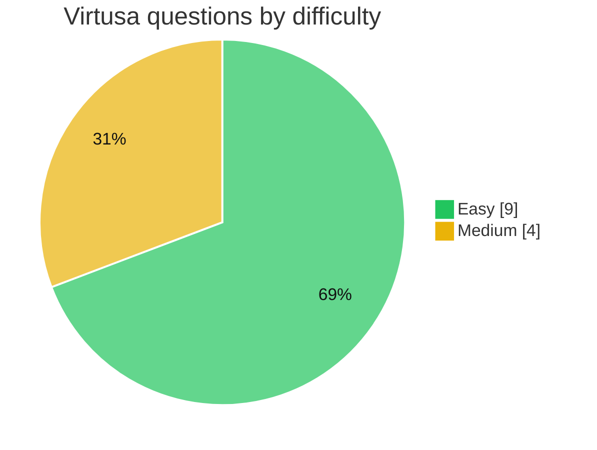

[← All companies](../README.md) · [Most asked across companies](../most-asked.md)

# Virtusa Coding Questions

   

**13 Virtusa coding questions** — 9 easy and 4 medium. Each one links to a free page where you can solve it in 13 languages, with hints and an editorial.

13 problems the CodeKairo catalogue tags as commonly asked in Virtusa's coding rounds — 9 easy and 4 medium, no hard ones — each judged by hidden tests in 13 languages. The most common topics among them are Strings (6), Math (6) and Hash Table (4). The tag is the catalogue's own annotation of where a problem tends to come up — not a list published by Virtusa, which CodeKairo is not affiliated with.

**Practise on CodeKairo:** [All 13 Virtusa questions](https://codekairo.com/challenges/company/virtusa?utm_source=github) · [Virtusa — Online Test & Coder Challenge mock test](https://codekairo.com/tests/virtusa-coder-challenge?utm_source=github) · [Virtusa hiring process, round by round](https://codekairo.com/simulations/virtusa?utm_source=github)

## Contents

- [Start with these 10](#start-with-these-10)
- [Topics Virtusa asks most](#topics-virtusa-asks-most)
- 🟢 [Easy (9)](#easy-9)
- 🟡 [Medium (4)](#medium-4)

## Start with these 10

The Virtusa questions most other companies ask too — the patterns worth knowing first.

1. 🟢 [Two Sum](https://codekairo.com/problems/two-sum?utm_source=github) — also asked at 18 other companies
2. 🟡 [Longest Substring Without Repeating Characters](https://codekairo.com/problems/longest-substring-without-repeating-characters?utm_source=github) — also asked at 13 other companies
3. 🟢 [Reverse String](https://codekairo.com/problems/reverse-string?utm_source=github) — also asked at 7 other companies
4. 🟢 [Fibonacci Number](https://codekairo.com/problems/fibonacci-number?utm_source=github) — also asked at 7 other companies
5. 🟢 [First Unique Character in a String](https://codekairo.com/problems/first-unique-character-in-a-string?utm_source=github) — also asked at 7 other companies
6. 🟡 [Count Primes](https://codekairo.com/problems/count-primes?utm_source=github) — also asked at 7 other companies
7. 🟡 [Reverse Words in a String](https://codekairo.com/problems/reverse-words-in-a-string?utm_source=github) — also asked at 7 other companies
8. 🟢 [Roman to Integer](https://codekairo.com/problems/roman-to-integer?utm_source=github) — also asked at 6 other companies
9. 🟢 [Palindrome Number](https://codekairo.com/problems/palindrome-number?utm_source=github) — also asked at 5 other companies
10. 🟢 [Second Largest Element](https://codekairo.com/problems/second-largest-element?utm_source=github) — also asked at 4 other companies

## Topics Virtusa asks most

[Math](https://codekairo.com/challenges/math?utm_source=github) (6) · [Strings](https://codekairo.com/challenges/strings?utm_source=github) (6) · [Hash Table](https://codekairo.com/challenges/hash-table?utm_source=github) (4) · [Arrays](https://codekairo.com/challenges/arrays?utm_source=github) (3) · [Two Pointers](https://codekairo.com/challenges/two-pointers?utm_source=github) (3) · [Counting](https://codekairo.com/challenges/counting?utm_source=github) (1) · [Dynamic Programming](https://codekairo.com/challenges/dynamic-programming?utm_source=github) (1) · [Queue](https://codekairo.com/challenges/queue?utm_source=github) (1) · [Recursion](https://codekairo.com/challenges/recursion?utm_source=github) (1) · [Sieve of Eratosthenes](https://codekairo.com/challenges/sieve-of-eratosthenes?utm_source=github) (1)

## Easy (9)

| # | Question | Topics | Acceptance |
|---:|---|---|---:|
| 1 | 🟢 [Two Sum](https://codekairo.com/problems/two-sum?utm_source=github) | Arrays, Hash Table | — |
| 2 | 🟢 [Reverse String](https://codekairo.com/problems/reverse-string?utm_source=github) | Two Pointers, Strings | — |
| 3 | 🟢 [Palindrome Number](https://codekairo.com/problems/palindrome-number?utm_source=github) | Math | — |
| 28 | 🟢 [Longest Common Prefix](https://codekairo.com/problems/longest-common-prefix?utm_source=github) | Strings | — |
| 159 | 🟢 [Roman to Integer](https://codekairo.com/problems/roman-to-integer?utm_source=github) | Hash Table, Math, Strings | — |
| 164 | 🟢 [Fibonacci Number](https://codekairo.com/problems/fibonacci-number?utm_source=github) | Math, Dynamic Programming, Recursion | — |
| 170 | 🟢 [Disarium Number](https://codekairo.com/problems/disarium-number?utm_source=github) | Math | — |
| 213 | 🟢 [First Unique Character in a String](https://codekairo.com/problems/first-unique-character-in-a-string?utm_source=github) | Hash Table, Strings, Queue | — |
| 475 | 🟢 [Second Largest Element](https://codekairo.com/problems/second-largest-element?utm_source=github) | Arrays | — |

## Medium (4)

| # | Question | Topics | Acceptance |
|---:|---|---|---:|
| 15 | 🟡 [Rotate Array](https://codekairo.com/problems/rotate-array?utm_source=github) | Arrays, Math, Two Pointers | — |
| 29 | 🟡 [Longest Substring Without Repeating Characters](https://codekairo.com/problems/longest-substring-without-repeating-characters?utm_source=github) | Strings, Sliding Window, Hash Table | — |
| 150 | 🟡 [Count Primes](https://codekairo.com/problems/count-primes?utm_source=github) | Math, Sieve of Eratosthenes | — |
| 210 | 🟡 [Reverse Words in a String](https://codekairo.com/problems/reverse-words-in-a-string?utm_source=github) | Two Pointers, Strings | — |

---

[← All companies](../README.md) · Rebuilt every night from [codekairo.com](https://codekairo.com/challenges/company/virtusa?utm_source=github). Last refreshed: November 2026. ⭐ [Star the repo](https://github.com/ayaanp14/company-wise-coding-questions) if it helps.
